<!-- source: DeepWiki mcp.deepwiki.com · repo android/android-health-connect-codelab · page 12 Implementation Guide for Students · fetched 2026-10-23 -->

# Implementation Guide for Students

<details>
<summary>Relevant source files</summary>

The following files were used as context for generating this wiki page:

- [README.md](README.md)
- [finished/src/main/java/com/example/healthconnect/codelab/data/HealthConnectManager.kt](finished/src/main/java/com/example/healthconnect/codelab/data/HealthConnectManager.kt)
- [screenshots/hc1.png](screenshots/hc1.png)
- [start/src/main/java/com/example/healthconnect/codelab/data/HealthConnectManager.kt](start/src/main/java/com/example/healthconnect/codelab/data/HealthConnectManager.kt)

</details>


## Purpose and Scope

This guide provides a step-by-step walkthrough for implementing the TODO methods in the **start** module of the Health Connect Codelab. The start module contains stub implementations with TODO comments and placeholder Toast messages that students must complete to create a fully functional Health Connect application.

This document focuses on the practical implementation tasks. For conceptual information about the overall architecture, see [Architecture Overview](#4). For detailed explanations of permission management, see [Permission Management](#5.2). For information about Health Connect record types, see [Health Records and Data Types](#5.3).

---

## Learning Path Overview

The codelab uses a dual-module structure where the **start** module provides skeleton code and the **finished** module provides reference solutions. All TODO items are located in `HealthConnectManager.kt`.

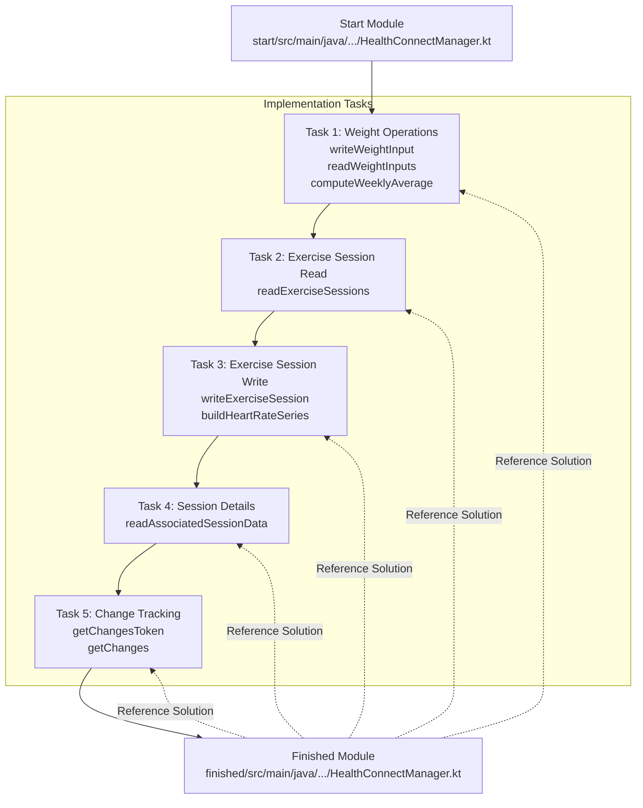

**Implementation Progression**: Tasks are ordered from simplest (single record write/read) to most complex (multi-record writes with associated data and change tracking).

**Sources**: [start/src/main/java/com/example/healthconnect/codelab/data/HealthConnectManager.kt:1-215](), [finished/src/main/java/com/example/healthconnect/codelab/data/HealthConnectManager.kt:1-346]()

---

## TODO Method Summary

The following table lists all methods that require implementation:

| Method | Lines (Start) | Lines (Finished) | Complexity | Purpose |
|--------|---------------|------------------|------------|---------|
| `writeWeightInput` | [99-103]() | [100-115]() | Low | Insert a single WeightRecord |
| `readWeightInputs` | [108-111]() | [120-127]() | Low | Query WeightRecords in time range |
| `computeWeeklyAverage` | [116-119]() | [132-139]() | Low | Aggregate WeightRecord average |
| `readExerciseSessions` | [124-127]() | [147-154]() | Low | Query ExerciseSessionRecords |
| `writeExerciseSession` | [132-134]() | [159-189]() | High | Insert exercise with associated records |
| `buildHeartRateSeries` | [139-144]() | [194-217]() | Medium | Build HeartRateRecord with samples |
| `readAssociatedSessionData` | [149-153]() | [222-261]() | High | Read aggregated and raw session data |
| `getChangesToken` | [158-161]() | [266-278]() | Low | Obtain token for change tracking |
| `getChanges` | [166-168]() | [283-299]() | Medium | Retrieve changes using token |

**Sources**: [start/src/main/java/com/example/healthconnect/codelab/data/HealthConnectManager.kt:99-168](), [finished/src/main/java/com/example/healthconnect/codelab/data/HealthConnectManager.kt:100-299]()

---

## Task 1: Weight Operations

### Task 1.1: Implement `writeWeightInput`

**Objective**: Write a single `WeightRecord` to Health Connect with the current timestamp.

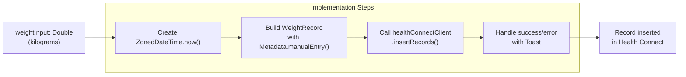

**Implementation Steps**:

1. **Create timestamp**: Use `ZonedDateTime.now().withNano(0)` to get current time without nanoseconds
2. **Build WeightRecord**: Construct with:
   - `metadata = Metadata.manualEntry()` (indicates user-entered data)
   - `weight = Mass.kilograms(weightInput)` (convert Double to Mass type)
   - `time = time.toInstant()` (convert ZonedDateTime to Instant)
   - `zoneOffset = time.offset` (store timezone offset)
3. **Insert records**: Create list containing the record and call `healthConnectClient.insertRecords(records)`
4. **Error handling**: Wrap in try-catch and display Toast messages

**Key Classes**: `WeightRecord`, `Mass`, `Metadata`, `ZonedDateTime`

**Reference Implementation**: [finished/src/main/java/com/example/healthconnect/codelab/data/HealthConnectManager.kt:100-115]()

**Sources**: [finished/src/main/java/com/example/healthconnect/codelab/data/HealthConnectManager.kt:100-115]()

---

### Task 1.2: Implement `readWeightInputs`

**Objective**: Query all `WeightRecord` entries within a specified time range.

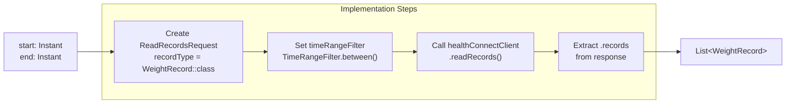

**Implementation Steps**:

1. **Create request**: Instantiate `ReadRecordsRequest` with:
   - `recordType = WeightRecord::class` (specify record type using Kotlin reflection)
   - `timeRangeFilter = TimeRangeFilter.between(start, end)` (filter by time range)
2. **Execute query**: Call `healthConnectClient.readRecords(request)` (returns response object)
3. **Return results**: Access `response.records` property to get `List<WeightRecord>`

**Key Classes**: `ReadRecordsRequest`, `TimeRangeFilter`

**Reference Implementation**: [finished/src/main/java/com/example/healthconnect/codelab/data/HealthConnectManager.kt:120-127]()

**Sources**: [finished/src/main/java/com/example/healthconnect/codelab/data/HealthConnectManager.kt:120-127]()

---

### Task 1.3: Implement `computeWeeklyAverage`

**Objective**: Calculate the average weight over a time period using Health Connect's aggregation API.

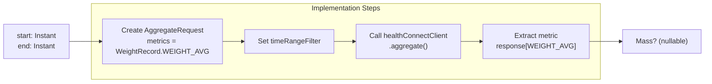

**Implementation Steps**:

1. **Create aggregate request**: Build `AggregateRequest` with:
   - `metrics = setOf(WeightRecord.WEIGHT_AVG)` (request specific aggregate metric)
   - `timeRangeFilter = TimeRangeFilter.between(start, end)` (define time window)
2. **Execute aggregation**: Call `healthConnectClient.aggregate(request)`
3. **Extract result**: Use bracket syntax `response[WeightRecord.WEIGHT_AVG]` to get `Mass?`

**Note**: Returns `null` if no data exists in the time range.

**Key Classes**: `AggregateRequest`, `WeightRecord.WEIGHT_AVG`

**Reference Implementation**: [finished/src/main/java/com/example/healthconnect/codelab/data/HealthConnectManager.kt:132-139]()

**Sources**: [finished/src/main/java/com/example/healthconnect/codelab/data/HealthConnectManager.kt:132-139]()

---

## Task 2: Implement `readExerciseSessions`

**Objective**: Query all `ExerciseSessionRecord` entries in a time range.

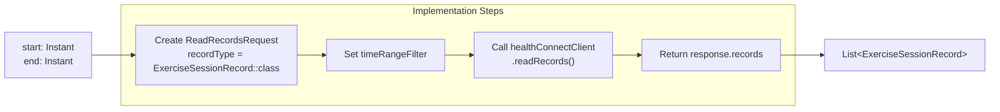

**Implementation Steps**:

1. **Create request**: Build `ReadRecordsRequest` with:
   - `recordType = ExerciseSessionRecord::class`
   - `timeRangeFilter = TimeRangeFilter.between(start, end)`
2. **Execute query**: Call `healthConnectClient.readRecords(request)`
3. **Return records**: Access `response.records`

**Pattern**: This follows the same pattern as `readWeightInputs`, just with a different record type.

**Key Classes**: `ExerciseSessionRecord`

**Reference Implementation**: [finished/src/main/java/com/example/healthconnect/codelab/data/HealthConnectManager.kt:147-154]()

**Sources**: [finished/src/main/java/com/example/healthconnect/codelab/data/HealthConnectManager.kt:147-154]()

---

## Task 3: Exercise Session Write Operations

### Task 3.1: Implement `buildHeartRateSeries`

**Objective**: Generate a `HeartRateRecord` with time-series samples at 30-second intervals.

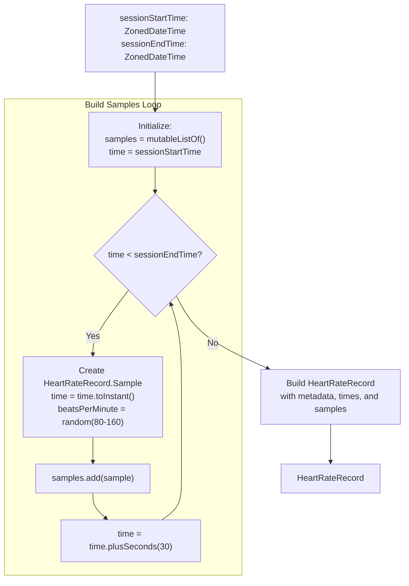

**Implementation Steps**:

1. **Initialize loop**: Create `mutableListOf<HeartRateRecord.Sample>()` and set `time = sessionStartTime`
2. **Generate samples**: While `time.isBefore(sessionEndTime)`:
   - Create `HeartRateRecord.Sample(time = time.toInstant(), beatsPerMinute = (80 + Random.nextInt(80)).toLong())`
   - Add sample to list
   - Increment: `time = time.plusSeconds(30)`
3. **Build record**: Create `HeartRateRecord` with:
   - `metadata = Metadata.manualEntry()`
   - `startTime = sessionStartTime.toInstant()`
   - `startZoneOffset = sessionStartTime.offset`
   - `endTime = sessionEndTime.toInstant()`
   - `endZoneOffset = sessionEndTime.offset`
   - `samples = samples` (list built in loop)

**Key Classes**: `HeartRateRecord`, `HeartRateRecord.Sample`

**Reference Implementation**: [finished/src/main/java/com/example/healthconnect/codelab/data/HealthConnectManager.kt:194-217]()

**Sources**: [finished/src/main/java/com/example/healthconnect/codelab/data/HealthConnectManager.kt:194-217]()

---

### Task 3.2: Implement `writeExerciseSession`

**Objective**: Write an `ExerciseSessionRecord` along with associated `StepsRecord`, `TotalCaloriesBurnedRecord`, and `HeartRateRecord` in a single transaction.

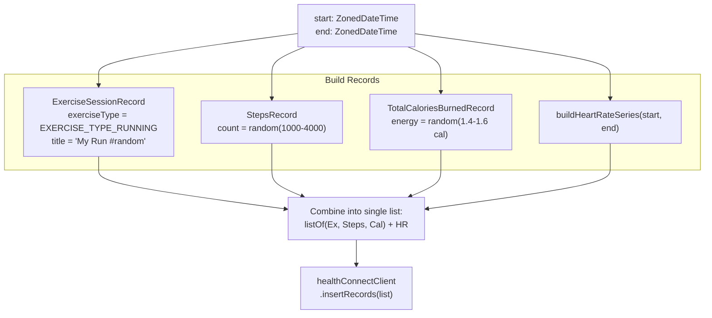

**Implementation Steps**:

1. **Build ExerciseSessionRecord**:
   - `metadata = Metadata.manualEntry()`
   - `startTime = start.toInstant()`, `startZoneOffset = start.offset`
   - `endTime = end.toInstant()`, `endZoneOffset = end.offset`
   - `exerciseType = ExerciseSessionRecord.EXERCISE_TYPE_RUNNING`
   - `title = "My Run #${Random.nextInt(0, 60)}"` (generates random title)

2. **Build StepsRecord**:
   - Same metadata and time fields
   - `count = (1000 + 1000 * Random.nextInt(3)).toLong()` (1000-3000 steps)

3. **Build TotalCaloriesBurnedRecord**:
   - Same metadata and time fields
   - `energy = Energy.calories((140 + Random.nextInt(20)) * 0.01)` (1.4-1.6 calories)

4. **Build HeartRateRecord**: Call `buildHeartRateSeries(start, end)`

5. **Insert all records**: Combine into list using `listOf(exercise, steps, calories) + heartRate` and call `healthConnectClient.insertRecords(list)`

**Key Insight**: Multiple records can be inserted atomically in a single `insertRecords` call. The `+` operator concatenates the list with the heart rate record.

**Key Classes**: `ExerciseSessionRecord`, `StepsRecord`, `TotalCaloriesBurnedRecord`, `Energy`, `Random`

**Reference Implementation**: [finished/src/main/java/com/example/healthconnect/codelab/data/HealthConnectManager.kt:159-189]()

**Sources**: [finished/src/main/java/com/example/healthconnect/codelab/data/HealthConnectManager.kt:159-189]()

---

## Task 4: Implement `readAssociatedSessionData`

**Objective**: Read a specific exercise session by UID and retrieve both aggregated metrics and raw heart rate time-series data.

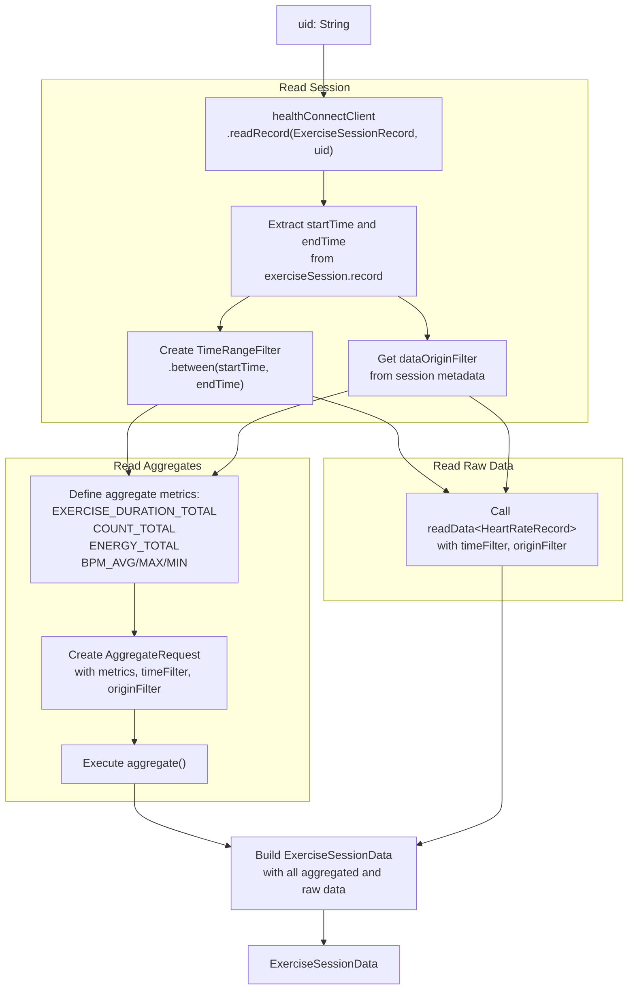

**Implementation Steps**:

1. **Read specific session**: Call `healthConnectClient.readRecord(ExerciseSessionRecord::class, uid)` to get single record by UID

2. **Extract time range**: Create `TimeRangeFilter.between(exerciseSession.record.startTime, exerciseSession.record.endTime)`

3. **Extract data origin**: Get `dataOriginFilter = setOf(exerciseSession.record.metadata.dataOrigin)` to limit reads to same app

4. **Define aggregate metrics**:
   ```
   setOf(
       ExerciseSessionRecord.EXERCISE_DURATION_TOTAL,
       StepsRecord.COUNT_TOTAL,
       TotalCaloriesBurnedRecord.ENERGY_TOTAL,
       HeartRateRecord.BPM_AVG,
       HeartRateRecord.BPM_MAX,
       HeartRateRecord.BPM_MIN
   )
   ```

5. **Create aggregate request**: Build `AggregateRequest` with metrics, `timeRangeFilter`, and `dataOriginFilter`

6. **Execute aggregation**: `val aggregateData = healthConnectClient.aggregate(aggregateRequest)`

7. **Read heart rate samples**: Call helper method `readData<HeartRateRecord>(timeRangeFilter, dataOriginFilter)`

8. **Build result object**: Return `ExerciseSessionData` with:
   - `uid = uid`
   - `totalActiveTime = aggregateData[ExerciseSessionRecord.EXERCISE_DURATION_TOTAL]`
   - `totalSteps = aggregateData[StepsRecord.COUNT_TOTAL]`
   - `totalEnergyBurned = aggregateData[TotalCaloriesBurnedRecord.ENERGY_TOTAL]`
   - `minHeartRate = aggregateData[HeartRateRecord.BPM_MIN]`
   - `maxHeartRate = aggregateData[HeartRateRecord.BPM_MAX]`
   - `avgHeartRate = aggregateData[HeartRateRecord.BPM_AVG]`
   - `heartRateSeries = heartRateData`

**Key Insight**: The `readData` helper method (already implemented at [start/src/main/java/com/example/healthconnect/codelab/data/HealthConnectManager.kt:183-193]()) provides reusable logic for reading any record type with time and origin filters.

**Key Classes**: `ExerciseSessionData`, `TimeRangeFilter`, `DataOrigin`

**Reference Implementation**: [finished/src/main/java/com/example/healthconnect/codelab/data/HealthConnectManager.kt:222-261]()

**Sources**: [finished/src/main/java/com/example/healthconnect/codelab/data/HealthConnectManager.kt:222-261](), [start/src/main/java/com/example/healthconnect/codelab/data/HealthConnectManager.kt:183-193]()

---

## Task 5: Change Tracking Operations

### Task 5.1: Implement `getChangesToken`

**Objective**: Obtain an initial token for tracking changes to specified record types.

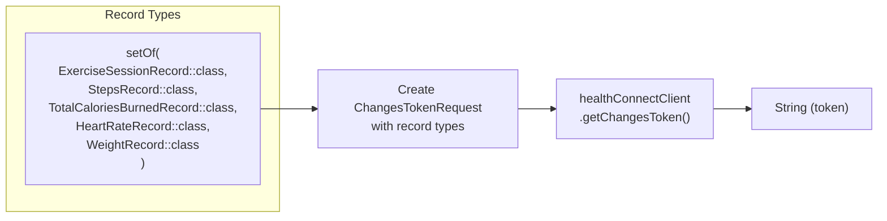

**Implementation Steps**:

1. **Define record types**: Create set of KClass objects for all record types to track:
   - `ExerciseSessionRecord::class`
   - `StepsRecord::class`
   - `TotalCaloriesBurnedRecord::class`
   - `HeartRateRecord::class`
   - `WeightRecord::class`

2. **Create request**: Build `ChangesTokenRequest(recordTypes)` with the set

3. **Get token**: Call `healthConnectClient.getChangesToken(request)` and return the String result

**Key Classes**: `ChangesTokenRequest`, `KClass`

**Reference Implementation**: [finished/src/main/java/com/example/healthconnect/codelab/data/HealthConnectManager.kt:266-278]()

**Sources**: [finished/src/main/java/com/example/healthconnect/codelab/data/HealthConnectManager.kt:266-278]()

---

### Task 5.2: Implement `getChanges`

**Objective**: Retrieve all changes since a given token, handling pagination and token expiration.

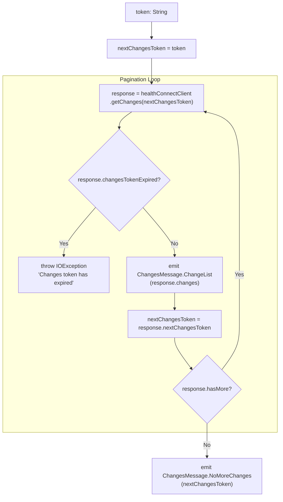

**Implementation Steps**:

1. **Initialize token**: `var nextChangesToken = token`

2. **Start pagination loop**: Use `do-while` loop to handle pagination:
   ```
   do {
       // Process changes
   } while (response.hasMore)
   ```

3. **Get changes**: Call `healthConnectClient.getChanges(nextChangesToken)`

4. **Check token expiration**: If `response.changesTokenExpired == true`, throw `IOException("Changes token has expired")`

5. **Emit changes**: Use `emit(ChangesMessage.ChangeList(response.changes))` to send changes downstream

6. **Update token**: Set `nextChangesToken = response.nextChangesToken` for next iteration

7. **Check pagination**: Loop continues while `response.hasMore == true`

8. **Emit completion**: After loop exits, emit `ChangesMessage.NoMoreChanges(nextChangesToken)` with final token

**Return Type**: `Flow<ChangesMessage>` - Uses Kotlin Flow for asynchronous streaming

**Token Validity**: Tokens expire after 30 days. Apps must use the changes API regularly to avoid expiration.

**Key Classes**: `ChangesMessage`, `Flow`, `Change`

**Reference Implementation**: [finished/src/main/java/com/example/healthconnect/codelab/data/HealthConnectManager.kt:283-299]()

**Sources**: [finished/src/main/java/com/example/healthconnect/codelab/data/HealthConnectManager.kt:283-299]()

---

## Code Entity Reference Map

The following diagram maps the TODO methods to their usage in the UI layer:

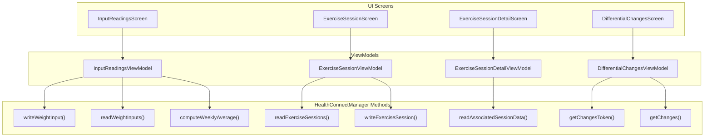

**Sources**: [start/src/main/java/com/example/healthconnect/codelab/data/HealthConnectManager.kt:99-168]()

---

## Testing Your Implementation

### Manual Testing Steps

1. **Test Weight Operations** (Tasks 1.1-1.3):
   - Navigate to "Input Readings" screen
   - Ensure permissions are granted
   - Enter a weight value (e.g., 70.5 kg)
   - Click "Add weight" - verify Toast shows success
   - Verify weight appears in list below
   - Check weekly average is displayed

2. **Test Exercise Session Read** (Task 2):
   - Navigate to "Exercise Sessions" screen
   - Grant permissions if needed
   - Click "Generate sample data" to create test sessions
   - Verify sessions appear in LazyColumn list

3. **Test Exercise Session Write** (Tasks 3.1-3.2):
   - On "Exercise Sessions" screen
   - Click "Generate sample data"
   - Verify new exercise appears with title like "My Run #X"
   - Note that heart rate, steps, and calories are generated randomly

4. **Test Session Details** (Task 4):
   - From exercise list, click on any session
   - Verify navigation to detail screen
   - Check that aggregated metrics display (duration, steps, calories, heart rate stats)
   - Verify heart rate chart shows time-series data

5. **Test Change Tracking** (Tasks 5.1-5.2):
   - Navigate to "Differential Changes" screen
   - Click "Enable tracking" - this calls `getChangesToken()`
   - Add/modify data in other screens
   - Return to changes screen and click "Get changes"
   - Verify list shows upserted or deleted records

### Common Issues and Solutions

| Issue | Cause | Solution |
|-------|-------|----------|
| NullPointerException when building records | Missing required field | Verify all required fields (metadata, time, zoneOffset) are set |
| Empty list returned from queries | No data in time range | Use broader time range or generate sample data first |
| Permission denied errors | Permissions not granted | Check `hasAllPermissions()` before operations |
| Token expired exception | Token older than 30 days | Get new token using `getChangesToken()` |
| Type mismatch in aggregation | Wrong metric type | Ensure metric type matches record (e.g., `WeightRecord.WEIGHT_AVG`) |
| Heart rate series not displaying | Empty samples list | Verify loop condition and sample generation in `buildHeartRateSeries` |

**Sources**: General implementation knowledge

---

## Build and Run

### Building the Start Module

```bash
./gradlew :start:assembleDebug
```

The APK will be generated at: `start/build/outputs/apk/debug/start-debug.apk`

### Comparing with Finished Module

To verify your implementation matches the reference:

1. Build both modules:
   ```bash
   ./gradlew :start:assembleDebug
   ./gradlew :finished:assembleDebug
   ```

2. Install and test both APKs on the same device

3. Compare functionality screen-by-screen

4. Review differences in `HealthConnectManager.kt` between modules

**Sources**: [README.md:1-31]()

---

## Additional Resources

### Relevant Wiki Pages

- [Data Layer - HealthConnectManager](#5) - Comprehensive overview of all data operations
- [Reading Health Data](#5.4) - Deep dive into query patterns
- [Writing Health Data](#5.5) - Detailed write operation examples  
- [Aggregations and Statistics](#5.6) - Aggregation API usage
- [Differential Changes Tracking](#5.7) - Change tracking concepts

### Key API References

- **HealthConnectClient**: Main entry point for all Health Connect operations
- **Record Types**: `WeightRecord`, `ExerciseSessionRecord`, `StepsRecord`, `HeartRateRecord`, `TotalCaloriesBurnedRecord`
- **Request Types**: `ReadRecordsRequest`, `AggregateRequest`, `ChangesTokenRequest`
- **Filter Types**: `TimeRangeFilter`, `DataOrigin`

**Sources**: [start/src/main/java/com/example/healthconnect/codelab/data/HealthConnectManager.kt:1-215](), [finished/src/main/java/com/example/healthconnect/codelab/data/HealthConnectManager.kt:1-346]()