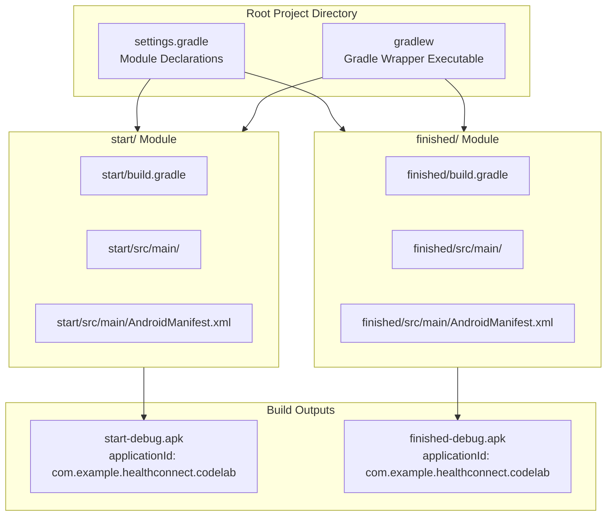
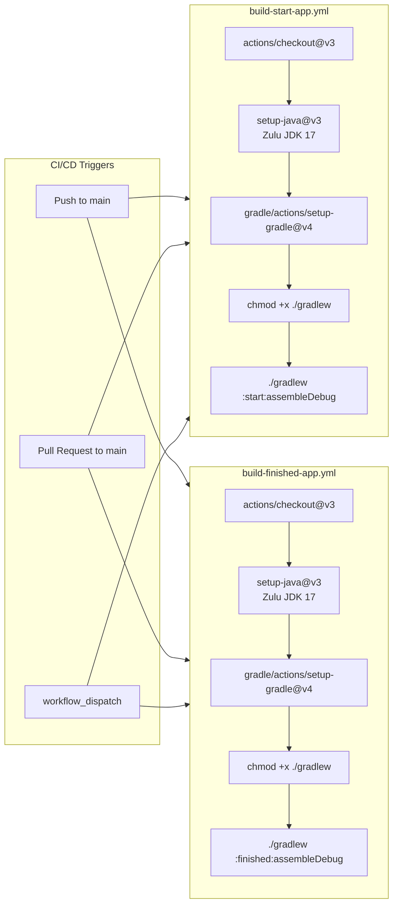

<!-- source: DeepWiki mcp.deepwiki.com · repo android/android-health-connect-codelab · page 2 Getting Started · fetched 2026-10-23 -->

# Getting Started

<details>
<summary>Relevant source files</summary>

The following files were used as context for generating this wiki page:

- [.github/workflows/build-finished-app.yml](.github/workflows/build-finished-app.yml)
- [.github/workflows/build-start-app.yml](.github/workflows/build-start-app.yml)
- [README.md](README.md)
- [finished/build.gradle](finished/build.gradle)
- [screenshots/hc1.png](screenshots/hc1.png)

</details>


This document provides setup instructions, system requirements, and build procedures for the Health Connect Codelab. It covers environment prerequisites, dependency installation, and commands to build both the `start` (student template) and `finished` (reference solution) modules.

For information about the project's overall structure and how the dual-module architecture works, see [Project Structure](#3). For details about specific build configurations and dependencies, see [Build Configuration](#3.2).

---

## System Requirements

The Health Connect Codelab requires specific Android versions and development tools to function correctly.

### Android Device or Emulator

| Requirement | Specification |
|-------------|---------------|
| **Minimum API Level** | 26 (Android 8.0) |
| **Target API Level** | 33 (Android 13) |
| **Compile SDK** | 35 |
| **Recommended** | API level 27 or greater |

The application defines `minSdk 26` in [finished/build.gradle:27]() and [start/build.gradle:27](), meaning devices running Android 8.0 or higher are supported. However, Health Connect behavior varies by Android version, particularly regarding permission handling and APK installation requirements.

Sources: [README.md:9](), [finished/build.gradle:23-34]()

### Health Connect APK Installation

For devices running **Android 13 and lower**, the Health Connect APK must be manually installed from the Play Store before using this codelab. This is a system-level service that provides the health data platform.

| Android Version | Installation Method |
|-----------------|---------------------|
| Android 13 and lower | Manual installation from [Play Store][health-connect-apk] required |
| Android 14 and higher | Health Connect is pre-installed as a platform module |

The Health Connect APK package identifier is `com.google.android.apps.healthdata`. The application checks for Health Connect availability using `HealthConnectClient.getSdkStatus()` as documented in the Data Layer (see [Health Connect Availability](#5.1)).

Sources: [README.md:10]()

---

## Development Environment Setup

### Java Development Kit (JDK)

The project requires **JDK 17** with the Zulu distribution. This is enforced in the CI/CD pipeline.

```yaml
distribution: 'zulu'
java-version: '17'
```

The build configuration targets Java 8 bytecode compatibility for runtime:

```gradle
compileOptions {
    sourceCompatibility JavaVersion.VERSION_1_8
    targetCompatibility JavaVersion.VERSION_1_8
}
kotlinOptions {
    jvmTarget = '1.8'
}
```

Sources: [.github/workflows/build-start-app.yml:18-22](), [finished/build.gradle:44-50]()

### Android Studio

Use the latest stable version of Android Studio. Open the project using **File > Open** and select the root directory containing `settings.gradle`.

### Gradle Build System

The project uses Gradle with the following configuration:

| Property | Value |
|----------|-------|
| Gradle Plugin | `com.android.application` |
| Kotlin Plugin | `kotlin-android` |
| Kotlin Compiler Extension | `1.4.0` (for Compose) |

The root `settings.gradle` declares both modules:

```gradle
include ':start'
include ':finished'
```

Sources: [finished/build.gradle:17-20](), [finished/build.gradle:52-57]()

---

## Build Module Architecture

The codebase contains two independent Android application modules that can be built separately.



**Module Isolation**: Both modules share the same `applicationId` (`com.example.healthconnect.codelab`) and dependencies but are built independently. The `start` module contains skeleton implementations with TODO markers, while the `finished` module provides complete reference implementations. For architectural details, see [Start vs Finished Modules](#3.1).

Sources: [finished/build.gradle:26](), [README.md:18]()

---

## Building the Project

### Using Gradle Wrapper (Command Line)

Make the Gradle wrapper executable (Linux/macOS):

```bash
chmod +x ./gradlew
```

#### Build the Start Module

```bash
./gradlew :start:assembleDebug
```

This command compiles the student template module and produces `start/build/outputs/apk/debug/start-debug.apk`.

#### Build the Finished Module

```bash
./gradlew :finished:assembleDebug
```

This command compiles the reference solution module and produces `finished/build/outputs/apk/debug/finished-debug.apk`.

#### Build Both Modules

```bash
./gradlew build
```

This command builds both modules in parallel, executing their respective `assembleDebug` tasks.

Sources: [README.md:18](), [.github/workflows/build-start-app.yml:28-31](), [.github/workflows/build-finished-app.yml:28-31]()

### Using Android Studio

1. Open the project in Android Studio
2. Select the build variant from the **Build Variants** panel:
   - Choose `start` to work with the student template
   - Choose `finished` to view the reference solution
3. Click **Build > Make Project** or use the toolbar build button
4. To install and run, select a device/emulator and click **Run**

---

## Build Configuration Details

### Dependencies

Both modules declare identical dependencies, including:

| Dependency | Version | Purpose |
|------------|---------|---------|
| `androidx.health.connect:connect-client` | `1.1.0-alpha12` | Health Connect SDK |
| `androidx.compose:compose-bom` | `2022.10.00` | Jetpack Compose UI framework |
| `androidx.work:work-runtime-ktx` | `2.9.1` | Background task scheduling |
| `androidx.navigation:navigation-compose` | `$navigation_compose_version` | Navigation framework |
| `androidx.lifecycle:lifecycle-viewmodel-compose` | `$lifecycle_version` | ViewModel integration |

The Health Connect client dependency is the core SDK that provides the `HealthConnectClient` interface used throughout the application.

Sources: [finished/build.gradle:66-83]()

### Build Types

The project defines two build types:

**Debug Build** (default):
- No minification
- Full debugging symbols
- Used for development and testing

**Release Build**:
```gradle
buildTypes {
    release {
        minifyEnabled true
        shrinkResources true
        proguardFiles getDefaultProguardFile('proguard-android-optimize.txt'), 'proguard-rules.pro'
    }
}
```

Sources: [finished/build.gradle:37-43]()

---

## Continuous Integration Build Process

The GitHub Actions workflows demonstrate the automated build process for both modules.



Both workflows run on `ubuntu-latest` and use Gradle caching to optimize build times. The `setup-gradle` action automatically caches Gradle dependencies and build outputs.

Sources: [.github/workflows/build-start-app.yml:1-32](), [.github/workflows/build-finished-app.yml:1-32]()

---

## Verification Steps

After building, verify the setup:

### 1. Check APK Generation

Verify that APK files are created:
- **Start module**: `start/build/outputs/apk/debug/start-debug.apk`
- **Finished module**: `finished/build/outputs/apk/debug/finished-debug.apk`

### 2. Install on Device/Emulator

```bash
adb install start/build/outputs/apk/debug/start-debug.apk
```

or

```bash
adb install finished/build/outputs/apk/debug/finished-debug.apk
```

### 3. Verify Health Connect Availability

After installation, launch the app. The `WelcomeScreen` displays the Health Connect availability status. If Health Connect is not installed (Android 13 and lower), the app will show an "Install Health Connect" button.

The availability check is performed by `HealthConnectManager.checkAvailability()`, which queries the SDK status. See [Health Connect Availability](#5.1) for implementation details.

### 4. Grant Permissions

The app requires multiple Health Connect permissions to function. On first launch, navigate through the permission flow to grant:
- Read/Write Exercise Sessions
- Read/Write Heart Rate
- Read/Write Steps
- Read/Write Weight
- Read/Write Total Calories Burned

Permission management is detailed in [Permission Management](#5.2).

Sources: [README.md:16-18]()

---

## Next Steps

After successfully building and installing the application:

1. **For Learners**: Start with the `start` module and implement the TODO methods marked in `HealthConnectManager`. See [Implementation Guide for Students](#12) for step-by-step instructions.

2. **For Reference**: Consult the `finished` module to see complete implementations of all Health Connect operations.

3. **Understanding Architecture**: Review [Architecture Overview](#4) to understand the MVVM pattern and data flow.

4. **Explore Features**: Navigate through the three main features: [Exercise Sessions](#6), [Weight Input](#7), and [Differential Changes](#8).

Sources: [README.md:1-31]()

---

