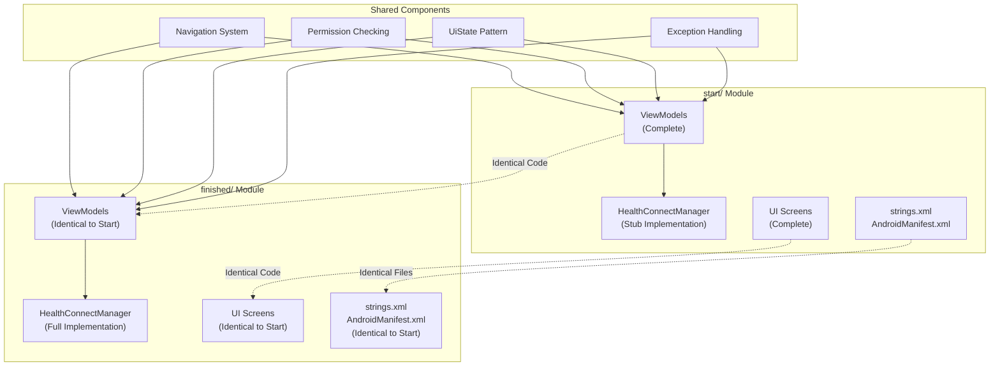
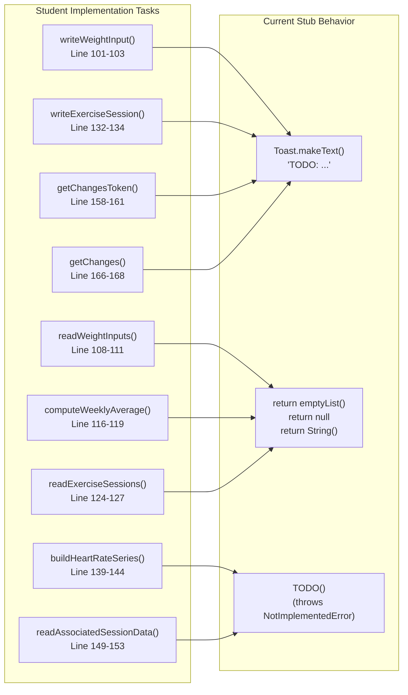
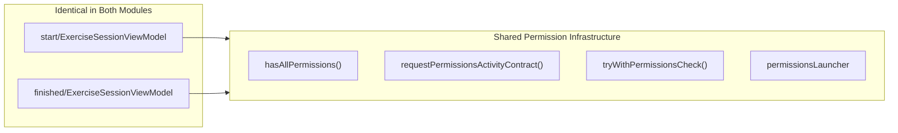
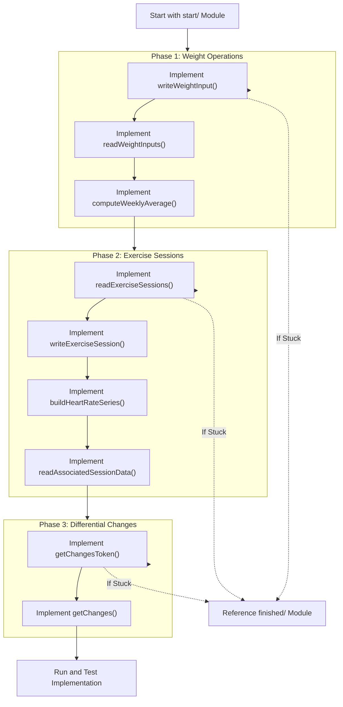

<!-- source: DeepWiki mcp.deepwiki.com · repo android/android-health-connect-codelab · page 3.1 Start vs Finished Modules · fetched 2026-10-23 -->

# Start vs Finished Modules

<details>
<summary>Relevant source files</summary>

The following files were used as context for generating this wiki page:

- [finished/src/main/java/com/example/healthconnect/codelab/data/HealthConnectManager.kt](finished/src/main/java/com/example/healthconnect/codelab/data/HealthConnectManager.kt)
- [finished/src/main/java/com/example/healthconnect/codelab/presentation/screen/exercisesession/ExerciseSessionViewModel.kt](finished/src/main/java/com/example/healthconnect/codelab/presentation/screen/exercisesession/ExerciseSessionViewModel.kt)
- [start/src/main/java/com/example/healthconnect/codelab/data/HealthConnectManager.kt](start/src/main/java/com/example/healthconnect/codelab/data/HealthConnectManager.kt)
- [start/src/main/java/com/example/healthconnect/codelab/presentation/screen/exercisesession/ExerciseSessionViewModel.kt](start/src/main/java/com/example/healthconnect/codelab/presentation/screen/exercisesession/ExerciseSessionViewModel.kt)

</details>


## Purpose and Scope

This document explains the pedagogical structure of the Health Connect Codelab, which provides two parallel modules: a student template (`start/`) and a reference solution (`finished/`). This dual-module approach allows learners to implement Health Connect functionality incrementally while having access to a working reference implementation. For information about the overall project organization, see [Project Structure](#3). For details on building these modules, see [Build Configuration](#3.2).

## Dual-Module Architecture

The codelab implements a template-and-solution pattern where both modules share identical UI, navigation, and ViewModels, but differ in their data layer implementations.



**Sources:** [start/src/main/java/com/example/healthconnect/codelab/data/HealthConnectManager.kt:1-215](), [finished/src/main/java/com/example/healthconnect/codelab/data/HealthConnectManager.kt:1-346]()

## Start Module: Student Template

The `start/` module provides a functional application skeleton where the presentation and business logic layers are complete, but data layer methods contain `TODO` markers and stub implementations.

### Complete Components in Start Module

The following components are fully implemented and identical to the finished module:

| Component | Status | Purpose |
|-----------|--------|---------|
| `ExerciseSessionViewModel` | ✓ Complete | State management and permission checks |
| `ExerciseSessionScreen` | ✓ Complete | UI rendering and user interactions |
| `InputReadingsViewModel` | ✓ Complete | Weight input state management |
| `DifferentialChangesViewModel` | ✓ Complete | Changes tracking state management |
| `tryWithPermissionsCheck()` | ✓ Complete | Permission wrapper with error handling |
| `UiState` sealed class | ✓ Complete | State transitions (Uninitialized/Done/Error) |

**Sources:** [start/src/main/java/com/example/healthconnect/codelab/presentation/screen/exercisesession/ExerciseSessionViewModel.kt:44-178]()

### Stub Implementations in Start Module

The `HealthConnectManager` class contains seven TODO methods that students must implement:



**Sources:** [start/src/main/java/com/example/healthconnect/codelab/data/HealthConnectManager.kt:99-168]()

### Stub Implementation Patterns

The start module uses three stub patterns:

1. **Toast Placeholder** - Shows "TODO" message to user:
   ```kotlin
   // Line 102
   Toast.makeText(context, "TODO: write weight input", Toast.LENGTH_SHORT).show()
   ```

2. **Empty Return** - Returns empty collections or null:
   ```kotlin
   // Lines 108-111
   suspend fun readWeightInputs(start: Instant, end: Instant): List<WeightRecord> {
     // Toast.makeText(context, "TODO: read weight inputs", Toast.LENGTH_SHORT).show()
     return emptyList()
   }
   ```

3. **TODO() Call** - Throws `NotImplementedError`:
   ```kotlin
   // Line 143
   private fun buildHeartRateSeries(...): HeartRateRecord {
     TODO()
   }
   ```

**Sources:** [start/src/main/java/com/example/healthconnect/codelab/data/HealthConnectManager.kt:101-144]()

## Finished Module: Reference Solution

The `finished/` module contains complete implementations of all Health Connect operations, serving as both a reference and a verification of correct implementation patterns.

### Implemented Data Operations

```mermaid
graph TB
    subgraph WriteOps["Write Operations"]
        WriteWeight["writeWeightInput()<br/>Lines 100-115"]
        WriteSession["writeExerciseSession()<br/>Lines 159-189"]
        BuildHR["buildHeartRateSeries()<br/>Lines 194-217"]
    end
    
    subgraph ReadOps["Read Operations"]
        ReadWeight["readWeightInputs()<br/>Lines 120-127"]
        ReadSessions["readExerciseSessions()<br/>Lines 147-154"]
        ReadDetail["readAssociatedSessionData()<br/>Lines 222-261"]
    end
    
    subgraph AggOps["Aggregation Operations"]
        AvgWeight["computeWeeklyAverage()<br/>Lines 132-139"]
    end
    
    subgraph SyncOps["Sync Operations"]
        GetToken["getChangesToken()<br/>Lines 266-278"]
        GetChanges["getChanges()<br/>Lines 283-299"]
    end
    
    subgraph HealthConnectSDK["Health Connect SDK Calls"]
        InsertRecords["healthConnectClient.insertRecords()"]
        ReadRecords["healthConnectClient.readRecords()"]
        Aggregate["healthConnectClient.aggregate()"]
        GetChangesToken["healthConnectClient.getChangesToken()"]
        GetChangesAPI["healthConnectClient.getChanges()"]
    end
    
    WriteWeight --> InsertRecords
    WriteSession --> InsertRecords
    
    ReadWeight --> ReadRecords
    ReadSessions --> ReadRecords
    ReadDetail --> ReadRecords
    ReadDetail --> Aggregate
    
    AvgWeight --> Aggregate
    
    GetToken --> GetChangesToken
    GetChanges --> GetChangesAPI
```



**Sources:** [finished/src/main/java/com/example/healthconnect/codelab/data/HealthConnectManager.kt:100-299]()

### Implementation Highlights

Key implementation patterns demonstrated in the finished module:

| Method | Key Features | Lines |
|--------|-------------|-------|
| `writeWeightInput()` | Creates `WeightRecord` with manual entry metadata, uses try-catch for error handling | 100-115 |
| `writeExerciseSession()` | Inserts multiple related records (ExerciseSessionRecord, StepsRecord, TotalCaloriesBurnedRecord, HeartRateRecord) in single transaction | 159-189 |
| `buildHeartRateSeries()` | Generates time-series samples with 30-second intervals | 194-217 |
| `readAssociatedSessionData()` | Combines aggregate metrics and raw time-series data using `dataOriginFilter` | 222-261 |
| `getChanges()` | Implements paginated change retrieval with token expiration handling | 283-299 |

**Sources:** [finished/src/main/java/com/example/healthconnect/codelab/data/HealthConnectManager.kt:100-299]()

## Key Differences Between Modules

The primary differences exist exclusively in `HealthConnectManager`. The table below maps each TODO in the start module to its complete implementation:

| Function | Start Module Behavior | Finished Module Implementation | 
|----------|----------------------|-------------------------------|
| `writeWeightInput()` | Shows TODO toast | Creates `WeightRecord`, calls `insertRecords()`, handles exceptions |
| `readWeightInputs()` | Returns `emptyList()` | Builds `ReadRecordsRequest`, returns `response.records` |
| `computeWeeklyAverage()` | Returns `null` | Builds `AggregateRequest` with `WEIGHT_AVG`, returns aggregated `Mass` |
| `readExerciseSessions()` | Returns `emptyList()` | Reads `ExerciseSessionRecord` with time range filter |
| `writeExerciseSession()` | Shows TODO toast | Inserts ExerciseSession + Steps + Calories + HeartRate in single batch |
| `buildHeartRateSeries()` | Throws `NotImplementedError` | Generates samples in 30-second intervals with random BPM |
| `readAssociatedSessionData()` | Throws `NotImplementedError` | Reads session by UID, aggregates metrics, reads raw heart rate data |
| `getChangesToken()` | Returns empty `String()` | Calls `getChangesToken()` with record type set |
| `getChanges()` | Emits nothing | Implements paginated Flow with token expiration check |

**Sources:** [start/src/main/java/com/example/healthconnect/codelab/data/HealthConnectManager.kt:99-168](), [finished/src/main/java/com/example/healthconnect/codelab/data/HealthConnectManager.kt:100-299]()

### Code Comparison: writeWeightInput()

**Start Module** [start/src/main/java/com/example/healthconnect/codelab/data/HealthConnectManager.kt:99-103]():
```kotlin
suspend fun writeWeightInput(weightInput: Double) {
  Toast.makeText(context, "TODO: write weight input", Toast.LENGTH_SHORT).show()
}
```

**Finished Module** [finished/src/main/java/com/example/healthconnect/codelab/data/HealthConnectManager.kt:100-115]():
```kotlin
suspend fun writeWeightInput(weightInput: Double) {
  val time = ZonedDateTime.now().withNano(0)
  val weightRecord = WeightRecord(
    metadata = Metadata.manualEntry(),
    weight = Mass.kilograms(weightInput),
    time = time.toInstant(),
    zoneOffset = time.offset
  )
  val records = listOf(weightRecord)
  try {
    healthConnectClient.insertRecords(records)
    Toast.makeText(context, "Successfully insert records", Toast.LENGTH_SHORT).show()
  } catch (e: Exception) {
    Toast.makeText(context, e.message.toString(), Toast.LENGTH_SHORT).show()
  }
}
```

## Shared Infrastructure

Both modules share identical implementations for infrastructure that is not part of the learning objectives:

### Permission Management
Both modules contain the same permission checking logic in ViewModels:



**Sources:** [start/src/main/java/com/example/healthconnect/codelab/presentation/screen/exercisesession/ExerciseSessionViewModel.kt:80-154](), [finished/src/main/java/com/example/healthconnect/codelab/presentation/screen/exercisesession/ExerciseSessionViewModel.kt:80-154]()

### Error Handling
The `tryWithPermissionsCheck()` wrapper method is identical in both modules and handles four exception types:
- `RemoteException` - Health Connect service issues
- `SecurityException` - Permission violations
- `IOException` - Network/data access errors
- `IllegalStateException` - Invalid state transitions

**Sources:** [start/src/main/java/com/example/healthconnect/codelab/presentation/screen/exercisesession/ExerciseSessionViewModel.kt:130-154](), [finished/src/main/java/com/example/healthconnect/codelab/presentation/screen/exercisesession/ExerciseSessionViewModel.kt:130-154]()

### UiState Management
Both modules use the same sealed class pattern with UUID-based error deduplication:

[start/src/main/java/com/example/healthconnect/codelab/presentation/screen/exercisesession/ExerciseSessionViewModel.kt:156-163]():
```kotlin
sealed class UiState {
  object Uninitialized : UiState()
  object Done : UiState()
  data class Error(val exception: Throwable, val uuid: UUID = UUID.randomUUID()) : UiState()
}
```

## Learning Path

The recommended approach for students working through this codelab:



### Implementation Order Rationale

1. **Weight Operations First** - Simplest CRUD operations with single record types
2. **Exercise Sessions Second** - More complex with multiple related records and time-series data
3. **Differential Changes Last** - Most advanced with pagination and token management

**Sources:** [start/src/main/java/com/example/healthconnect/codelab/data/HealthConnectManager.kt:99-168]()

## Helper Functions

Both modules contain identical helper functions that students can use:

| Function | Purpose | Availability |
|----------|---------|--------------|
| `readData<T>()` | Reusable generic function for reading any record type with time/origin filters | Lines 183-193 (start), 314-324 (finished) |
| `checkAvailability()` | Determines Health Connect installation status | Lines 70-76 (both) |
| `isFeatureAvailable()` | Checks if specific Health Connect features are available | Lines 78-82 (both) |
| `hasAllPermissions()` | Validates permission grants | Lines 90-92 (both) |
| `enqueueReadStepWorker()` | Queues background work | Lines 173-178 (start), 304-309 (finished) |

**Sources:** [start/src/main/java/com/example/healthconnect/codelab/data/HealthConnectManager.kt:183-193](), [finished/src/main/java/com/example/healthconnect/codelab/data/HealthConnectManager.kt:314-324]()

## Build and CI/CD Independence

Both modules are built independently with separate CI/CD workflows, ensuring that changes to one module don't break the other. Each module has its own `build.gradle` with identical dependency configurations. For details on the build system, see [Build Configuration](#3.2) and [CI/CD Pipeline](#3.3).

**Sources:** High-level architecture diagrams

---

