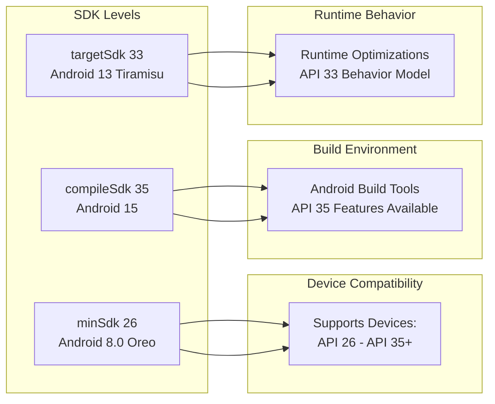
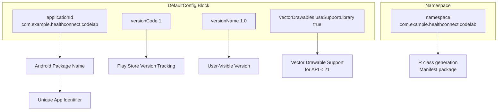
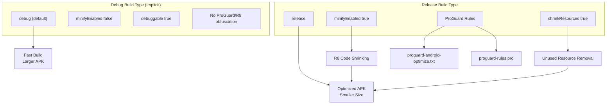
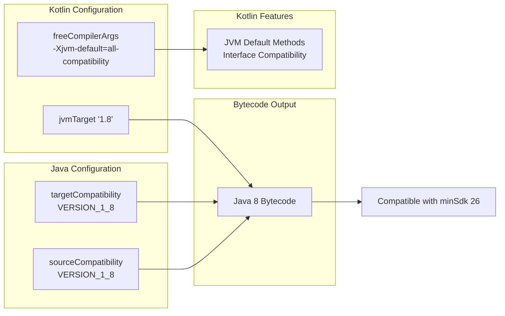
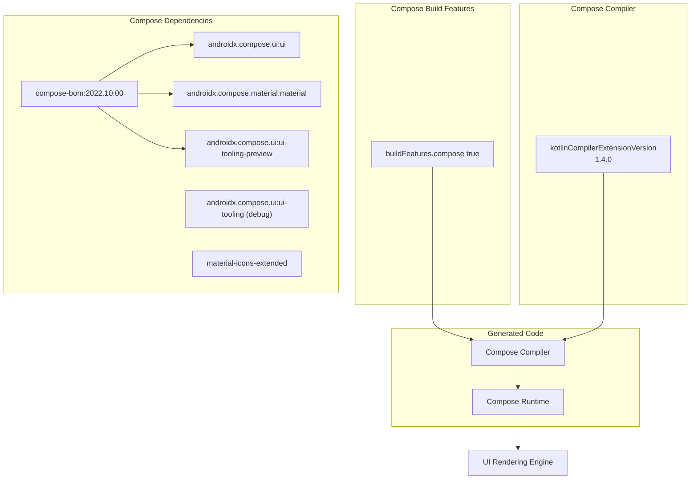
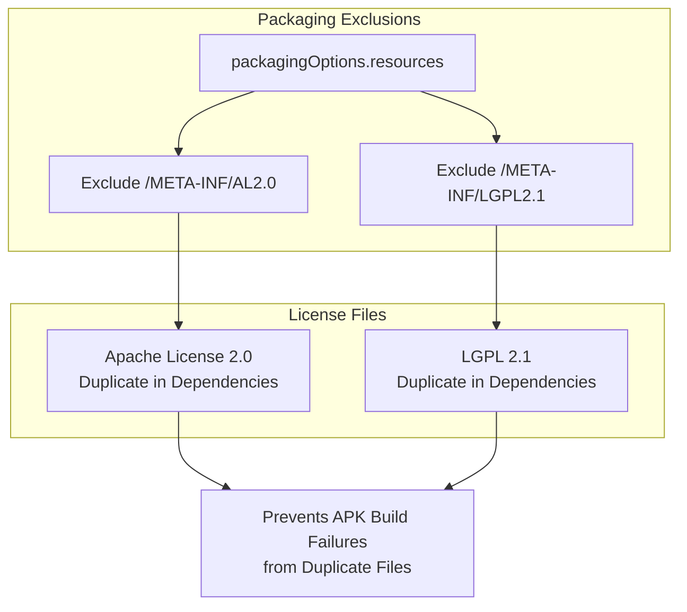
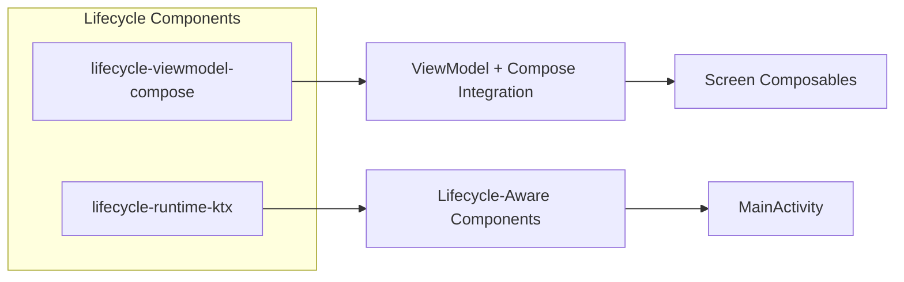
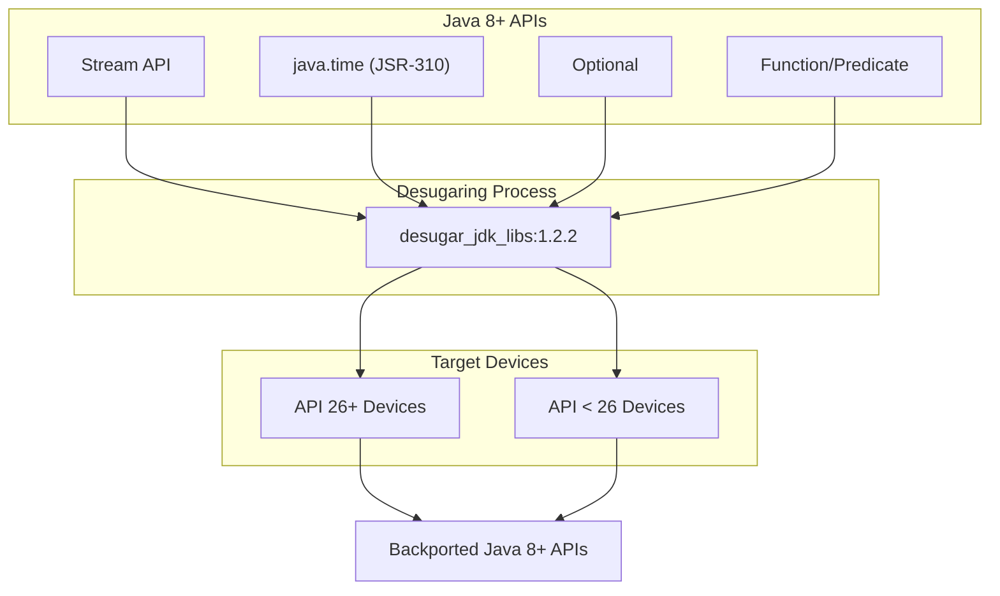

<!-- source: DeepWiki mcp.deepwiki.com · repo android/android-health-connect-codelab · page 3.2 Build Configuration · fetched 2026-10-23 -->

# Build Configuration

<details>
<summary>Relevant source files</summary>

The following files were used as context for generating this wiki page:

- [finished/build.gradle](finished/build.gradle)
- [start/build.gradle](start/build.gradle)

</details>


## Purpose and Scope

This document details the Gradle build configuration for the Health Connect Codelab project. It covers the Android SDK settings, Gradle plugins, Kotlin compiler options, Jetpack Compose configuration, and all dependency declarations used in both the `start` and `finished` modules. 

For information about the CI/CD workflows that build these modules, see [CI/CD Pipeline](#3.3). For details on the module structure and pedagogical differences between start and finished, see [Start vs Finished Modules](#3.1).

---

## Configuration Identity

Both `start/build.gradle` and `finished/build.gradle` are **byte-for-byte identical**. This ensures that students working in the `start` module have the exact same dependencies and build environment as the reference `finished` module, eliminating configuration-related issues during the codelab.

**Sources:** [finished/build.gradle:1-96](), [start/build.gradle:1-96]()

---

## Build Configuration Architecture

```mermaid
graph TB
    subgraph "Root Project"
        SettingsGradle["settings.gradle<br/>Module Registration"]
    end
    
    subgraph "start/ Module"
        StartBuildGradle["start/build.gradle"]
        StartSrcMain["start/src/main/"]
        StartManifest["start/AndroidManifest.xml"]
    end
    
    subgraph "finished/ Module"
        FinBuildGradle["finished/build.gradle"]
        FinSrcMain["finished/src/main/"]
        FinManifest["finished/AndroidManifest.xml"]
    end
    
    subgraph "Build System"
        GradleWrapper["gradlew / gradle-wrapper"]
        AGP["Android Gradle Plugin 8.x"]
        KotlinPlugin["Kotlin Android Plugin"]
    end
    
    subgraph "External Dependencies"
        MavenCentral["Maven Central"]
        GoogleMaven["Google Maven"]
        HealthConnectSDK["androidx.health.connect:connect-client"]
        ComposeBOM["androidx.compose:compose-bom"]
        WorkManager["androidx.work:work-runtime-ktx"]
    end
    
    SettingsGradle --> StartBuildGradle
    SettingsGradle --> FinBuildGradle
    
    StartBuildGradle --> AGP
    StartBuildGradle --> KotlinPlugin
    FinBuildGradle --> AGP
    FinBuildGradle --> KotlinPlugin
    
    StartBuildGradle --> StartSrcMain
    StartBuildGradle --> StartManifest
    FinBuildGradle --> FinSrcMain
    FinBuildGradle --> FinManifest
    
    StartBuildGradle --> MavenCentral
    StartBuildGradle --> GoogleMaven
    FinBuildGradle --> MavenCentral
    FinBuildGradle --> GoogleMaven
    
    MavenCentral --> HealthConnectSDK
    GoogleMaven --> ComposeBOM
    MavenCentral --> WorkManager
    
    StartBuildGradle --> HealthConnectSDK
    StartBuildGradle --> ComposeBOM
    StartBuildGradle --> WorkManager
    FinBuildGradle --> HealthConnectSDK
    FinBuildGradle --> ComposeBOM
    FinBuildGradle --> WorkManager
```



**Sources:** [finished/build.gradle:1-96](), [start/build.gradle:1-96]()

---

## Gradle Plugins

The build configuration applies two Gradle plugins:

| Plugin ID | Purpose |
|-----------|---------|
| `com.android.application` | Configures the module as an Android application (produces APK/AAB) |
| `kotlin-android` | Enables Kotlin compilation for Android |

These plugins are declared in [finished/build.gradle:17-20]() and [start/build.gradle:17-20]().

**Sources:** [finished/build.gradle:17-20](), [start/build.gradle:17-20]()

---

## Android SDK Configuration



### SDK Version Details

| Configuration | Value | Rationale |
|---------------|-------|-----------|
| `compileSdk` | `35` | Latest Android 15 SDK for build-time compilation. Provides access to newest APIs and tools. |
| `minSdk` | `26` | Android 8.0 (Oreo). Health Connect requires API 26+ for core functionality. |
| `targetSdk` | `33` | Android 13 (Tiramisu). Ensures compatibility with Health Connect's permission model introduced in Android 13. |

The `minSdk 26` requirement aligns with Health Connect's minimum API level, which relies on features introduced in Android 8.0. The `targetSdk 33` is set to Android 13 because Health Connect's permission system and intent filters differ between API 33 and API 34+, as documented in the manifest configuration.

**Sources:** [finished/build.gradle:23-28](), [start/build.gradle:23-28]()

---

## Application Configuration



| Property | Value | Location |
|----------|-------|----------|
| `applicationId` | `com.example.healthconnect.codelab` | [finished/build.gradle:26]() |
| `versionCode` | `1` | [finished/build.gradle:29]() |
| `versionName` | `"1.0"` | [finished/build.gradle:30]() |
| `namespace` | `com.example.healthconnect.codelab` | [finished/build.gradle:63]() |
| `vectorDrawables.useSupportLibrary` | `true` | [finished/build.gradle:32-34]() |

The `namespace` property defines the package name for generated resources (R class) and must match the package structure in `AndroidManifest.xml`.

**Sources:** [finished/build.gradle:25-34, 63](), [start/build.gradle:25-34, 63]()

---

## Build Types



### Release Build Type Configuration

The release build type is explicitly configured with optimization flags:

| Property | Value | Purpose |
|----------|-------|---------|
| `minifyEnabled` | `true` | Enables R8 code shrinking, obfuscation, and optimization |
| `shrinkResources` | `true` | Removes unused resources from the APK |
| `proguardFiles` | `proguard-android-optimize.txt`, `proguard-rules.pro` | ProGuard/R8 rule sets for optimization |

The debug build type uses default settings (no minification, debuggable enabled).

**Sources:** [finished/build.gradle:37-42](), [start/build.gradle:37-42]()

---

## Kotlin and Java Compilation Settings



### Compile Options

**Java Compatibility** ([finished/build.gradle:44-47]()):
- `sourceCompatibility JavaVersion.VERSION_1_8`
- `targetCompatibility JavaVersion.VERSION_1_8`

**Kotlin Options** ([finished/build.gradle:48-51]()):
- `jvmTarget = '1.8'`: Generates Java 8 bytecode
- `freeCompilerArgs = ['-Xjvm-default=all-compatibility']`: Enables JVM default method compatibility for interfaces

The `-Xjvm-default=all-compatibility` flag allows Kotlin interfaces to compile with JVM default methods while maintaining compatibility with older code that doesn't expect them. This is important for interoperability with Java code and Android framework APIs.

**Sources:** [finished/build.gradle:44-51](), [start/build.gradle:44-51]()

---

## Jetpack Compose Configuration



### Compose Build Features

**Enabled Features** ([finished/build.gradle:52-54]()):
- `compose = true`: Enables Jetpack Compose build support

**Compose Options** ([finished/build.gradle:55-57]()):
- `kotlinCompilerExtensionVersion = "1.4.0"`: Specifies the Compose compiler plugin version

### Compose Compiler Version Compatibility

The `kotlinCompilerExtensionVersion "1.4.0"` must be compatible with the Kotlin version used by the `kotlin-android` plugin. Version 1.4.0 of the Compose compiler is compatible with Kotlin 1.8.x.

**Sources:** [finished/build.gradle:52-57](), [start/build.gradle:52-57]()

---

## Packaging Options



The packaging options exclude duplicate license files that appear in multiple dependencies:

```
excludes += '/META-INF/{AL2.0,LGPL2.1}'
```

This prevents build failures caused by duplicate META-INF files from transitive dependencies.

**Sources:** [finished/build.gradle:58-62](), [start/build.gradle:58-62]()

---

## Dependency Architecture

```mermaid
graph TB
    subgraph "Dependency Categories"
        HealthConnect["Health Connect SDK"]
        ComposeStack["Jetpack Compose Stack"]
        AndroidX["AndroidX Libraries"]
        BackgroundWork["Background Processing"]
        Utilities["Utility Libraries"]
    end
    
    subgraph "Health Connect"
        HCSDK["androidx.health.connect:connect-client:1.1.0-alpha12"]
    end
    
    subgraph "Compose BOM"
        BOM["androidx.compose:compose-bom:2022.10.00"]
        BOM --> ComposeUI["compose.ui:ui"]
        BOM --> ComposeMaterial["compose.material:material"]
        BOM --> ComposePreview["compose.ui:ui-tooling-preview"]
        BOM --> ComposeIcons["compose.material:material-icons-extended"]
    end
    
    subgraph "Lifecycle & ViewModel"
        ViewModelCompose["lifecycle-viewmodel-compose"]
        LifecycleRuntime["lifecycle-runtime-ktx"]
    end
    
    subgraph "Navigation"
        NavCompose["navigation-compose"]
    end
    
    subgraph "Background Work"
        WorkManagerKTX["work-runtime-ktx:2.9.1"]
    end
    
    subgraph "Concurrency"
        ConcurrentFutures["concurrent-futures-ktx"]
    end
    
    subgraph "Activity"
        ActivityCompose["activity-compose"]
    end
    
    subgraph "Desugaring"
        Desugaring["desugar_jdk_libs:1.2.2"]
    end
    
    HealthConnect --> HCSDK
    ComposeStack --> BOM
    AndroidX --> ViewModelCompose
    AndroidX --> LifecycleRuntime
    AndroidX --> NavCompose
    AndroidX --> ActivityCompose
    BackgroundWork --> WorkManagerKTX
    Utilities --> ConcurrentFutures
    Utilities --> Desugaring
```

**Sources:** [finished/build.gradle:66-96](), [start/build.gradle:66-96]()

---

## Dependency Breakdown

### Health Connect SDK

| Dependency | Version | Configuration | Purpose |
|------------|---------|---------------|---------|
| `androidx.health.connect:connect-client` | `1.1.0-alpha12` | `implementation` | Core Health Connect client library for reading/writing health data |

**Location:** [finished/build.gradle:73]()

This is the primary dependency for the codelab, providing the `HealthConnectClient` class and all health record types (ExerciseSessionRecord, WeightRecord, etc.).

---

### Jetpack Compose Dependencies

The Compose Bill of Materials (BOM) is used to manage version alignment across Compose libraries:

```gradle
def composeBom = platform('androidx.compose:compose-bom:2022.10.00')
implementation(composeBom)
```

**Location:** [finished/build.gradle:69-70]()

**Compose Libraries:**

| Library | Purpose |
|---------|---------|
| `androidx.compose.ui:ui` | Core UI primitives and composables |
| `androidx.compose.material:material` | Material Design components |
| `androidx.compose.ui:ui-tooling-preview` | Preview annotations for Android Studio |
| `androidx.compose.material:material-icons-extended` | Extended Material icon set |
| `androidx.compose.ui:ui-tooling` (debug only) | Tooling support for Compose preview and inspection |

**Locations:** [finished/build.gradle:85-93]()

The BOM ensures all Compose libraries use compatible versions without explicit version declarations.

---

### Lifecycle and ViewModel



| Dependency | Version Variable | Purpose |
|------------|------------------|---------|
| `androidx.lifecycle:lifecycle-viewmodel-compose` | `$lifecycle_version` | Integration between ViewModel and Compose, provides `viewModel()` function |
| `androidx.lifecycle:lifecycle-runtime-ktx` | `$lifecycle_version` | Kotlin extensions for lifecycle-aware components |

**Locations:** [finished/build.gradle:76, 90]()

The `lifecycle-viewmodel-compose` dependency is critical for the codelab's architecture, as it provides the `viewModel()` composable function used in screens like `ExerciseSessionScreen` and `InputReadingsScreen`.

---

### Navigation

| Dependency | Version Variable | Purpose |
|------------|------------------|---------|
| `androidx.navigation:navigation-compose` | `$navigation_compose_version` | Jetpack Navigation integration with Compose |

**Location:** [finished/build.gradle:79]()

This library provides the `NavHost`, `NavController`, and composable navigation functions used in `MainActivity` to implement the app's navigation system. See [Navigation System](#4.2) for implementation details.

---

### Background Work

| Dependency | Version | Purpose |
|------------|---------|---------|
| `androidx.work:work-runtime-ktx` | `2.9.1` | WorkManager for background task scheduling |

**Location:** [finished/build.gradle:68]()

Used by `HealthConnectManager.enqueueReadStepWorker()` to schedule background reading of step data. See [Background Work with WorkManager](#5.8) for implementation details.

---

### Activity Compose

| Dependency | Version Variable | Purpose |
|------------|------------------|---------|
| `androidx.activity:activity-compose` | `$activity_compose_version` | Bridge between ComponentActivity and Compose |

**Location:** [finished/build.gradle:91]()

Provides `setContent` extension function used in `MainActivity` to set the Compose UI tree as the activity's content.

---

### Concurrency Utilities

| Dependency | Version Variable | Purpose |
|------------|------------------|---------|
| `androidx.concurrent:concurrent-futures-ktx` | `$concurrent_futures_version` | Kotlin coroutines bridge for ListenableFuture |

**Location:** [finished/build.gradle:82]()

Allows converting between `ListenableFuture` (used by some Health Connect APIs) and Kotlin suspend functions via `await()` extension.

---

### Core Library Desugaring



| Dependency | Version | Configuration | Purpose |
|------------|---------|---------------|---------|
| `com.android.tools:desugar_jdk_libs` | `1.2.2` | `coreLibraryDesugaring` | Backports Java 8+ APIs to older Android versions |

**Location:** [finished/build.gradle:95]()

Enables use of `java.time` APIs (Instant, LocalDate, etc.) on API levels below 26, even though the app's minSdk is already 26. This provides compatibility for devices that don't have complete Java 8 library support and enables certain Java 8+ language features.

**Sources:** [finished/build.gradle:95](), [start/build.gradle:95]()

---

## Version Variables

The build files reference version variables for several dependencies:

| Variable Name | Referenced Dependencies |
|---------------|------------------------|
| `$lifecycle_version` | `lifecycle-viewmodel-compose`, `lifecycle-runtime-ktx` |
| `$navigation_compose_version` | `navigation-compose` |
| `$activity_compose_version` | `activity-compose` |
| `$concurrent_futures_version` | `concurrent-futures-ktx` |

These variables are defined in the root project's `gradle.properties` file or in a parent `build.gradle` file, allowing centralized version management across modules.

**Sources:** [finished/build.gradle:76-91](), [start/build.gradle:76-91]()

---

## Build Configuration Summary

| Aspect | Configuration |
|--------|---------------|
| **Module Type** | Android Application (APK-producing) |
| **Language** | Kotlin with Java 8 bytecode target |
| **UI Framework** | Jetpack Compose 1.4.0 |
| **Minimum Android** | API 26 (Android 8.0) |
| **Target Android** | API 33 (Android 13) |
| **Compile SDK** | API 35 (Android 15) |
| **Primary Dependency** | Health Connect SDK 1.1.0-alpha12 |
| **Background Work** | WorkManager 2.9.1 |
| **Release Optimization** | R8 minification + resource shrinking enabled |

Both `start` and `finished` modules share this identical configuration, ensuring a consistent development experience for codelab participants regardless of which module they're working in.

**Sources:** [finished/build.gradle:1-96](), [start/build.gradle:1-96]()

---

