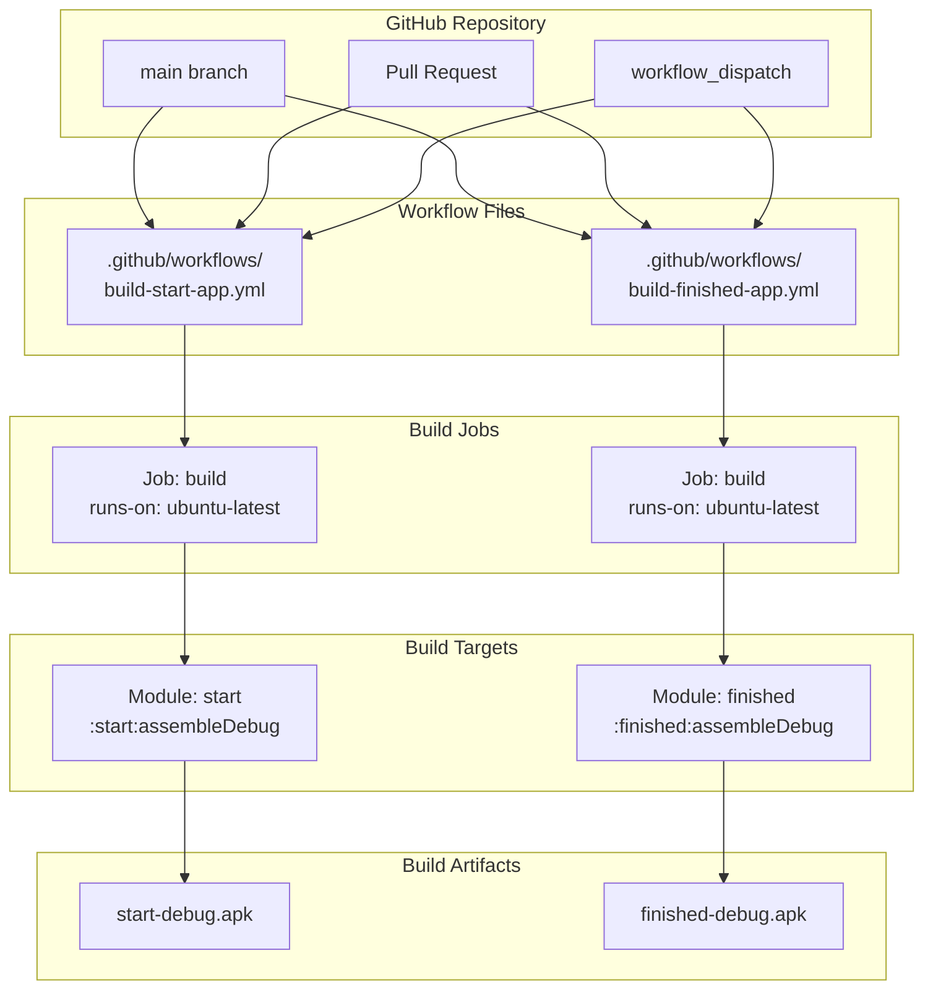
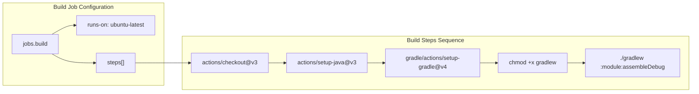
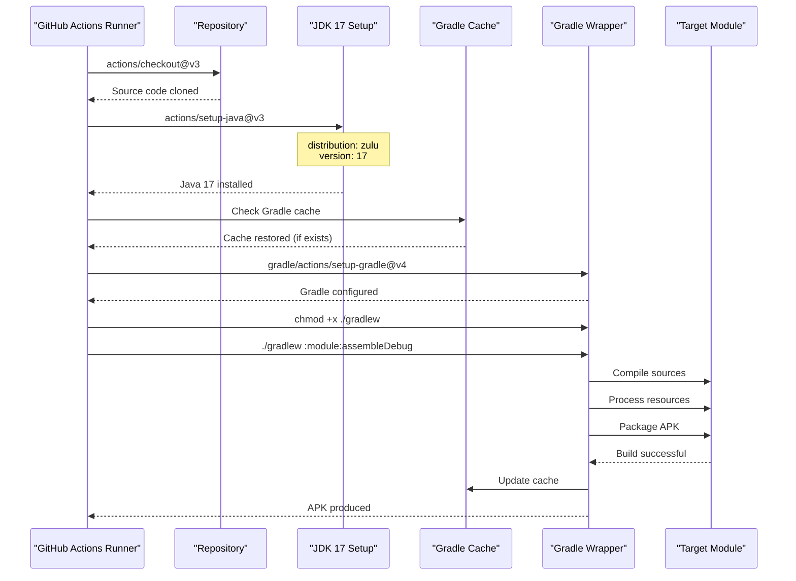
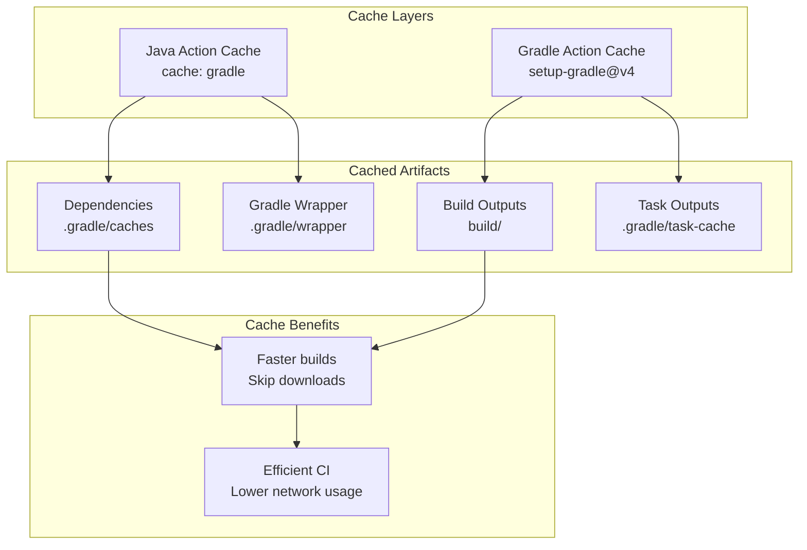
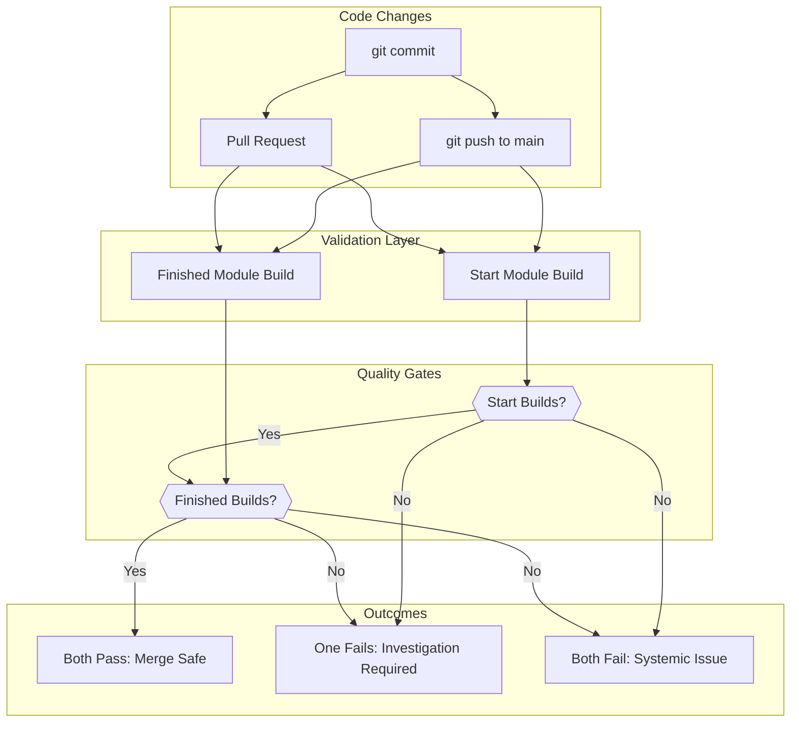

<!-- source: DeepWiki mcp.deepwiki.com · repo android/android-health-connect-codelab · page 3.3 CI/CD Pipeline · fetched 2026-10-23 -->

# CI/CD Pipeline

<details>
<summary>Relevant source files</summary>

The following files were used as context for generating this wiki page:

- [.github/workflows/build-finished-app.yml](.github/workflows/build-finished-app.yml)
- [.github/workflows/build-start-app.yml](.github/workflows/build-start-app.yml)

</details>


## Purpose and Scope

This document describes the CI/CD automation system that builds and validates both the `start` and `finished` modules of the Health Connect Codelab. The pipeline uses GitHub Actions to ensure that both the student template and reference solution remain buildable and functional throughout development.

For information about the structure of the start and finished modules themselves, see [Start vs Finished Modules](#3.1). For details on the Gradle configuration used by these builds, see [Build Configuration](#3.2).

## Workflow Architecture

The CI/CD system consists of two parallel GitHub Actions workflows, each responsible for building one module independently. This separation ensures that changes to either module are validated without interference.

### Dual Workflow Structure



**Sources:** [.github/workflows/build-start-app.yml:1-32](), [.github/workflows/build-finished-app.yml:1-32]()

The two workflows are structurally identical except for their names and the specific module they build:
- `build-start-app.yml` builds the `start` module
- `build-finished-app.yml` builds the `finished` module

## Trigger Configuration

Both workflows use identical trigger configurations, ensuring parallel validation of code changes.

| Trigger Type | Configuration | Purpose |
|-------------|---------------|---------|
| `push` | Branches: `main` | Validates commits to the main branch |
| `pull_request` | Branches: `main` | Validates PR changes before merge |
| `workflow_dispatch` | Manual | Allows on-demand builds |

The trigger section appears at [.github/workflows/build-start-app.yml:4-9]() and [.github/workflows/build-finished-app.yml:4-9]():

```yaml
on:
  workflow_dispatch:
  push:
    branches: [ main ]
  pull_request:
    branches: [ main ]
```

**Sources:** [.github/workflows/build-start-app.yml:4-9](), [.github/workflows/build-finished-app.yml:4-9]()

## Build Job Configuration

### Execution Environment

Both workflows execute on `ubuntu-latest` runners, as specified at [.github/workflows/build-start-app.yml:13]() and [.github/workflows/build-finished-app.yml:13](). This provides a consistent Linux environment for builds.



**Sources:** [.github/workflows/build-start-app.yml:11-31](), [.github/workflows/build-finished-app.yml:11-31]()

## Build Steps

### Step 1: Code Checkout

```yaml
- uses: actions/checkout@v3
```

Uses the GitHub Actions checkout action to clone the repository at [.github/workflows/build-start-app.yml:15]() and [.github/workflows/build-finished-app.yml:15]().

### Step 2: JDK Configuration

```yaml
- name: Set Up JDK
  uses: actions/setup-java@v3
  with:
    distribution: 'zulu'
    java-version: '17'
    cache: 'gradle'
```

Configures the Java Development Kit at [.github/workflows/build-start-app.yml:17-22]() and [.github/workflows/build-finished-app.yml:17-22]():

| Configuration | Value | Purpose |
|--------------|-------|---------|
| `distribution` | `zulu` | Uses Azul Zulu OpenJDK distribution |
| `java-version` | `17` | Installs Java 17, matching project requirements |
| `cache` | `gradle` | Enables Gradle dependency caching |

### Step 3: Gradle Setup

```yaml
- name: Setup Gradle
  uses: gradle/actions/setup-gradle@v4
```

Uses the official Gradle action at [.github/workflows/build-start-app.yml:24-25]() and [.github/workflows/build-finished-app.yml:24-25]() to configure Gradle with built-in caching for build artifacts and wrapper distributions.

### Step 4: Gradlew Permissions

```yaml
- name: Make gradlew executable
  run: chmod +x ./gradlew
```

Ensures the Gradle wrapper script has execute permissions at [.github/workflows/build-start-app.yml:27-28]() and [.github/workflows/build-finished-app.yml:27-28](). This is necessary on Linux systems where file permissions are not preserved in Git.

### Step 5: Module Assembly

The final step differs between workflows to target the appropriate module:

**Start Module Build:**
```yaml
- name: Build start app
  run: ./gradlew :start:assembleDebug
```
Located at [.github/workflows/build-start-app.yml:30-31]()

**Finished Module Build:**
```yaml
- name: Build finished app
  run: ./gradlew :finished:assembleDebug
```
Located at [.github/workflows/build-finished-app.yml:30-31]()

The `:module:assembleDebug` task compiles the specified module and produces a debug APK.

**Sources:** [.github/workflows/build-start-app.yml:15-31](), [.github/workflows/build-finished-app.yml:15-31]()

## Build Step Execution Flow



**Sources:** [.github/workflows/build-start-app.yml:14-31](), [.github/workflows/build-finished-app.yml:14-31]()

## Caching Strategy

The CI/CD pipeline implements two levels of caching to optimize build performance:

### Java Distribution Cache

The `setup-java` action enables caching of Gradle dependencies through the `cache: 'gradle'` parameter at [.github/workflows/build-start-app.yml:22]() and [.github/workflows/build-finished-app.yml:22](). This caches:
- Gradle dependency downloads (jars, aars)
- Maven repository metadata
- Gradle wrapper distributions

### Gradle Build Cache

The `setup-gradle` action at [.github/workflows/build-start-app.yml:24-25]() and [.github/workflows/build-finished-app.yml:24-25]() provides additional caching for:
- Gradle build artifacts
- Task outputs
- Incremental compilation results



**Sources:** [.github/workflows/build-start-app.yml:17-25](), [.github/workflows/build-finished-app.yml:17-25]()

Cache keys are automatically managed by the actions based on:
- `build.gradle` files
- `gradle.properties`
- `gradle-wrapper.properties`

## Module-Specific Build Commands

The workflows execute module-specific Gradle tasks to isolate builds:

| Module | Gradle Task | Workflow File | Line Reference |
|--------|------------|---------------|----------------|
| `start` | `:start:assembleDebug` | `build-start-app.yml` | [31]() |
| `finished` | `:finished:assembleDebug` | `build-finished-app.yml` | [31]() |

The `:module:` prefix ensures Gradle builds only the specified module and its dependencies, not the entire multi-module project. The `assembleDebug` task produces a debug-signed APK without running tests or lint checks.

**Sources:** [.github/workflows/build-start-app.yml:30-31](), [.github/workflows/build-finished-app.yml:30-31]()

## Continuous Validation Benefits

The parallel workflow architecture provides several quality assurance benefits:



**Sources:** [.github/workflows/build-start-app.yml:1-32](), [.github/workflows/build-finished-app.yml:1-32]()

### Validation Scenarios

1. **Start Module Fails, Finished Passes:** Indicates incomplete or incorrect student template code that needs fixing
2. **Finished Module Fails, Start Passes:** Suggests issues in the reference solution implementation
3. **Both Modules Fail:** Points to systemic problems (dependency updates, SDK changes, shared configuration issues)
4. **Both Modules Pass:** Confirms both learning template and reference solution remain functional

This dual validation is essential for a codelab repository where both versions must remain in working order—the `start` module as a functional skeleton for students, and the `finished` module as a verified reference implementation.

## Workflow Execution Matrix

| Aspect | Start Workflow | Finished Workflow | Shared |
|--------|----------------|-------------------|--------|
| Workflow Name | "Build Health Connect Codelab - Start App" | "Build Health Connect Codelab - Finished App" | - |
| File Path | `.github/workflows/build-start-app.yml` | `.github/workflows/build-finished-app.yml` | - |
| Runner OS | `ubuntu-latest` | `ubuntu-latest` | ✓ |
| Java Version | 17 | 17 | ✓ |
| Java Distribution | Zulu | Zulu | ✓ |
| Gradle Action | `setup-gradle@v4` | `setup-gradle@v4` | ✓ |
| Build Task | `:start:assembleDebug` | `:finished:assembleDebug` | - |
| Output APK | `start/build/outputs/apk/debug/` | `finished/build/outputs/apk/debug/` | - |
| Triggers | `push`, `pull_request`, `workflow_dispatch` | `push`, `pull_request`, `workflow_dispatch` | ✓ |

**Sources:** [.github/workflows/build-start-app.yml:1-32](), [.github/workflows/build-finished-app.yml:1-32]()

## Workflow Status and Monitoring

Both workflows appear as separate status checks in GitHub:
- "Build Health Connect Codelab - Start App" check
- "Build Health Connect Codelab - Finished App" check

Pull requests must pass both checks before merge, ensuring neither module breaks due to changes. The `workflow_dispatch` trigger allows manual execution for testing or demonstration purposes without requiring a code push.

**Sources:** [.github/workflows/build-start-app.yml:1-10](), [.github/workflows/build-finished-app.yml:1-10]()

---

