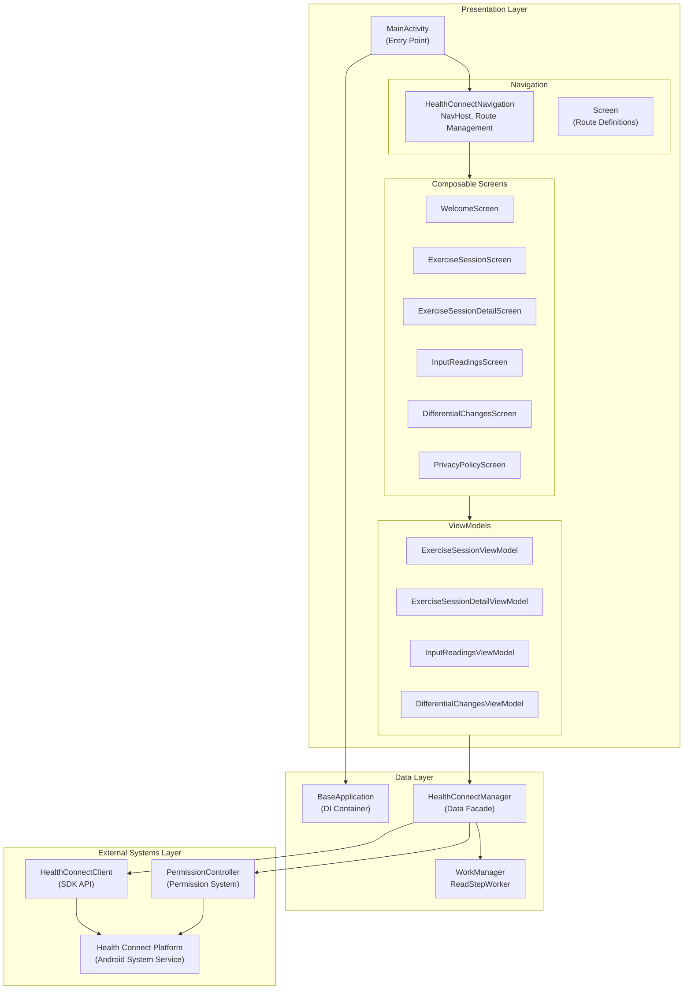
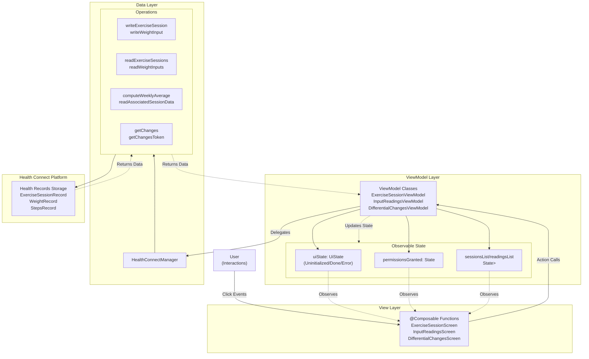
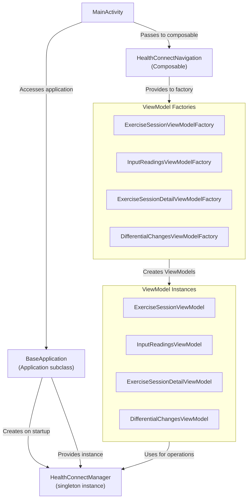
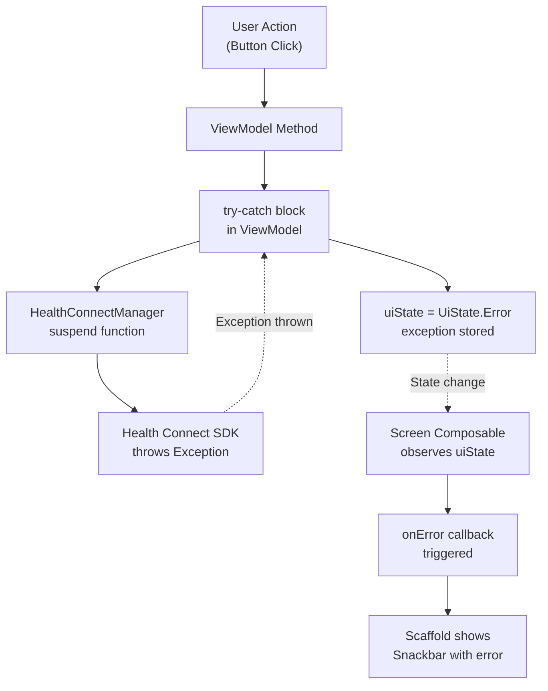

<!-- source: DeepWiki mcp.deepwiki.com · repo android/android-health-connect-codelab · page 4 Architecture Overview · fetched 2026-10-23 -->

# Architecture Overview

<details>
<summary>Relevant source files</summary>

The following files were used as context for generating this wiki page:

- [finished/src/main/java/com/example/healthconnect/codelab/data/HealthConnectManager.kt](finished/src/main/java/com/example/healthconnect/codelab/data/HealthConnectManager.kt)
- [finished/src/main/java/com/example/healthconnect/codelab/presentation/MainActivity.kt](finished/src/main/java/com/example/healthconnect/codelab/presentation/MainActivity.kt)
- [finished/src/main/java/com/example/healthconnect/codelab/presentation/navigation/HealthConnectNavigation.kt](finished/src/main/java/com/example/healthconnect/codelab/presentation/navigation/HealthConnectNavigation.kt)

</details>


## Purpose and Scope

This document presents the high-level architecture of the Health Connect Codelab application, explaining how the major components interact and how data flows through the system. The application implements the **MVVM (Model-View-ViewModel)** architectural pattern with a clear three-layer structure: Presentation, Data, and External Systems. This document focuses on architectural patterns, component responsibilities, and data flow principles.

For implementation details of specific components, see:
- Application initialization and entry point: [Application Entry Point](#4.1)
- Screen routing and navigation flow: [Navigation System](#4.2)
- Data operations and Health Connect integration: [Data Layer - HealthConnectManager](#5)
- Individual feature implementations: [Feature: Exercise Sessions](#6), [Feature: Weight Input](#7), [Feature: Differential Changes](#8)

**Sources:** [finished/src/main/java/com/example/healthconnect/codelab/data/HealthConnectManager.kt:1-346](), [finished/src/main/java/com/example/healthconnect/codelab/presentation/MainActivity.kt:1-36](), [finished/src/main/java/com/example/healthconnect/codelab/presentation/navigation/HealthConnectNavigation.kt:1-232]()

## Architectural Pattern: MVVM

The codelab implements the **Model-View-ViewModel (MVVM)** pattern, a widely-adopted architectural approach for Android applications that promotes separation of concerns and testability. The three components are:

| Component | Responsibility | Implementation |
|-----------|----------------|----------------|
| **View** | UI rendering and user interaction | Jetpack Compose `@Composable` functions in `presentation/screen/` |
| **ViewModel** | Business logic, state management, UI state transformation | `*ViewModel` classes extending `ViewModel` |
| **Model** | Data operations, business domain logic | `HealthConnectManager` and Health Connect SDK types |

The MVVM pattern enables:
- **Testability**: ViewModels contain no Android framework dependencies and can be unit tested
- **Separation of Concerns**: UI logic is decoupled from business logic and data access
- **Lifecycle Awareness**: ViewModels survive configuration changes, preserving state
- **Unidirectional Data Flow**: Data flows in one direction (Model → ViewModel → View) with events flowing upward

**Sources:** [finished/src/main/java/com/example/healthconnect/codelab/presentation/navigation/HealthConnectNavigation.kt:75-125]()

## Three-Layer Architecture

The application is structured into three distinct layers, each with clearly defined responsibilities:



**Sources:** [finished/src/main/java/com/example/healthconnect/codelab/presentation/MainActivity.kt:22-35](), [finished/src/main/java/com/example/healthconnect/codelab/data/HealthConnectManager.kt:59-75](), [finished/src/main/java/com/example/healthconnect/codelab/presentation/navigation/HealthConnectNavigation.kt:48-231]()

### Layer Responsibilities

#### Presentation Layer
Located in `finished/src/main/java/com/example/healthconnect/codelab/presentation/`:

- **MainActivity**: Application entry point, initializes dependency injection
- **Navigation Components**: Routes users between screens based on navigation actions
- **Composable Screens**: Render UI, handle user interactions, observe ViewModel state
- **ViewModels**: Manage UI state, execute business logic, coordinate data operations

#### Data Layer
Located in `finished/src/main/java/com/example/healthconnect/codelab/data/`:

- **HealthConnectManager**: Central facade for all Health Connect operations
- **WorkManager Integration**: Background data synchronization via `ReadStepWorker`
- **Data Models**: Domain objects like `ExerciseSessionData`, `HealthConnectAvailability`

#### External Systems Layer

- **Health Connect SDK**: Android Health Connect client library (`HealthConnectClient`)
- **Permission System**: Android runtime permissions via `PermissionController`
- **Health Connect Platform**: System-level service storing health and fitness data

**Sources:** [finished/src/main/java/com/example/healthconnect/codelab/data/HealthConnectManager.kt:59-68](), [finished/src/main/java/com/example/healthconnect/codelab/presentation/MainActivity.kt:25-34]()

## Component Responsibilities

The following table details the core components and their specific responsibilities:

| Component | File Path | Key Responsibilities |
|-----------|-----------|---------------------|
| `MainActivity` | `presentation/MainActivity.kt` | App entry point, creates `HealthConnectApp` composable, accesses `BaseApplication` for dependencies |
| `BaseApplication` | `BaseApplication.kt` | Dependency injection container, creates and holds singleton `HealthConnectManager` instance |
| `HealthConnectNavigation` | `presentation/navigation/HealthConnectNavigation.kt` | Defines `NavHost`, creates ViewModels with factories, manages navigation routes and deep links |
| `HealthConnectManager` | `data/HealthConnectManager.kt` | Centralizes Health Connect operations (read/write/aggregate/changes), manages availability and permissions |
| `*ViewModel` classes | `presentation/screen/*/` | State management, permission checking, error handling, delegates data operations to `HealthConnectManager` |
| `*Screen` composables | `presentation/screen/*/` | UI rendering, user input handling, observes ViewModel state, triggers ViewModel actions |
| `ReadStepWorker` | `workers/ReadStepWorker.kt` | Background work execution, reads step data when app is not in foreground |

**Sources:** [finished/src/main/java/com/example/healthconnect/codelab/presentation/MainActivity.kt:22-35](), [finished/src/main/java/com/example/healthconnect/codelab/data/HealthConnectManager.kt:59-95](), [finished/src/main/java/com/example/healthconnect/codelab/presentation/navigation/HealthConnectNavigation.kt:75-95]()

## Unidirectional Data Flow

The application implements a unidirectional data flow pattern where data flows downward through the component hierarchy and events flow upward:



**Data Flow Direction:**
1. **User → View**: User interactions (button clicks, text input) trigger composable callbacks
2. **View → ViewModel**: Composables invoke ViewModel methods (e.g., `insertExerciseSession()`, `inputReadings()`)
3. **ViewModel → HealthConnectManager**: ViewModels delegate data operations to `HealthConnectManager`
4. **HealthConnectManager → Platform**: Manager calls Health Connect SDK APIs
5. **Platform → HealthConnectManager → ViewModel**: Results flow back, updating ViewModel state
6. **ViewModel → View**: State changes trigger UI recomposition via Compose's reactive system

**Sources:** [finished/src/main/java/com/example/healthconnect/codelab/presentation/navigation/HealthConnectNavigation.kt:95-124](), [finished/src/main/java/com/example/healthconnect/codelab/data/HealthConnectManager.kt:100-189]()

## State Management Pattern

The application uses Jetpack Compose's state management system with the following patterns:

### ViewModel State Objects

Each ViewModel exposes observable state using `mutableStateOf()` from Compose:

```mermaid
graph LR
    subgraph ViewModelState["ViewModel State Properties"]
        uiState["uiState: MutableState<UiState><br/>(Uninitialized/Done/Error)"]
        permissionsGranted["permissionsGranted: MutableState<Boolean>"]
        dataState["sessionsList/readingsList<br/>MutableState<List<T>>"]
        aggregateState["weeklyAvg/sessionMetrics<br/>MutableState<T?>"]
    end
    
    subgraph Composables["Composable Functions"]
        ScreenComposable["ExerciseSessionScreen<br/>InputReadingsScreen<br/>etc."]
    end
    
    subgraph StateObservation["State Observation"]
        byDelegate["val sessionsList by viewModel.sessionsList<br/>val permissionsGranted by viewModel.permissionsGranted"]
    end
    
    ViewModelState -.->|"Delegated Property"| StateObservation
    StateObservation -.->|"Reads State"| Composables
    Composables -.->|"Recomposes on Change"| Composables
```



**Key State Types:**

| State Property | Type | Purpose |
|----------------|------|---------|
| `uiState` | `UiState` (sealed class) | Tracks operation status: `Uninitialized`, `Done`, `Error` |
| `permissionsGranted` | `Boolean` | Whether all required permissions are granted |
| `sessionsList` / `readingsList` | `List<T>` | Lists of health records for display |
| `weeklyAvg` / `sessionMetrics` | Aggregate types | Computed statistics from health data |

**State Update Flow:**
1. ViewModel methods call `HealthConnectManager` methods (suspend functions)
2. On success, ViewModel updates state properties: `uiState.value = UiState.Done`, `sessionsList.value = result`
3. Compose runtime detects state changes and schedules recomposition
4. Composables reading these states recompose with new values

**Sources:** [finished/src/main/java/com/example/healthconnect/codelab/presentation/navigation/HealthConnectNavigation.kt:81-94](), [finished/src/main/java/com/example/healthconnect/codelab/data/HealthConnectManager.kt:62-63]()

## Dependency Management

The application uses manual dependency injection through the `BaseApplication` class:



**Dependency Injection Flow:**

1. **Application Level**: `BaseApplication` creates `HealthConnectManager` instance in `onCreate()` [BaseApplication.kt]
2. **Activity Level**: `MainActivity.onCreate()` retrieves `healthConnectManager` from `application` cast [finished/src/main/java/com/example/healthconnect/codelab/presentation/MainActivity.kt:29]()
3. **Composable Level**: `MainActivity` passes manager to `HealthConnectApp` and `HealthConnectNavigation`
4. **ViewModel Creation**: Navigation composables create ViewModels using factory pattern, passing `healthConnectManager` to factories [finished/src/main/java/com/example/healthconnect/codelab/presentation/navigation/HealthConnectNavigation.kt:76-79]()

This approach provides:
- **Singleton Pattern**: Single `HealthConnectManager` instance shared across all ViewModels
- **Lifecycle Management**: Manager survives activity recreation
- **Testability**: Easy to replace with mock implementations in tests

**Sources:** [finished/src/main/java/com/example/healthconnect/codelab/presentation/MainActivity.kt:22-35](), [finished/src/main/java/com/example/healthconnect/codelab/presentation/navigation/HealthConnectNavigation.kt:75-80]()

## Key Architectural Decisions

### Centralized Health Connect Operations

All Health Connect SDK interactions are centralized in `HealthConnectManager` rather than scattered across ViewModels:

**Benefits:**
- **Single Source of Truth**: One class manages all Health Connect state (availability, permissions, client instance)
- **Code Reusability**: Common operations like reading data with time filters are implemented once [finished/src/main/java/com/example/healthconnect/codelab/data/HealthConnectManager.kt:314-324]()
- **Testability**: ViewModels can be tested by mocking only `HealthConnectManager` interface
- **Consistency**: Error handling, permission checks, and API patterns are consistent

**Pattern Example:**
ViewModels call methods like `writeExerciseSession()`, `readWeightInputs()`, `computeWeeklyAverage()` rather than directly using `HealthConnectClient` [finished/src/main/java/com/example/healthconnect/codelab/data/HealthConnectManager.kt:100-189]()

### Jetpack Compose for UI

The application uses Jetpack Compose (declarative UI) instead of traditional XML layouts:

**Benefits:**
- **Reactive UI**: UI automatically updates when ViewModel state changes
- **Less Boilerplate**: No separate XML files, view binding, or findViewById calls
- **Type Safety**: Compile-time verification of composable parameters
- **State Management**: Built-in state hoisting and delegation patterns

**Implementation:**
All screens are `@Composable` functions that observe ViewModel state via delegated properties (`val sessionsList by viewModel.sessionsList`)

### ViewModel State Management

ViewModels manage state using Compose's `mutableStateOf()` rather than LiveData:

**Benefits:**
- **Compose Integration**: Direct compatibility with Compose's reactive system
- **Simplicity**: No need for lifecycle-aware observers
- **Performance**: Granular recomposition only for changed state

**Pattern:**
```
var sessionsList = mutableStateOf<List<ExerciseSessionRecord>>(listOf())
    private set
```

This exposes a read-only public property with private setter, ensuring state changes only through ViewModel methods.

### Permission Handling Architecture

Permissions are checked at the ViewModel level before any data operations:

**Pattern:**
1. ViewModel checks `hasAllPermissions()` on initialization
2. If permissions missing, Screen displays request button
3. User grants permissions via `ActivityResultLauncher`
4. ViewModel rechecks permissions and loads data

This prevents unauthorized data access attempts and provides clear user guidance [finished/src/main/java/com/example/healthconnect/codelab/presentation/navigation/HealthConnectNavigation.kt:81-94]()

**Sources:** [finished/src/main/java/com/example/healthconnect/codelab/data/HealthConnectManager.kt:59-95](), [finished/src/main/java/com/example/healthconnect/codelab/presentation/navigation/HealthConnectNavigation.kt:75-124]()

## Cross-Cutting Concerns

### Error Handling

Error handling is implemented at multiple layers:



**Error Flow:**
1. ViewModels wrap `HealthConnectManager` calls in try-catch blocks
2. Caught exceptions are stored in `uiState = UiState.Error(exception)`
3. Screens observe `uiState` and invoke `onError` callback
4. Navigation layer displays snackbar via `showExceptionSnackbar()` [finished/src/main/java/com/example/healthconnect/codelab/presentation/navigation/HealthConnectNavigation.kt:116]()

### Background Operations

Background work is managed through WorkManager integration:

- `HealthConnectManager.enqueueReadStepWorker()` schedules background tasks [finished/src/main/java/com/example/healthconnect/codelab/data/HealthConnectManager.kt:304-309]()
- `ReadStepWorker` performs data operations when app is backgrounded
- Worker requires `READ_HEALTH_DATA_IN_BACKGROUND` permission

This architecture supports periodic sync and data monitoring without keeping the app in foreground.

**Sources:** [finished/src/main/java/com/example/healthconnect/codelab/data/HealthConnectManager.kt:304-309](), [finished/src/main/java/com/example/healthconnect/codelab/presentation/navigation/HealthConnectNavigation.kt:115-117]()

---

