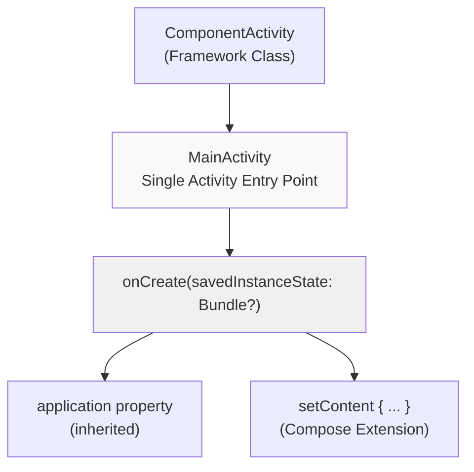
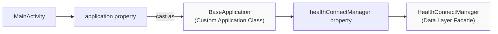
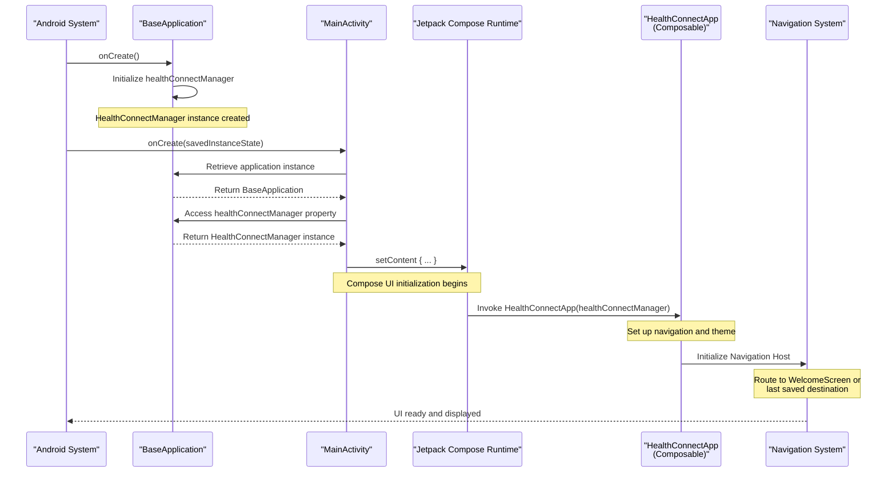
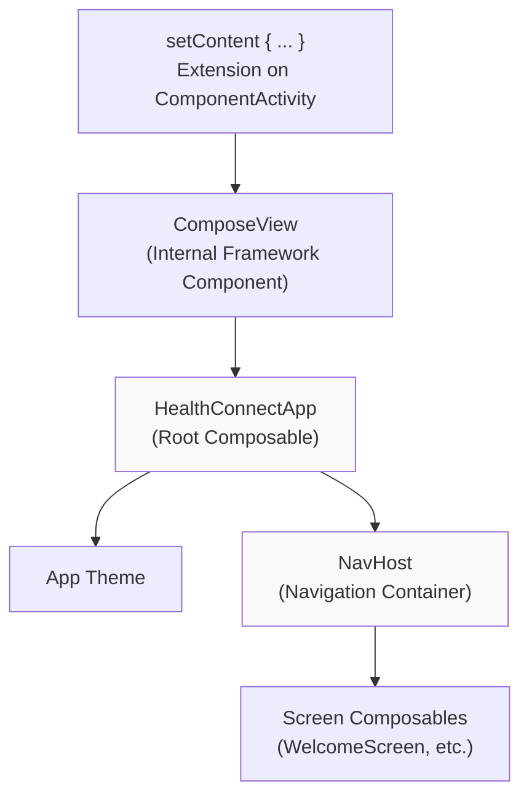

<!-- source: DeepWiki mcp.deepwiki.com · repo android/android-health-connect-codelab · page 4.1 Application Entry Point · fetched 2026-10-23 -->

# Application Entry Point

<details>
<summary>Relevant source files</summary>

The following files were used as context for generating this wiki page:

- [finished/src/main/java/com/example/healthconnect/codelab/presentation/MainActivity.kt](finished/src/main/java/com/example/healthconnect/codelab/presentation/MainActivity.kt)

</details>


## Purpose and Scope

This document describes the application initialization flow for the Health Connect Codelab, covering the `MainActivity` as the Android entry point, the `BaseApplication` class for dependency management, and the Jetpack Compose setup. This page focuses on the application lifecycle initialization and how the UI composition is established.

For details about the navigation system and routing that takes place after initialization, see [Navigation System](#4.2). For information about the `HealthConnectManager` dependency being injected, see [Data Layer - HealthConnectManager](#5).

---

## MainActivity: The Application Entry Point

The `MainActivity` class serves as the single entry point for the Health Connect Codelab application. It extends `ComponentActivity`, which is the base class for activities that enable Jetpack Compose integration.

### Class Structure



**Diagram: MainActivity Class Hierarchy and Key Methods**

The `MainActivity` implementation is minimal by design, containing only the essential initialization logic in the `onCreate` method. It does not manage any UI state directly—all presentation logic is delegated to Composable functions and ViewModels.

**Sources:** [finished/src/main/java/com/example/healthconnect/codelab/presentation/MainActivity.kt:25-35]()

---

## BaseApplication and Dependency Injection

The application uses the Application class pattern for dependency management. The `BaseApplication` class (extending `android.app.Application`) serves as the application-level dependency container.

### Dependency Retrieval Pattern



**Diagram: Dependency Injection Flow**

In `MainActivity.onCreate`, the application instance is cast to `BaseApplication` to access the `healthConnectManager` property:

```kotlin
val healthConnectManager = (application as BaseApplication).healthConnectManager
```

This pattern provides:
- **Single Instance Management**: The `HealthConnectManager` is instantiated once at the application level
- **Lifecycle Alignment**: The manager exists for the entire application lifecycle
- **Simple Dependency Access**: Activities and other components can retrieve dependencies via the application instance

The `BaseApplication` class must be declared in `AndroidManifest.xml` as the `android:name` attribute of the `<application>` tag to ensure Android uses this custom application class instead of the default.

**Sources:** [finished/src/main/java/com/example/healthconnect/codelab/presentation/MainActivity.kt:29]()

---

## Application Initialization Flow

The following diagram illustrates the complete initialization sequence from app launch to UI rendering:



**Diagram: Application Initialization Sequence**

### Initialization Steps

| Step | Component | Action | Description |
|------|-----------|--------|-------------|
| 1 | `BaseApplication` | `onCreate()` | Application class is instantiated; `healthConnectManager` is initialized |
| 2 | `MainActivity` | `onCreate(Bundle?)` | Activity lifecycle begins; receives savedInstanceState for restoration |
| 3 | `MainActivity` | Retrieve dependency | Casts `application` to `BaseApplication` and accesses `healthConnectManager` |
| 4 | `MainActivity` | `setContent { }` | Establishes Compose UI tree; triggers composition |
| 5 | Compose Runtime | Composition | Invokes `HealthConnectApp` Composable function |
| 6 | `HealthConnectApp` | UI Setup | Initializes navigation, theme, and routes to initial screen |

**Sources:** [finished/src/main/java/com/example/healthconnect/codelab/presentation/MainActivity.kt:26-34]()

---

## Jetpack Compose Integration

The application uses Jetpack Compose as its UI framework, with `MainActivity` establishing the Compose UI tree through the `setContent` extension function.

### setContent and Composition



**Diagram: Compose UI Hierarchy**

The `setContent` block at [finished/src/main/java/com/example/healthconnect/codelab/presentation/MainActivity.kt:31-33]() establishes the Compose UI hierarchy:

```kotlin
setContent {
  HealthConnectApp(healthConnectManager = healthConnectManager)
}
```

### Key Characteristics

| Aspect | Details |
|--------|---------|
| **Entry Point** | `HealthConnectApp` Composable function is the root of the UI tree |
| **Parameter Passing** | `healthConnectManager` is passed down from Activity scope into Compose scope |
| **Recomposition Scope** | The entire UI tree can recompose based on state changes managed by ViewModels |
| **Lifecycle Awareness** | Compose lifecycle is automatically tied to Activity lifecycle through `ComponentActivity` |

### HealthConnectApp Composable

The `HealthConnectApp` Composable function serves as the root container that:

1. **Receives Dependencies**: Accepts `healthConnectManager` as a parameter
2. **Establishes Theme**: Applies Material Design theming
3. **Initializes Navigation**: Sets up `NavHost` with route definitions
4. **Manages Global State**: Can provide app-level state through CompositionLocal if needed

For the detailed navigation setup within `HealthConnectApp`, see [Navigation System](#4.2).

**Sources:** [finished/src/main/java/com/example/healthconnect/codelab/presentation/MainActivity.kt:31-33]()

---

## Code Entity Reference

The following table maps the conceptual components described in this document to their actual code entities:

| Concept | Code Entity | File Path | Lines |
|---------|-------------|-----------|-------|
| Application Entry Point | `MainActivity` class | `finished/src/main/java/com/example/healthconnect/codelab/presentation/MainActivity.kt` | 25-35 |
| Lifecycle Initialization | `onCreate(Bundle?)` method | `finished/src/main/java/com/example/healthconnect/codelab/presentation/MainActivity.kt` | 26-34 |
| Dependency Container | `BaseApplication` class | Inferred from cast | 29 |
| Dependency Retrieval | `application as BaseApplication` | `finished/src/main/java/com/example/healthconnect/codelab/presentation/MainActivity.kt` | 29 |
| Data Facade Access | `.healthConnectManager` property | `finished/src/main/java/com/example/healthconnect/codelab/presentation/MainActivity.kt` | 29 |
| Compose Root Setup | `setContent { }` block | `finished/src/main/java/com/example/healthconnect/codelab/presentation/MainActivity.kt` | 31-33 |
| Root Composable | `HealthConnectApp(...)` function | `finished/src/main/java/com/example/healthconnect/codelab/presentation/MainActivity.kt` | 32 |

---

## Architectural Implications

The `MainActivity` design demonstrates several architectural patterns:

### Single Activity Architecture

The application follows the Single Activity pattern recommended by Android:
- **Single Entry Point**: Only one `Activity` in the entire application
- **Navigation via Compose**: Screen transitions handled by Compose Navigation, not Activity intents
- **Simplified State Management**: No need to manage state across multiple Activity instances
- **Deep Linking**: Deep links are handled by navigation routes, not Activity intent filters

### Dependency Injection Pattern

While this codelab uses manual dependency injection via `BaseApplication`, the pattern demonstrates:
- **Inversion of Control**: `MainActivity` depends on abstractions (`HealthConnectManager`) rather than creating dependencies
- **Testability**: Dependencies can be mocked by providing different `BaseApplication` implementations
- **Centralized Dependency Graph**: All dependencies originate from a single location

For production applications, frameworks like Hilt or Koin could replace `BaseApplication` while maintaining the same dependency access pattern in `MainActivity`.

**Sources:** [finished/src/main/java/com/example/healthconnect/codelab/presentation/MainActivity.kt:25-35]()

---

## Module Differences: Start vs. Finished

Both the `start` and `finished` modules contain identical `MainActivity` implementations. This is because:

1. **Complete from the Start**: The entry point setup is provided as working code in the student template
2. **Focus on Data Layer**: The learning objectives center on implementing Health Connect operations, not Activity setup
3. **Standard Boilerplate**: Activity initialization is standard Android boilerplate that doesn't teach Health Connect concepts

Students working through the codelab will not modify `MainActivity`; their implementation work occurs in:
- `HealthConnectManager` methods (see [Data Layer - HealthConnectManager](#5))
- ViewModel logic (see feature-specific sections)

**Sources:** [finished/src/main/java/com/example/healthconnect/codelab/presentation/MainActivity.kt:1-36]()

---

