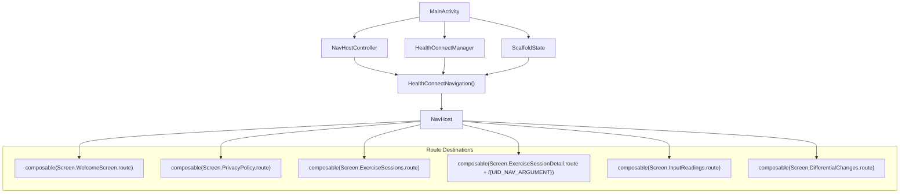
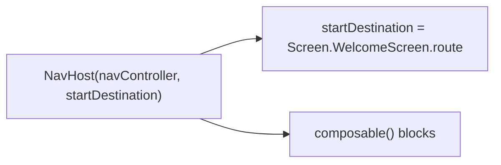
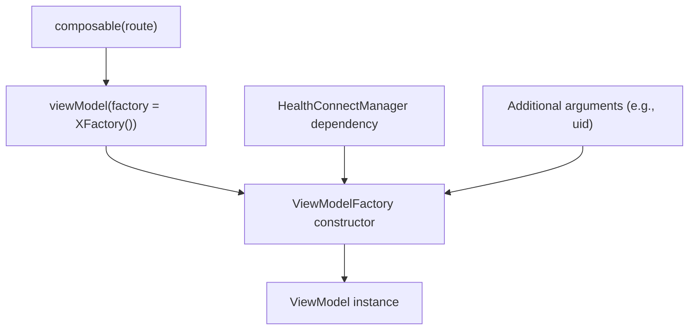
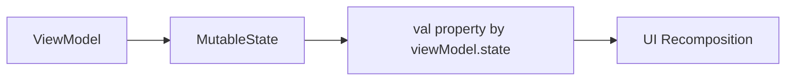
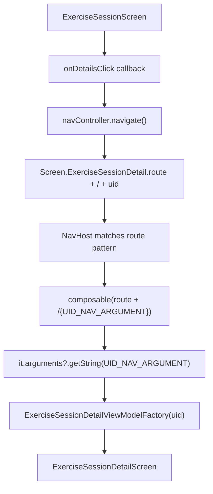
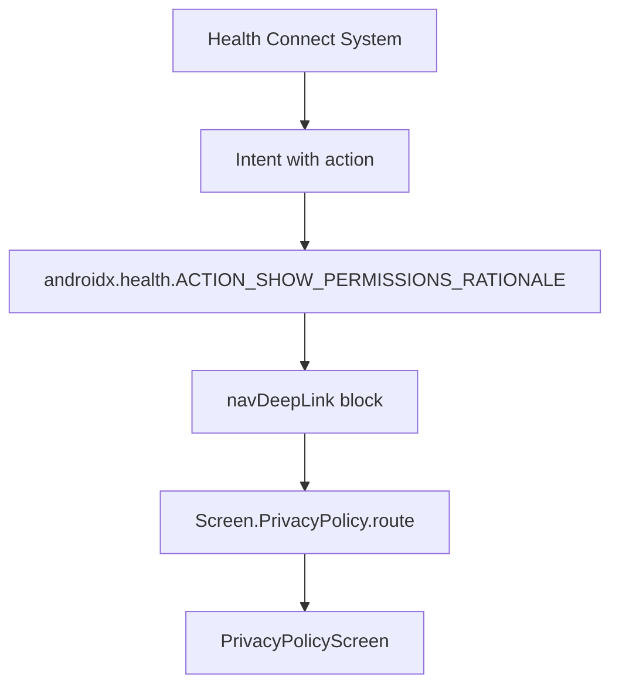
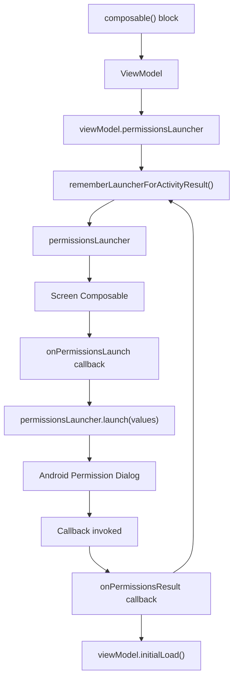
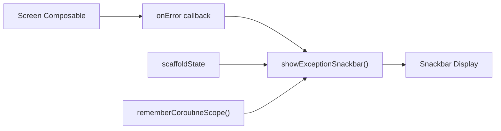

<!-- source: DeepWiki mcp.deepwiki.com · repo android/android-health-connect-codelab · page 4.2 Navigation System · fetched 2026-10-23 -->

# Navigation System

<details>
<summary>Relevant source files</summary>

The following files were used as context for generating this wiki page:

- [finished/src/main/java/com/example/healthconnect/codelab/presentation/navigation/HealthConnectNavigation.kt](finished/src/main/java/com/example/healthconnect/codelab/presentation/navigation/HealthConnectNavigation.kt)
- [start/src/main/java/com/example/healthconnect/codelab/presentation/navigation/HealthConnectNavigation.kt](start/src/main/java/com/example/healthconnect/codelab/presentation/navigation/HealthConnectNavigation.kt)

</details>


## Purpose and Scope

This document describes the navigation infrastructure used in the Health Connect Codelab application. The navigation system is implemented using Jetpack Compose Navigation and manages routing between six feature screens, handles deep linking for permission rationale, passes navigation arguments, and integrates with the permission system and error handling mechanisms. The navigation logic is centralized in the `HealthConnectNavigation` composable function.

For information about the application entry point that initializes this navigation system, see [Application Entry Point](#4.1). For details about individual screen implementations and their ViewModels, see feature-specific sections ([Exercise Sessions](#6), [Weight Input](#7), [Differential Changes](#8)).

---

## Navigation Architecture

The navigation system follows a centralized routing pattern where all navigation configuration is defined in a single composable function that receives dependencies from the application layer.

### Navigation Component Structure



**Sources:** [finished/src/main/java/com/example/healthconnect/codelab/presentation/navigation/HealthConnectNavigation.kt:48-55]()

---

## Route Definitions and Screen Enum

The application uses a `Screen` sealed class (referenced but not shown in the navigation file) that defines route constants. The navigation system references these routes through the `Screen` class properties:

| Screen Destination | Route Property | Navigation Arguments |
|-------------------|----------------|---------------------|
| Welcome Screen | `Screen.WelcomeScreen.route` | None |
| Privacy Policy | `Screen.PrivacyPolicy.route` | None (deep link enabled) |
| Exercise Sessions | `Screen.ExerciseSessions.route` | None |
| Exercise Session Detail | `Screen.ExerciseSessionDetail.route` | `UID_NAV_ARGUMENT` |
| Input Readings | `Screen.InputReadings.route` | None |
| Differential Changes | `Screen.DifferentialChanges.route` | None |

The `UID_NAV_ARGUMENT` constant is used for passing exercise session identifiers to the detail screen.

**Sources:** [finished/src/main/java/com/example/healthconnect/codelab/presentation/navigation/HealthConnectNavigation.kt:55,57,66,75,126,158,194]()

---

## NavHost Configuration

The `HealthConnectNavigation` function creates a `NavHost` that manages the backstack and handles navigation between composable destinations.

### NavHost Setup



The `NavHost` is initialized with:
- **navController**: The `NavHostController` passed from `MainActivity`
- **startDestination**: Set to `Screen.WelcomeScreen.route`, making the welcome screen the initial destination

Inside the `NavHost` lambda, the `availability` state is observed from `HealthConnectManager`, which is then passed to the `WelcomeScreen` to display Health Connect availability status.

**Sources:** [finished/src/main/java/com/example/healthconnect/codelab/presentation/navigation/HealthConnectNavigation.kt:55-64]()

---

## ViewModel Factory Pattern

Each feature screen instantiates its ViewModel using a custom factory that provides required dependencies. The pattern follows this structure for all screens:

### ViewModel Instantiation Pattern



### Example: Exercise Session Screen

At [finished/src/main/java/com/example/healthconnect/codelab/presentation/navigation/HealthConnectNavigation.kt:76-80](), the `ExerciseSessionViewModel` is instantiated:

```kotlin
val viewModel: ExerciseSessionViewModel = viewModel(
  factory = ExerciseSessionViewModelFactory(
    healthConnectManager = healthConnectManager
  )
)
```

### Example: Exercise Session Detail Screen with Arguments

At [finished/src/main/java/com/example/healthconnect/codelab/presentation/navigation/HealthConnectNavigation.kt:126-132](), the `ExerciseSessionDetailViewModel` receives both the UID argument and the `HealthConnectManager`:

```kotlin
val uid = it.arguments?.getString(UID_NAV_ARGUMENT)!!
val viewModel: ExerciseSessionDetailViewModel = viewModel(
  factory = ExerciseSessionDetailViewModelFactory(
    uid = uid,
    healthConnectManager = healthConnectManager
  )
)
```

### ViewModel Factories by Screen

| Screen | ViewModel | Factory Class | Dependencies |
|--------|-----------|---------------|-------------|
| Exercise Sessions | `ExerciseSessionViewModel` | `ExerciseSessionViewModelFactory` | `healthConnectManager` |
| Exercise Detail | `ExerciseSessionDetailViewModel` | `ExerciseSessionDetailViewModelFactory` | `uid`, `healthConnectManager` |
| Input Readings | `InputReadingsViewModel` | `InputReadingsViewModelFactory` | `healthConnectManager` |
| Differential Changes | `DifferentialChangesViewModel` | `DifferentialChangesViewModelFactory` | `healthConnectManager` |

**Sources:** [finished/src/main/java/com/example/healthconnect/codelab/presentation/navigation/HealthConnectNavigation.kt:76-80,128-132,159-162,195-198]()

---

## State Observation and Delegation

Each composable block observes ViewModel state using Kotlin's delegated properties with the `by` keyword. This enables automatic recomposition when state changes.

### State Observation Pattern



### Example: Exercise Session State Observation

At [finished/src/main/java/com/example/healthconnect/codelab/presentation/navigation/HealthConnectNavigation.kt:81-89](), multiple state properties are observed:

```kotlin
val permissionsGranted by viewModel.permissionsGranted
val sessionsList by viewModel.sessionsList
val permissions = viewModel.permissions
val backgroundReadPermissions = viewModel.backgroundReadPermissions
val backgroundReadAvailable by viewModel.backgroundReadAvailable
val backgroundReadGranted by viewModel.backgroundReadGranted
val historyReadPermissions = viewModel.historyReadPermissions
val historyReadAvailable by viewModel.historyReadAvailable
val historyReadGranted by viewModel.historyReadGranted
```

Note that some properties use delegation (`by`) while others do not. Properties marked with `by` are `MutableState` objects that trigger recomposition, while non-delegated properties are typically immutable lists or constants.

**Sources:** [finished/src/main/java/com/example/healthconnect/codelab/presentation/navigation/HealthConnectNavigation.kt:81-89,134-136,164-167,200-202]()

---

## Navigation with Arguments

The Exercise Session Detail screen demonstrates parameter passing through navigation arguments.

### Navigation Argument Flow



### Implementation Details

At [finished/src/main/java/com/example/healthconnect/codelab/presentation/navigation/HealthConnectNavigation.kt:112-114](), the navigation is triggered:

```kotlin
onDetailsClick = { uid ->
  navController.navigate(Screen.ExerciseSessionDetail.route + "/" + uid)
}
```

The route pattern includes a placeholder: [finished/src/main/java/com/example/healthconnect/codelab/presentation/navigation/HealthConnectNavigation.kt:126]()

```kotlin
composable(Screen.ExerciseSessionDetail.route + "/{$UID_NAV_ARGUMENT}")
```

The argument is extracted from the backstack entry: [finished/src/main/java/com/example/healthconnect/codelab/presentation/navigation/HealthConnectNavigation.kt:127]()

```kotlin
val uid = it.arguments?.getString(UID_NAV_ARGUMENT)!!
```

**Sources:** [finished/src/main/java/com/example/healthconnect/codelab/presentation/navigation/HealthConnectNavigation.kt:112-114,126-127]()

---

## Deep Linking Configuration

The Privacy Policy screen implements deep linking to handle the permission rationale intent from the Health Connect system.

### Deep Link Architecture



At [finished/src/main/java/com/example/healthconnect/codelab/presentation/navigation/HealthConnectNavigation.kt:65-74](), the deep link is configured:

```kotlin
composable(
  route = Screen.PrivacyPolicy.route,
  deepLinks = listOf(
    navDeepLink {
      action = "androidx.health.ACTION_SHOW_PERMISSIONS_RATIONALE"
    }
  )
) {
  PrivacyPolicyScreen()
}
```

This configuration allows the Android system to launch the Privacy Policy screen when the Health Connect permission rationale intent is triggered. This is particularly relevant for Android 14+ where apps must provide a rationale before requesting Health Connect permissions.

**Sources:** [finished/src/main/java/com/example/healthconnect/codelab/presentation/navigation/HealthConnectNavigation.kt:65-74]()

---

## Permission Launcher Integration

Each screen that requires Health Connect permissions integrates a permission launcher using `rememberLauncherForActivityResult`.

### Permission Flow Integration



### Example: Exercise Session Permission Launcher

At [finished/src/main/java/com/example/healthconnect/codelab/presentation/navigation/HealthConnectNavigation.kt:90-94](), the launcher is set up:

```kotlin
val onPermissionsResult = { viewModel.initialLoad() }
val permissionsLauncher =
  rememberLauncherForActivityResult(viewModel.permissionsLauncher) {
    onPermissionsResult()
  }
```

The launcher is then passed to the screen composable at [finished/src/main/java/com/example/healthconnect/codelab/presentation/navigation/HealthConnectNavigation.kt:121-123]():

```kotlin
onPermissionsLaunch = { values ->
  permissionsLauncher.launch(values)
}
```

This pattern ensures that:
1. The launcher is remembered across recompositions
2. When permissions are granted/denied, `viewModel.initialLoad()` is called to refresh data
3. The screen can trigger permission requests through the `onPermissionsLaunch` callback

**Sources:** [finished/src/main/java/com/example/healthconnect/codelab/presentation/navigation/HealthConnectNavigation.kt:90-94,118-123,137-141,168-172,203-206]()

---

## Error Handling Integration

The navigation layer integrates error handling by passing error callbacks to each screen that invoke the `showExceptionSnackbar` function.

### Error Handling Flow



At [finished/src/main/java/com/example/healthconnect/codelab/presentation/navigation/HealthConnectNavigation.kt:54](), a coroutine scope is created:

```kotlin
val scope = rememberCoroutineScope()
```

Each screen receives an error handler at various locations (e.g., [finished/src/main/java/com/example/healthconnect/codelab/presentation/navigation/HealthConnectNavigation.kt:115-117]()):

```kotlin
onError = { exception ->
  showExceptionSnackbar(scaffoldState, scope, exception)
}
```

The `showExceptionSnackbar` function (defined elsewhere in the codebase) displays error messages to users using the Material `ScaffoldState` snackbar mechanism. This pattern centralizes error presentation and ensures consistent error handling across all screens.

**Sources:** [finished/src/main/java/com/example/healthconnect/codelab/presentation/navigation/HealthConnectNavigation.kt:54,115-117,147-149,183-185,220-222]()

---

## Summary of Navigation Patterns

The navigation system implements several key patterns:

| Pattern | Purpose | Implementation Location |
|---------|---------|------------------------|
| Centralized Route Management | Single source of truth for navigation | `HealthConnectNavigation` composable |
| ViewModel Factory Injection | Provide dependencies to ViewModels | Each `composable()` block |
| State Delegation | Automatic recomposition on state changes | `by` keyword on state properties |
| Navigation Arguments | Pass data between screens | Route pattern with `{UID_NAV_ARGUMENT}` |
| Deep Linking | Handle system intents | `navDeepLink` configuration |
| Permission Launcher Pattern | Request and handle permissions | `rememberLauncherForActivityResult` |
| Error Callback Integration | Consistent error handling | `onError` callbacks to screens |

The navigation implementation in both the start and finished modules is identical, as navigation configuration does not require students to implement any TODO items. The complexity lies in the ViewModel implementations and data operations that are triggered through navigation, which are covered in feature-specific documentation sections.

**Sources:** [finished/src/main/java/com/example/healthconnect/codelab/presentation/navigation/HealthConnectNavigation.kt:48-231](), [start/src/main/java/com/example/healthconnect/codelab/presentation/navigation/HealthConnectNavigation.kt:48-231]()

---

