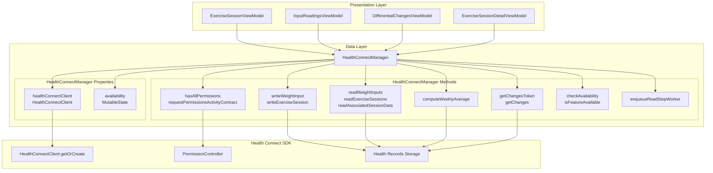
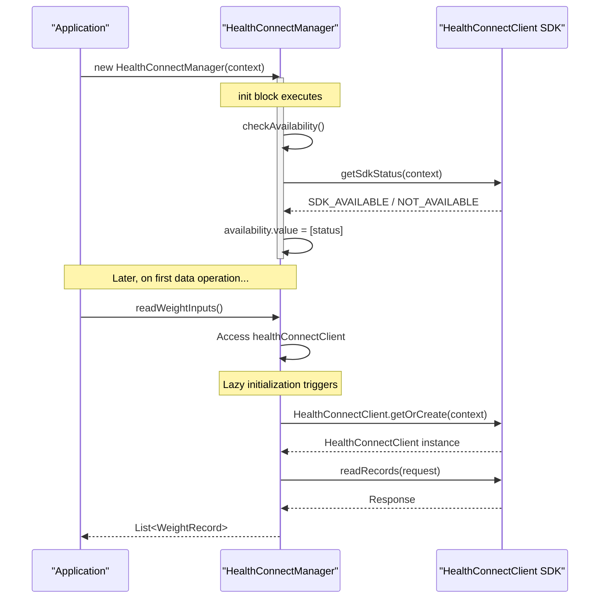
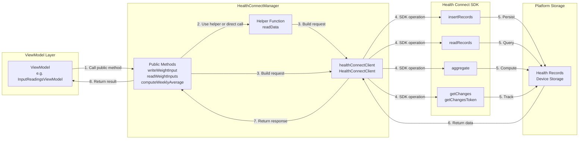
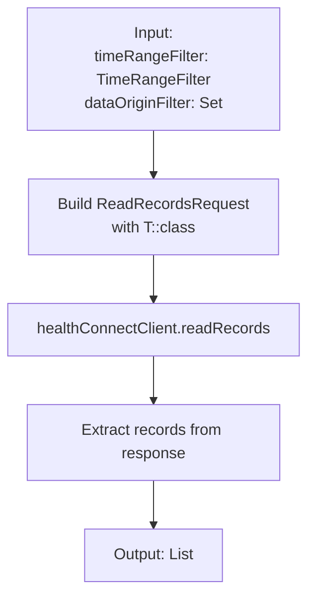
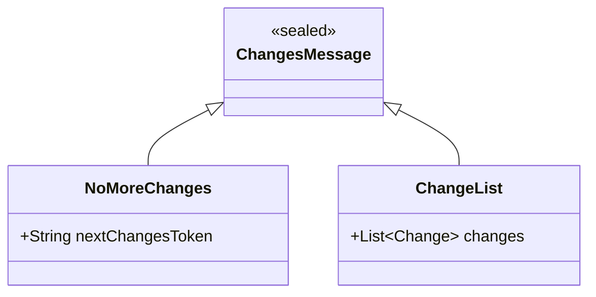
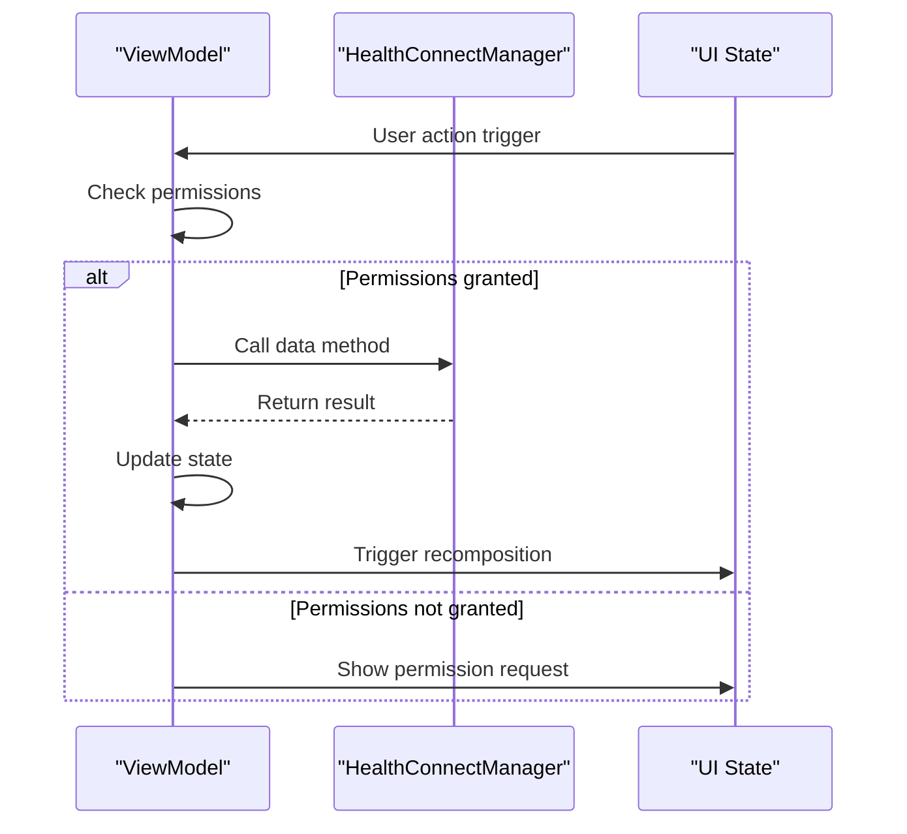

<!-- source: DeepWiki mcp.deepwiki.com · repo android/android-health-connect-codelab · page 5 Data Layer - HealthConnectManager · fetched 2026-10-23 -->

# Data Layer - HealthConnectManager

Relevant source files

The following files were used as context for generating this wiki page:

- [finished/src/main/java/com/example/healthconnect/codelab/data/HealthConnectManager.kt](finished/src/main/java/com/example/healthconnect/codelab/data/HealthConnectManager.kt)
- [start/src/main/java/com/example/healthconnect/codelab/data/HealthConnectManager.kt](start/src/main/java/com/example/healthconnect/codelab/data/HealthConnectManager.kt)

## Purpose and Scope

This document provides a comprehensive overview of the `HealthConnectManager` class, which serves as the central data access layer for all Health Connect operations in the codebase. The class acts as a facade that abstracts the complexity of the Android Health Connect SDK, providing a clean API for reading and writing health records, managing permissions, and tracking data changes.

For specific implementation details on subsystems, see:
- Health Connect availability checking: [Health Connect Availability](#5.1)
- Permission system details: [Permission Management](#5.2)
- Record type specifications: [Health Records and Data Types](#5.3)
- Reading patterns: [Reading Health Data](#5.4)
- Writing patterns: [Writing Health Data](#5.5)
- Aggregation logic: [Aggregations and Statistics](#5.6)
- Change tracking: [Differential Changes Tracking](#5.7)
- Background work: [Background Work with WorkManager](#5.8)

## Class Overview

The `HealthConnectManager` class is located at [start/src/main/java/com/example/healthconnect/codelab/data/HealthConnectManager.kt:60]() and [finished/src/main/java/com/example/healthconnect/codelab/data/HealthConnectManager.kt:59](). It is a single, non-singleton class instantiated with a `Context` parameter and serves as the sole interface between the application's ViewModels and the Health Connect platform.

**Diagram: HealthConnectManager Position in Application Architecture**

Sources: [start/src/main/java/com/example/healthconnect/codelab/data/HealthConnectManager.kt:60-202](), [finished/src/main/java/com/example/healthconnect/codelab/data/HealthConnectManager.kt:59-345]()

### Key Properties

| Property | Type | Visibility | Description |
|----------|------|------------|-------------|
| `context` | `Context` | `private` | Android Context for SDK interactions |
| `healthConnectClient` | `HealthConnectClient` | `private` | Lazy-initialized Health Connect client instance |
| `availability` | `MutableState<HealthConnectAvailability>` | `var` (private setter) | Observable state tracking Health Connect installation status |

Sources: [start/src/main/java/com/example/healthconnect/codelab/data/HealthConnectManager.kt:60-64](), [finished/src/main/java/com/example/healthconnect/codelab/data/HealthConnectManager.kt:59-63]()

## Initialization and Lifecycle

The `HealthConnectManager` initializes the `healthConnectClient` lazily using `HealthConnectClient.getOrCreate(context)` [start/src/main/java/com/example/healthconnect/codelab/data/HealthConnectManager.kt:61](). This lazy initialization ensures the client is only created when first accessed, optimizing startup performance.

During object construction, the `init` block immediately calls `checkAvailability()` to determine if Health Connect is installed on the device [start/src/main/java/com/example/healthconnect/codelab/data/HealthConnectManager.kt:66-68]().

**Diagram: HealthConnectManager Initialization and First Access Sequence**

Sources: [start/src/main/java/com/example/healthconnect/codelab/data/HealthConnectManager.kt:60-68](), [finished/src/main/java/com/example/healthconnect/codelab/data/HealthConnectManager.kt:59-67]()

## Core Responsibilities

The `HealthConnectManager` class encapsulates four primary responsibilities:

### 1. Availability and Feature Management

- **`checkAvailability()`** [start/src/main/java/com/example/healthconnect/codelab/data/HealthConnectManager.kt:70-76](): Determines if Health Connect is installed, supported, or unavailable on the device
- **`isFeatureAvailable(feature: Int)`** [start/src/main/java/com/example/healthconnect/codelab/data/HealthConnectManager.kt:78-82](): Checks if specific Health Connect features (like background read) are available

### 2. Permission Management

- **`hasAllPermissions(permissions: Set<String>)`** [start/src/main/java/com/example/healthconnect/codelab/data/HealthConnectManager.kt:90-92](): Verifies if all specified permissions are granted
- **`requestPermissionsActivityContract()`** [start/src/main/java/com/example/healthconnect/codelab/data/HealthConnectManager.kt:94-96](): Returns an `ActivityResultContract` for requesting Health Connect permissions

### 3. Data Operations (CRUD)

The manager provides methods for creating, reading, and aggregating health records across five record types: `WeightRecord`, `ExerciseSessionRecord`, `StepsRecord`, `HeartRateRecord`, and `TotalCaloriesBurnedRecord`.

### 4. Change Tracking and Synchronization

- **`getChangesToken()`**: Obtains a token for differential change tracking
- **`getChanges(token: String)`**: Retrieves incremental changes since the token was issued

Sources: [start/src/main/java/com/example/healthconnect/codelab/data/HealthConnectManager.kt:60-202]()

## Method Categories

The following table categorizes all public methods exposed by `HealthConnectManager`:

| Category | Method | Return Type | Purpose |
|----------|--------|-------------|---------|
| **Availability** | `checkAvailability()` | `Unit` | Updates availability state |
| | `isFeatureAvailable(feature: Int)` | `Boolean` | Checks specific feature support |
| **Permissions** | `hasAllPermissions(permissions: Set<String>)` | `Boolean` | Verifies permission grants |
| | `requestPermissionsActivityContract()` | `ActivityResultContract` | Returns permission request contract |
| **Weight Operations** | `writeWeightInput(weightInput: Double)` | `Unit` | Inserts weight measurement |
| | `readWeightInputs(start: Instant, end: Instant)` | `List<WeightRecord>` | Retrieves weight records |
| | `computeWeeklyAverage(start: Instant, end: Instant)` | `Mass?` | Calculates average weight |
| **Exercise Operations** | `readExerciseSessions(start: Instant, end: Instant)` | `List<ExerciseSessionRecord>` | Retrieves exercise sessions |
| | `writeExerciseSession(start: ZonedDateTime, end: ZonedDateTime)` | `Unit` | Inserts exercise session with associated data |
| | `readAssociatedSessionData(uid: String)` | `ExerciseSessionData` | Reads aggregated and raw session data |
| **Change Tracking** | `getChangesToken()` | `String` | Obtains changes token |
| | `getChanges(token: String)` | `Flow<ChangesMessage>` | Streams incremental changes |
| **Background Work** | `enqueueReadStepWorker()` | `Unit` | Schedules background step reading |

Sources: [start/src/main/java/com/example/healthconnect/codelab/data/HealthConnectManager.kt:70-178](), [finished/src/main/java/com/example/healthconnect/codelab/data/HealthConnectManager.kt:69-309]()

## Data Flow Architecture

**Diagram: Data Flow Through HealthConnectManager**

Sources: [start/src/main/java/com/example/healthconnect/codelab/data/HealthConnectManager.kt:60-202](), [finished/src/main/java/com/example/healthconnect/codelab/data/HealthConnectManager.kt:59-345]()

### Flow Description

1. **ViewModel Invocation**: A ViewModel calls a public method on `HealthConnectManager` (e.g., `readWeightInputs(start, end)`)
2. **Request Construction**: The method constructs appropriate request objects (`ReadRecordsRequest`, `AggregateRequest`, etc.)
3. **Client Delegation**: The request is passed to `healthConnectClient`
4. **SDK Interaction**: The SDK performs the operation (insert, read, aggregate, or change tracking)
5. **Platform Access**: The SDK interacts with the Health Connect platform storage
6. **Response Return**: Data flows back through the same layers
7. **Result Processing**: `HealthConnectManager` may transform the response before returning
8. **ViewModel Update**: The ViewModel receives the result and updates UI state

## Helper Functions

The `HealthConnectManager` includes private helper functions that reduce code duplication:

### `readData<T : Record>`

Located at [start/src/main/java/com/example/healthconnect/codelab/data/HealthConnectManager.kt:183-193]() and [finished/src/main/java/com/example/healthconnect/codelab/data/HealthConnectManager.kt:314-324](), this inline generic function provides a reusable pattern for reading any record type:

**Diagram: readData Helper Function Flow**

The function accepts two parameters:
- `timeRangeFilter`: Specifies the time window for records
- `dataOriginFilter`: Optional filter for specific data sources (defaults to empty set)

This helper is used internally by methods like `readAssociatedSessionData` to retrieve `HeartRateRecord` data with consistent filtering [finished/src/main/java/com/example/healthconnect/codelab/data/HealthConnectManager.kt:249]().

### `isSupported`

A simple private function [start/src/main/java/com/example/healthconnect/codelab/data/HealthConnectManager.kt:195]() that checks if the Android version is at least `O_MR1` (API 27), the minimum SDK required for Health Connect support.

Sources: [start/src/main/java/com/example/healthconnect/codelab/data/HealthConnectManager.kt:183-195](), [finished/src/main/java/com/example/healthconnect/codelab/data/HealthConnectManager.kt:314-326]()

## Supporting Data Structures

### HealthConnectAvailability Enum

Defined at [start/src/main/java/com/example/healthconnect/codelab/data/HealthConnectManager.kt:210-214](), this enum represents three possible states:

| State | Description |
|-------|-------------|
| `INSTALLED` | Health Connect APK is installed and available |
| `NOT_INSTALLED` | Device supports Health Connect but APK not installed |
| `NOT_SUPPORTED` | Device does not support Health Connect (Android version too old) |

### ChangesMessage Sealed Class

Located at [start/src/main/java/com/example/healthconnect/codelab/data/HealthConnectManager.kt:198-201](), this sealed class represents two message types in the changes flow:

**Diagram: ChangesMessage Type Hierarchy**

- **`NoMoreChanges`**: Signals that all changes have been retrieved; contains the token for the next sync
- **`ChangeList`**: Contains a batch of changes to process

Sources: [start/src/main/java/com/example/healthconnect/codelab/data/HealthConnectManager.kt:198-214](), [finished/src/main/java/com/example/healthconnect/codelab/data/HealthConnectManager.kt:329-345]()

## Implementation Pattern: Start vs Finished

The codebase maintains two parallel implementations:

### Start Module (Template)

The start module at [start/src/main/java/com/example/healthconnect/codelab/data/HealthConnectManager.kt]() contains TODO placeholders for student implementation. Key methods like `writeWeightInput` [start/src/main/java/com/example/healthconnect/codelab/data/HealthConnectManager.kt:101-103](), `readExerciseSessions` [start/src/main/java/com/example/healthconnect/codelab/data/HealthConnectManager.kt:124-127](), and `getChanges` [start/src/main/java/com/example/healthconnect/codelab/data/HealthConnectManager.kt:166-168]() show Toast messages and return empty/null values.

### Finished Module (Reference)

The finished module at [finished/src/main/java/com/example/healthconnect/codelab/data/HealthConnectManager.kt]() contains complete implementations. For example, `writeWeightInput` [finished/src/main/java/com/example/healthconnect/codelab/data/HealthConnectManager.kt:100-115]() creates a `WeightRecord` with proper metadata and inserts it, while `getChanges` [finished/src/main/java/com/example/healthconnect/codelab/data/HealthConnectManager.kt:283-299]() implements full token-based change retrieval with expiration handling.

Sources: [start/src/main/java/com/example/healthconnect/codelab/data/HealthConnectManager.kt:1-215](), [finished/src/main/java/com/example/healthconnect/codelab/data/HealthConnectManager.kt:1-346]()

## Usage Patterns

ViewModels interact with `HealthConnectManager` following consistent patterns:

**Diagram: Typical ViewModel-to-HealthConnectManager Interaction Pattern**

Example from `InputReadingsViewModel`:
1. User clicks "Enter Weight"
2. ViewModel checks `permissionsGranted` state
3. If granted, calls `healthConnectManager.writeWeightInput(weight)`
4. On success/error, updates `uiState` and `weightRecords` state
5. UI recomposes based on new state

The manager methods are all suspend functions, enabling ViewModels to call them from coroutines (typically `viewModelScope.launch`). Error handling is typically done at the ViewModel level, with exceptions caught and converted to UI error states.

Sources: [finished/src/main/java/com/example/healthconnect/codelab/data/HealthConnectManager.kt:59-345]()

## Integration with WorkManager

The `enqueueReadStepWorker()` method [start/src/main/java/com/example/healthconnect/codelab/data/HealthConnectManager.kt:173-178]() demonstrates integration with Android's WorkManager for background operations. It creates a `OneTimeWorkRequest` for `ReadStepWorker` with a 10-second initial delay and enqueues it using `WorkManager.getInstance(context)`.

This pattern allows health data reading to continue even when the app is not in the foreground, subject to proper permissions (background read permission). See [Background Work with WorkManager](#5.8) for detailed implementation.

Sources: [start/src/main/java/com/example/healthconnect/codelab/data/HealthConnectManager.kt:173-178](), [finished/src/main/java/com/example/healthconnect/codelab/data/HealthConnectManager.kt:304-309]()

---

