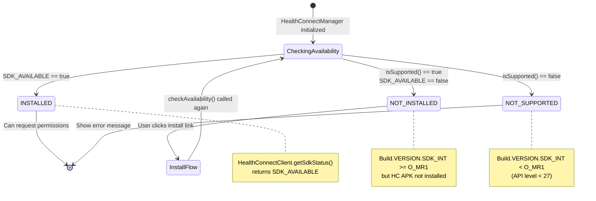
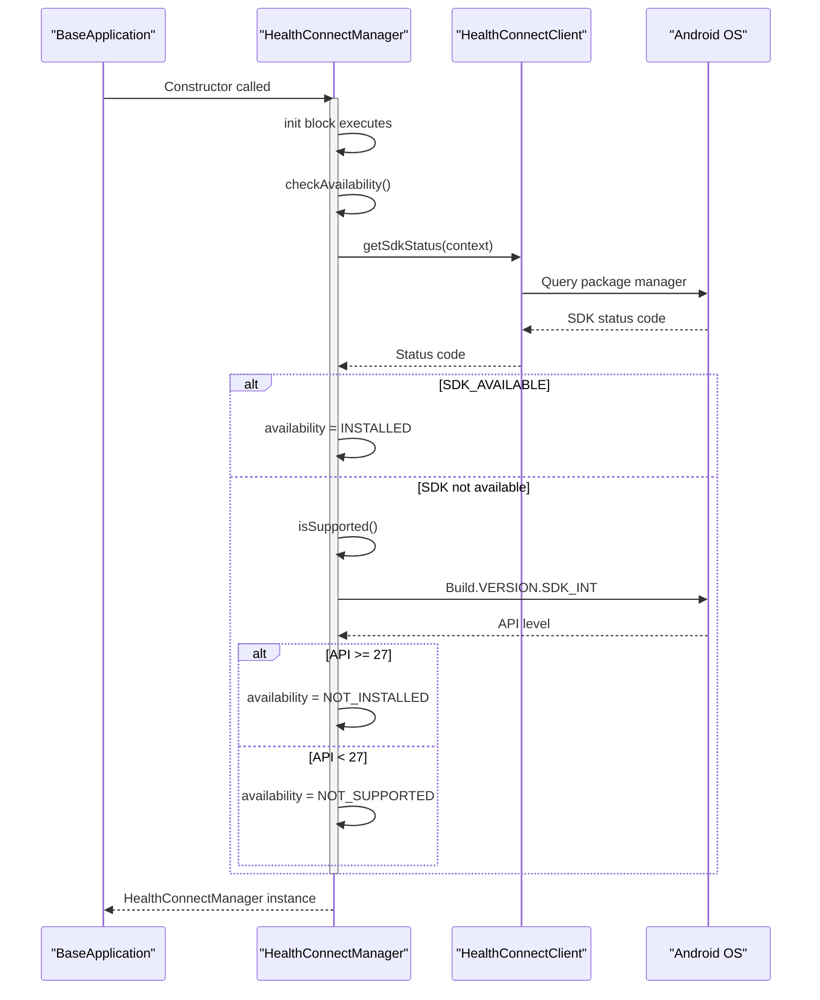
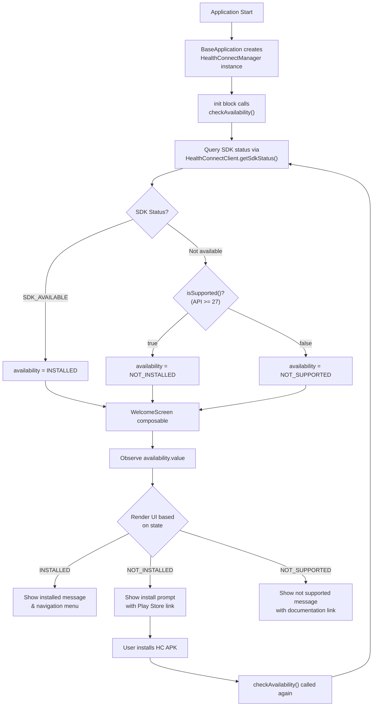

<!-- source: DeepWiki mcp.deepwiki.com · repo android/android-health-connect-codelab · page 5.1 Health Connect Availability · fetched 2026-10-23 -->

# Health Connect Availability

<details>
<summary>Relevant source files</summary>

The following files were used as context for generating this wiki page:

- [finished/src/main/java/com/example/healthconnect/codelab/data/HealthConnectManager.kt](finished/src/main/java/com/example/healthconnect/codelab/data/HealthConnectManager.kt)
- [finished/src/main/res/values/strings.xml](finished/src/main/res/values/strings.xml)
- [start/src/main/res/values/strings.xml](start/src/main/res/values/strings.xml)

</details>


## Purpose and Scope

This document describes how the application determines whether Health Connect is available on the device and manages the availability state throughout the application lifecycle. Health Connect availability checking is the first critical step before any health data operations can be performed.

For information about permission management after availability is confirmed, see [Permission Management](#5.2). For details on the actual data operations that require an available Health Connect instance, see [Reading Health Data](#5.4) and [Writing Health Data](#5.5).

---

## Overview

Health Connect is not guaranteed to be present on all Android devices. The application must handle three distinct availability scenarios before attempting any health data operations:

1. **Health Connect is installed and ready** - The app can proceed with permission requests and data operations
2. **Health Connect is supported but not installed** - The user must install the Health Connect APK from Google Play
3. **Health Connect is not supported** - The device's Android version is too old to support Health Connect

The `HealthConnectManager` class centralizes availability checking and exposes the current availability state as observable state that UI components can react to.

**Sources:** [finished/src/main/java/com/example/healthconnect/codelab/data/HealthConnectManager.kt:59-75]()

---

## Availability State Enumeration

The `HealthConnectAvailability` enum defines three mutually exclusive states:

| State | Description | User Action Required |
|-------|-------------|---------------------|
| `INSTALLED` | Health Connect APK is installed and available | None - app can request permissions |
| `NOT_INSTALLED` | Device supports Health Connect but APK is missing | Install Health Connect from Google Play |
| `NOT_SUPPORTED` | Android version is too old (< API 27) | Upgrade device OS or use different device |

```kotlin
enum class HealthConnectAvailability {
  INSTALLED,
  NOT_INSTALLED,
  NOT_SUPPORTED
}
```

The availability state is stored as a mutable state object in `HealthConnectManager`:

```kotlin
var availability = mutableStateOf(HealthConnectAvailability.NOT_SUPPORTED)
  private set
```

This allows Jetpack Compose UI components to automatically recompose when availability changes.

**Sources:** [finished/src/main/java/com/example/healthconnect/codelab/data/HealthConnectManager.kt:341-345](), [finished/src/main/java/com/example/healthconnect/codelab/data/HealthConnectManager.kt:62-63]()

---

## Availability State Machine



**Sources:** [finished/src/main/java/com/example/healthconnect/codelab/data/HealthConnectManager.kt:65-75]()

---

## Availability Checking Implementation

### Initialization

The `HealthConnectManager` checks availability immediately upon instantiation via an `init` block:

```kotlin
init {
  checkAvailability()
}
```

This ensures the availability state is set before any UI components attempt to interact with Health Connect.

**Sources:** [finished/src/main/java/com/example/healthconnect/codelab/data/HealthConnectManager.kt:65-67]()

### The checkAvailability() Method

The `checkAvailability()` function implements a hierarchical checking strategy:

```kotlin
fun checkAvailability() {
  availability.value = when {
    HealthConnectClient.getSdkStatus(context) == SDK_AVAILABLE -> HealthConnectAvailability.INSTALLED
    isSupported() -> HealthConnectAvailability.NOT_INSTALLED
    else -> HealthConnectAvailability.NOT_SUPPORTED
  }
}
```

**Checking Logic:**

1. **First Priority - SDK Available Check**: Calls `HealthConnectClient.getSdkStatus(context)` and compares the result to `SDK_AVAILABLE` constant. If true, Health Connect is ready to use.

2. **Second Priority - Support Check**: If SDK is not available, calls `isSupported()` to determine if the device's Android version meets minimum requirements. If true, Health Connect is supported but the user needs to install the APK.

3. **Fallback - Not Supported**: If neither condition is met, the device cannot run Health Connect at all.

**Sources:** [finished/src/main/java/com/example/healthconnect/codelab/data/HealthConnectManager.kt:69-75]()

### Minimum SDK Requirement

The minimum supported Android version is defined as a constant:

```kotlin
const val MIN_SUPPORTED_SDK = Build.VERSION_CODES.O_MR1
```

`Build.VERSION_CODES.O_MR1` corresponds to API level 27 (Android 8.1 Oreo MR1). The `isSupported()` helper function performs the version check:

```kotlin
private fun isSupported() = Build.VERSION.SDK_INT >= MIN_SUPPORTED_SDK
```

**Sources:** [finished/src/main/java/com/example/healthconnect/codelab/data/HealthConnectManager.kt:54](), [finished/src/main/java/com/example/healthconnect/codelab/data/HealthConnectManager.kt:326]()

---

## Availability Checking Sequence



**Sources:** [finished/src/main/java/com/example/healthconnect/codelab/data/HealthConnectManager.kt:59-75]()

---

## Feature Availability Checking

Beyond basic Health Connect availability, certain features may not be available even when Health Connect is installed. The `isFeatureAvailable()` method checks for specific feature support:

```kotlin
fun isFeatureAvailable(feature: Int): Boolean{
  return healthConnectClient
    .features
    .getFeatureStatus(feature) == HealthConnectFeatures.FEATURE_STATUS_AVAILABLE
}
```

This method queries the `HealthConnectClient.features` API to determine if a specific feature (identified by an integer constant) has status `FEATURE_STATUS_AVAILABLE`.

### Common Feature Checks

The application uses this method to check for features like:

- **Background Read Permission**: Allows reading health data when the app is in the background
- **History Read Permission**: Enables access to historical health data

UI components conditionally enable or disable buttons based on feature availability:

```
if (isFeatureAvailable(HealthConnectFeatures.FEATURE_READ_HEALTH_DATA_IN_BACKGROUND)) {
  // Show "Request Background Read" button
} else {
  // Show "Background Read is not available" message
}
```

**Sources:** [finished/src/main/java/com/example/healthconnect/codelab/data/HealthConnectManager.kt:77-81]()

---

## UI Integration and User Feedback

### String Resources for Availability States

The application defines string resources for each availability state to provide appropriate user feedback:

#### NOT_INSTALLED State

```xml
<string name="not_installed_description">
  Health Connect is supported on this device, but is not currently installed.
</string>
<string name="not_installed_link_text">
  To use this sample, and other apps using Health Connect, please install the Health Connect
  package from Google Play.
</string>
```

These strings guide users to install the Health Connect APK from Google Play using the package identifier:

```xml
<string name="health_connect_package">com.google.android.apps.healthdata</string>
<string name="market_url">market://details</string>
```

#### NOT_SUPPORTED State

```xml
<string name="not_supported_description">
  Health Connect is only supported on Android devices running API level %1$d or above.
</string>
<string name="not_supported_link_text">
  Please visit the Health Connect guides to learn more about device compatibility and using
  Health Connect.
</string>
```

The `%1$d` placeholder is formatted with `MIN_SUPPORTED_SDK` value (27) at runtime.

#### INSTALLED State

```xml
<string name="installed_welcome_message">
  Health Connect is installed on this device. Use the menu to explore the sample, with each
  screen demonstrating a different aspect of Health Connect functionality.
</string>
```

**Sources:** [finished/src/main/res/values/strings.xml:46-63](), [finished/src/main/res/values/strings.xml:28-31]()

---

## Availability State Flow in Application Lifecycle



**Sources:** [finished/src/main/java/com/example/healthconnect/codelab/data/HealthConnectManager.kt:59-75]()

---

## Lazy Initialization of HealthConnectClient

The `HealthConnectManager` uses lazy initialization for the `HealthConnectClient` instance:

```kotlin
private val healthConnectClient by lazy { HealthConnectClient.getOrCreate(context) }
```

This ensures that:

1. The client is only created when first accessed
2. Subsequent accesses reuse the same instance
3. No client creation overhead occurs if availability checking determines Health Connect is not supported

The `HealthConnectClient.getOrCreate()` factory method handles retrieving or instantiating the singleton client for the given context.

**Sources:** [finished/src/main/java/com/example/healthconnect/codelab/data/HealthConnectManager.kt:60]()

---

## Key Implementation Details

### State Exposure Pattern

The `availability` property uses a common Kotlin pattern for exposing mutable state:

```kotlin
var availability = mutableStateOf(HealthConnectAvailability.NOT_SUPPORTED)
  private set
```

- **Public getter**: UI components can read the current value and observe changes
- **Private setter**: Only `HealthConnectManager` can modify the state, preventing external corruption

This ensures unidirectional data flow where the manager is the single source of truth for availability state.

### Re-checking Availability

The `checkAvailability()` method is public, allowing the application to re-check availability after the user installs Health Connect:

```kotlin
// User returns from Play Store after installing HC
healthConnectManager.checkAvailability()
// availability.value updates automatically, triggering UI recomposition
```

**Sources:** [finished/src/main/java/com/example/healthconnect/codelab/data/HealthConnectManager.kt:62-63](), [finished/src/main/java/com/example/healthconnect/codelab/data/HealthConnectManager.kt:69-75]()

---

## Summary

The Health Connect availability system provides a robust, three-state model that handles device compatibility and APK installation status. The key components are:

| Component | File | Purpose |
|-----------|------|---------|
| `HealthConnectAvailability` enum | [HealthConnectManager.kt:341-345]() | Defines three availability states |
| `MIN_SUPPORTED_SDK` constant | [HealthConnectManager.kt:54]() | Specifies minimum Android API level (27) |
| `availability` property | [HealthConnectManager.kt:62-63]() | Observable state for UI components |
| `checkAvailability()` method | [HealthConnectManager.kt:69-75]() | Determines current availability state |
| `isSupported()` method | [HealthConnectManager.kt:326]() | Checks Android version compatibility |
| `isFeatureAvailable()` method | [HealthConnectManager.kt:77-81]() | Checks for specific HC feature support |

This architecture ensures that the application gracefully handles all device scenarios before attempting any health data operations, providing clear user feedback and actionable next steps in each case.

**Sources:** [finished/src/main/java/com/example/healthconnect/codelab/data/HealthConnectManager.kt:54-82](), [finished/src/main/java/com/example/healthconnect/codelab/data/HealthConnectManager.kt:326](), [finished/src/main/java/com/example/healthconnect/codelab/data/HealthConnectManager.kt:341-345]()

---

