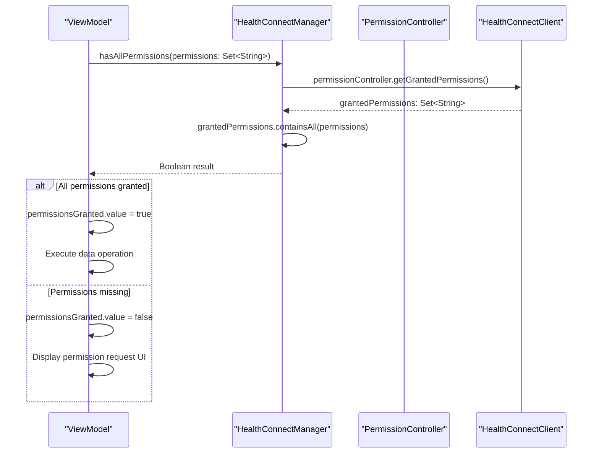
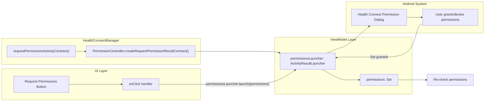
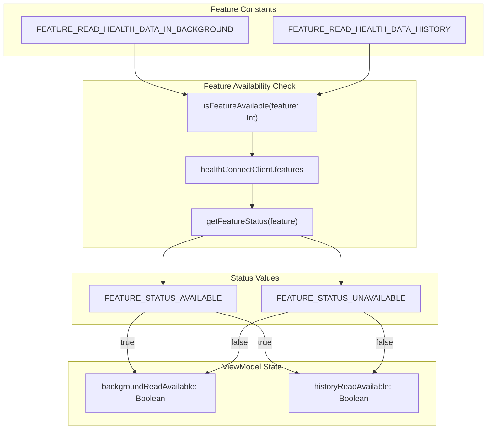
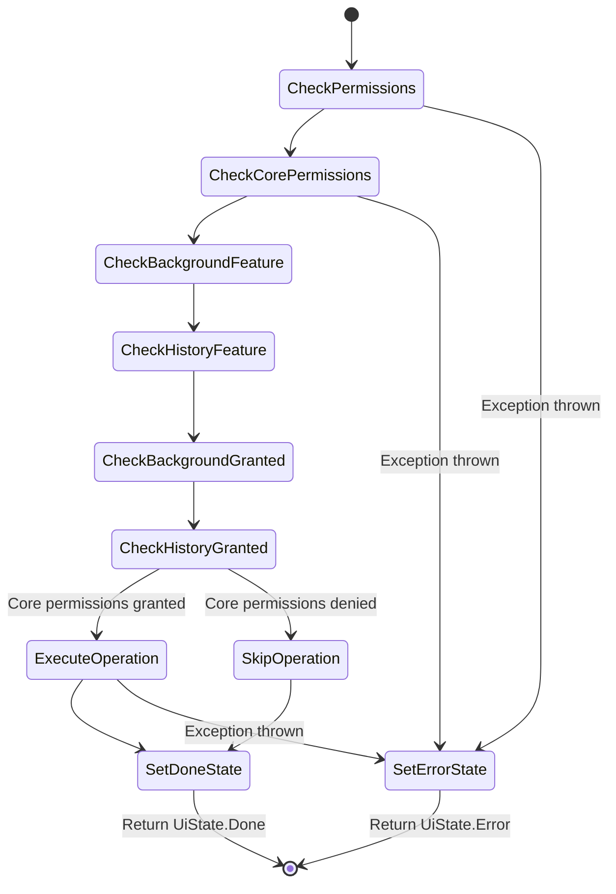
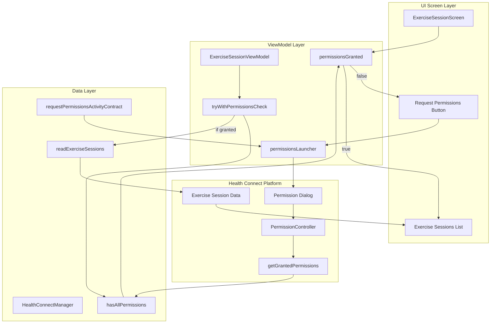

<!-- source: DeepWiki mcp.deepwiki.com · repo android/android-health-connect-codelab · page 5.2 Permission Management · fetched 2026-10-23 -->

# Permission Management

Relevant source files

The following files were used as context for generating this wiki page:

- [finished/src/main/AndroidManifest.xml](finished/src/main/AndroidManifest.xml)
- [finished/src/main/java/com/example/healthconnect/codelab/data/HealthConnectManager.kt](finished/src/main/java/com/example/healthconnect/codelab/data/HealthConnectManager.kt)
- [finished/src/main/java/com/example/healthconnect/codelab/presentation/screen/exercisesession/ExerciseSessionViewModel.kt](finished/src/main/java/com/example/healthconnect/codelab/presentation/screen/exercisesession/ExerciseSessionViewModel.kt)

## Purpose and Scope

This document details the permission management system used throughout the Health Connect codelab to control access to health data. The system implements a three-tier permission model with runtime permission checks, feature availability detection, and integration with Android's permission framework.

For information about how permissions integrate with the Health Connect platform availability, see [Health Connect Availability](#5.1). For details on the specific health record types that require permissions, see [Health Records and Data Types](#5.3).

---

## Three-Tier Permission Model

The codelab implements three distinct permission tiers to handle different access scenarios:

```mermaid
graph TB
    subgraph "Permission Tiers"
        subgraph "Tier 1: Core Permissions"
            ExerciseR["ExerciseSessionRecord READ"]
            ExerciseW["ExerciseSessionRecord WRITE"]
            StepsR["StepsRecord READ"]
            StepsW["StepsRecord WRITE"]
            CaloriesW["TotalCaloriesBurnedRecord WRITE"]
            HeartRateW["HeartRateRecord WRITE"]
        end
        
        subgraph "Tier 2: Background Read"
            BgRead["READ_HEALTH_DATA_IN_BACKGROUND"]
        end
        
        subgraph "Tier 3: History Read"
            HistRead["READ_HEALTH_DATA_HISTORY"]
        end
    end
    
    subgraph "Feature Availability Check"
        BgFeature["HealthConnectFeatures.FEATURE_READ_HEALTH_DATA_IN_BACKGROUND"]
        HistFeature["HealthConnectFeatures.FEATURE_READ_HEALTH_DATA_HISTORY"]
    end
    
    BgRead -.->|"requires"| BgFeature
    HistRead -.->|"requires"| HistFeature
    
    subgraph "ViewModel State Management"
        CoreState["permissionsGranted: MutableState<Boolean>"]
        BgAvailable["backgroundReadAvailable: MutableState<Boolean>"]
        BgGranted["backgroundReadGranted: MutableState<Boolean>"]
        HistAvailable["historyReadAvailable: MutableState<Boolean>"]
        HistGranted["historyReadGranted: MutableState<Boolean>"]
    end
    
    ExerciseR --> CoreState
    ExerciseW --> CoreState
    StepsR --> CoreState
    StepsW --> CoreState
    CaloriesW --> CoreState
    HeartRateW --> CoreState
    
    BgFeature --> BgAvailable
    BgRead --> BgGranted
    HistFeature --> HistAvailable
    HistRead --> HistGranted
```

**Tier 1: Core Permissions** are required for basic data operations. The `ExerciseSessionViewModel` defines a set of core permissions that must all be granted before any health data operations can proceed:

[finished/src/main/java/com/example/healthconnect/codelab/presentation/screen/exercisesession/ExerciseSessionViewModel.kt:46-54]()

These permissions cover reading and writing exercise sessions, steps, calories, and heart rate data.

**Tier 2: Background Read Permission** allows the application to read health data when running in the background via WorkManager:

[finished/src/main/java/com/example/healthconnect/codelab/presentation/screen/exercisesession/ExerciseSessionViewModel.kt:56]()

**Tier 3: History Read Permission** allows access to historical health data beyond the default time window:

[finished/src/main/java/com/example/healthconnect/codelab/presentation/screen/exercisesession/ExerciseSessionViewModel.kt:57]()

**Sources:** [finished/src/main/java/com/example/healthconnect/codelab/presentation/screen/exercisesession/ExerciseSessionViewModel.kt:46-57]()

---

## Permission Declaration in Manifest

All Health Connect permissions must be declared in the AndroidManifest.xml before they can be requested at runtime. The codelab declares twelve distinct health permissions:

| Permission | Purpose |
|------------|---------|
| `android.permission.health.READ_HEART_RATE` | Read heart rate records |
| `android.permission.health.WRITE_HEART_RATE` | Write heart rate records |
| `android.permission.health.READ_STEPS` | Read step count records |
| `android.permission.health.WRITE_STEPS` | Write step count records |
| `android.permission.health.READ_EXERCISE` | Read exercise session records |
| `android.permission.health.WRITE_EXERCISE` | Write exercise session records |
| `android.permission.health.READ_TOTAL_CALORIES_BURNED` | Read calorie burn records |
| `android.permission.health.WRITE_TOTAL_CALORIES_BURNED` | Write calorie burn records |
| `android.permission.health.READ_WEIGHT` | Read weight records |
| `android.permission.health.WRITE_WEIGHT` | Write weight records |
| `android.permission.health.READ_HEALTH_DATA_IN_BACKGROUND` | Background data access |
| `android.permission.health.READ_HEALTH_DATA_HISTORY` | Historical data access |

[finished/src/main/AndroidManifest.xml:16-27]()

**Sources:** [finished/src/main/AndroidManifest.xml:16-27]()

---

## Permission Checking Flow

The permission checking flow determines whether the application has the necessary permissions before attempting health data operations.

The `HealthConnectManager.hasAllPermissions` method is the central permission checking function:

[finished/src/main/java/com/example/healthconnect/codelab/data/HealthConnectManager.kt:89-91]()

This method delegates to `PermissionController.getGrantedPermissions()`, which queries the Health Connect platform for currently granted permissions. The method returns `true` only if all requested permissions are present in the granted set.

ViewModels call this method within a `tryWithPermissionsCheck` wrapper that performs permission checks before executing data operations:

[finished/src/main/java/com/example/healthconnect/codelab/presentation/screen/exercisesession/ExerciseSessionViewModel.kt:130-154]()

The wrapper function performs multiple permission checks:
1. Core permissions (line 131)
2. Background read feature availability (lines 132-134)
3. History read feature availability (lines 135-137)
4. Background read permission grant status (line 138)
5. History read permission grant status (line 139)

If all core permissions are granted, the `block` lambda executes (line 142). Otherwise, the operation is skipped and the UI state updates to reflect the missing permissions.

**Sources:** [finished/src/main/java/com/example/healthconnect/codelab/data/HealthConnectManager.kt:89-91](), [finished/src/main/java/com/example/healthconnect/codelab/presentation/screen/exercisesession/ExerciseSessionViewModel.kt:130-154]()

---

## Permission Request Flow

When permissions are not granted, the application must request them using Android's `ActivityResultContract` pattern.

The `HealthConnectManager` provides an `ActivityResultContract` for permission requests:

[finished/src/main/java/com/example/healthconnect/codelab/data/HealthConnectManager.kt:93-95]()

This method returns the contract created by `PermissionController.createRequestPermissionResultContract()`, which is specifically designed for Health Connect permissions.

ViewModels initialize a launcher with this contract:

[finished/src/main/java/com/example/healthconnect/codelab/presentation/screen/exercisesession/ExerciseSessionViewModel.kt:80]()

The UI layer invokes the launcher when the user clicks a "Request Permissions" button, passing the required permission set. The Android system displays a Health Connect permission dialog, and the result flows back to the launcher, triggering a re-check of permission state.

**Sources:** [finished/src/main/java/com/example/healthconnect/codelab/data/HealthConnectManager.kt:93-95](), [finished/src/main/java/com/example/healthconnect/codelab/presentation/screen/exercisesession/ExerciseSessionViewModel.kt:80]()

---

## Feature Availability Detection

Some permission tiers (background read and history read) are only available on devices with specific Health Connect platform capabilities. The application must check feature availability before requesting or using these permissions.

The `HealthConnectManager.isFeatureAvailable` method queries the Health Connect client for feature support:

[finished/src/main/java/com/example/healthconnect/codelab/data/HealthConnectManager.kt:77-81]()

ViewModels call this method to determine whether background read and history read features are available:

[finished/src/main/java/com/example/healthconnect/codelab/presentation/screen/exercisesession/ExerciseSessionViewModel.kt:132-137]()

The availability state is stored in `MutableState` properties:

[finished/src/main/java/com/example/healthconnect/codelab/presentation/screen/exercisesession/ExerciseSessionViewModel.kt:62-72]()

These state properties control UI visibility. If a feature is not available, the UI hides or disables the corresponding permission request button, preventing users from attempting to request unavailable permissions.

**Sources:** [finished/src/main/java/com/example/healthconnect/codelab/data/HealthConnectManager.kt:77-81](), [finished/src/main/java/com/example/healthconnect/codelab/presentation/screen/exercisesession/ExerciseSessionViewModel.kt:62-72](), [finished/src/main/java/com/example/healthconnect/codelab/presentation/screen/exercisesession/ExerciseSessionViewModel.kt:132-137]()

---

## Permission State Management in ViewModels

ViewModels maintain five distinct state properties to track permission status:

| State Property | Type | Purpose |
|----------------|------|---------|
| `permissionsGranted` | `MutableState<Boolean>` | Whether all core permissions are granted |
| `backgroundReadAvailable` | `MutableState<Boolean>` | Whether background read feature is supported |
| `backgroundReadGranted` | `MutableState<Boolean>` | Whether background read permission is granted |
| `historyReadAvailable` | `MutableState<Boolean>` | Whether history read feature is supported |
| `historyReadGranted` | `MutableState<Boolean>` | Whether history read permission is granted |

[finished/src/main/java/com/example/healthconnect/codelab/presentation/screen/exercisesession/ExerciseSessionViewModel.kt:59-72]()

The `tryWithPermissionsCheck` wrapper function updates all five state properties before executing any data operation:

The permission check sequence:
1. Call `hasAllPermissions(permissions)` to check core permissions (line 131)
2. Call `isFeatureAvailable` for background read feature (lines 132-134)
3. Call `isFeatureAvailable` for history read feature (lines 135-137)
4. Call `hasAllPermissions` for background read permission (line 138)
5. Call `hasAllPermissions` for history read permission (line 139)
6. If core permissions granted, execute the `block` lambda (line 142)
7. Return `UiState.Done` or catch exceptions and return `UiState.Error` (lines 145-153)

This pattern ensures that ViewModels never attempt health data operations without proper permissions, while simultaneously maintaining accurate UI state for conditional rendering.

**Sources:** [finished/src/main/java/com/example/healthconnect/codelab/presentation/screen/exercisesession/ExerciseSessionViewModel.kt:59-72](), [finished/src/main/java/com/example/healthconnect/codelab/presentation/screen/exercisesession/ExerciseSessionViewModel.kt:130-154]()

---

## Permission Rationale Intent Filters

Android requires applications to provide permission rationale deep links that allow users to navigate from Health Connect settings back to the application. The manifest declares two intent filters to handle different Android versions:

**Android 13 and below:**

[finished/src/main/AndroidManifest.xml:48-50]()

This intent filter handles the `androidx.health.ACTION_SHOW_PERMISSIONS_RATIONALE` action, which Health Connect uses on Android 13 and earlier to request permission rationale explanations.

**Android 14 and above:**

[finished/src/main/AndroidManifest.xml:53-56]()

Starting with Android 14, the system uses the standardized `android.intent.action.VIEW_PERMISSION_USAGE` action with the `android.intent.category.HEALTH_PERMISSIONS` category for permission management deep linking.

When a user navigates to permission settings in Health Connect and selects the application, these intent filters ensure that the system launches the application's main activity, where the user can view permission rationale and request permissions.

**Sources:** [finished/src/main/AndroidManifest.xml:48-56]()

---

## Permission and Data Operation Integration

The following diagram illustrates how permission management integrates with data operations across the application layers:

Key integration points:

1. **UI Conditional Rendering**: Screens observe `permissionsGranted` state to determine whether to display permission request buttons or data content.

2. **Permission-Gated Operations**: All data operations (like `insertExerciseSession` at lines 90-107 or `initialLoad` at lines 82-88) are wrapped in `tryWithPermissionsCheck`, ensuring permission checks occur before each operation.

3. **Permission Request Flow**: The UI triggers the `permissionsLauncher` with the required permission set, which launches the system dialog. Results flow back through the launcher callback, triggering a state update.

4. **Automatic Re-check**: After permission requests complete, ViewModels automatically re-check permission status and execute previously-blocked operations if permissions were granted.

**Sources:** [finished/src/main/java/com/example/healthconnect/codelab/presentation/screen/exercisesession/ExerciseSessionViewModel.kt:82-107](), [finished/src/main/java/com/example/healthconnect/codelab/presentation/screen/exercisesession/ExerciseSessionViewModel.kt:130-154](), [finished/src/main/java/com/example/healthconnect/codelab/data/HealthConnectManager.kt:89-95]()

---

