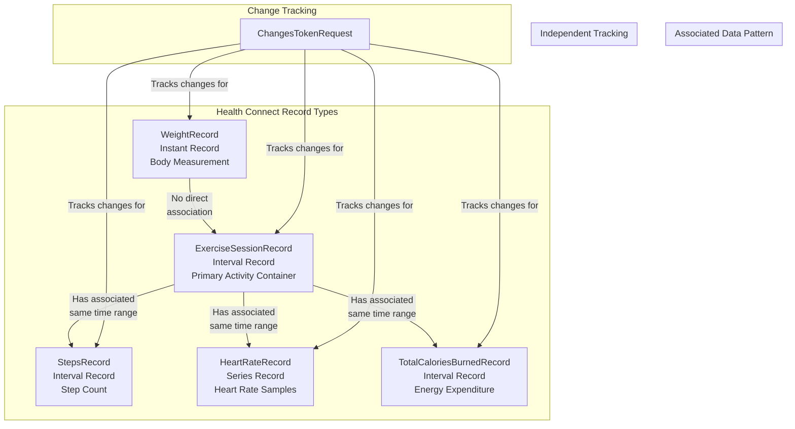
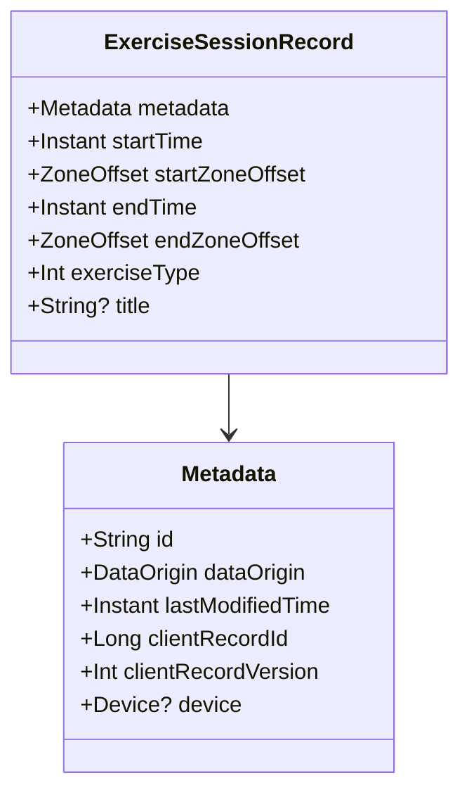
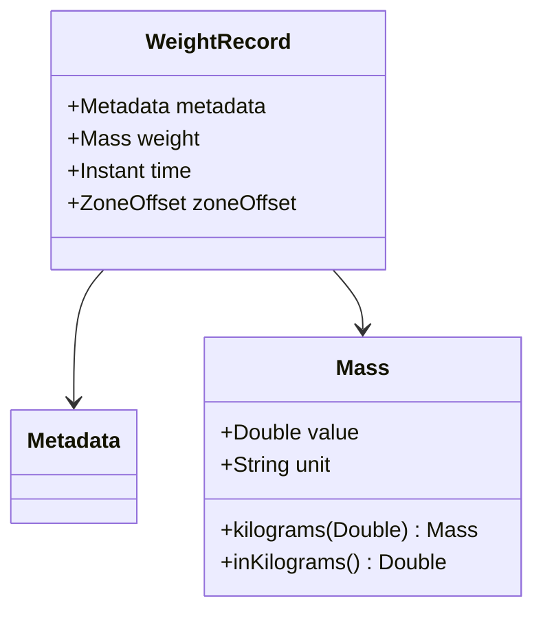
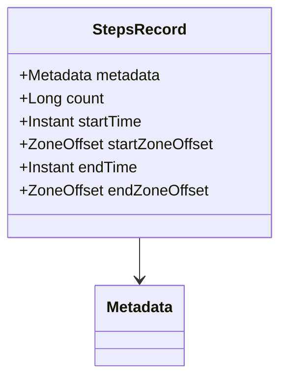
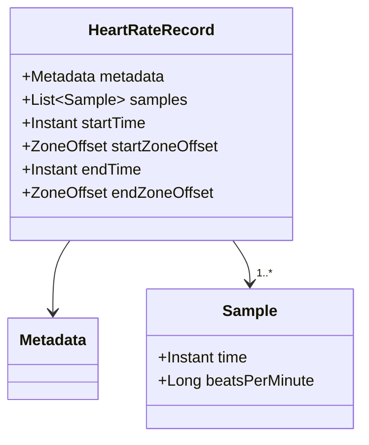
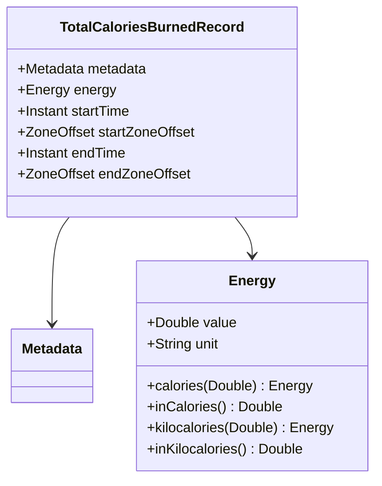
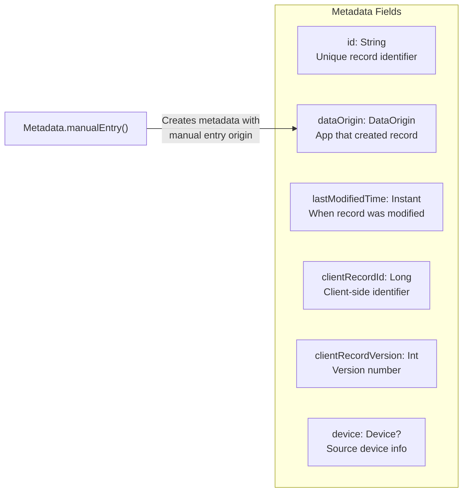
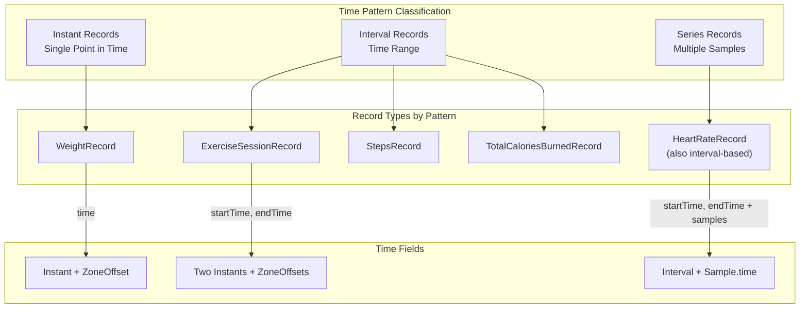
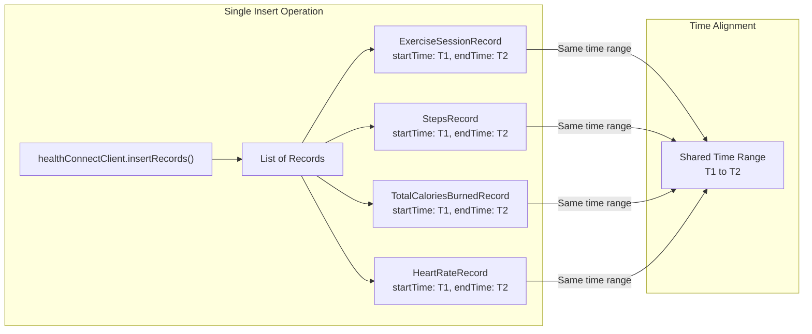

<!-- source: DeepWiki mcp.deepwiki.com · repo android/android-health-connect-codelab · page 5.3 Health Records and Data Types · fetched 2026-10-23 -->

# Health Records and Data Types

Relevant source files

The following files were used as context for generating this wiki page:

- [finished/src/main/java/com/example/healthconnect/codelab/data/HealthConnectManager.kt](finished/src/main/java/com/example/healthconnect/codelab/data/HealthConnectManager.kt)
- [finished/src/main/res/values/strings.xml](finished/src/main/res/values/strings.xml)
- [start/src/main/res/values/strings.xml](start/src/main/res/values/strings.xml)

## Purpose and Scope

This page documents the five Health Connect record types used in this codelab application: `ExerciseSessionRecord`, `WeightRecord`, `StepsRecord`, `HeartRateRecord`, and `TotalCaloriesBurnedRecord`. It covers their structure, fields, metadata properties, and relationships to each other.

For information about reading these records from Health Connect, see [Reading Health Data](#5.4). For writing records, see [Writing Health Data](#5.5). For aggregating data across records, see [Aggregations and Statistics](#5.6).

---

## Record Types Overview

The codelab uses five distinct Health Connect record types, each representing a different category of health data:

| Record Type | Purpose | Time Representation | Key Fields |
|-------------|---------|---------------------|------------|
| `ExerciseSessionRecord` | Represents a period of physical activity | Interval (start/end time) | `exerciseType`, `title`, `startTime`, `endTime` |
| `WeightRecord` | Captures body weight measurements | Instant (single point in time) | `weight` (Mass), `time` |
| `StepsRecord` | Tracks step count over a period | Interval (start/end time) | `count`, `startTime`, `endTime` |
| `HeartRateRecord` | Records heart rate measurements | Interval with samples | `samples` (list of Sample objects), `startTime`, `endTime` |
| `TotalCaloriesBurnedRecord` | Tracks total energy expenditure | Interval (start/end time) | `energy` (Energy), `startTime`, `endTime` |

Sources: [finished/src/main/java/com/example/healthconnect/codelab/data/HealthConnectManager.kt:28-33]()

---

## Record Type Relationships

The following diagram shows how these record types relate to each other and which types can be associated together:

**Diagram: Record Type Relationships and Associations**

Sources: [finished/src/main/java/com/example/healthconnect/codelab/data/HealthConnectManager.kt:159-189](), [finished/src/main/java/com/example/healthconnect/codelab/data/HealthConnectManager.kt:222-261](), [finished/src/main/java/com/example/healthconnect/codelab/data/HealthConnectManager.kt:266-278]()

---

## ExerciseSessionRecord

`ExerciseSessionRecord` represents a conceptual period of physical activity. It is an interval record with start and end times.

### Structure

**Diagram: ExerciseSessionRecord Structure**

### Key Fields

- **`metadata`**: Contains record identification and provenance information (see Metadata section)
- **`startTime`** / **`endTime`**: The time range of the exercise session as `Instant` objects
- **`startZoneOffset`** / **`endZoneOffset`**: Time zone offsets as `ZoneOffset` for proper local time interpretation
- **`exerciseType`**: Integer constant identifying the type of exercise (e.g., `EXERCISE_TYPE_RUNNING`)
- **`title`**: Optional string title for the session (e.g., "Morning Run #5")

### Usage in Codebase

The codelab writes `ExerciseSessionRecord` with randomly generated titles and the running exercise type:

[finished/src/main/java/com/example/healthconnect/codelab/data/HealthConnectManager.kt:162-169]()

Exercise sessions are read using time range filters:

[finished/src/main/java/com/example/healthconnect/codelab/data/HealthConnectManager.kt:147-154]()

Sources: [finished/src/main/java/com/example/healthconnect/codelab/data/HealthConnectManager.kt:28](), [finished/src/main/java/com/example/healthconnect/codelab/data/HealthConnectManager.kt:159-189]()

---

## WeightRecord

`WeightRecord` captures a body weight measurement at a specific point in time. It is an instant record.

### Structure

**Diagram: WeightRecord Structure**

### Key Fields

- **`metadata`**: Standard metadata for the record
- **`weight`**: The body weight as a `Mass` object, typically created using `Mass.kilograms(Double)`
- **`time`**: The instant when the measurement was taken
- **`zoneOffset`**: Time zone offset for the measurement

### Usage in Codebase

Writing a weight record:

[finished/src/main/java/com/example/healthconnect/codelab/data/HealthConnectManager.kt:100-115]()

Reading weight records within a time range:

[finished/src/main/java/com/example/healthconnect/codelab/data/HealthConnectManager.kt:120-127]()

Computing weekly average weight:

[finished/src/main/java/com/example/healthconnect/codelab/data/HealthConnectManager.kt:132-139]()

Sources: [finished/src/main/java/com/example/healthconnect/codelab/data/HealthConnectManager.kt:33](), [finished/src/main/java/com/example/healthconnect/codelab/data/HealthConnectManager.kt:100-139]()

---

## StepsRecord

`StepsRecord` tracks the number of steps taken during a time interval. It is an interval record.

### Structure

**Diagram: StepsRecord Structure**

### Key Fields

- **`metadata`**: Standard metadata for the record
- **`count`**: The total number of steps as a `Long` value
- **`startTime`** / **`endTime`**: The time interval during which steps were counted
- **`startZoneOffset`** / **`endZoneOffset`**: Time zone offsets

### Usage in Codebase

`StepsRecord` is written alongside `ExerciseSessionRecord` with randomly generated step counts:

[finished/src/main/java/com/example/healthconnect/codelab/data/HealthConnectManager.kt:171-178]()

It is also read in the background by `ReadStepWorker` for background data synchronization.

Sources: [finished/src/main/java/com/example/healthconnect/codelab/data/HealthConnectManager.kt:31](), [finished/src/main/java/com/example/healthconnect/codelab/data/HealthConnectManager.kt:171-178]()

---

## HeartRateRecord

`HeartRateRecord` represents heart rate measurements over a time interval, stored as a series of samples. It is a series record.

### Structure

**Diagram: HeartRateRecord Structure**

### Key Fields

- **`metadata`**: Standard metadata for the record
- **`samples`**: A list of `HeartRateRecord.Sample` objects, each containing:
  - `time`: The instant of the measurement
  - `beatsPerMinute`: The heart rate value as `Long`
- **`startTime`** / **`endTime`**: The overall time range covered by all samples
- **`startZoneOffset`** / **`endZoneOffset`**: Time zone offsets

### Sample Generation Pattern

The codelab generates heart rate samples at 30-second intervals:

[finished/src/main/java/com/example/healthconnect/codelab/data/HealthConnectManager.kt:194-217]()

This pattern creates synthetic heart rate data ranging from 80 to 160 BPM, with samples every 30 seconds throughout the exercise session duration.

Sources: [finished/src/main/java/com/example/healthconnect/codelab/data/HealthConnectManager.kt:29](), [finished/src/main/java/com/example/healthconnect/codelab/data/HealthConnectManager.kt:194-217]()

---

## TotalCaloriesBurnedRecord

`TotalCaloriesBurnedRecord` tracks total energy expenditure during a time interval. It is an interval record.

### Structure

**Diagram: TotalCaloriesBurnedRecord Structure**

### Key Fields

- **`metadata`**: Standard metadata for the record
- **`energy`**: The total energy burned as an `Energy` object, created using `Energy.calories(Double)` or `Energy.kilocalories(Double)`
- **`startTime`** / **`endTime`**: The time interval for energy expenditure
- **`startZoneOffset`** / **`endZoneOffset`**: Time zone offsets

### Usage in Codebase

Written alongside exercise sessions with randomized calorie values:

[finished/src/main/java/com/example/healthconnect/codelab/data/HealthConnectManager.kt:179-186]()

Sources: [finished/src/main/java/com/example/healthconnect/codelab/data/HealthConnectManager.kt:32](), [finished/src/main/java/com/example/healthconnect/codelab/data/HealthConnectManager.kt:179-186]()

---

## Metadata and Common Properties

All Health Connect records share a common `Metadata` object that provides identification and provenance information.

### Metadata Structure

**Diagram: Metadata Structure and Creation**

### Creating Metadata

The codelab uses `Metadata.manualEntry()` for all inserted records:

[finished/src/main/java/com/example/healthconnect/codelab/data/HealthConnectManager.kt:103]()

This factory method creates metadata indicating the record was manually entered by the user (via the app UI) rather than automatically captured by a sensor.

### DataOrigin Usage

`DataOrigin` identifies which application created a record. When reading associated session data, the codelab filters by data origin to ensure consistency:

[finished/src/main/java/com/example/healthconnect/codelab/data/HealthConnectManager.kt:242-246]()

Sources: [finished/src/main/java/com/example/healthconnect/codelab/data/HealthConnectManager.kt:34-35](), [finished/src/main/java/com/example/healthconnect/codelab/data/HealthConnectManager.kt:103](), [finished/src/main/java/com/example/healthconnect/codelab/data/HealthConnectManager.kt:242-246]()

---

## Record Time Patterns

Health Connect records follow two time patterns:

### Instant Records

Records representing a single point in time (e.g., `WeightRecord`):
- Have a single `time: Instant` field
- Have a single `zoneOffset: ZoneOffset` field

### Interval Records

Records representing a time range (e.g., `ExerciseSessionRecord`, `StepsRecord`, `TotalCaloriesBurnedRecord`):
- Have `startTime: Instant` and `endTime: Instant` fields
- Have `startZoneOffset: ZoneOffset` and `endZoneOffset: ZoneOffset` fields
- Allow for time zone changes during the interval

### Series Records

Records containing multiple time-stamped samples (e.g., `HeartRateRecord`):
- Are interval records with overall start/end times
- Contain a `samples` list where each sample has its own timestamp
- All sample timestamps must fall within the record's start/end range

**Diagram: Record Time Patterns**

Sources: [finished/src/main/java/com/example/healthconnect/codelab/data/HealthConnectManager.kt:100-115](), [finished/src/main/java/com/example/healthconnect/codelab/data/HealthConnectManager.kt:159-189](), [finished/src/main/java/com/example/healthconnect/codelab/data/HealthConnectManager.kt:194-217]()

---

## Record Association Pattern

Exercise sessions can have associated records that share the same time range. The codelab demonstrates this by writing multiple records together and reading them as a group.

### Writing Associated Records

When creating an exercise session, multiple records are inserted in a single operation:

**Diagram: Associated Record Writing Pattern**

[finished/src/main/java/com/example/healthconnect/codelab/data/HealthConnectManager.kt:160-189]()

### Reading Associated Records

When reading an exercise session's associated data, the pattern is:

1. Read the specific `ExerciseSessionRecord` by UID
2. Extract its time range
3. Read other record types filtered by:
   - The same time range (`TimeRangeFilter.between()`)
   - The same data origin (`dataOriginFilter`)

[finished/src/main/java/com/example/healthconnect/codelab/data/HealthConnectManager.kt:222-261]()

This pattern ensures that only data from the same source (app) and time period is retrieved, maintaining data consistency.

Sources: [finished/src/main/java/com/example/healthconnect/codelab/data/HealthConnectManager.kt:159-189](), [finished/src/main/java/com/example/healthconnect/codelab/data/HealthConnectManager.kt:222-261]()

---

## Record Types in Differential Changes

All five record types can be tracked using the differential changes API. The `ChangesTokenRequest` specifies which record types to monitor:

[finished/src/main/java/com/example/healthconnect/codelab/data/HealthConnectManager.kt:266-278]()

Changes can be of type:
- **Upserted**: Record was inserted or updated
- **Deleted**: Record was removed

The string resources provide localized labels for each record type in the changes UI:

| Record Type | String Resource Key |
|-------------|---------------------|
| `ExerciseSessionRecord` | `differential_changes_type_exercise_session` |
| `StepsRecord` | `differential_changes_type_steps` |
| `TotalCaloriesBurnedRecord` | `differential_changes_type_total_calories` |
| `HeartRateRecord` | `differential_changes_type_heart_rate_series` |
| `WeightRecord` | `differential_changes_type_weight` |

Sources: [finished/src/main/java/com/example/healthconnect/codelab/data/HealthConnectManager.kt:266-278](), [finished/src/main/res/values/strings.xml:126-135]()

---

## Summary Table: Record Properties

| Property | ExerciseSessionRecord | WeightRecord | StepsRecord | HeartRateRecord | TotalCaloriesBurnedRecord |
|----------|----------------------|--------------|-------------|-----------------|---------------------------|
| Time Pattern | Interval | Instant | Interval | Series (Interval + Samples) | Interval |
| Primary Value | `exerciseType`, `title` | `weight` (Mass) | `count` (Long) | `samples` (List<Sample>) | `energy` (Energy) |
| Can Associate with Exercise | N/A (is the exercise) | No | Yes | Yes | Yes |
| Aggregation Metrics | `EXERCISE_DURATION_TOTAL` | `WEIGHT_AVG` | `COUNT_TOTAL` | `BPM_MIN`, `BPM_MAX`, `BPM_AVG` | `ENERGY_TOTAL` |
| Used in Background Read | No | No | Yes | No | No |

Sources: [finished/src/main/java/com/example/healthconnect/codelab/data/HealthConnectManager.kt:28-33](), [finished/src/main/java/com/example/healthconnect/codelab/data/HealthConnectManager.kt:231-238]()

---

