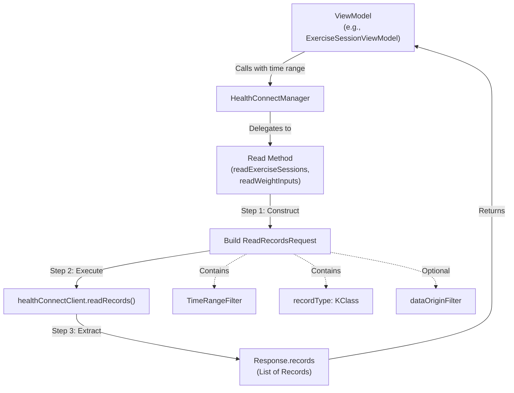
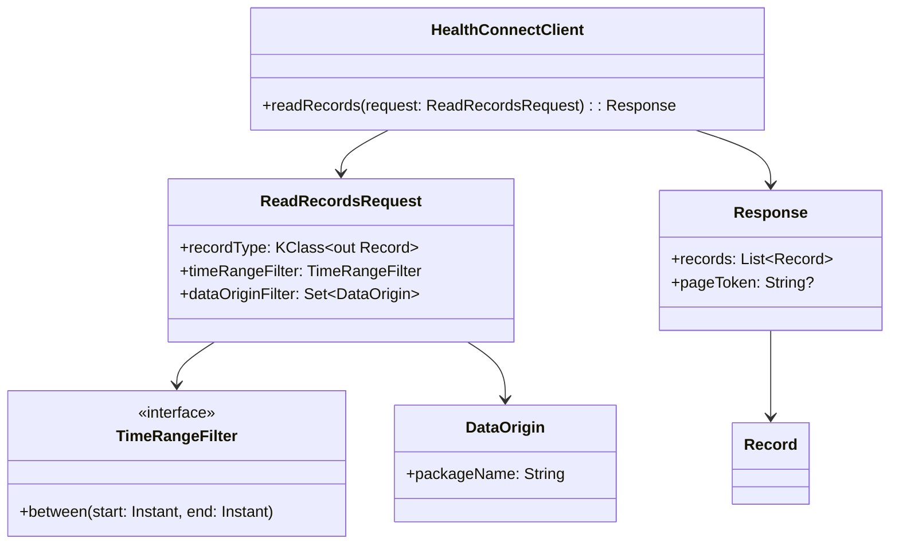
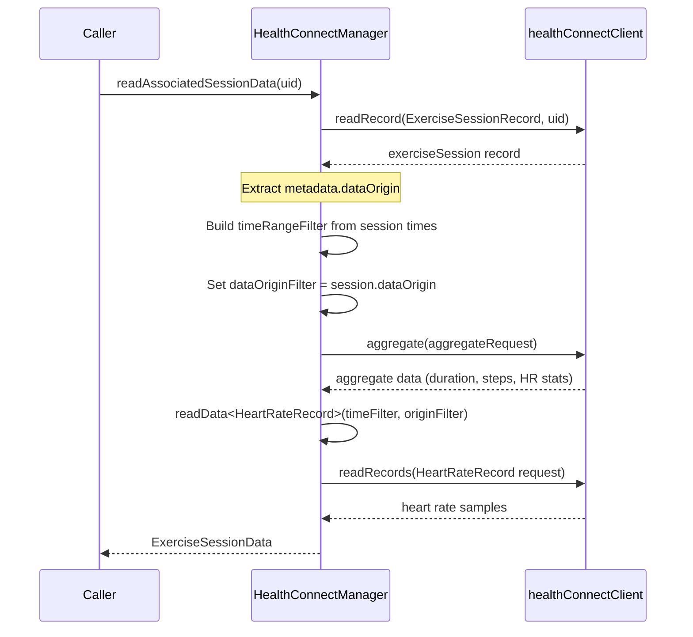
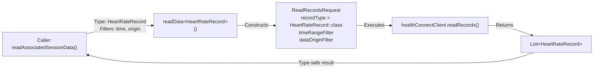
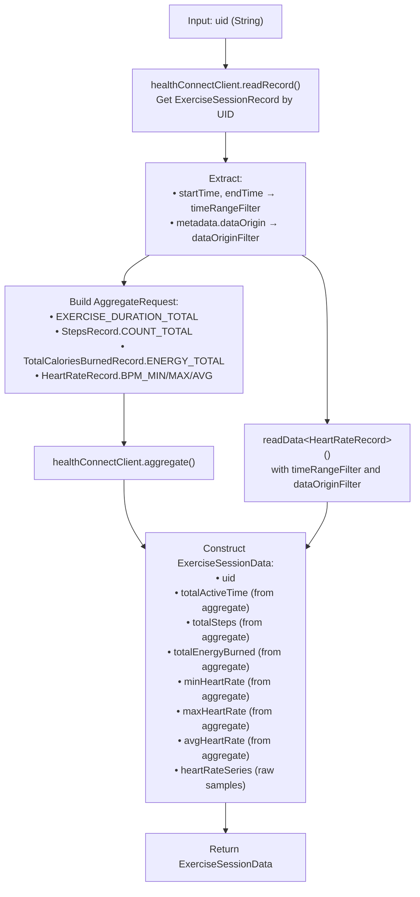

<!-- source: DeepWiki mcp.deepwiki.com · repo android/android-health-connect-codelab · page 5.4 Reading Health Data · fetched 2026-10-23 -->

# Reading Health Data

<details>
<summary>Relevant source files</summary>

The following files were used as context for generating this wiki page:

- [finished/src/main/java/com/example/healthconnect/codelab/data/HealthConnectManager.kt](finished/src/main/java/com/example/healthconnect/codelab/data/HealthConnectManager.kt)

</details>


## Purpose and Scope

This page explains the data reading patterns implemented in the Health Connect Codelab. It covers how to query health records using time range filters, data origin filters, and the reusable helper functions that abstract common read operations. For information about the record types themselves, see [Health Records and Data Types](#5.3). For writing data, see [Writing Health Data](#5.5). For computing aggregations and statistics, see [Aggregations and Statistics](#5.6).

---

## Read Operations Overview

The `HealthConnectManager` class provides three categories of read operations:

| Operation Type | Method | Purpose | Line Reference |
|---------------|---------|---------|----------------|
| **List Reads** | `readWeightInputs()` | Retrieve multiple weight records in a time range | [finished/src/main/java/com/example/healthconnect/codelab/data/HealthConnectManager.kt:120-127]() |
| **List Reads** | `readExerciseSessions()` | Retrieve multiple exercise sessions in a time range | [finished/src/main/java/com/example/healthconnect/codelab/data/HealthConnectManager.kt:147-154]() |
| **Single Record Read** | `readRecord()` | Read a specific record by UID (via SDK) | [finished/src/main/java/com/example/healthconnect/codelab/data/HealthConnectManager.kt:225]() |
| **Associated Data Read** | `readAssociatedSessionData()` | Read aggregates and time-series data for a session | [finished/src/main/java/com/example/healthconnect/codelab/data/HealthConnectManager.kt:222-261]() |
| **Generic Helper** | `readData<T>()` | Reusable private function for any record type | [finished/src/main/java/com/example/healthconnect/codelab/data/HealthConnectManager.kt:314-324]() |

All read operations follow a consistent pattern: construct a request object, execute it via the `healthConnectClient`, and extract records from the response.



**Sources:** [finished/src/main/java/com/example/healthconnect/codelab/data/HealthConnectManager.kt:120-154](), [finished/src/main/java/com/example/healthconnect/codelab/data/HealthConnectManager.kt:314-324]()

---

## ReadRecordsRequest Structure

Every list-based read operation constructs a `ReadRecordsRequest` with three key parameters:

### Required Parameters

1. **`recordType`**: A Kotlin class reference (`KClass`) specifying the record type to query (e.g., `WeightRecord::class`, `ExerciseSessionRecord::class`)
2. **`timeRangeFilter`**: A `TimeRangeFilter` defining the time bounds for the query

### Optional Parameters

3. **`dataOriginFilter`**: A `Set<DataOrigin>` to restrict results to specific apps (empty set means all origins)

The SDK's `HealthConnectClient.readRecords()` method accepts this request and returns a response object containing a `records` property with the matched records.



**Sources:** [finished/src/main/java/com/example/healthconnect/codelab/data/HealthConnectManager.kt:121-125](), [finished/src/main/java/com/example/healthconnect/codelab/data/HealthConnectManager.kt:318-322]()

---

## Time Range Filtering

All read operations require a time range to scope the query. The codebase uses `TimeRangeFilter.between(start, end)` consistently, where `start` and `end` are `Instant` objects.

### Reading Weight Inputs Example

The `readWeightInputs()` method demonstrates the standard time filtering pattern:

```kotlin
// Signature: suspend fun readWeightInputs(start: Instant, end: Instant): List<WeightRecord>

val request = ReadRecordsRequest(
    recordType = WeightRecord::class,
    timeRangeFilter = TimeRangeFilter.between(start, end)
)
val response = healthConnectClient.readRecords(request)
return response.records
```

The method accepts `Instant` parameters from the caller (typically a ViewModel), constructs the filter, and returns the filtered list of `WeightRecord` objects.

**Sources:** [finished/src/main/java/com/example/healthconnect/codelab/data/HealthConnectManager.kt:120-127]()

### Reading Exercise Sessions Example

The `readExerciseSessions()` method uses an identical pattern for `ExerciseSessionRecord`:

```kotlin
// Signature: suspend fun readExerciseSessions(start: Instant, end: Instant): List<ExerciseSessionRecord>

val request = ReadRecordsRequest(
    recordType = ExerciseSessionRecord::class,
    timeRangeFilter = TimeRangeFilter.between(start, end)
)
val response = healthConnectClient.readRecords(request)
return response.records
```

**Sources:** [finished/src/main/java/com/example/healthconnect/codelab/data/HealthConnectManager.kt:147-154]()

---

## Data Origin Filtering

Data origin filtering restricts query results to records written by specific applications. This is particularly useful when reading associated session data to avoid mixing data from different apps.

### Use Case: Reading Associated Session Data

The `readAssociatedSessionData()` method demonstrates data origin filtering. After reading a specific exercise session record, it uses that session's data origin to filter subsequent queries:



The relevant code shows how the data origin is extracted and applied:

```kotlin
// Line 225: Read the specific exercise session
val exerciseSession = healthConnectClient.readRecord(ExerciseSessionRecord::class, uid)

// Lines 227-230: Use the session's time bounds
val timeRangeFilter = TimeRangeFilter.between(
    startTime = exerciseSession.record.startTime,
    endTime = exerciseSession.record.endTime
)

// Lines 239-242: Extract the data origin from the session's metadata
val dataOriginFilter = setOf(exerciseSession.record.metadata.dataOrigin)

// Lines 243-247: Apply the filter to the aggregate request
val aggregateRequest = AggregateRequest(
    metrics = aggregateDataTypes,
    timeRangeFilter = timeRangeFilter,
    dataOriginFilter = dataOriginFilter
)

// Line 249: Apply the same filter to raw data reads
val heartRateData = readData<HeartRateRecord>(timeRangeFilter, dataOriginFilter)
```

This ensures that the statistics and time-series data returned are only from the same app that created the exercise session, preventing data contamination across apps.

**Sources:** [finished/src/main/java/com/example/healthconnect/codelab/data/HealthConnectManager.kt:222-261]()

---

## The readData Helper Function

The `readData<T : Record>()` private function is a reusable, type-safe helper that eliminates code duplication for reading any record type. It uses Kotlin's reified type parameters to construct requests without explicitly passing the class reference.

### Function Signature and Implementation

```kotlin
// Lines 314-324
private suspend inline fun <reified T : Record> readData(
    timeRangeFilter: TimeRangeFilter,
    dataOriginFilter: Set<DataOrigin> = setOf(),
): List<T> {
    val request = ReadRecordsRequest(
        recordType = T::class,
        dataOriginFilter = dataOriginFilter,
        timeRangeFilter = timeRangeFilter
    )
    return healthConnectClient.readRecords(request).records
}
```

### Key Features

| Feature | Description |
|---------|-------------|
| **Reified Type Parameter** | `<reified T : Record>` allows using `T::class` at runtime without explicitly passing the class |
| **Inline Function** | The `inline` keyword ensures zero runtime overhead by inserting the function body at call sites |
| **Default Parameter** | `dataOriginFilter` defaults to an empty set, meaning "all origins" if not specified |
| **Type Safety** | Returns `List<T>` where `T` is the specific record type, providing compile-time type checking |

### Usage Example

In `readAssociatedSessionData()`, the helper is called to read heart rate records:

```kotlin
// Line 249
val heartRateData = readData<HeartRateRecord>(timeRangeFilter, dataOriginFilter)
```

The compiler infers `T = HeartRateRecord`, so `readData` constructs a `ReadRecordsRequest` with `recordType = HeartRateRecord::class` and returns `List<HeartRateRecord>`.



**Sources:** [finished/src/main/java/com/example/healthconnect/codelab/data/HealthConnectManager.kt:314-324](), [finished/src/main/java/com/example/healthconnect/codelab/data/HealthConnectManager.kt:249]()

---

## Reading Single Records by UID

While most read operations query lists of records by time range, the SDK also supports reading a single record by its unique identifier (UID). This is used in `readAssociatedSessionData()` to retrieve a specific exercise session:

```kotlin
// Line 225
val exerciseSession = healthConnectClient.readRecord(ExerciseSessionRecord::class, uid)
```

### Return Value Structure

The SDK's `readRecord()` method returns an object containing a `record` property:

```kotlin
// Line 226-230: Access the record and its time bounds
val timeRangeFilter = TimeRangeFilter.between(
    startTime = exerciseSession.record.startTime,
    endTime = exerciseSession.record.endTime
)

// Line 242: Access the record's metadata
val dataOriginFilter = setOf(exerciseSession.record.metadata.dataOrigin)
```

The `exerciseSession` object wraps the actual `ExerciseSessionRecord`, which is accessed via the `.record` property.

**Sources:** [finished/src/main/java/com/example/healthconnect/codelab/data/HealthConnectManager.kt:225-242]()

---

## Reading Associated Session Data

The `readAssociatedSessionData()` method demonstrates a complex read pattern that combines multiple operations:

1. **Single record read by UID** (the exercise session)
2. **Aggregate read** (statistics like total steps, duration, heart rate min/max/avg)
3. **Time-series read** (raw heart rate samples)

### Method Flow



### Implementation Details

The method signature and key steps:

```kotlin
// Line 222-224
suspend fun readAssociatedSessionData(uid: String): ExerciseSessionData {
    // Step 1: Read the session by UID
    val exerciseSession = healthConnectClient.readRecord(ExerciseSessionRecord::class, uid)
    
    // Step 2: Build time range filter from session times
    val timeRangeFilter = TimeRangeFilter.between(
        startTime = exerciseSession.record.startTime,
        endTime = exerciseSession.record.endTime
    )
    
    // Step 3: Define aggregate metrics (lines 231-238)
    val aggregateDataTypes = setOf(
        ExerciseSessionRecord.EXERCISE_DURATION_TOTAL,
        StepsRecord.COUNT_TOTAL,
        TotalCaloriesBurnedRecord.ENERGY_TOTAL,
        HeartRateRecord.BPM_AVG,
        HeartRateRecord.BPM_MAX,
        HeartRateRecord.BPM_MIN,
    )
    
    // Step 4: Extract data origin filter (lines 239-242)
    val dataOriginFilter = setOf(exerciseSession.record.metadata.dataOrigin)
    
    // Step 5: Execute aggregate request (lines 243-248)
    val aggregateRequest = AggregateRequest(
        metrics = aggregateDataTypes,
        timeRangeFilter = timeRangeFilter,
        dataOriginFilter = dataOriginFilter
    )
    val aggregateData = healthConnectClient.aggregate(aggregateRequest)
    
    // Step 6: Read time-series heart rate data (line 249)
    val heartRateData = readData<HeartRateRecord>(timeRangeFilter, dataOriginFilter)
    
    // Step 7: Construct result object (lines 251-260)
    return ExerciseSessionData(
        uid = uid,
        totalActiveTime = aggregateData[ExerciseSessionRecord.EXERCISE_DURATION_TOTAL],
        totalSteps = aggregateData[StepsRecord.COUNT_TOTAL],
        totalEnergyBurned = aggregateData[TotalCaloriesBurnedRecord.ENERGY_TOTAL],
        minHeartRate = aggregateData[HeartRateRecord.BPM_MIN],
        maxHeartRate = aggregateData[HeartRateRecord.BPM_MAX],
        avgHeartRate = aggregateData[HeartRateRecord.BPM_AVG],
        heartRateSeries = heartRateData,
    )
}
```

### Data Origin Filtering Rationale

The comment at lines 239-242 explains the filtering decision:

> "Limit the data read to just the application that wrote the session. This may or may not be desirable depending on the use case: In some cases, it may be useful to combine with data written by other apps."

By filtering to the session's origin, the method ensures that statistics and time-series data come from the same source, preventing situations where one app creates a session and another app's data influences the statistics.

**Sources:** [finished/src/main/java/com/example/healthconnect/codelab/data/HealthConnectManager.kt:222-261]()

---

## Summary Table: Read Methods and Their Parameters

| Method | Parameters | Returns | Time Filter | Origin Filter | Use Case |
|--------|-----------|---------|-------------|---------------|----------|
| `readWeightInputs()` | `start: Instant`<br/>`end: Instant` | `List<WeightRecord>` | `TimeRangeFilter.between(start, end)` | None (all origins) | Display weight history |
| `readExerciseSessions()` | `start: Instant`<br/>`end: Instant` | `List<ExerciseSessionRecord>` | `TimeRangeFilter.between(start, end)` | None (all origins) | Display exercise session list |
| `readAssociatedSessionData()` | `uid: String` | `ExerciseSessionData` | Session's start/end times | Session's data origin only | Display detailed session metrics |
| `readData<T>()` (private) | `timeRangeFilter: TimeRangeFilter`<br/>`dataOriginFilter: Set<DataOrigin>` | `List<T>` | Provided by caller | Optional (defaults to all) | Reusable helper for any record type |

**Sources:** [finished/src/main/java/com/example/healthconnect/codelab/data/HealthConnectManager.kt:120-154](), [finished/src/main/java/com/example/healthconnect/codelab/data/HealthConnectManager.kt:222-261](), [finished/src/main/java/com/example/healthconnect/codelab/data/HealthConnectManager.kt:314-324]()

---

