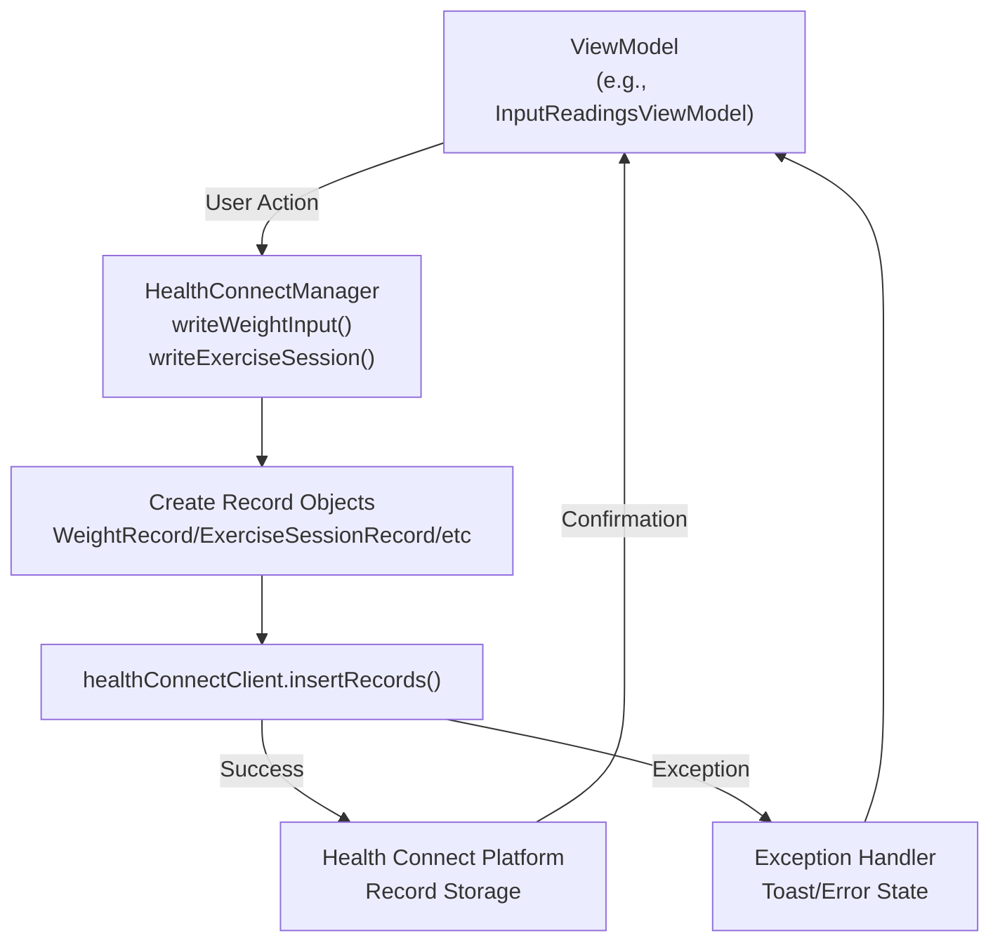
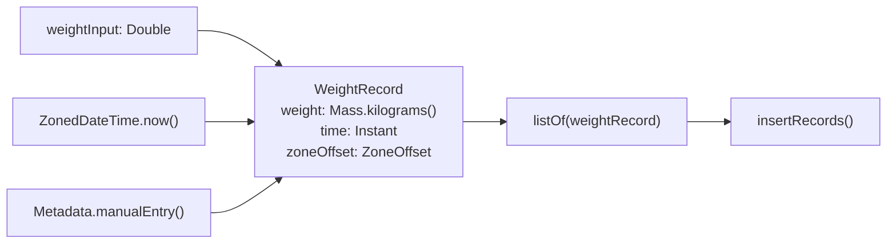
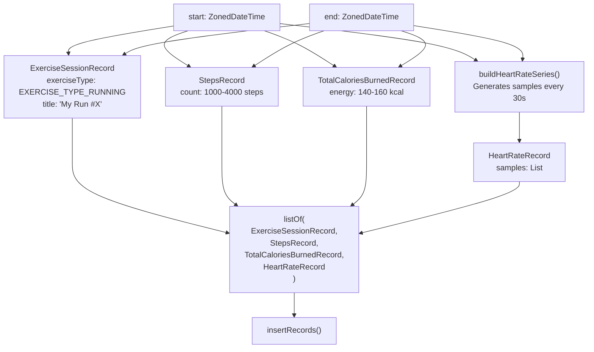
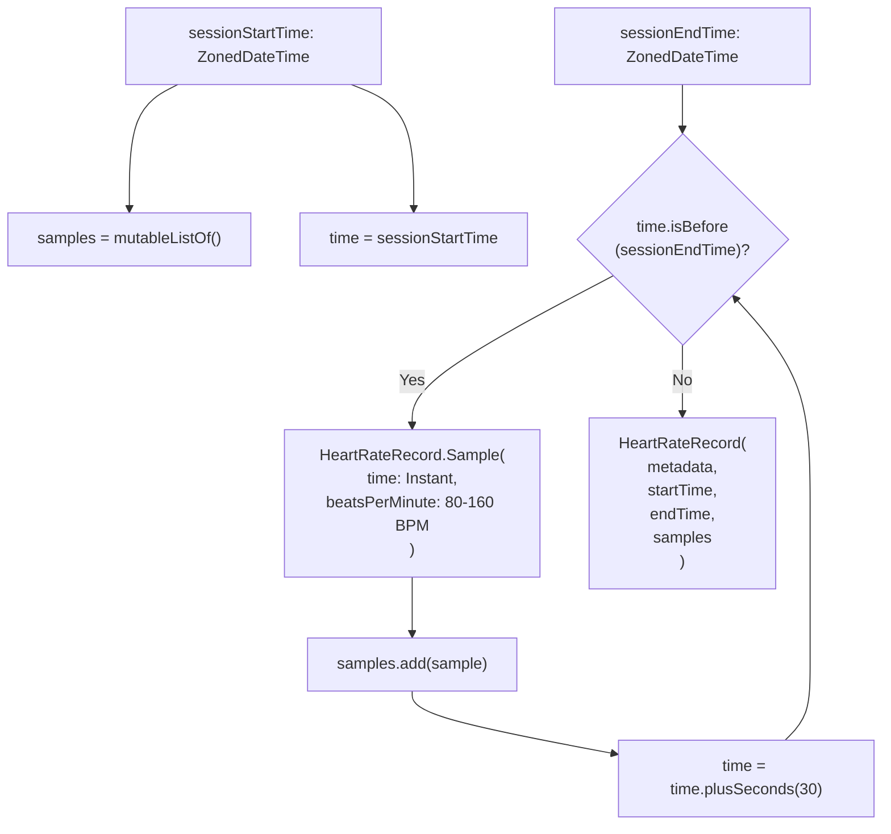
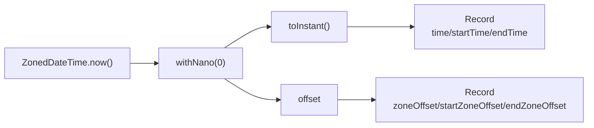
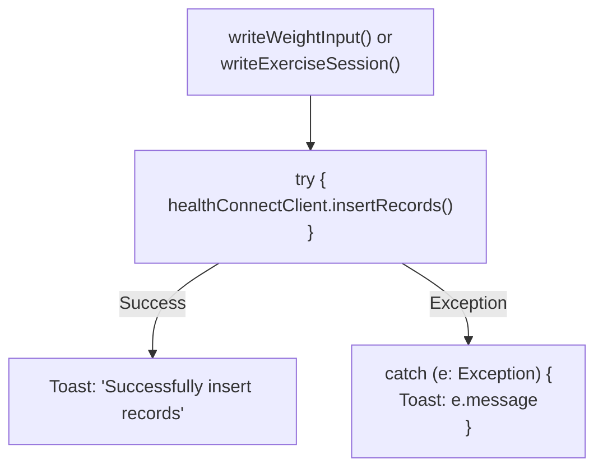
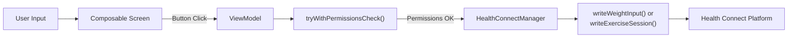

<!-- source: DeepWiki mcp.deepwiki.com · repo android/android-health-connect-codelab · page 5.5 Writing Health Data · fetched 2026-10-23 -->

# Writing Health Data

<details>
<summary>Relevant source files</summary>

The following files were used as context for generating this wiki page:

- [finished/src/main/java/com/example/healthconnect/codelab/data/HealthConnectManager.kt](finished/src/main/java/com/example/healthconnect/codelab/data/HealthConnectManager.kt)

</details>


## Purpose and Scope

This document explains how to write (insert) health records into Health Connect using the `HealthConnectManager` class. It covers the core write operations for individual records like `WeightRecord` and compound operations that write multiple related records together such as exercise sessions with associated steps, calories, and heart rate data.

For reading health data from Health Connect, see [Reading Health Data](#5.4). For computing aggregations and statistics from existing data, see [Aggregations and Statistics](#5.6).

## Overview of Write Operations

The `HealthConnectManager` provides two primary methods for writing health data:

| Method | Purpose | Records Written |
|--------|---------|----------------|
| `writeWeightInput(weightInput: Double)` | Records a single weight measurement | `WeightRecord` |
| `writeExerciseSession(start: ZonedDateTime, end: ZonedDateTime)` | Records an exercise session with associated metrics | `ExerciseSessionRecord`, `StepsRecord`, `TotalCaloriesBurnedRecord`, `HeartRateRecord` |

Both methods use the `HealthConnectClient.insertRecords()` API to persist data. All write operations are asynchronous suspend functions that must be called from a coroutine context.

Sources: [finished/src/main/java/com/example/healthconnect/codelab/data/HealthConnectManager.kt:98-217]()

## The insertRecords API

All write operations in Health Connect use the `insertRecords()` method:

```kotlin
healthConnectClient.insertRecords(records: List<Record>)
```

This method accepts a list of `Record` objects and persists them atomically. If any record in the list fails validation or encounters an error, the entire operation fails and no records are written.

### Write Operation Flow



Sources: [finished/src/main/java/com/example/healthconnect/codelab/data/HealthConnectManager.kt:100-115, 159-189]()

## Writing Single Records: Weight Input

The `writeWeightInput()` method demonstrates the basic pattern for writing a single health record.

### Implementation Pattern



### Key Components

| Component | Purpose | Example |
|-----------|---------|---------|
| **Timestamp** | Records the exact time of measurement | `ZonedDateTime.now().withNano(0)` |
| **Metadata** | Indicates data source and entry method | `Metadata.manualEntry()` |
| **Value Conversion** | Converts raw input to typed units | `Mass.kilograms(weightInput)` |
| **Zone Offset** | Stores timezone information | `time.offset` |

### Code Location

The complete implementation is at [finished/src/main/java/com/example/healthconnect/codelab/data/HealthConnectManager.kt:100-115]():

- **Lines 101-107**: Creates the `WeightRecord` with current timestamp, metadata, and converted mass value
- **Lines 108**: Wraps the record in a list (required by `insertRecords()`)
- **Lines 109-114**: Try-catch block with success/error Toast messages

### Metadata and Manual Entry

All records created in this codelab use `Metadata.manualEntry()` to indicate they were entered by the user through the app's UI. The metadata also automatically captures the app's package name as the `DataOrigin`, which can be used later to filter reads to only app-generated data.

Sources: [finished/src/main/java/com/example/healthconnect/codelab/data/HealthConnectManager.kt:100-115]()

## Writing Multiple Related Records: Exercise Sessions

The `writeExerciseSession()` method demonstrates writing multiple related records in a single transaction. This is the recommended pattern when records are logically connected (e.g., steps and calories burned during a run).

### Multi-Record Write Structure



### Record Construction Details

#### ExerciseSessionRecord
[finished/src/main/java/com/example/healthconnect/codelab/data/HealthConnectManager.kt:162-170]()

- **Exercise Type**: Uses `ExerciseSessionRecord.EXERCISE_TYPE_RUNNING` constant
- **Title**: Generates random title for demonstration (`"My Run #X"`)
- **Time Range**: Defines the conceptual period of the exercise

#### StepsRecord
[finished/src/main/java/com/example/healthconnect/codelab/data/HealthConnectManager.kt:171-178]()

- **Count**: Random value between 1000-4000 steps
- **Time Range**: Same as exercise session (steps occurred during the run)

#### TotalCaloriesBurnedRecord
[finished/src/main/java/com/example/healthconnect/codelab/data/HealthConnectManager.kt:179-186]()

- **Energy**: Random value between 1.4-1.6 calories (using Energy.calories())
- **Time Range**: Same as exercise session

#### HeartRateRecord (Time-Series)
[finished/src/main/java/com/example/healthconnect/codelab/data/HealthConnectManager.kt:187-188, 194-217]()

- Built using the `buildHeartRateSeries()` helper function
- Contains multiple samples taken throughout the exercise

Sources: [finished/src/main/java/com/example/healthconnect/codelab/data/HealthConnectManager.kt:159-189]()

## Building Time-Series Data: Heart Rate Samples

Time-series records like `HeartRateRecord` contain multiple data points sampled over a time period. The `buildHeartRateSeries()` helper function demonstrates this pattern.

### Sample Generation Algorithm



### Sample Construction

Each `HeartRateRecord.Sample` contains:

| Field | Type | Description |
|-------|------|-------------|
| `time` | `Instant` | Exact timestamp of measurement |
| `beatsPerMinute` | `Long` | Heart rate value (80-160 BPM in demo) |

The algorithm:
1. Starts at `sessionStartTime`
2. Creates a sample every 30 seconds
3. Generates random BPM values between 80-160
4. Continues until reaching `sessionEndTime`
5. Wraps all samples in a single `HeartRateRecord`

### Time-Series Record Structure

The resulting `HeartRateRecord` includes:

- **Overall time range**: `startTime` and `endTime` of the session
- **Samples list**: Individual measurements with precise timestamps
- **Zone offsets**: Timezone information for start and end times
- **Metadata**: Standard manual entry metadata

Sources: [finished/src/main/java/com/example/healthconnect/codelab/data/HealthConnectManager.kt:194-217]()

## Time Handling and Zone Offsets

All write operations require both `Instant` (absolute time) and `ZoneOffset` (timezone) values.

### ZonedDateTime Pattern



### Key Time Components

| Component | Usage | Example |
|-----------|-------|---------|
| `ZonedDateTime.now()` | Get current time with timezone | Creates timestamp for weight measurement |
| `.withNano(0)` | Remove nanoseconds for cleaner timestamps | Optional precision adjustment |
| `.toInstant()` | Convert to absolute time | Required for record fields |
| `.offset` | Extract timezone offset | Required for record timezone fields |

This pattern ensures:
- Health Connect can correctly order events regardless of timezone
- Users see data in their local timezone
- Daylight saving time changes are handled correctly

Sources: [finished/src/main/java/com/example/healthconnect/codelab/data/HealthConnectManager.kt:101-107, 159-189]()

## Error Handling

Both write methods implement try-catch error handling with user feedback via Toast messages.

### Error Handling Pattern



### Common Exception Types

While the current implementation catches all exceptions generically, Health Connect can throw:

- `SecurityException`: Missing required permissions
- `IllegalArgumentException`: Invalid record data (e.g., end time before start time)
- `IOException`: Connection issues with Health Connect service
- `RemoteException`: Health Connect APK issues

### Production Considerations

The codelab's Toast-based error handling is simplified for demonstration. Production implementations should:

1. **Propagate errors** to ViewModels for proper UI state management
2. **Distinguish exception types** for user-friendly error messages
3. **Retry logic** for transient failures
4. **Logging** for debugging and analytics

Sources: [finished/src/main/java/com/example/healthconnect/codelab/data/HealthConnectManager.kt:109-114]()

## Integration with ViewModels

Write operations are triggered from ViewModels in response to user actions:

### Write Flow from UI to Storage



ViewModels call write methods within their permission-checking wrappers to ensure:
- Required permissions are granted before attempting writes
- Users are prompted for permissions if needed
- Errors are caught and converted to UI state

For details on permission checking patterns, see [Permission Management](#5.2).

Sources: [finished/src/main/java/com/example/healthconnect/codelab/data/HealthConnectManager.kt:100-189]()

## Summary

Writing health data to Health Connect follows these key patterns:

1. **Create record objects** with proper metadata, timestamps, and zone offsets
2. **Use typed units** (e.g., `Mass.kilograms()`, `Energy.calories()`) for values
3. **Write related records together** in a single `insertRecords()` call for atomicity
4. **Build time-series data** using sample lists for interval-based measurements
5. **Handle errors** and provide user feedback

The two primary write operations demonstrated are:
- **Simple writes**: Single records like `WeightRecord` ([writeWeightInput:100-115]())
- **Complex writes**: Multiple related records like exercise sessions with steps, calories, and heart rate ([writeExerciseSession:159-189]())

Both patterns ensure data consistency, proper timezone handling, and appropriate metadata tagging.

Sources: [finished/src/main/java/com/example/healthconnect/codelab/data/HealthConnectManager.kt:98-217]()

---

