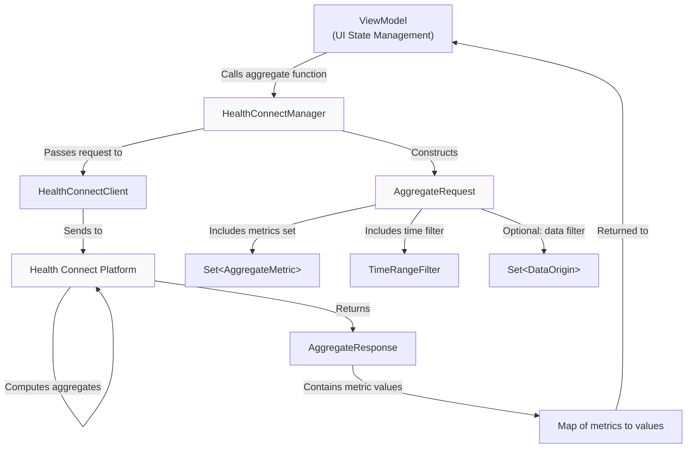
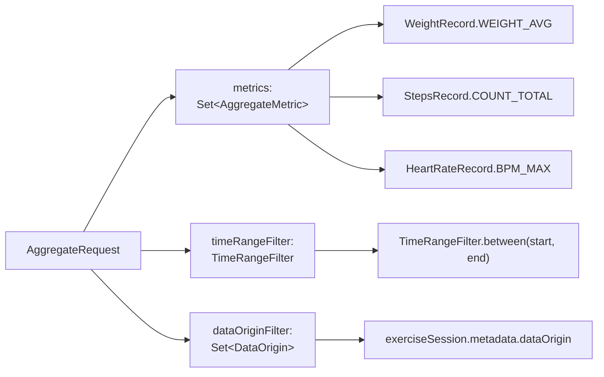
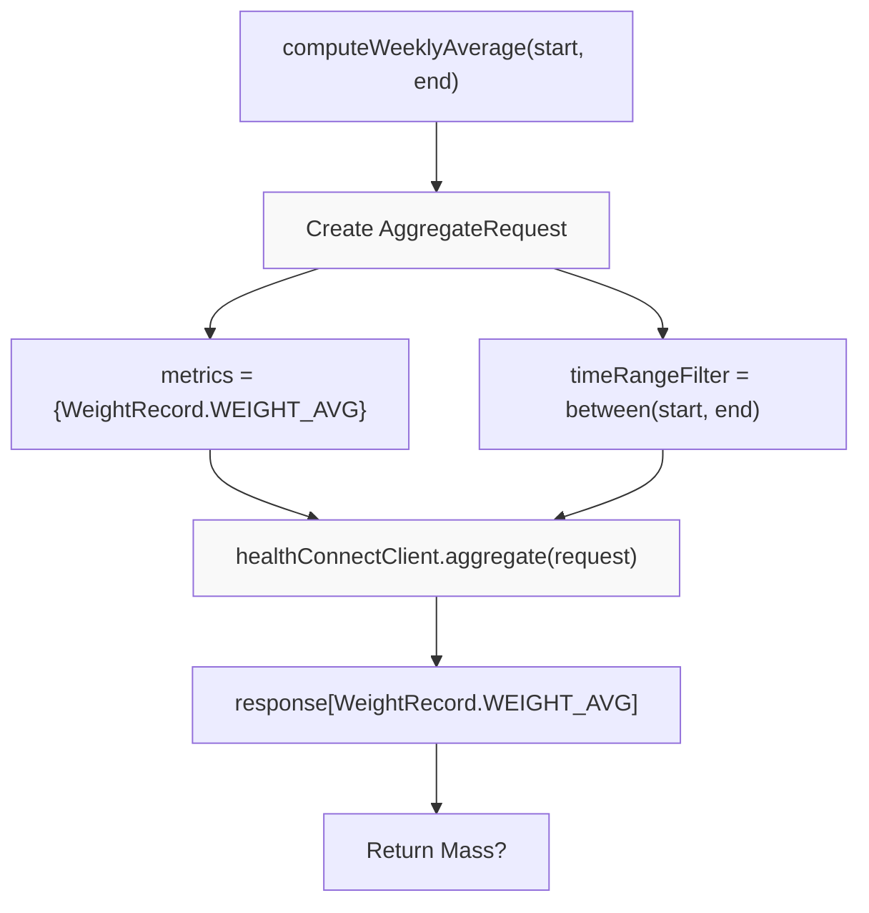
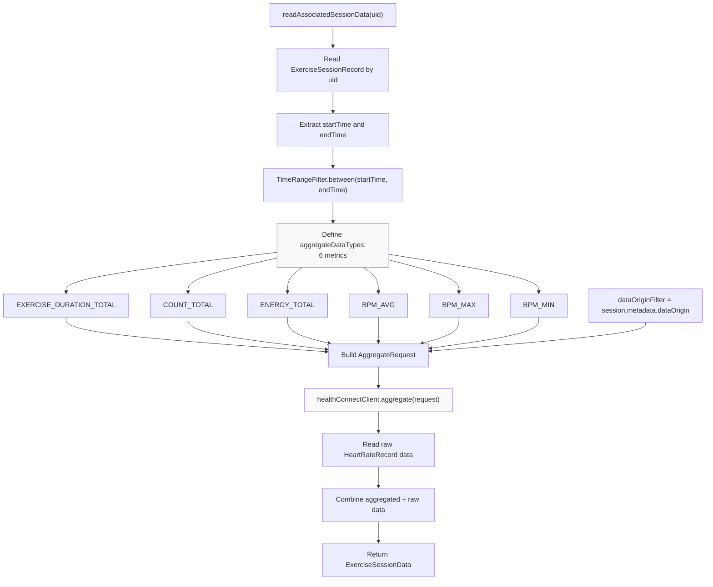
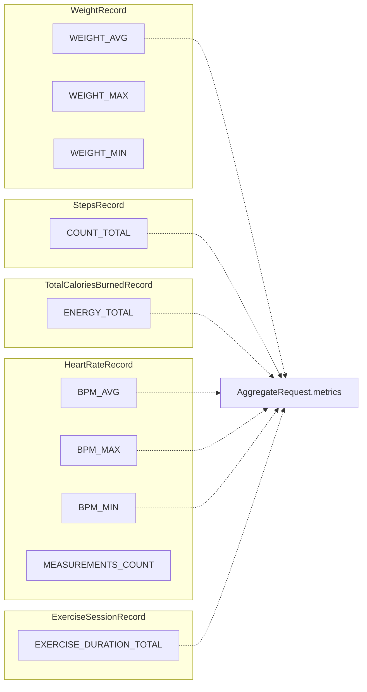
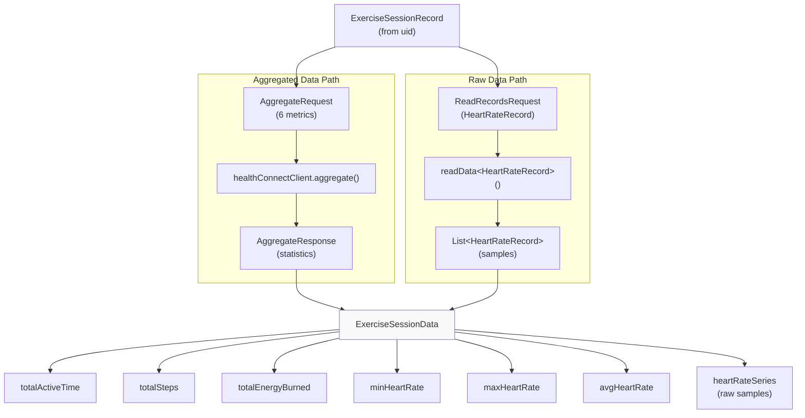
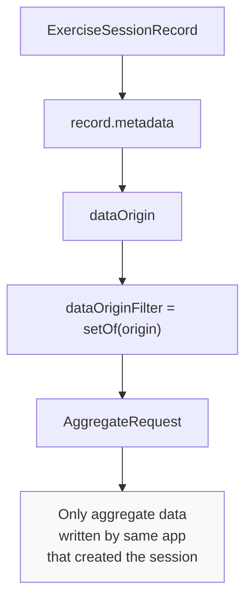

<!-- source: DeepWiki mcp.deepwiki.com · repo android/android-health-connect-codelab · page 5.6 Aggregations and Statistics · fetched 2026-10-23 -->

# Aggregations and Statistics

Relevant source files

The following files were used as context for generating this wiki page:

- [finished/src/main/java/com/example/healthconnect/codelab/data/HealthConnectManager.kt](finished/src/main/java/com/example/healthconnect/codelab/data/HealthConnectManager.kt)

## Purpose and Scope

This page documents the aggregation and statistical computation patterns used in the Health Connect Codelab. It explains how to compute aggregate metrics (such as averages, totals, minimums, and maximums) over time-filtered health data using the Health Connect SDK's `AggregateRequest` API. 

For reading raw health records without aggregation, see [Reading Health Data](#5.4). For writing health data, see [Writing Health Data](#5.5).

**Sources:** [finished/src/main/java/com/example/healthconnect/codelab/data/HealthConnectManager.kt:1-346]()

---

## Aggregation Model Overview

The Health Connect SDK provides an aggregation API that computes statistical summaries over health records within a specified time range. Rather than reading all individual records and computing statistics manually, aggregations are performed server-side by the Health Connect platform, returning only the computed results.

### Aggregation Flow

**Sources:** [finished/src/main/java/com/example/healthconnect/codelab/data/HealthConnectManager.kt:132-139](), [finished/src/main/java/com/example/healthconnect/codelab/data/HealthConnectManager.kt:222-261]()

---

## Building AggregateRequest

An `AggregateRequest` consists of three primary components:

| Component | Type | Purpose | Required |
|-----------|------|---------|----------|
| `metrics` | `Set<AggregateMetric>` | Specifies which aggregate metrics to compute | Yes |
| `timeRangeFilter` | `TimeRangeFilter` | Defines the time window for aggregation | Yes |
| `dataOriginFilter` | `Set<DataOrigin>` | Filters records by source application | No |

### AggregateRequest Structure

**Sources:** [finished/src/main/java/com/example/healthconnect/codelab/data/HealthConnectManager.kt:36-37](), [finished/src/main/java/com/example/healthconnect/codelab/data/HealthConnectManager.kt:133-136]()

---

## Weight Aggregation: Weekly Average

The `computeWeeklyAverage()` function demonstrates the simplest aggregation pattern, computing the average weight over a specified time period.

### Implementation Pattern

### Code Location

The function is implemented at [finished/src/main/java/com/example/healthconnect/codelab/data/HealthConnectManager.kt:132-139]():

- **Line 133-136**: Constructs `AggregateRequest` with `WeightRecord.WEIGHT_AVG` metric
- **Line 137**: Calls `healthConnectClient.aggregate(request)` to perform server-side computation
- **Line 138**: Extracts the average weight value from the response using bracket notation

The response type is `Mass?` (nullable), as there may be no weight records in the specified time range.

**Sources:** [finished/src/main/java/com/example/healthconnect/codelab/data/HealthConnectManager.kt:132-139]()

---

## Exercise Session Aggregation

The `readAssociatedSessionData()` function demonstrates a more complex aggregation pattern, computing multiple metrics simultaneously for a single exercise session.

### Multi-Metric Aggregation Flow

### Aggregate Metrics Defined

At [finished/src/main/java/com/example/healthconnect/codelab/data/HealthConnectManager.kt:231-238](), six aggregate metrics are defined:

| Metric | Record Type | Purpose |
|--------|-------------|---------|
| `EXERCISE_DURATION_TOTAL` | `ExerciseSessionRecord` | Total active time during the session |
| `COUNT_TOTAL` | `StepsRecord` | Total step count |
| `ENERGY_TOTAL` | `TotalCaloriesBurnedRecord` | Total calories burned |
| `BPM_AVG` | `HeartRateRecord` | Average heart rate |
| `BPM_MAX` | `HeartRateRecord` | Maximum heart rate |
| `BPM_MIN` | `HeartRateRecord` | Minimum heart rate |

**Sources:** [finished/src/main/java/com/example/healthconnect/codelab/data/HealthConnectManager.kt:222-261]()

---

## Available Aggregate Metrics by Record Type

Each Health Connect record type provides specific aggregate metrics as static fields on the record class.

### Aggregate Metrics Mapping

### Usage Pattern

Aggregate metrics are referenced as static fields on their respective record types:

- `WeightRecord.WEIGHT_AVG` - Used at [finished/src/main/java/com/example/healthconnect/codelab/data/HealthConnectManager.kt:134]()
- `StepsRecord.COUNT_TOTAL` - Used at [finished/src/main/java/com/example/healthconnect/codelab/data/HealthConnectManager.kt:233]()
- `TotalCaloriesBurnedRecord.ENERGY_TOTAL` - Used at [finished/src/main/java/com/example/healthconnect/codelab/data/HealthConnectManager.kt:234]()
- `HeartRateRecord.BPM_AVG`, `BPM_MAX`, `BPM_MIN` - Used at [finished/src/main/java/com/example/healthconnect/codelab/data/HealthConnectManager.kt:235-237]()
- `ExerciseSessionRecord.EXERCISE_DURATION_TOTAL` - Used at [finished/src/main/java/com/example/healthconnect/codelab/data/HealthConnectManager.kt:232]()

**Sources:** [finished/src/main/java/com/example/healthconnect/codelab/data/HealthConnectManager.kt:231-238]()

---

## Combining Aggregated and Raw Data

The `readAssociatedSessionData()` function demonstrates combining server-computed aggregates with raw time-series data. This pattern is useful when both summary statistics and detailed data points are needed.

### Combined Data Pattern

### Implementation Details

At [finished/src/main/java/com/example/healthconnect/codelab/data/HealthConnectManager.kt:248-260]():

1. **Line 248**: Aggregate request is executed, returning summary statistics
2. **Line 249**: Raw heart rate data is read using the `readData<HeartRateRecord>()` helper
3. **Lines 251-260**: Results are combined into `ExerciseSessionData` object
   - **Lines 253-258**: Aggregated metrics extracted from response using bracket notation
   - **Line 259**: Raw heart rate series included directly

This pattern enables displaying both summary cards (e.g., "Total Steps: 2500") and detailed charts (e.g., heart rate over time graph) from a single data retrieval operation.

**Sources:** [finished/src/main/java/com/example/healthconnect/codelab/data/HealthConnectManager.kt:248-260]()

---

## Data Origin Filtering in Aggregations

Aggregations can be filtered by data source using the `dataOriginFilter` parameter. This ensures that aggregated statistics only include data from specific applications.

### Data Origin Filter Usage

At [finished/src/main/java/com/example/healthconnect/codelab/data/HealthConnectManager.kt:239-246]():

### Filter Rationale

The data origin filter at [finished/src/main/java/com/example/healthconnect/codelab/data/HealthConnectManager.kt:242]() restricts aggregation to records with the same `dataOrigin` as the exercise session. This ensures:

1. **Consistency**: Steps, calories, and heart rate aggregates only include data written alongside the session
2. **Accuracy**: Prevents mixing data from different sources (e.g., manual entries vs. fitness tracker data)
3. **Optionality**: The comment at [finished/src/main/java/com/example/healthconnect/codelab/data/HealthConnectManager.kt:239-241]() notes this may or may not be desirable depending on use case

The `dataOriginFilter` parameter is optional in `AggregateRequest`. When omitted, all records matching the time range are included regardless of source.

**Sources:** [finished/src/main/java/com/example/healthconnect/codelab/data/HealthConnectManager.kt:239-246]()

---

## Extracting Aggregate Results

After calling `healthConnectClient.aggregate()`, results are extracted from the `AggregateResponse` using bracket notation with the aggregate metric as the key.

### Response Extraction Pattern

| Operation | Syntax | Return Type | Example |
|-----------|--------|-------------|---------|
| Extract single metric | `response[metric]` | Nullable value type | `response[WeightRecord.WEIGHT_AVG]` → `Mass?` |
| Check for value | `response[metric] != null` | Boolean | Used to determine if data exists |
| Multiple extractions | Sequential bracket access | Various types | See exercise session example |

### Type Safety

Each aggregate metric has a corresponding return type:

- `WEIGHT_AVG` → `Mass?`
- `COUNT_TOTAL` → `Long?`
- `ENERGY_TOTAL` → `Energy?`
- `BPM_AVG`, `BPM_MAX`, `BPM_MIN` → `Long?`
- `EXERCISE_DURATION_TOTAL` → `Duration?`

All values are nullable because the time range may contain no matching records.

**Sources:** [finished/src/main/java/com/example/healthconnect/codelab/data/HealthConnectManager.kt:138](), [finished/src/main/java/com/example/healthconnect/codelab/data/HealthConnectManager.kt:253-258]()

---

## Summary

The Health Connect aggregation system provides:

1. **Server-Side Computation**: Aggregates are computed by the Health Connect platform, not in-app
2. **Efficient Retrieval**: Only summary statistics are returned, not all raw records
3. **Multi-Metric Support**: Multiple aggregates can be requested in a single operation
4. **Time Filtering**: All aggregations are scoped to a specific time range via `TimeRangeFilter`
5. **Origin Filtering**: Optional filtering by data source for consistent aggregations
6. **Hybrid Queries**: Aggregated statistics can be combined with raw data in the same function

The two primary aggregation patterns in the codebase are:
- **Simple aggregation**: `computeWeeklyAverage()` - single metric over time range
- **Complex aggregation**: `readAssociatedSessionData()` - multiple metrics with raw data combination

**Sources:** [finished/src/main/java/com/example/healthconnect/codelab/data/HealthConnectManager.kt:132-261]()

---

