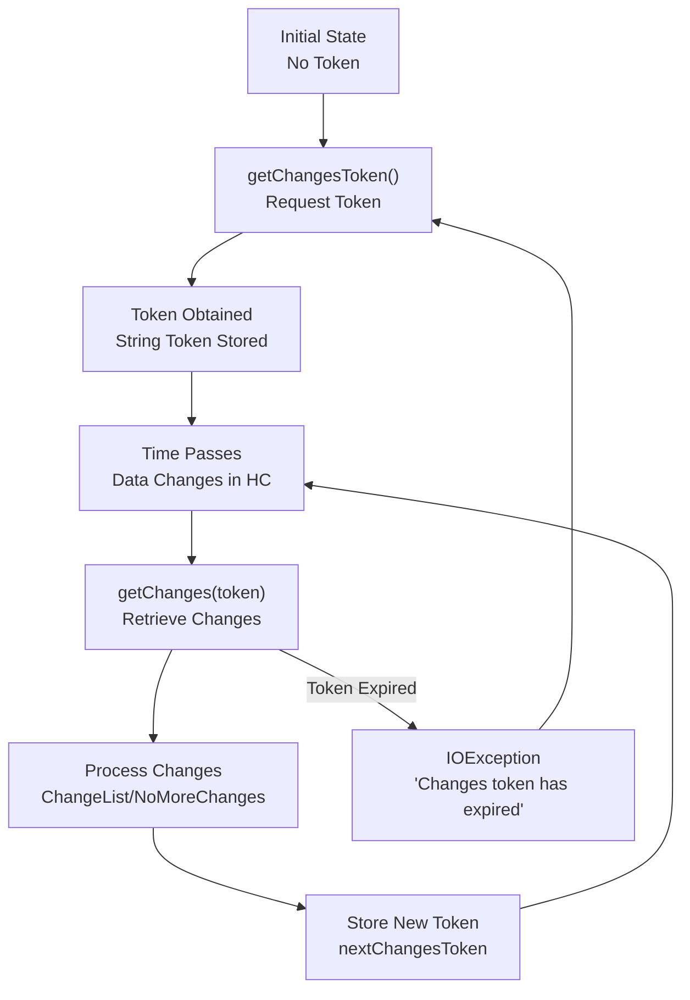
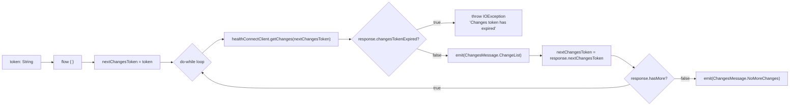
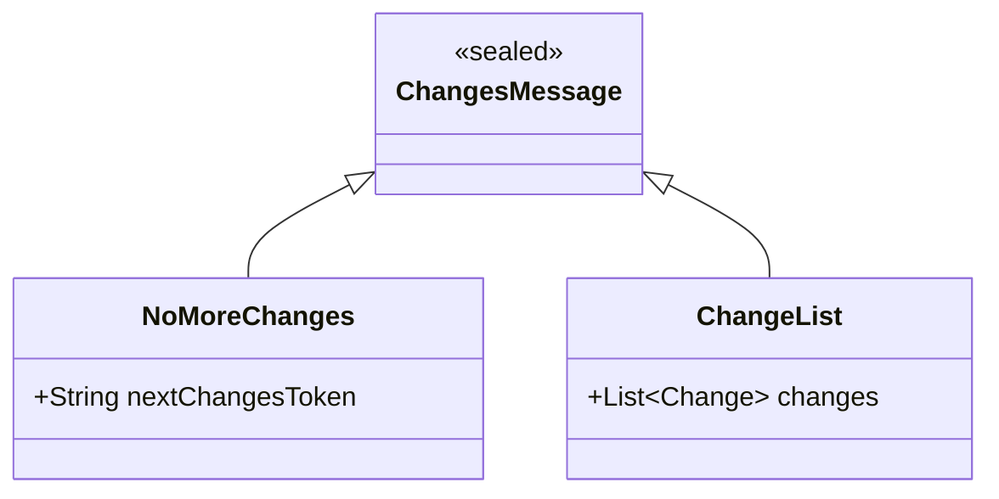
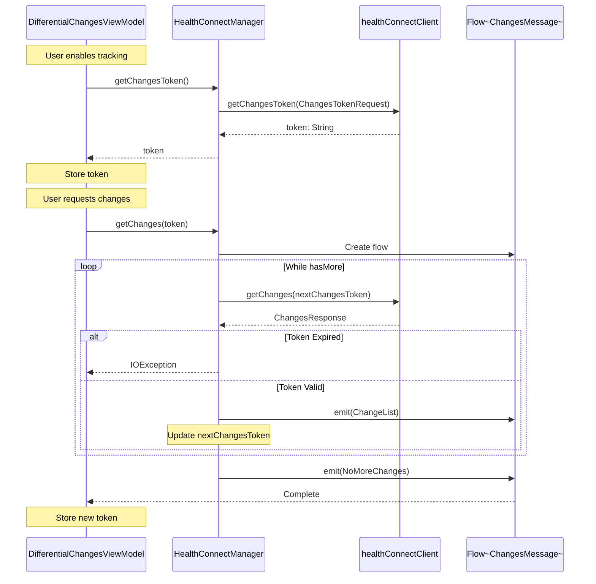

<!-- source: DeepWiki mcp.deepwiki.com · repo android/android-health-connect-codelab · page 5.7 Differential Changes Tracking · fetched 2026-10-23 -->

# Differential Changes Tracking

<details>
<summary>Relevant source files</summary>

The following files were used as context for generating this wiki page:

- [finished/src/main/java/com/example/healthconnect/codelab/data/HealthConnectManager.kt](finished/src/main/java/com/example/healthconnect/codelab/data/HealthConnectManager.kt)
- [finished/src/main/res/values/strings.xml](finished/src/main/res/values/strings.xml)
- [start/src/main/res/values/strings.xml](start/src/main/res/values/strings.xml)

</details>


## Purpose and Scope

This document describes the differential changes tracking system in Health Connect, which enables efficient incremental synchronization of health data. The system uses token-based change tracking to detect modifications (insertions, updates, deletions) in Health Connect records without needing to read the entire dataset on each sync operation.

This page covers the token generation mechanism, change retrieval flow, pagination handling, and token expiration management. For information about the UI implementation that displays these changes, see [Feature: Differential Changes](#8). For details on the specific record types that can be tracked, see [Health Records and Data Types](#5.3).

---

## Overview

The differential changes API provides a mechanism to track changes across multiple Health Connect record types using tokens. A **changes token** represents a specific point in time in the Health Connect data store. By comparing the current state against a previously obtained token, applications can efficiently identify only the data that has changed since that token was created.

The system tracks two types of changes:
- **Upserted records**: Records that were inserted or updated
- **Deleted records**: Records that were removed from Health Connect

**Sources:** [finished/src/main/java/com/example/healthconnect/codelab/data/HealthConnectManager.kt:264-299]()

---

## Token-Based Synchronization Model

### Token Lifecycle Diagram



**Sources:** [finished/src/main/java/com/example/healthconnect/codelab/data/HealthConnectManager.kt:266-299]()

---

## Changes Token Generation

The `getChangesToken()` method obtains a new changes token from Health Connect. This token represents a snapshot of the current state and can be used later to detect subsequent changes.

### Method Signature and Implementation

```kotlin
suspend fun getChangesToken(): String
```

The implementation at [finished/src/main/java/com/example/healthconnect/codelab/data/HealthConnectManager.kt:266-278]() creates a `ChangesTokenRequest` specifying which record types to track.

### Tracked Record Types

The system tracks changes for five record types:

| Record Type | Purpose |
|------------|---------|
| `ExerciseSessionRecord` | Exercise activities with duration and type |
| `StepsRecord` | Step count measurements |
| `TotalCaloriesBurnedRecord` | Calorie expenditure data |
| `HeartRateRecord` | Heart rate measurements and series |
| `WeightRecord` | Body weight measurements |

**Note:** The token tracks changes only for the record types specified in the `ChangesTokenRequest`. If additional record types need tracking, they must be explicitly included in the request.

**Sources:** [finished/src/main/java/com/example/healthconnect/codelab/data/HealthConnectManager.kt:266-278]()

---

## Retrieving Changes with Tokens

The `getChanges()` method retrieves all changes that have occurred since the token was created. It returns a `Flow<ChangesMessage>` to handle pagination and asynchronous data emission.

### Method Signature

```kotlin
suspend fun getChanges(token: String): Flow<ChangesMessage>
```

### Change Retrieval Architecture



**Sources:** [finished/src/main/java/com/example/healthconnect/codelab/data/HealthConnectManager.kt:283-299]()

---

## Pagination Handling

Health Connect returns changes in pages to manage memory efficiently. The `getChanges()` method implements automatic pagination using a do-while loop that continues until all changes are retrieved.

### Pagination Flow

1. **Initial Request**: Call `healthConnectClient.getChanges(token)` with the provided token
2. **Emit Changes**: Emit the list of changes as `ChangesMessage.ChangeList`
3. **Update Token**: Store `response.nextChangesToken` for the next iteration
4. **Check Continuation**: Evaluate `response.hasMore` flag
5. **Loop or Complete**: If `hasMore` is true, repeat with `nextChangesToken`; otherwise, emit `ChangesMessage.NoMoreChanges` with the final token

The do-while loop structure at [finished/src/main/java/com/example/healthconnect/codelab/data/HealthConnectManager.kt:285-298]() ensures that at least one request is made and continues until `response.hasMore` returns false.

**Sources:** [finished/src/main/java/com/example/healthconnect/codelab/data/HealthConnectManager.kt:283-299]()

---

## ChangesMessage Sealed Class

The `ChangesMessage` sealed class provides a type-safe way to represent the two possible states of the change retrieval flow.

### Class Structure



### Message Types

| Type | Purpose | Data |
|------|---------|------|
| `ChangeList` | Represents a page of changes | `List<Change>` - the actual change records |
| `NoMoreChanges` | Signals completion of pagination | `nextChangesToken: String` - token for next sync |

The sealed class definition at [finished/src/main/java/com/example/healthconnect/codelab/data/HealthConnectManager.kt:329-332]() ensures exhaustive when-expression handling in consumers.

**Sources:** [finished/src/main/java/com/example/healthconnect/codelab/data/HealthConnectManager.kt:328-332]()

---

## Token Expiration Handling

Changes tokens expire after 30 days. The system checks for expiration on every change retrieval attempt.

### Expiration Detection and Handling

The `response.changesTokenExpired` boolean flag indicates whether the provided token is still valid. When a token has expired, the method at [finished/src/main/java/com/example/healthconnect/codelab/data/HealthConnectManager.kt:287-294]() throws an `IOException` with the message "Changes token has expired".

### Best Practices for Token Expiration

1. **Regular Usage**: Use the changes API frequently (at least monthly) to prevent expiration
2. **Expiration Fallback**: Implement fallback logic to obtain a new token when expiration occurs
3. **Alternative Sync**: Consider implementing date-based data import as a fallback when tokens expire
4. **Token Persistence**: Store the latest token persistently to survive app restarts

The comment at [finished/src/main/java/com/example/healthconnect/codelab/data/HealthConnectManager.kt:288-293]() references the official Health Connect documentation on token expiration and recommends ensuring regular API usage.

**Sources:** [finished/src/main/java/com/example/healthconnect/codelab/data/HealthConnectManager.kt:283-299]()

---

## Complete Data Flow Architecture

### End-to-End Change Tracking Flow



**Sources:** [finished/src/main/java/com/example/healthconnect/codelab/data/HealthConnectManager.kt:266-299]()

---

## Change Record Structure

Each `Change` object in the changes list contains information about what was modified. The Health Connect SDK defines the `Change` class with the following characteristics:

### Change Properties

| Property | Type | Description |
|----------|------|-------------|
| Record reference | Varies | The actual record that changed (upserted) or its metadata (deleted) |
| Change type | Enum | Indicates whether the record was upserted or deleted |
| Record type | Class | The specific record class (e.g., `ExerciseSessionRecord::class`) |

The changes can be differentiated and processed based on their record type, allowing ViewModels to update different parts of the UI accordingly.

**Sources:** [finished/src/main/res/values/strings.xml:116-135]()

---

## String Resources for Change Display

The application provides localized strings for displaying change information to users. These strings are defined at [finished/src/main/res/values/strings.xml:116-135]() and [start/src/main/res/values/strings.xml:116-135]().

### UI String Categories

**General Change Tracking Strings:**
- `differential_changes_title_text`: Explanation of enabling change tracking
- `differential_changes_continuation_text`: Instructions for retrieving changes
- `differential_changes_switch_text`: Toggle label for "Track changes"
- `differential_changes_button_text`: Button text "Get new changes"
- `differential_changes_empty`: Message when no changes found
- `differential_changes_current_token`: Display format for current token

**Change Type Labels:**
- `differential_changes_upserted`: Header for inserted/updated records
- `differential_changes_deleted`: Header for deleted records

**Record Type Names:**
The strings file includes human-readable names for all trackable record types:
- Exercise session, Exercise event, Speed series, Heart rate series
- Total calories, Steps, Weight
- Sleep session, Sleep stage, Distance

**Sources:** [finished/src/main/res/values/strings.xml:116-135](), [start/src/main/res/values/strings.xml:116-135]()

---

## Implementation Considerations

### Memory Management

The Flow-based approach with pagination ensures that large change sets don't consume excessive memory. Each `ChangeList` emission contains only a subset of changes, allowing the collector to process and discard data incrementally.

### Concurrency

Both `getChangesToken()` and `getChanges()` are suspend functions, designed to be called from coroutines. The Flow emission is sequential within the do-while loop, ensuring changes are processed in order.

### Error Handling

The primary error condition is token expiration, which throws `IOException`. Consumers should catch this exception and implement appropriate recovery logic, typically by obtaining a fresh token with `getChangesToken()`.

### Token Storage

The application is responsible for persisting tokens between sessions. The final `nextChangesToken` from `ChangesMessage.NoMoreChanges` should be stored and used for subsequent change retrievals.

**Sources:** [finished/src/main/java/com/example/healthconnect/codelab/data/HealthConnectManager.kt:266-299]()

---

