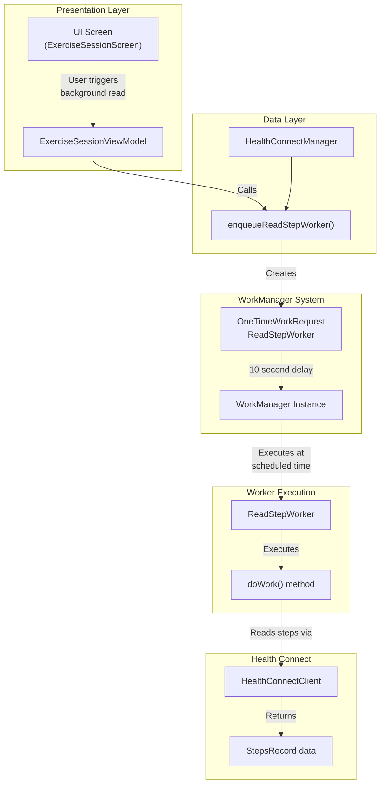
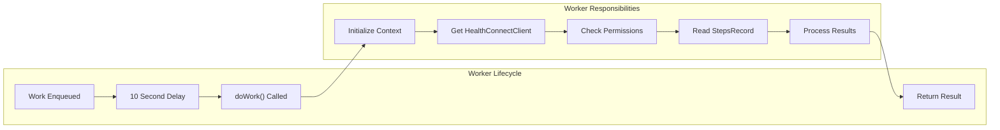
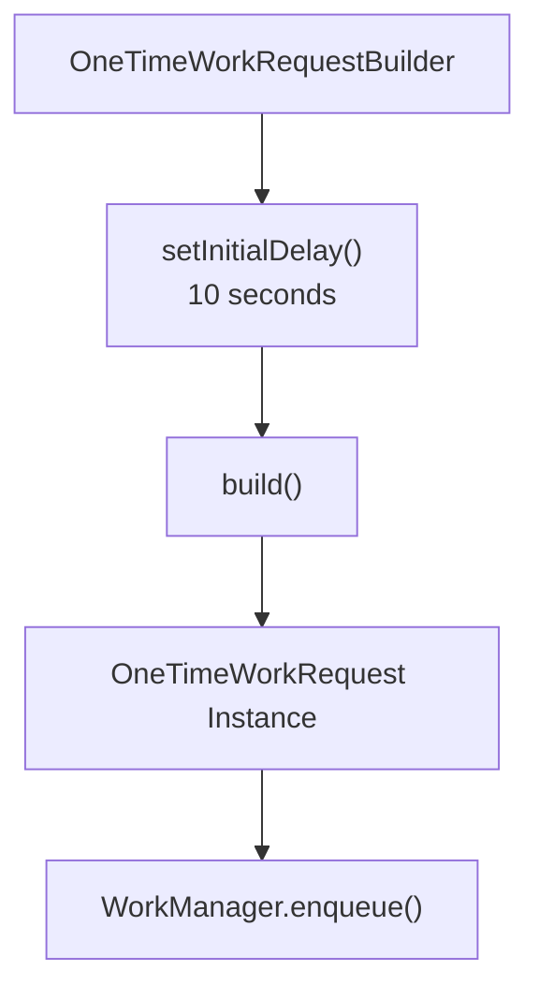
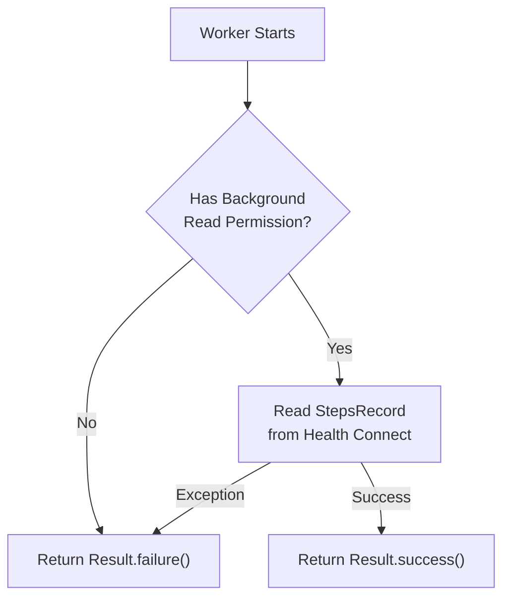
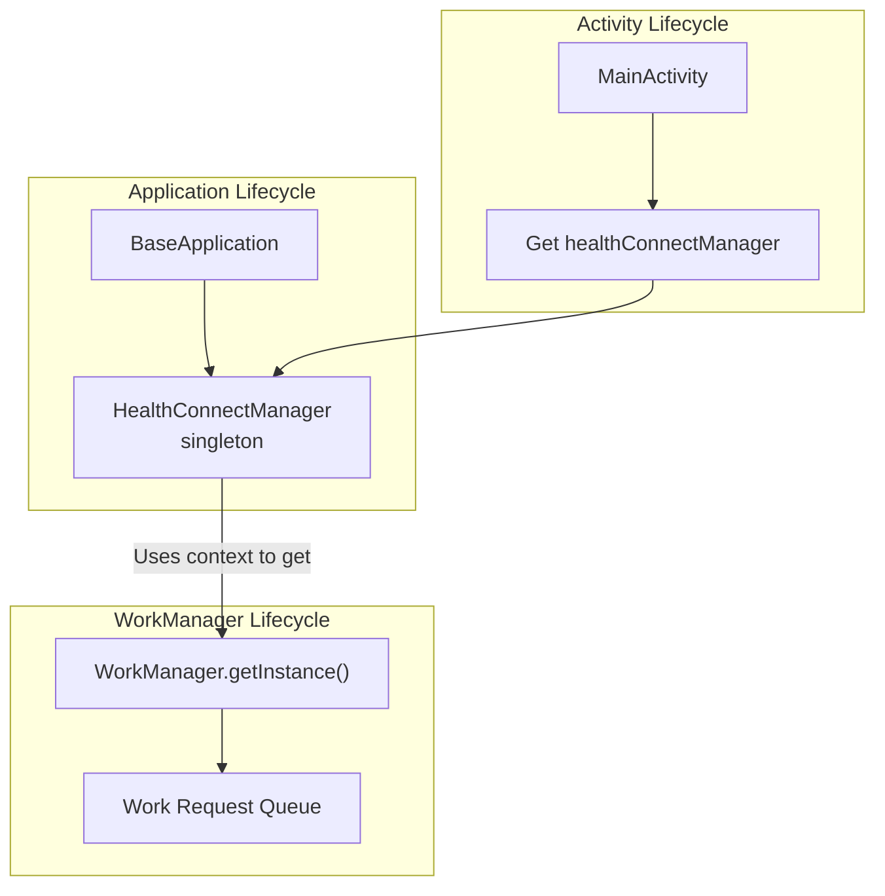
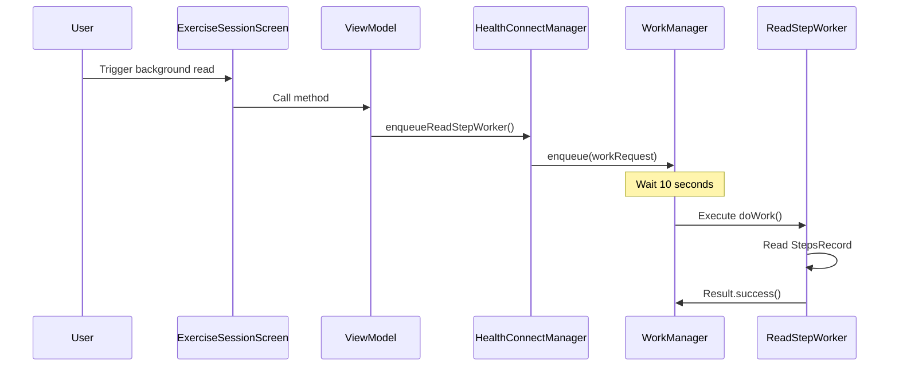

<!-- source: DeepWiki mcp.deepwiki.com · repo android/android-health-connect-codelab · page 5.8 Background Work with WorkManager · fetched 2026-10-23 -->

# Background Work with WorkManager

Relevant source files

The following files were used as context for generating this wiki page:

- [finished/src/main/java/com/example/healthconnect/codelab/data/HealthConnectManager.kt](finished/src/main/java/com/example/healthconnect/codelab/data/HealthConnectManager.kt)
- [finished/src/main/java/com/example/healthconnect/codelab/presentation/MainActivity.kt](finished/src/main/java/com/example/healthconnect/codelab/presentation/MainActivity.kt)

## Purpose and Scope

This document covers the integration of WorkManager with Health Connect for performing background data operations. The codelab demonstrates how to enqueue background work to read health data (specifically step counts) when the app is not in the foreground, using Android's WorkManager library.

For information about the broader data access patterns, see [Data Layer - HealthConnectManager](#5). For permission requirements specific to background access, see [Permission Management](#5.2).

## Overview of Background Work Architecture

The Health Connect Codelab implements background data reading using WorkManager to demonstrate accessing health data while the app is backgrounded. This pattern is essential for applications that need to synchronize or process health data periodically without user interaction.

**Sources:** [finished/src/main/java/com/example/healthconnect/codelab/data/HealthConnectManager.kt:304-309]()

## WorkManager Integration in HealthConnectManager

The `HealthConnectManager` class provides the `enqueueReadStepWorker()` method to schedule background work. This method creates a `OneTimeWorkRequest` configured with a 10-second initial delay before execution.

### Method Implementation

The enqueuing logic is implemented as follows:

| Aspect | Implementation Detail |
|--------|----------------------|
| Method Name | `enqueueReadStepWorker()` |
| Worker Type | `OneTimeWorkRequest<ReadStepWorker>` |
| Initial Delay | 10 seconds |
| Work Policy | Single execution (OneTime) |
| WorkManager Instance | Context-scoped singleton |

The method creates a work request builder, configures the delay, builds the request, and enqueues it with the WorkManager instance for the application context.

**Sources:** [finished/src/main/java/com/example/healthconnect/codelab/data/HealthConnectManager.kt:304-309]()

## The ReadStepWorker Class

The `ReadStepWorker` is a custom Worker implementation that executes background health data operations. While the worker class itself is imported from `com.example.healthconnect.codelab.workers.ReadStepWorker`, its integration demonstrates key patterns for background Health Connect access.

### Worker Characteristics

| Characteristic | Value/Description |
|----------------|-------------------|
| Base Class | `Worker` (from androidx.work) |
| Execution Context | Background thread managed by WorkManager |
| Permission Requirement | `READ_HEALTH_DATA_IN_BACKGROUND` |
| Data Type Read | `StepsRecord` |
| Failure Handling | Returns `Result.failure()` on exception |
| Success Handling | Returns `Result.success()` on completion |

**Sources:** [finished/src/main/java/com/example/healthconnect/codelab/data/HealthConnectManager.kt:42-44]()

## Enqueuing Configuration

The work request is configured with specific parameters to control its execution behavior:

### Configuration Details

The `OneTimeWorkRequestBuilder` pattern creates a single-execution work request. The 10-second delay ensures the work doesn't execute immediately, demonstrating how to schedule deferred background operations. The `TimeUnit.SECONDS` parameter explicitly specifies the delay unit.

The WorkManager singleton instance is retrieved via `WorkManager.getInstance(context)`, ensuring the work request is properly tracked within the application's WorkManager database.

**Sources:** [finished/src/main/java/com/example/healthconnect/codelab/data/HealthConnectManager.kt:305-308]()

## Background Read Permissions

Background access to Health Connect data requires specific permissions beyond standard read permissions. The worker must verify that the `READ_HEALTH_DATA_IN_BACKGROUND` permission is granted before attempting to access health data.

### Permission Requirements

| Permission | Purpose | Required For |
|-----------|---------|--------------|
| `READ_STEPS` | Read step count data | Accessing StepsRecord |
| `READ_HEALTH_DATA_IN_BACKGROUND` | Background data access | Worker execution |

Without the background read permission, the worker will fail to access Health Connect data even if the standard read permission is granted. The application must request this permission separately (see [Permission Management](#5.2)).

**Sources:** [finished/src/main/java/com/example/healthconnect/codelab/data/HealthConnectManager.kt:304-309]()

## Integration with Application Context

The WorkManager integration pattern relies on the application context to maintain the WorkManager lifecycle across activity recreations.

The `HealthConnectManager` is instantiated with the application context, ensuring that WorkManager operations are tied to the application lifecycle rather than individual activities. This prevents work cancellation when activities are destroyed.

**Sources:** [finished/src/main/java/com/example/healthconnect/codelab/presentation/MainActivity.kt:29-32](), [finished/src/main/java/com/example/healthconnect/codelab/data/HealthConnectManager.kt:59-60]()

## Usage Pattern in the Application

The background work is triggered from the presentation layer through the ViewModel layer, maintaining clean architectural separation.

### Invocation Flow

The user initiates background work through a UI action. The screen delegates to its ViewModel, which calls the `enqueueReadStepWorker()` method on the `HealthConnectManager` instance. The work request is then handled independently by WorkManager, executing after the configured delay regardless of whether the originating activity is still active.

**Sources:** [finished/src/main/java/com/example/healthconnect/codelab/data/HealthConnectManager.kt:304-309]()

## Work Request Lifecycle

The OneTimeWorkRequest follows a specific lifecycle from creation to completion:

| State | Description | Duration |
|-------|-------------|----------|
| Enqueued | Work added to WorkManager queue | Immediate |
| Scheduled | Waiting for delay to elapse | 10 seconds |
| Running | Worker executing doWork() method | Variable |
| Succeeded | Result.success() returned | Terminal state |
| Failed | Result.failure() returned | Terminal state |

WorkManager persists the work request state across application restarts, ensuring reliable execution even if the app process is killed during the delay period.

**Sources:** [finished/src/main/java/com/example/healthconnect/codelab/data/HealthConnectManager.kt:305-308]()

## Key Design Patterns

The WorkManager integration demonstrates several important patterns:

1. **Separation of Concerns**: The worker logic is separate from the data manager, which is separate from the UI layer
2. **Context Management**: Uses application context to prevent lifecycle issues
3. **Delayed Execution**: Demonstrates scheduling work for future execution
4. **Permission Awareness**: Background work must verify background-specific permissions
5. **Singleton WorkManager**: Uses the shared WorkManager instance rather than creating new instances

These patterns ensure that background health data access is reliable, maintainable, and follows Android best practices for background work execution.

**Sources:** [finished/src/main/java/com/example/healthconnect/codelab/data/HealthConnectManager.kt:42-44](), [finished/src/main/java/com/example/healthconnect/codelab/data/HealthConnectManager.kt:304-309]()

---

