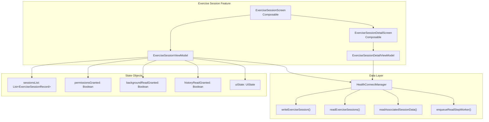
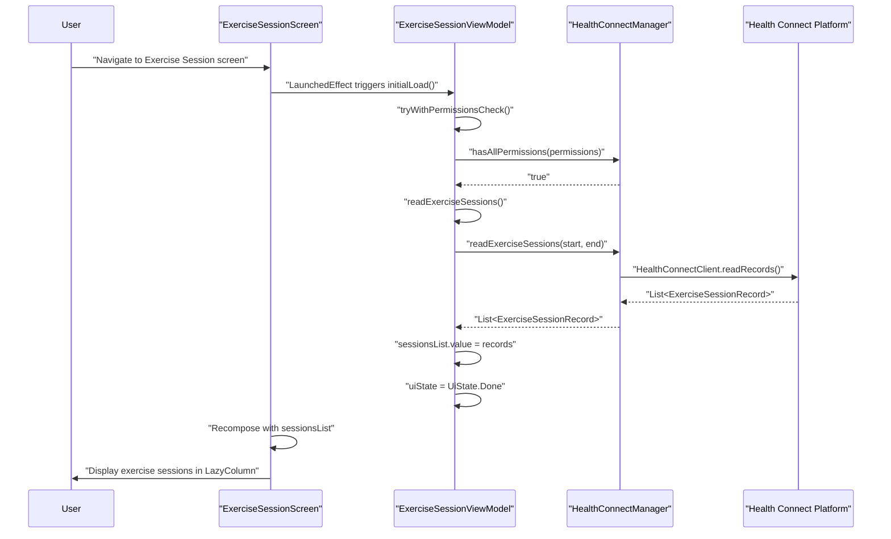
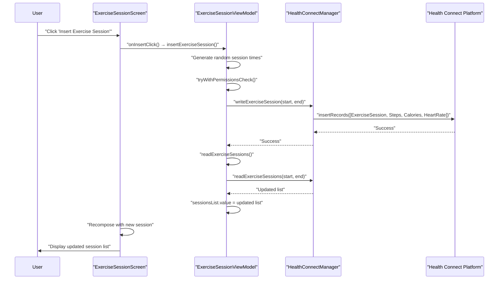
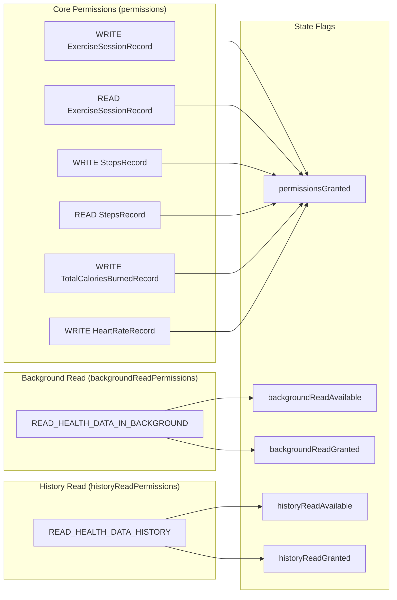
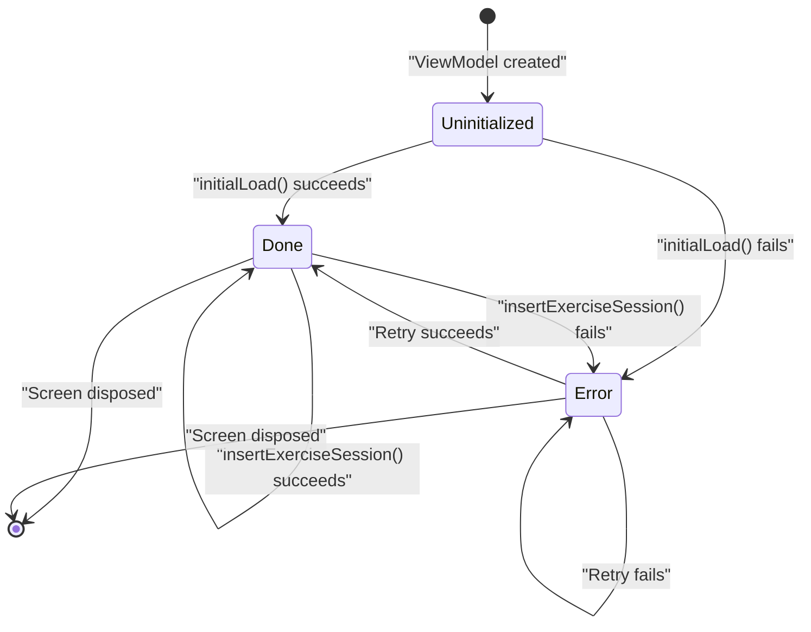
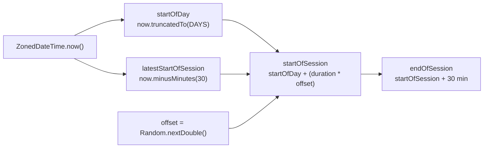
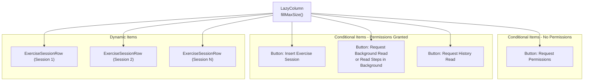

<!-- source: DeepWiki mcp.deepwiki.com · repo android/android-health-connect-codelab · page 6 Feature: Exercise Sessions · fetched 2026-10-23 -->

# Feature: Exercise Sessions

<details>
<summary>Relevant source files</summary>

The following files were used as context for generating this wiki page:

- [finished/src/main/java/com/example/healthconnect/codelab/presentation/screen/exercisesession/ExerciseSessionScreen.kt](finished/src/main/java/com/example/healthconnect/codelab/presentation/screen/exercisesession/ExerciseSessionScreen.kt)
- [finished/src/main/java/com/example/healthconnect/codelab/presentation/screen/exercisesession/ExerciseSessionViewModel.kt](finished/src/main/java/com/example/healthconnect/codelab/presentation/screen/exercisesession/ExerciseSessionViewModel.kt)

</details>


## Purpose and Scope

This document provides an overview of the Exercise Session feature in the Health Connect Codelab. The feature enables users to view, create, and inspect exercise sessions stored in Health Connect. It demonstrates reading `ExerciseSessionRecord` data, writing exercise sessions with associated time-series data (heart rate, steps, calories), and navigating to detailed session views.

For detailed information about the HealthConnectManager methods used by this feature, see [Data Layer - HealthConnectManager](#5). For UI architecture patterns and state management, see [UI Architecture Patterns](#9). For the detail view implementation, see [Exercise Session Detail View](#6.3).

---

## Feature Architecture

The Exercise Session feature consists of four primary components organized into a list-detail pattern:

| Component | File Path | Responsibility |
|-----------|-----------|----------------|
| `ExerciseSessionScreen` | [finished/src/main/java/com/example/healthconnect/codelab/presentation/screen/exercisesession/ExerciseSessionScreen.kt]() | Displays list of exercise sessions and permission controls |
| `ExerciseSessionViewModel` | [finished/src/main/java/com/example/healthconnect/codelab/presentation/screen/exercisesession/ExerciseSessionViewModel.kt]() | Manages state, permissions, and data operations for the list view |
| `ExerciseSessionDetailScreen` | (Not in provided files) | Displays detailed metrics for a single exercise session |
| `ExerciseSessionDetailViewModel` | (Not in provided files) | Manages state and data operations for the detail view |



**Sources:** [finished/src/main/java/com/example/healthconnect/codelab/presentation/screen/exercisesession/ExerciseSessionScreen.kt:44-188](), [finished/src/main/java/com/example/healthconnect/codelab/presentation/screen/exercisesession/ExerciseSessionViewModel.kt:44-164]()

---

## User Journey and Data Flow

The Exercise Session feature supports three primary user flows: viewing existing sessions, creating new sessions, and examining session details.

### Flow 1: Viewing Exercise Sessions



**Sources:** [finished/src/main/java/com/example/healthconnect/codelab/presentation/screen/exercisesession/ExerciseSessionScreen.kt:71-85](), [finished/src/main/java/com/example/healthconnect/codelab/presentation/screen/exercisesession/ExerciseSessionViewModel.kt:82-114]()

### Flow 2: Creating Exercise Sessions



**Sources:** [finished/src/main/java/com/example/healthconnect/codelab/presentation/screen/exercisesession/ExerciseSessionScreen.kt:110-115](), [finished/src/main/java/com/example/healthconnect/codelab/presentation/screen/exercisesession/ExerciseSessionViewModel.kt:90-107]()

### Flow 3: Navigating to Session Details

When a user taps on an exercise session row, the application navigates to the detail screen, passing the session's UID as a navigation argument. The detail screen then loads associated data including aggregated metrics and time-series heart rate samples.

**Sources:** [finished/src/main/java/com/example/healthconnect/codelab/presentation/screen/exercisesession/ExerciseSessionScreen.kt:173-183]()

---

## Core Data Operations

The Exercise Session feature uses the following `HealthConnectManager` methods:

| Method | Purpose | Called By | Time Range |
|--------|---------|-----------|------------|
| `readExerciseSessions(startTime, endTime)` | Retrieves all exercise sessions within a time range | `ExerciseSessionViewModel.readExerciseSessions()` | Last 90 days to now |
| `writeExerciseSession(startTime, endTime)` | Creates a new exercise session with steps, calories, and heart rate data | `ExerciseSessionViewModel.insertExerciseSession()` | Generated random time within today |
| `enqueueReadStepWorker()` | Schedules background work to read step data | `ExerciseSessionViewModel.enqueueReadStepWorker()` | N/A (background task) |
| `readAssociatedSessionData(uid)` | Retrieves detailed metrics for a specific session | `ExerciseSessionDetailViewModel` (not in provided files) | N/A |

The `readExerciseSessions()` method queries for records from 90 days prior to the current day, as seen in [finished/src/main/java/com/example/healthconnect/codelab/presentation/screen/exercisesession/ExerciseSessionViewModel.kt:110-111]():

```kotlin
val start = ZonedDateTime.now().truncatedTo(ChronoUnit.DAYS).minusDays(90)
val now = Instant.now()
```

**Sources:** [finished/src/main/java/com/example/healthconnect/codelab/presentation/screen/exercisesession/ExerciseSessionViewModel.kt:109-114]()

---

## Permission Management

The Exercise Session feature manages three distinct permission sets, each controlling different aspects of Health Connect access:

### Permission Set Definitions



**Sources:** [finished/src/main/java/com/example/healthconnect/codelab/presentation/screen/exercisesession/ExerciseSessionViewModel.kt:46-72]()

### Permission State Management

The `tryWithPermissionsCheck()` method [finished/src/main/java/com/example/healthconnect/codelab/presentation/screen/exercisesession/ExerciseSessionViewModel.kt:130-154]() performs comprehensive permission checking before executing any Health Connect operation:

1. **Check core permissions** - Verifies all read/write permissions for exercise, steps, calories, and heart rate
2. **Check feature availability** - Determines if background read and history read features are available on the device
3. **Check special permissions** - Verifies background read and history read permissions are granted
4. **Execute operation** - Only if core permissions are granted
5. **Handle errors** - Catches `RemoteException`, `SecurityException`, `IOException`, and `IllegalStateException`

The UI conditionally renders three types of buttons based on permission state:

- **Permission Request Button** - Shown when core permissions are not granted [finished/src/main/java/com/example/healthconnect/codelab/presentation/screen/exercisesession/ExerciseSessionScreen.kt:93-102]()
- **Background Read Button** - Shown when background permission is available but not granted [finished/src/main/java/com/example/healthconnect/codelab/presentation/screen/exercisesession/ExerciseSessionScreen.kt:117-135]()
- **History Read Button** - Shown when history read permission is available but not granted [finished/src/main/java/com/example/healthconnect/codelab/presentation/screen/exercisesession/ExerciseSessionScreen.kt:152-171]()

**Sources:** [finished/src/main/java/com/example/healthconnect/codelab/presentation/screen/exercisesession/ExerciseSessionViewModel.kt:130-154](), [finished/src/main/java/com/example/healthconnect/codelab/presentation/screen/exercisesession/ExerciseSessionScreen.kt:93-171]()

---

## State Management

The `ExerciseSessionViewModel` uses a `UiState` sealed class to represent the loading lifecycle:



The sealed class definition [finished/src/main/java/com/example/healthconnect/codelab/presentation/screen/exercisesession/ExerciseSessionViewModel.kt:156-163]():

- **`UiState.Uninitialized`** - Initial state before any data has been loaded
- **`UiState.Done`** - Operation completed successfully
- **`UiState.Error(exception, uuid)`** - Operation failed with an exception; includes a unique UUID to prevent duplicate error displays during recomposition

The screen observes `uiState` using `LaunchedEffect` [finished/src/main/java/com/example/healthconnect/codelab/presentation/screen/exercisesession/ExerciseSessionScreen.kt:71-85]() and triggers initial loading when in the `Uninitialized` state. When an error occurs, it uses UUID comparison to avoid showing the same error multiple times.

**Sources:** [finished/src/main/java/com/example/healthconnect/codelab/presentation/screen/exercisesession/ExerciseSessionViewModel.kt:156-163](), [finished/src/main/java/com/example/healthconnect/codelab/presentation/screen/exercisesession/ExerciseSessionScreen.kt:67-85]()

---

## Exercise Session Creation

The `insertExerciseSession()` method [finished/src/main/java/com/example/healthconnect/codelab/presentation/screen/exercisesession/ExerciseSessionViewModel.kt:90-107]() generates a random exercise session with the following characteristics:

### Time Generation Algorithm



This algorithm ensures:
- Sessions are created within the current day
- Session start times are at least 30 minutes before the current time
- Session duration is exactly 30 minutes
- Start time is randomly distributed between midnight and (now - 30 minutes)

The method then calls `healthConnectManager.writeExerciseSession(startOfSession, endOfSession)` which creates:
- An `ExerciseSessionRecord`
- Associated `StepsRecord` data
- Associated `TotalCaloriesBurnedRecord` data
- Associated `HeartRateRecord` time-series data

After successful insertion, the method calls `readExerciseSessions()` to refresh the list with the newly created session.

**Sources:** [finished/src/main/java/com/example/healthconnect/codelab/presentation/screen/exercisesession/ExerciseSessionViewModel.kt:90-107]()

---

## Background Work Integration

The Exercise Session feature includes integration with WorkManager for background data operations. When the user clicks the "Read Steps in Background" button (shown after background read permission is granted), the screen calls `onBackgroundReadClick()` which triggers `viewModel.enqueueReadStepWorker()` [finished/src/main/java/com/example/healthconnect/codelab/presentation/screen/exercisesession/ExerciseSessionViewModel.kt:116-118]().

This demonstrates Health Connect's background read capability, which allows apps to access health data when running in the background. The feature is only available on certain Android versions and requires the `READ_HEALTH_DATA_IN_BACKGROUND` permission.

**Sources:** [finished/src/main/java/com/example/healthconnect/codelab/presentation/screen/exercisesession/ExerciseSessionScreen.kt:137-149](), [finished/src/main/java/com/example/healthconnect/codelab/presentation/screen/exercisesession/ExerciseSessionViewModel.kt:116-118]()

---

## UI Component Hierarchy

The `ExerciseSessionScreen` Composable uses a `LazyColumn` to efficiently render the session list:



Each `ExerciseSessionRow` displays:
- Start time (converted to `ZonedDateTime` using session's `startZoneOffset`)
- End time (converted to `ZonedDateTime` using session's `endZoneOffset`)
- Session UID (`metadata.id`)
- Data origin package name (`metadata.dataOrigin.packageName`)
- Session title (or "No title" if null)

When clicked, the row calls `onDetailsClick(uid)`, which navigates to the detail screen.

**Sources:** [finished/src/main/java/com/example/healthconnect/codelab/presentation/screen/exercisesession/ExerciseSessionScreen.kt:88-187]()

---

## ViewModel Factory Pattern

The feature uses a `ViewModelFactory` to inject dependencies [finished/src/main/java/com/example/healthconnect/codelab/presentation/screen/exercisesession/ExerciseSessionViewModel.kt:166-178]():

```kotlin
class ExerciseSessionViewModelFactory(
    private val healthConnectManager: HealthConnectManager,
) : ViewModelProvider.Factory {
  override fun <T : ViewModel> create(modelClass: Class<T>): T {
    if (modelClass.isAssignableFrom(ExerciseSessionViewModel::class.java)) {
      @Suppress("UNCHECKED_CAST")
      return ExerciseSessionViewModel(
        healthConnectManager = healthConnectManager
      ) as T
    }
    throw IllegalArgumentException("Unknown ViewModel class")
  }
}
```

This pattern allows the `HealthConnectManager` instance to be injected into the ViewModel, enabling proper separation of concerns and testability.

**Sources:** [finished/src/main/java/com/example/healthconnect/codelab/presentation/screen/exercisesession/ExerciseSessionViewModel.kt:166-178]()

---

## Related Documentation

For implementation details of specific components:
- **Screen UI implementation** - See [ExerciseSessionScreen UI](#6.1)
- **ViewModel state management** - See [ExerciseSessionViewModel Logic](#6.2)
- **Detail view implementation** - See [Exercise Session Detail View](#6.3)
- **Health Connect data operations** - See [Data Layer - HealthConnectManager](#5)
- **Permission handling patterns** - See [Permission Management](#5.2)
- **UI state patterns** - See [State Management with UiState](#9.1)
- **Error handling** - See [Error Handling and User Feedback](#9.2)

---

