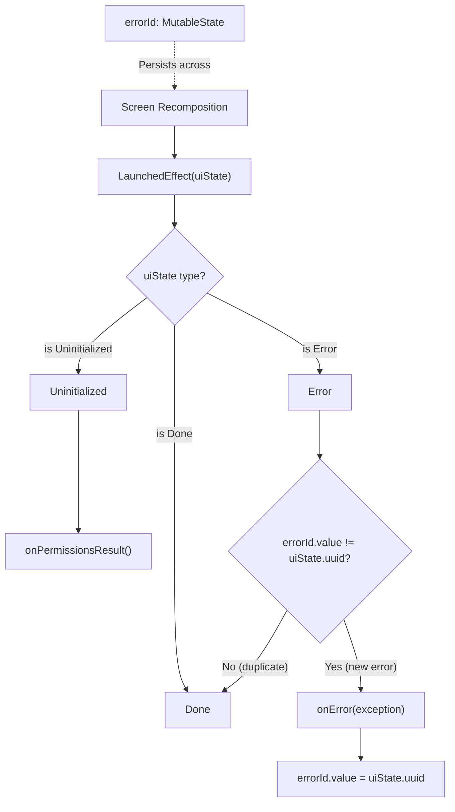
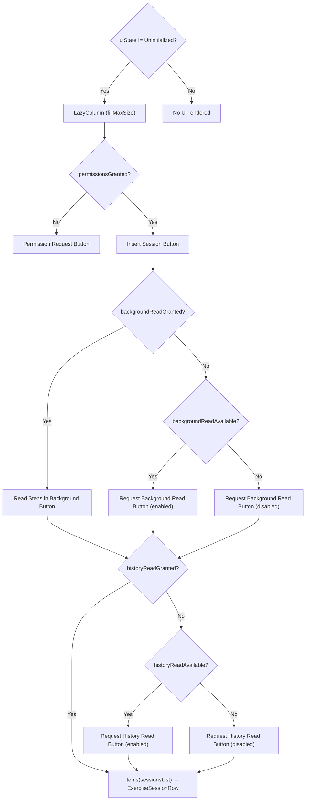
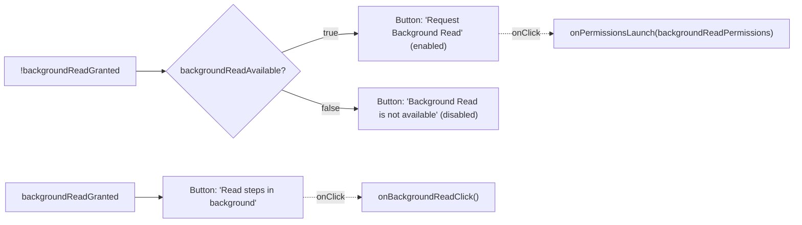
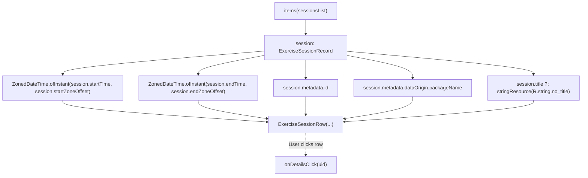
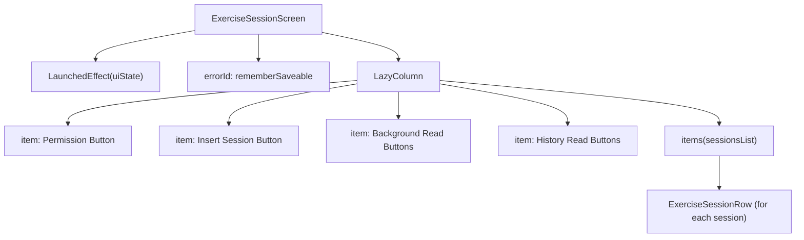

<!-- source: DeepWiki mcp.deepwiki.com · repo android/android-health-connect-codelab · page 6.1 ExerciseSessionScreen UI · fetched 2026-10-23 -->

# ExerciseSessionScreen UI

Relevant source files

The following files were used as context for generating this wiki page:

- [finished/src/main/java/com/example/healthconnect/codelab/presentation/screen/exercisesession/ExerciseSessionScreen.kt](finished/src/main/java/com/example/healthconnect/codelab/presentation/screen/exercisesession/ExerciseSessionScreen.kt)
- [finished/src/main/res/values/strings.xml](finished/src/main/res/values/strings.xml)
- [start/src/main/java/com/example/healthconnect/codelab/presentation/screen/exercisesession/ExerciseSessionScreen.kt](start/src/main/java/com/example/healthconnect/codelab/presentation/screen/exercisesession/ExerciseSessionScreen.kt)
- [start/src/main/res/values/strings.xml](start/src/main/res/values/strings.xml)

This document describes the `ExerciseSessionScreen` Composable function, which displays a list of exercise sessions and provides UI controls for permissions management and data operations. This page focuses on the UI layer implementation. For the business logic and state management, see [ExerciseSessionViewModel Logic](#6.2). For the detail view of individual sessions, see [Exercise Session Detail View](#6.3).

## Purpose and Scope

The `ExerciseSessionScreen` is the primary UI component for the exercise session feature. It implements a scrollable list interface that displays `ExerciseSessionRecord` objects from the current day. The screen conditionally renders different UI elements based on permission states, handles error reporting with deduplication, and delegates user actions to callback functions provided by the navigation layer.

**Sources:** [finished/src/main/java/com/example/healthconnect/codelab/presentation/screen/exercisesession/ExerciseSessionScreen.kt:44-46]()

## Composable Function Signature

The `ExerciseSessionScreen` function is located at [finished/src/main/java/com/example/healthconnect/codelab/presentation/screen/exercisesession/ExerciseSessionScreen.kt:48-65](). It accepts 14 parameters organized into four categories:

### Permission Parameters

| Parameter | Type | Description |
|-----------|------|-------------|
| `permissions` | `Set<String>` | Core Health Connect permissions (read/write for exercise, steps, heart rate, etc.) |
| `permissionsGranted` | `Boolean` | Whether core permissions have been granted |
| `backgroundReadPermissions` | `Set<String>` | Background read permission set |
| `backgroundReadAvailable` | `Boolean` | Whether background read is available on the device |
| `backgroundReadGranted` | `Boolean` | Whether background read permission is granted |
| `historyReadPermissions` | `Set<String>` | History read permission set |
| `historyReadAvailable` | `Boolean` | Whether history read is available on the device |
| `historyReadGranted` | `Boolean` | Whether history read permission is granted |

### Data Parameters

| Parameter | Type | Description |
|-----------|------|-------------|
| `sessionsList` | `List<ExerciseSessionRecord>` | Exercise sessions to display in the list |
| `uiState` | `ExerciseSessionViewModel.UiState` | Current UI state (Uninitialized/Done/Error) |

### Callback Parameters

| Parameter | Type | Description |
|-----------|------|-------------|
| `onBackgroundReadClick` | `() -> Unit` | Invoked when user triggers background step reading |
| `onInsertClick` | `() -> Unit` | Invoked when user clicks "Insert session" button |
| `onDetailsClick` | `(String) -> Unit` | Invoked when user clicks a session row, receives session UID |
| `onError` | `(Throwable?) -> Unit` | Invoked when an error needs to be displayed |
| `onPermissionsResult` | `() -> Unit` | Invoked to refresh data after permission check |
| `onPermissionsLaunch` | `(Set<String>) -> Unit` | Invoked to launch permission request dialog |

**Sources:** [finished/src/main/java/com/example/healthconnect/codelab/presentation/screen/exercisesession/ExerciseSessionScreen.kt:48-65]()

## UI State Management and Lifecycle

**Diagram: ExerciseSessionScreen State Management Flow**

The screen implements error deduplication using a `rememberSaveable` state holder at [finished/src/main/java/com/example/healthconnect/codelab/presentation/screen/exercisesession/ExerciseSessionScreen.kt:69](). This `errorId` persists across configuration changes and prevents duplicate error notifications when the screen recomposes with the same error state.

The `LaunchedEffect(uiState)` block at [finished/src/main/java/com/example/healthconnect/codelab/presentation/screen/exercisesession/ExerciseSessionScreen.kt:71-85]() performs two key operations:

1. **Initial Data Load**: If `uiState is ExerciseSessionViewModel.UiState.Uninitialized`, it invokes `onPermissionsResult()` to trigger permission checking and data loading.

2. **Error Handling with Deduplication**: If `uiState is ExerciseSessionViewModel.UiState.Error`, it compares the error's UUID with the saved `errorId`. Only if they differ does it call `onError()` and update `errorId`, preventing duplicate error messages.

**Sources:** [finished/src/main/java/com/example/healthconnect/codelab/presentation/screen/exercisesession/ExerciseSessionScreen.kt:67-85]()

## Conditional UI Rendering

**Diagram: ExerciseSessionScreen Conditional Rendering Logic**

The screen's UI structure is entirely conditional based on permission states. At [finished/src/main/java/com/example/healthconnect/codelab/presentation/screen/exercisesession/ExerciseSessionScreen.kt:87](), the outer conditional checks if `uiState != ExerciseSessionViewModel.UiState.Uninitialized`. If still uninitialized, no UI is rendered.

Once initialized, a `LazyColumn` is rendered with modifiers `fillMaxSize()`, `Arrangement.Top`, and `Alignment.CenterHorizontally` [finished/src/main/java/com/example/healthconnect/codelab/presentation/screen/exercisesession/ExerciseSessionScreen.kt:88-92]().

**Sources:** [finished/src/main/java/com/example/healthconnect/codelab/presentation/screen/exercisesession/ExerciseSessionScreen.kt:87-187]()

## Permission Request Flow

### Core Permissions Request

When `!permissionsGranted`, a single button is rendered at [finished/src/main/java/com/example/healthconnect/codelab/presentation/screen/exercisesession/ExerciseSessionScreen.kt:94-102](). This button:

- Displays the text from `R.string.permissions_button_label` ("Request permissions")
- Invokes `onPermissionsLaunch(permissions)` when clicked
- Is the only interactive element until core permissions are granted

### Insert Session Button

Once core permissions are granted, the "Insert session" button appears at [finished/src/main/java/com/example/healthconnect/codelab/presentation/screen/exercisesession/ExerciseSessionScreen.kt:104-116]() with:

- Text from `R.string.insert_exercise_session` ("Insert session")
- `onClick` handler calling `onInsertClick()`
- Modifiers: `fillMaxWidth()`, `height(48.dp)`, `padding(4.dp)`

### Background Read Permission Flow

The background read section at [finished/src/main/java/com/example/healthconnect/codelab/presentation/screen/exercisesession/ExerciseSessionScreen.kt:117-150]() implements a three-state logic:

**Diagram: Background Read Permission State Machine**

**Sources:** [finished/src/main/java/com/example/healthconnect/codelab/presentation/screen/exercisesession/ExerciseSessionScreen.kt:117-150]()

### History Read Permission Flow

The history read section at [finished/src/main/java/com/example/healthconnect/codelab/presentation/screen/exercisesession/ExerciseSessionScreen.kt:152-171]() follows an identical pattern to background read:

- If `!historyReadGranted`, renders a request button
- Button is `enabled = historyReadAvailable`
- Text differs based on availability: `R.string.request_history_read` vs `R.string.history_read_is_not_available`
- `onClick` invokes `onPermissionsLaunch(historyReadPermissions)`

**Sources:** [finished/src/main/java/com/example/healthconnect/codelab/presentation/screen/exercisesession/ExerciseSessionScreen.kt:152-171](), [finished/src/main/res/values/strings.xml:75-76]()

## Exercise Session List Rendering

**Diagram: Exercise Session List Item Rendering**

The session list is rendered at [finished/src/main/java/com/example/healthconnect/codelab/presentation/screen/exercisesession/ExerciseSessionScreen.kt:173-184]() using the `items` function from `LazyColumn`. For each `session` in `sessionsList`:

1. **Time Conversion**: Start and end times are converted from `Instant` to `ZonedDateTime` using the session's zone offsets
2. **Metadata Extraction**: The session's `metadata.id` and `metadata.dataOrigin.packageName` are extracted
3. **Title Handling**: The session's `title` field is used, falling back to `R.string.no_title` ("[No title]") if null
4. **Row Component**: All extracted data is passed to `ExerciseSessionRow`, which renders the visual representation
5. **Click Handling**: The `onDetailsClick` callback is passed through, receiving the session's UID when clicked

The `ExerciseSessionRow` component is a reusable UI element defined elsewhere in the codebase (see section 9 for common UI patterns).

**Sources:** [finished/src/main/java/com/example/healthconnect/codelab/presentation/screen/exercisesession/ExerciseSessionScreen.kt:173-184](), [finished/src/main/res/values/strings.xml:70]()

## Screen Component Hierarchy

**Diagram: ExerciseSessionScreen Component Tree**

**Sources:** [finished/src/main/java/com/example/healthconnect/codelab/presentation/screen/exercisesession/ExerciseSessionScreen.kt:48-188]()

## String Resources

The screen uses the following string resources from [finished/src/main/res/values/strings.xml]():

| String Resource ID | Value | Usage Location |
|-------------------|-------|----------------|
| `permissions_button_label` | "Request permissions" | Core permission button |
| `insert_exercise_session` | "Insert session" | Insert session button |
| `request_background_read` | "Request Background Read" | Background permission button (available) |
| `background_read_is_not_available` | "Background Read is not available" | Background permission button (unavailable) |
| `read_steps_in_background` | "Read steps in background" | Background read action button |
| `request_history_read` | "Request History Read" | History permission button (available) |
| `history_read_is_not_available` | "History Read is not available" | History permission button (unavailable) |
| `no_title` | "[No title]" | Fallback for sessions without titles |

**Sources:** [finished/src/main/res/values/strings.xml:65-76]()

## Preview Composable

The `ExerciseSessionScreenPreview` function at [finished/src/main/java/com/example/healthconnect/codelab/presentation/screen/exercisesession/ExerciseSessionScreen.kt:190-230]() demonstrates the screen's appearance with sample data. It creates:

- Two `ExerciseSessionRecord` instances (one running, one walking)
- Sample timestamps using `ZonedDateTime.now()` with 30-minute durations
- Manual entry metadata with random UUIDs
- Different exercise types (`EXERCISE_TYPE_RUNNING`, `EXERCISE_TYPE_WALKING`)

The preview shows the screen with `permissionsGranted = true`, `backgroundReadGranted = false`, `historyReadGranted = false`, and `uiState = Done`, demonstrating the typical state after core permissions are granted but before optional permissions.

**Sources:** [finished/src/main/java/com/example/healthconnect/codelab/presentation/screen/exercisesession/ExerciseSessionScreen.kt:190-230]()

## Module Consistency

The `ExerciseSessionScreen` implementation is identical in both the `start` and `finished` modules. The screen's UI structure is complete in the starter template because it depends on ViewModel callbacks for functionality. The learning exercise focuses on implementing the ViewModel logic and `HealthConnectManager` methods that the UI invokes, not on building the UI itself.

**Sources:** [start/src/main/java/com/example/healthconnect/codelab/presentation/screen/exercisesession/ExerciseSessionScreen.kt:1-231](), [finished/src/main/java/com/example/healthconnect/codelab/presentation/screen/exercisesession/ExerciseSessionScreen.kt:1-231]()

---

