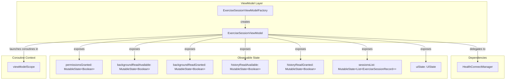
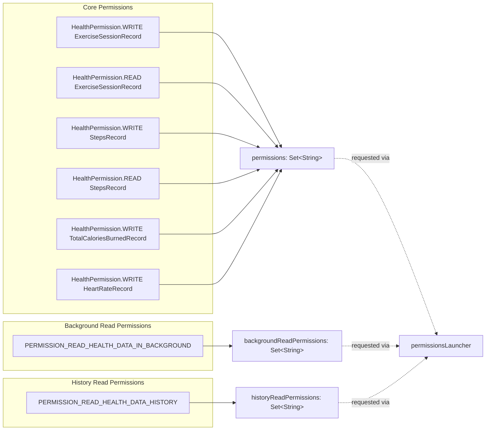
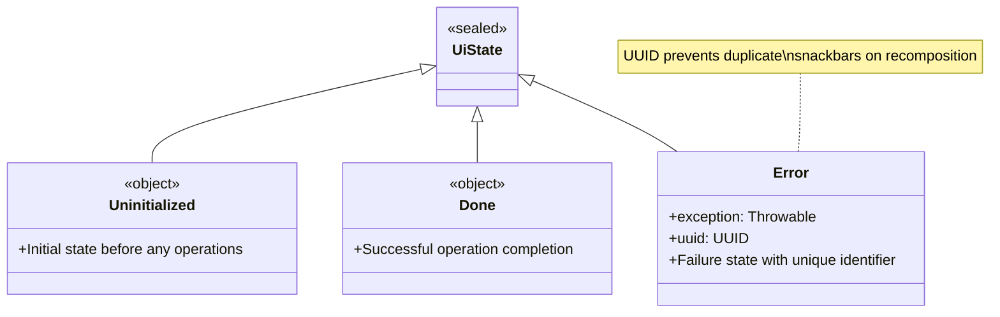
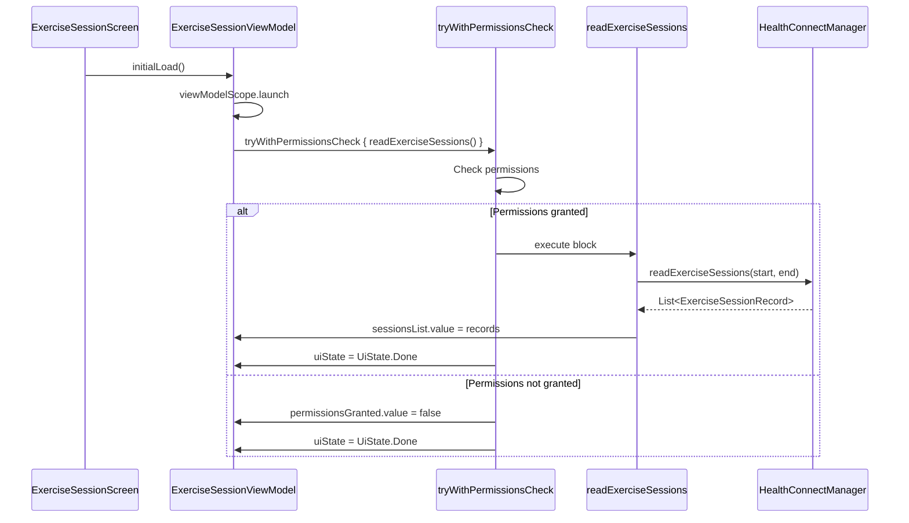
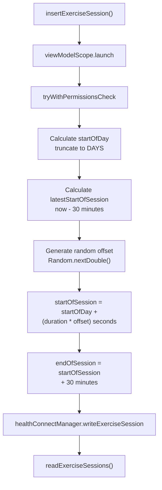
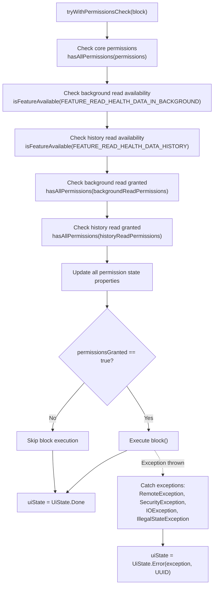
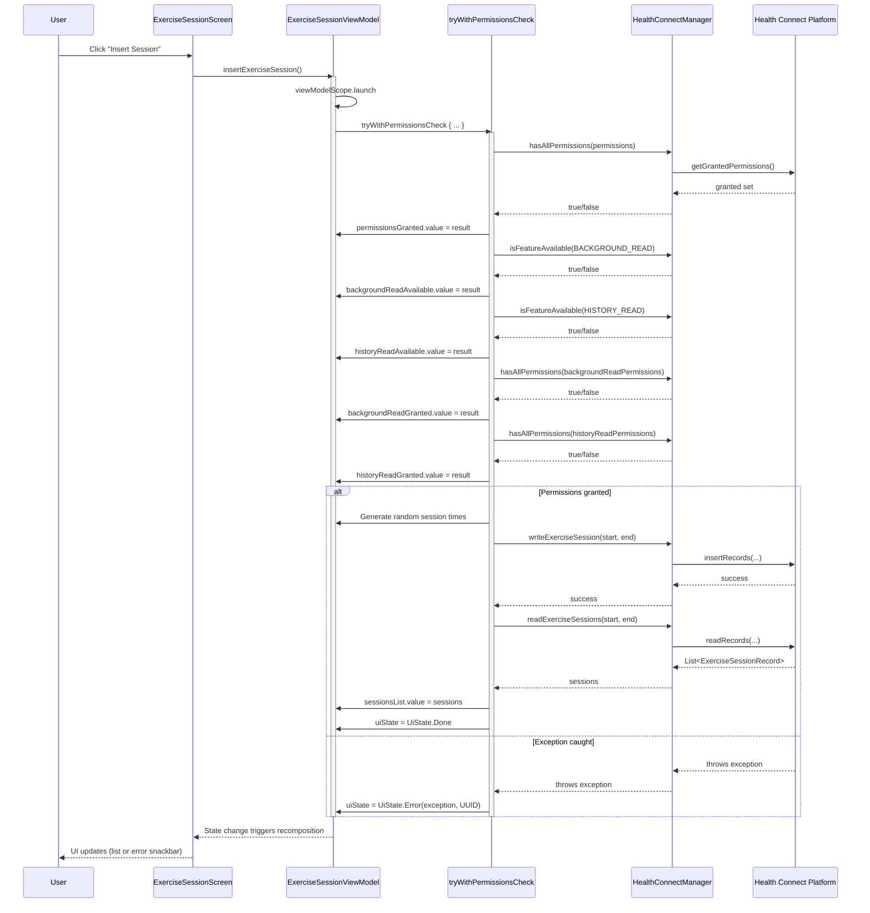
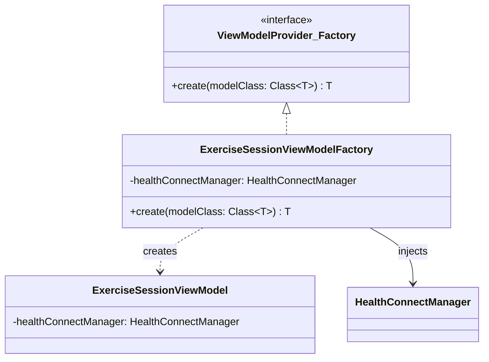

<!-- source: DeepWiki mcp.deepwiki.com · repo android/android-health-connect-codelab · page 6.2 ExerciseSessionViewModel Logic · fetched 2026-10-23 -->

# ExerciseSessionViewModel Logic

Relevant source files

The following files were used as context for generating this wiki page:

- [finished/src/main/java/com/example/healthconnect/codelab/presentation/screen/exercisesession/ExerciseSessionViewModel.kt](finished/src/main/java/com/example/healthconnect/codelab/presentation/screen/exercisesession/ExerciseSessionViewModel.kt)
- [start/src/main/java/com/example/healthconnect/codelab/presentation/screen/exercisesession/ExerciseSessionViewModel.kt](start/src/main/java/com/example/healthconnect/codelab/presentation/screen/exercisesession/ExerciseSessionViewModel.kt)

## Purpose and Scope

This document explains the `ExerciseSessionViewModel` class, which manages state and business logic for the Exercise Session feature. The ViewModel handles permission checking, exercise session data operations (read/write), error handling with UUID deduplication, and integration with background work scheduling.

For information about the UI layer that consumes this ViewModel, see [ExerciseSessionScreen UI](#6.1). For details about the underlying data operations, see [Data Layer - HealthConnectManager](#5).

**Sources:** [finished/src/main/java/com/example/healthconnect/codelab/presentation/screen/exercisesession/ExerciseSessionViewModel.kt:1-179]()

---

## Class Overview and Dependencies

The `ExerciseSessionViewModel` extends `ViewModel` from Jetpack Lifecycle and depends on a single `HealthConnectManager` instance for all Health Connect operations. It follows the MVVM pattern, exposing observable state properties that drive UI recomposition.

**Sources:** [finished/src/main/java/com/example/healthconnect/codelab/presentation/screen/exercisesession/ExerciseSessionViewModel.kt:44-80](), [finished/src/main/java/com/example/healthconnect/codelab/presentation/screen/exercisesession/ExerciseSessionViewModel.kt:166-178]()

---

## Permission Model and State Management

The ViewModel defines three distinct permission sets with corresponding state properties to track availability and grant status.

### Permission Set Definitions

| Permission Set | Purpose | State Properties |
|----------------|---------|------------------|
| **`permissions`** | Core read/write permissions for exercise sessions and associated data | `permissionsGranted` |
| **`backgroundReadPermissions`** | Permission to read health data while app is in background | `backgroundReadAvailable`, `backgroundReadGranted` |
| **`historyReadPermissions`** | Permission to access historical health data beyond default time limits | `historyReadAvailable`, `historyReadGranted` |

**Sources:** [finished/src/main/java/com/example/healthconnect/codelab/presentation/screen/exercisesession/ExerciseSessionViewModel.kt:46-72](), [finished/src/main/java/com/example/healthconnect/codelab/presentation/screen/exercisesession/ExerciseSessionViewModel.kt:80]()

---

## UiState Pattern

The ViewModel uses a sealed class pattern to represent three distinct UI states. The `Error` state includes a unique UUID to prevent duplicate snackbar displays during recomposition.

**State Transition Rules:**
- Initial state: `Uninitialized`
- After any successful operation (with or without permissions): `Done`
- After any caught exception: `Error(exception, randomUUID)`
- The UUID in `Error` is randomly generated on each exception occurrence

**Sources:** [finished/src/main/java/com/example/healthconnect/codelab/presentation/screen/exercisesession/ExerciseSessionViewModel.kt:156-163]()

---

## Core Public Functions

### initialLoad()

Called when the screen is first displayed. Triggers a permission check and loads the exercise sessions list.

**Sources:** [finished/src/main/java/com/example/healthconnect/codelab/presentation/screen/exercisesession/ExerciseSessionViewModel.kt:82-88]()

---

### insertExerciseSession()

Generates a random exercise session starting at a random time between the start of the current day and 30 minutes ago, with a 30-minute duration. After inserting, it refreshes the sessions list.

**Time Calculation Algorithm:**
1. `startOfDay` = Current date at 00:00:00
2. `latestStartOfSession` = Current time minus 30 minutes
3. `offset` = Random double between 0.0 and 1.0
4. `startOfSession` = `startOfDay` + (duration between start and latest) * offset
5. `endOfSession` = `startOfSession` + 30 minutes

**Sources:** [finished/src/main/java/com/example/healthconnect/codelab/presentation/screen/exercisesession/ExerciseSessionViewModel.kt:90-107]()

---

### readExerciseSessions()

Private suspend function that reads exercise sessions from the last 90 days and updates `sessionsList`.

**Time Range:**
- Start: Current date at 00:00:00 minus 90 days
- End: Current instant (`Instant.now()`)

**Sources:** [finished/src/main/java/com/example/healthconnect/codelab/presentation/screen/exercisesession/ExerciseSessionViewModel.kt:109-114]()

---

### enqueueReadStepWorker()

Delegates to `HealthConnectManager` to enqueue a background worker for reading step data. This demonstrates integration with WorkManager for background data access.

**Sources:** [finished/src/main/java/com/example/healthconnect/codelab/presentation/screen/exercisesession/ExerciseSessionViewModel.kt:116-118]()

---

## Permission Check Wrapper: tryWithPermissionsCheck()

This is the central error handling and permission checking mechanism used by all public data operation functions. It follows a specific execution flow with comprehensive error handling.

**Exception Handling:**

The function catches four specific exception types that Health Connect operations may throw:

| Exception Type | Cause | Handling |
|----------------|-------|----------|
| `RemoteException` | IPC communication failure with Health Connect service | Set `uiState` to `Error` |
| `SecurityException` | Permission denied or security policy violation | Set `uiState` to `Error` |
| `IOException` | Network or storage I/O failure | Set `uiState` to `Error` |
| `IllegalStateException` | Invalid state (e.g., Health Connect not available) | Set `uiState` to `Error` |

**State Updates Performed:**
1. `permissionsGranted.value` = result of core permissions check
2. `backgroundReadAvailable.value` = feature availability check
3. `historyReadAvailable.value` = feature availability check  
4. `backgroundReadGranted.value` = background permissions check
5. `historyReadGranted.value` = history permissions check
6. `uiState` = `Done` or `Error(exception, UUID)`

**Sources:** [finished/src/main/java/com/example/healthconnect/codelab/presentation/screen/exercisesession/ExerciseSessionViewModel.kt:120-154]()

---

## Complete Data Flow

This diagram shows the end-to-end flow from user interaction to UI state update.

**Sources:** [finished/src/main/java/com/example/healthconnect/codelab/presentation/screen/exercisesession/ExerciseSessionViewModel.kt:82-154]()

---

## ViewModelFactory Pattern

The `ExerciseSessionViewModelFactory` implements the Factory pattern required by Jetpack Lifecycle to construct ViewModels with custom dependencies.

**Factory Implementation:**
- Constructor accepts `HealthConnectManager` dependency
- `create()` checks if requested class is `ExerciseSessionViewModel`
- Instantiates ViewModel with injected dependency
- Throws `IllegalArgumentException` for unknown ViewModel classes

**Sources:** [finished/src/main/java/com/example/healthconnect/codelab/presentation/screen/exercisesession/ExerciseSessionViewModel.kt:166-178]()

---

## State Property Access Patterns

All mutable state properties follow a consistent pattern to prevent external modification while allowing observation.

| Property | Type | Visibility | External Access |
|----------|------|------------|-----------------|
| `permissionsGranted` | `MutableState<Boolean>` | Public getter | Read-only |
| `backgroundReadAvailable` | `MutableState<Boolean>` | Public getter | Read-only |
| `backgroundReadGranted` | `MutableState<Boolean>` | Public getter | Read-only |
| `historyReadAvailable` | `MutableState<Boolean>` | Public getter | Read-only |
| `historyReadGranted` | `MutableState<Boolean>` | Public getter | Read-only |
| `sessionsList` | `MutableState<List<ExerciseSessionRecord>>` | Public getter | Read-only |
| `uiState` | `UiState` | Public getter | Read-only |

All state properties use `private set` to ensure only the ViewModel can modify state, while the UI can observe changes. This enforces unidirectional data flow.

**Sources:** [finished/src/main/java/com/example/healthconnect/codelab/presentation/screen/exercisesession/ExerciseSessionViewModel.kt:59-78]()

---

## Integration Points

### HealthConnectManager Methods Used

| Method | Purpose | Called From |
|--------|---------|-------------|
| `hasAllPermissions(Set<String>)` | Check if all specified permissions are granted | `tryWithPermissionsCheck()` |
| `isFeatureAvailable(String)` | Check if a Health Connect feature is available on device | `tryWithPermissionsCheck()` |
| `requestPermissionsActivityContract()` | Get ActivityResultContract for permission requests | Initialization |
| `writeExerciseSession(ZonedDateTime, ZonedDateTime)` | Write exercise session with associated data | `insertExerciseSession()` |
| `readExerciseSessions(Instant, Instant)` | Read exercise sessions within time range | `readExerciseSessions()` |
| `enqueueReadStepWorker()` | Schedule background worker for step reading | `enqueueReadStepWorker()` |

**Sources:** [finished/src/main/java/com/example/healthconnect/codelab/presentation/screen/exercisesession/ExerciseSessionViewModel.kt:80-154]()

---

