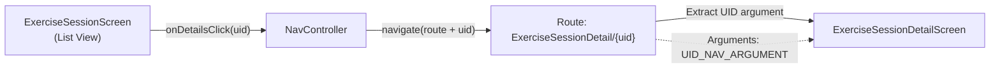
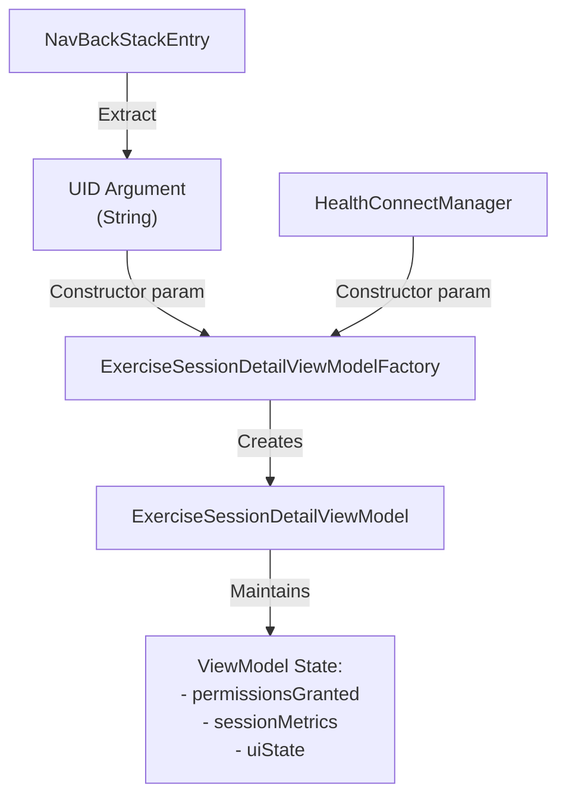
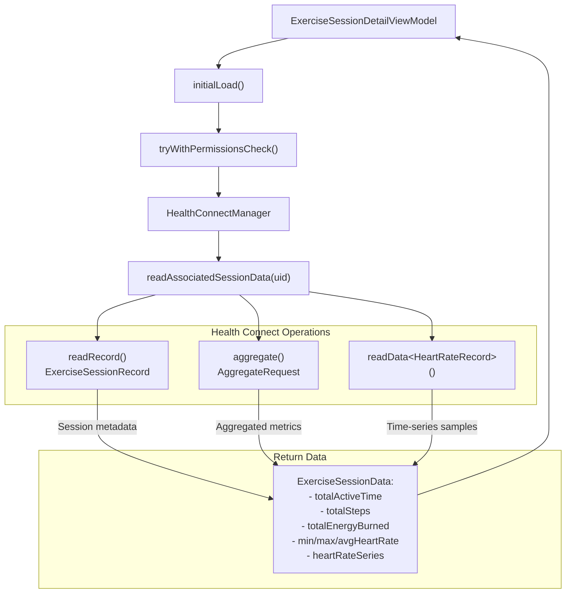
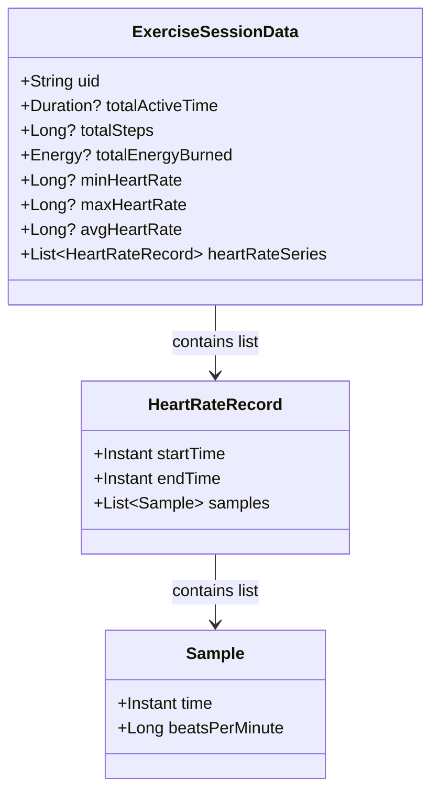
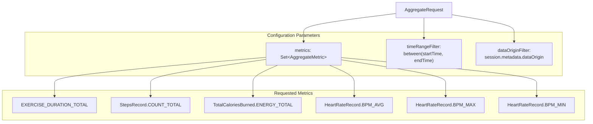
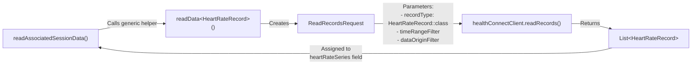
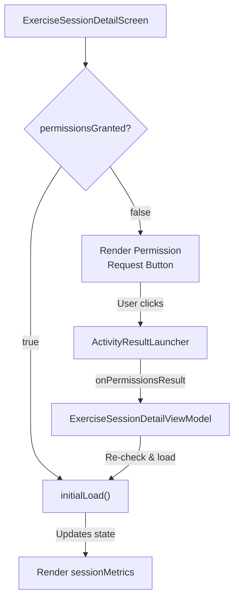
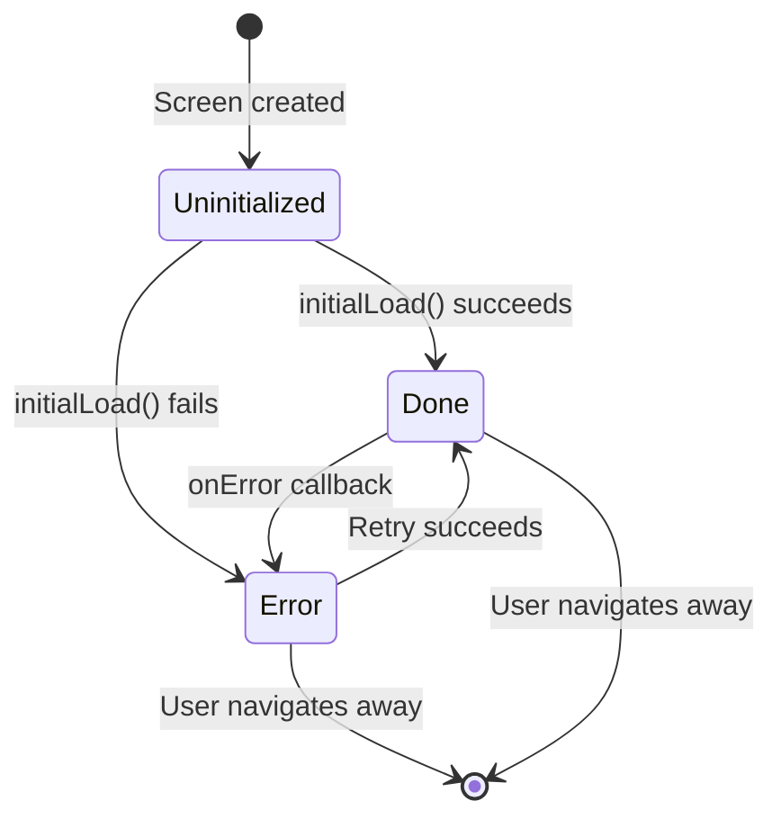

<!-- source: DeepWiki mcp.deepwiki.com · repo android/android-health-connect-codelab · page 6.3 Exercise Session Detail View · fetched 2026-10-23 -->

# Exercise Session Detail View

<details>
<summary>Relevant source files</summary>

The following files were used as context for generating this wiki page:

- [finished/src/main/java/com/example/healthconnect/codelab/data/HealthConnectManager.kt](finished/src/main/java/com/example/healthconnect/codelab/data/HealthConnectManager.kt)
- [finished/src/main/java/com/example/healthconnect/codelab/presentation/navigation/HealthConnectNavigation.kt](finished/src/main/java/com/example/healthconnect/codelab/presentation/navigation/HealthConnectNavigation.kt)

</details>


## Purpose and Scope

This document explains the architecture and implementation of the Exercise Session Detail View, which displays comprehensive metrics for a single exercise session. This includes how the detail screen receives a session UID through navigation arguments, retrieves both aggregated statistics and time-series data, and renders the information to the user.

For information about the exercise session list view, see [ExerciseSessionScreen UI](#6.1). For details on how sessions are created and managed, see [ExerciseSessionViewModel Logic](#6.2). For the underlying data operations, see [Reading Health Data](#5.4) and [Aggregations and Statistics](#5.6).

## Navigation to Detail Screen

The detail screen is accessed by navigating to a route that includes the session's unique identifier (UID) as a path parameter. The navigation system extracts this UID and passes it to the ViewModel during initialization.

**Navigation Route Structure**



**Sources:** [finished/src/main/java/com/example/healthconnect/codelab/presentation/navigation/HealthConnectNavigation.kt:112-114](), [finished/src/main/java/com/example/healthconnect/codelab/presentation/navigation/HealthConnectNavigation.kt:126-127]()

The navigation route is defined with a path parameter: `Screen.ExerciseSessionDetail.route + "/{$UID_NAV_ARGUMENT}"`. When a user taps a session in the list, the `onDetailsClick` callback is invoked with the session's UID, triggering navigation to the detail route with the UID appended.

The navigation argument is extracted from the `NavBackStackEntry`:

```kotlin
val uid = it.arguments?.getString(UID_NAV_ARGUMENT)!!
```

**Sources:** [finished/src/main/java/com/example/healthconnect/codelab/presentation/navigation/HealthConnectNavigation.kt:127]()

## ViewModel Initialization and Architecture

The `ExerciseSessionDetailViewModel` is instantiated using a factory pattern that requires both the session UID and the `HealthConnectManager` instance. This ensures the ViewModel has the necessary context to retrieve session-specific data.

**ViewModel Factory Pattern**



**Sources:** [finished/src/main/java/com/example/healthconnect/codelab/presentation/navigation/HealthConnectNavigation.kt:128-133]()

The factory receives the UID as a constructor parameter and passes it to the ViewModel, which stores it internally. The ViewModel maintains three primary state objects:

| State Property | Type | Purpose |
|----------------|------|---------|
| `permissionsGranted` | `State<Boolean>` | Tracks whether required permissions are granted |
| `sessionMetrics` | `State<ExerciseSessionData?>` | Holds the retrieved session metrics (aggregated + time-series) |
| `uiState` | `UiState` | Represents loading/success/error states |

**Sources:** [finished/src/main/java/com/example/healthconnect/codelab/presentation/navigation/HealthConnectNavigation.kt:134-136]()

## Data Retrieval Flow

When the detail screen loads and permissions are confirmed, the ViewModel calls `HealthConnectManager.readAssociatedSessionData(uid)` to retrieve comprehensive session information. This single method orchestrates multiple Health Connect operations.

**Data Retrieval Architecture**



**Sources:** [finished/src/main/java/com/example/healthconnect/codelab/data/HealthConnectManager.kt:222-261]()

The `readAssociatedSessionData` method performs the following operations:

1. **Read Session Record**: Retrieves the `ExerciseSessionRecord` by UID to obtain start/end times
2. **Create Time Filter**: Constructs a `TimeRangeFilter` using the session's time boundaries
3. **Filter by Data Origin**: Limits results to data written by the same app that created the session
4. **Aggregate Metrics**: Requests aggregated statistics for duration, steps, calories, and heart rate
5. **Read Time-Series Data**: Retrieves raw `HeartRateRecord` samples within the session timeframe

**Sources:** [finished/src/main/java/com/example/healthconnect/codelab/data/HealthConnectManager.kt:222-261]()

## Session Data Model

The retrieved data is encapsulated in an `ExerciseSessionData` object, which combines both aggregated statistics and time-series measurements.

**ExerciseSessionData Structure**



**Sources:** [finished/src/main/java/com/example/healthconnect/codelab/data/HealthConnectManager.kt:251-260]()

The data model includes:

**Aggregated Metrics:**
- `totalActiveTime`: Total duration of the exercise session
- `totalSteps`: Cumulative step count during the session
- `totalEnergyBurned`: Total calories burned
- `minHeartRate`, `maxHeartRate`, `avgHeartRate`: Heart rate statistics

**Time-Series Data:**
- `heartRateSeries`: List of `HeartRateRecord` objects containing individual heart rate samples with timestamps

All metrics are nullable, as not every session may have all data types recorded.

**Sources:** [finished/src/main/java/com/example/healthconnect/codelab/data/HealthConnectManager.kt:251-260]()

## Aggregated Metrics Retrieval

The aggregated metrics are obtained through a single `aggregate()` call to the Health Connect client, which efficiently computes statistics across multiple record types.

**Aggregate Request Configuration**



**Sources:** [finished/src/main/java/com/example/healthconnect/codelab/data/HealthConnectManager.kt:231-248]()

The aggregate request includes six distinct metrics:

```kotlin
val aggregateDataTypes = setOf(
  ExerciseSessionRecord.EXERCISE_DURATION_TOTAL,
  StepsRecord.COUNT_TOTAL,
  TotalCaloriesBurnedRecord.ENERGY_TOTAL,
  HeartRateRecord.BPM_AVG,
  HeartRateRecord.BPM_MAX,
  HeartRateRecord.BPM_MIN,
)
```

**Data Origin Filtering**: The request is filtered to include only data from the same origin as the exercise session. This prevents mixing data from different apps, which may have different accuracy or context. However, depending on use case requirements, this filter could be removed to aggregate data from all sources.

**Sources:** [finished/src/main/java/com/example/healthconnect/codelab/data/HealthConnectManager.kt:231-248]()

## Time-Series Data Retrieval

In addition to aggregated statistics, the detail view retrieves raw time-series data for heart rate, allowing the UI to render detailed charts or sample-by-sample displays.

**Time-Series Retrieval Process**



**Sources:** [finished/src/main/java/com/example/healthconnect/codelab/data/HealthConnectManager.kt:249](), [finished/src/main/java/com/example/healthconnect/codelab/data/HealthConnectManager.kt:314-324]()

The time-series retrieval uses the reusable `readData<T>` helper function with `HeartRateRecord` as the type parameter. This function constructs a `ReadRecordsRequest` with:

- **Record Type**: `HeartRateRecord::class` (using reified type parameter)
- **Time Range Filter**: Same filter used for aggregates (session start to end time)
- **Data Origin Filter**: Same origin filter to maintain consistency

Each `HeartRateRecord` contains a list of `Sample` objects, where each sample has:
- `time`: The exact `Instant` when the measurement was taken
- `beatsPerMinute`: The heart rate value (as `Long`)

**Sources:** [finished/src/main/java/com/example/healthconnect/codelab/data/HealthConnectManager.kt:249](), [finished/src/main/java/com/example/healthconnect/codelab/data/HealthConnectManager.kt:314-324]()

## Permission Management

The detail view follows the same permission pattern as other features, checking for required permissions before attempting data reads and providing a UI mechanism to request them if missing.

**Permission Flow in Detail View**



**Sources:** [finished/src/main/java/com/example/healthconnect/codelab/presentation/navigation/HealthConnectNavigation.kt:134-156]()

The detail screen requires read permissions for:
- `ExerciseSessionRecord`
- `StepsRecord`
- `TotalCaloriesBurnedRecord`
- `HeartRateRecord`

The ViewModel exposes:
- `permissions`: The set of required permission strings
- `permissionsGranted`: Boolean state indicating whether all permissions are granted
- `permissionsLauncher`: The `ActivityResultContract` for requesting permissions

The screen uses these properties to:
1. Conditionally render a permission request button when `permissionsGranted` is `false`
2. Launch the permission request flow when the button is clicked
3. Call `initialLoad()` after permissions are granted to retrieve data

**Sources:** [finished/src/main/java/com/example/healthconnect/codelab/presentation/navigation/HealthConnectNavigation.kt:134-156]()

## UI State Management

The detail view uses the standard `UiState` pattern to represent loading, success, and error states during data retrieval operations.

**State Transition Flow**



**Sources:** [finished/src/main/java/com/example/healthconnect/codelab/presentation/navigation/HealthConnectNavigation.kt:146-149]()

The screen receives:
- `uiState`: The current `UiState` value from the ViewModel
- `sessionMetrics`: The `ExerciseSessionData?` populated when `uiState` is `Done`
- `onError`: A callback that displays exceptions via snackbar

The UI renders different content based on the state:
- **Uninitialized**: Show loading indicator
- **Done**: Render the session metrics with aggregated and time-series data
- **Error**: Display error message (handled via snackbar through `onError` callback)

**Sources:** [finished/src/main/java/com/example/healthconnect/codelab/presentation/navigation/HealthConnectNavigation.kt:146-149]()

## Code Entity Mapping

The following table maps the natural language concepts discussed in this document to their concrete code entities:

| Concept | Code Entity | Location |
|---------|-------------|----------|
| Detail Screen Route | `Screen.ExerciseSessionDetail.route + "/{$UID_NAV_ARGUMENT}"` | HealthConnectNavigation.kt:126 |
| UID Navigation Argument | `UID_NAV_ARGUMENT` constant | HealthConnectNavigation.kt:127 |
| Detail Screen Composable | `ExerciseSessionDetailScreen` | HealthConnectNavigation.kt:142 |
| Detail ViewModel | `ExerciseSessionDetailViewModel` | HealthConnectNavigation.kt:128 |
| ViewModel Factory | `ExerciseSessionDetailViewModelFactory` | HealthConnectNavigation.kt:129 |
| Data Retrieval Method | `readAssociatedSessionData(uid: String)` | HealthConnectManager.kt:222 |
| Session Data Model | `ExerciseSessionData` | HealthConnectManager.kt:251-260 |
| Aggregate Request | `AggregateRequest` | HealthConnectManager.kt:243 |
| Time-Series Helper | `readData<HeartRateRecord>()` | HealthConnectManager.kt:249 |
| Permission State | `permissionsGranted` | HealthConnectNavigation.kt:134 |
| Session Metrics State | `sessionMetrics` | HealthConnectNavigation.kt:135 |
| UI State | `uiState` | HealthConnectNavigation.kt:146 |

**Sources:** [finished/src/main/java/com/example/healthconnect/codelab/presentation/navigation/HealthConnectNavigation.kt:126-156](), [finished/src/main/java/com/example/healthconnect/codelab/data/HealthConnectManager.kt:222-261]()

---

