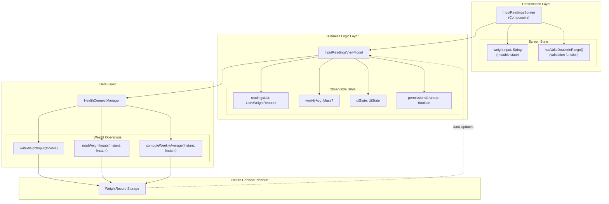
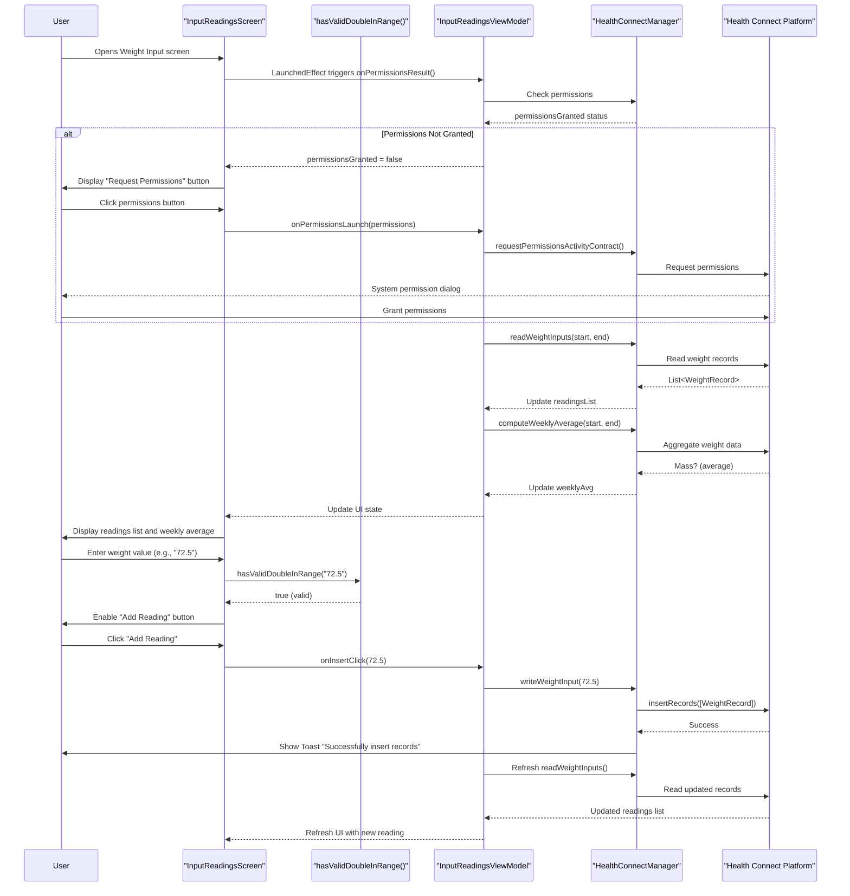
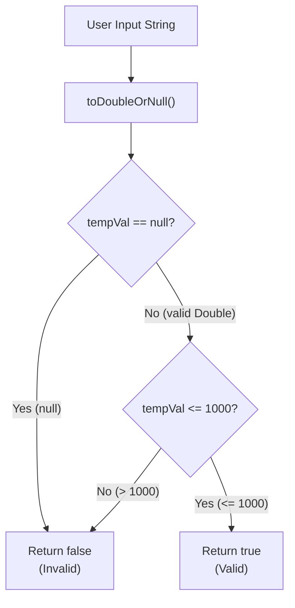
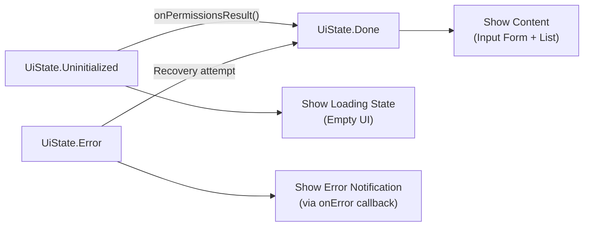
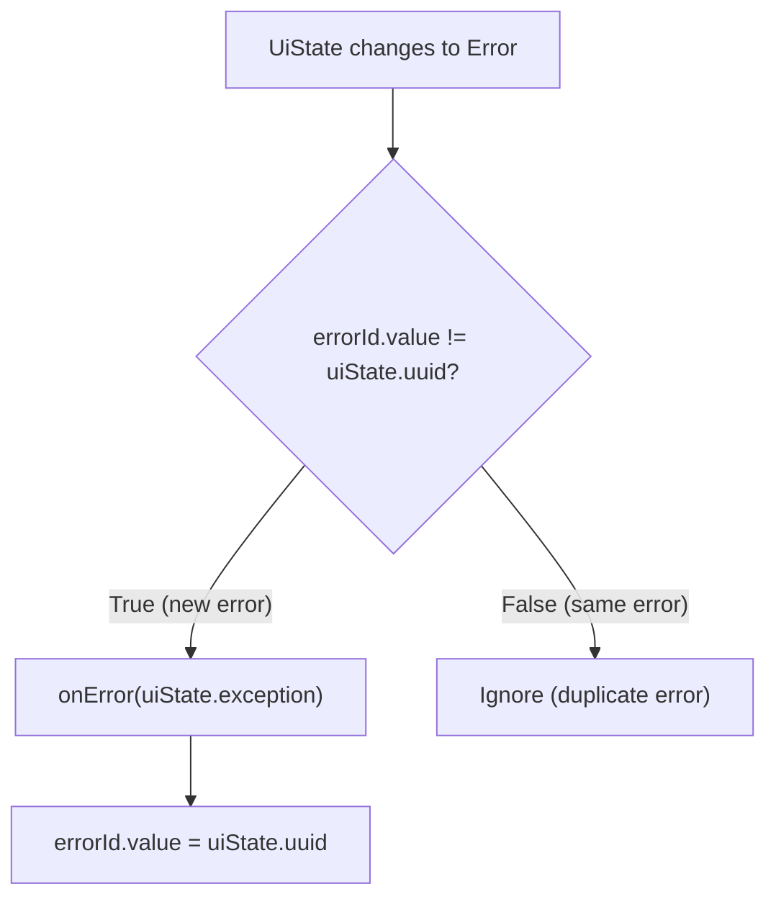

<!-- source: DeepWiki mcp.deepwiki.com · repo android/android-health-connect-codelab · page 7 Feature: Weight Input · fetched 2026-10-23 -->

# Feature: Weight Input

Relevant source files

The following files were used as context for generating this wiki page:

- [finished/src/main/java/com/example/healthconnect/codelab/data/HealthConnectManager.kt](finished/src/main/java/com/example/healthconnect/codelab/data/HealthConnectManager.kt)
- [finished/src/main/java/com/example/healthconnect/codelab/presentation/screen/inputreadings/InputReadingsScreen.kt](finished/src/main/java/com/example/healthconnect/codelab/presentation/screen/inputreadings/InputReadingsScreen.kt)
- [start/src/main/java/com/example/healthconnect/codelab/presentation/screen/inputreadings/InputReadingsScreen.kt](start/src/main/java/com/example/healthconnect/codelab/presentation/screen/inputreadings/InputReadingsScreen.kt)

## Purpose and Scope

The Weight Input feature enables users to record body weight measurements and track their weight history over time. This feature demonstrates fundamental Health Connect operations including writing individual health records, reading historical data with time-based filtering, and computing aggregate statistics (weekly averages).

This document provides an overview of the Weight Input feature's architecture, data flow, and key components. For detailed UI implementation, see [InputReadingsScreen UI](#7.1). For specific data operation implementations, see [Weight Data Operations](#7.2). For general information about the Health Connect data layer, see [Data Layer - HealthConnectManager](#5). For permission management details, see [Permission Management](#5.2).

**Sources:** [finished/src/main/java/com/example/healthconnect/codelab/data/HealthConnectManager.kt:100-139](), [start/src/main/java/com/example/healthconnect/codelab/presentation/screen/inputreadings/InputReadingsScreen.kt:1-219]()

---

## Feature Architecture

The Weight Input feature follows the MVVM (Model-View-ViewModel) architecture pattern, with clear separation between presentation, business logic, and data access layers.

### Component Interaction Diagram

**Sources:** [finished/src/main/java/com/example/healthconnect/codelab/presentation/screen/inputreadings/InputReadingsScreen.kt:57-67](), [finished/src/main/java/com/example/healthconnect/codelab/data/HealthConnectManager.kt:100-139]()

---

## Data Model: WeightRecord

The feature works with `WeightRecord` objects from the Health Connect SDK. Each weight record represents a single body weight measurement at a specific point in time.

| Field | Type | Description |
|-------|------|-------------|
| `metadata` | `Metadata` | Record metadata including data origin and entry method |
| `weight` | `Mass` | Weight measurement (typically in kilograms) |
| `time` | `Instant` | Timestamp when measurement was taken |
| `zoneOffset` | `ZoneOffset?` | Time zone offset for the measurement |

The `Mass` type is a Health Connect unit class that encapsulates weight values with proper unit handling. The SDK provides factory methods like `Mass.kilograms(value)` for creating instances.

**Sources:** [finished/src/main/java/com/example/healthconnect/codelab/data/HealthConnectManager.kt:102-107](), [start/src/main/java/com/example/healthconnect/codelab/presentation/screen/inputreadings/InputReadingsScreen.kt:45-46]()

---

## User Flow and Interactions

### Complete User Journey

**Sources:** [finished/src/main/java/com/example/healthconnect/codelab/presentation/screen/inputreadings/InputReadingsScreen.kt:73-86](), [finished/src/main/java/com/example/healthconnect/codelab/data/HealthConnectManager.kt:100-139]()

---

## Input Validation

The feature implements client-side validation to ensure data quality before submission to Health Connect.

### Validation Logic

The `hasValidDoubleInRange` function [start/src/main/java/com/example/healthconnect/codelab/presentation/screen/inputreadings/InputReadingsScreen.kt:92-97]() validates weight input with the following criteria:

1. **Type Validation**: Input must be parseable as a `Double` using `toDoubleOrNull()`
2. **Range Validation**: Value must be ≤ 1000 kg (upper bound sanity check)

When validation fails:
- The `OutlinedTextField` displays an error state (`isError = true`) [start/src/main/java/com/example/healthconnect/codelab/presentation/screen/inputreadings/InputReadingsScreen.kt:124]()
- An error message "Enter a valid weight: 0 <= weight <= 1000" appears below the input field [start/src/main/java/com/example/healthconnect/codelab/presentation/screen/inputreadings/InputReadingsScreen.kt:128-135]()
- The "Add Reading" button is disabled [start/src/main/java/com/example/healthconnect/codelab/presentation/screen/inputreadings/InputReadingsScreen.kt:138]()

**Sources:** [start/src/main/java/com/example/healthconnect/codelab/presentation/screen/inputreadings/InputReadingsScreen.kt:92-150]()

---

## Data Operations Overview

The feature performs three primary data operations through `HealthConnectManager`:

### 1. Write Operation: `writeWeightInput`

**Location:** [finished/src/main/java/com/example/healthconnect/codelab/data/HealthConnectManager.kt:100-115]()

Creates a new `WeightRecord` with the following characteristics:
- **Timestamp**: Current time (`ZonedDateTime.now().withNano(0)`) with nanoseconds zeroed
- **Metadata**: Manual entry marker (`Metadata.manualEntry()`)
- **Weight**: User-provided value converted to `Mass.kilograms(weightInput)`
- **Zone Offset**: Local time zone offset

The operation uses `healthConnectClient.insertRecords()` to persist the record and displays a Toast notification on success or error.

### 2. Read Operation: `readWeightInputs`

**Location:** [finished/src/main/java/com/example/healthconnect/codelab/data/HealthConnectManager.kt:120-127]()

Retrieves historical weight records within a specified time range:
- Uses `ReadRecordsRequest` with `recordType = WeightRecord::class`
- Applies `TimeRangeFilter.between(start, end)` for temporal filtering
- Returns `List<WeightRecord>` ordered by timestamp

### 3. Aggregate Operation: `computeWeeklyAverage`

**Location:** [finished/src/main/java/com/example/healthconnect/codelab/data/HealthConnectManager.kt:132-139]()

Computes the average weight over a time period:
- Uses `AggregateRequest` with metric `WeightRecord.WEIGHT_AVG`
- Applies time range filter for the aggregation window
- Returns `Mass?` (nullable in case no data exists in the time range)
- The result is extracted from the aggregate response using `response[WeightRecord.WEIGHT_AVG]`

**Sources:** [finished/src/main/java/com/example/healthconnect/codelab/data/HealthConnectManager.kt:100-139]()

---

## State Management

The feature uses the `UiState` sealed class pattern for managing screen state transitions.

### UiState States

| State | Description | Trigger |
|-------|-------------|---------|
| `Uninitialized` | Initial state before any data loading | Screen first composition |
| `Done` | Successful data operation completion | After successful read/write/aggregate |
| `Error` | Operation failure with exception details | Exception thrown during data operation |

The `UiState.Error` state includes:
- `exception: Throwable?` - The exception that caused the error
- `uuid: UUID` - Unique identifier for error deduplication [start/src/main/java/com/example/healthconnect/codelab/presentation/screen/inputreadings/InputReadingsScreen.kt:71]()

### State-Driven UI Rendering

The `LaunchedEffect(uiState)` block [start/src/main/java/com/example/healthconnect/codelab/presentation/screen/inputreadings/InputReadingsScreen.kt:73-86]() handles state transitions:
- **Uninitialized**: Triggers `onPermissionsResult()` to initiate data loading
- **Error**: Calls `onError(uiState.exception)` with UUID-based deduplication to prevent repeated error notifications during recomposition

**Sources:** [start/src/main/java/com/example/healthconnect/codelab/presentation/screen/inputreadings/InputReadingsScreen.kt:61-87]()

---

## UI Components

The `InputReadingsScreen` composable [start/src/main/java/com/example/healthconnect/codelab/presentation/screen/inputreadings/InputReadingsScreen.kt:56-187]() renders a vertically scrolling layout using `LazyColumn`:

### Component Breakdown

| Component | Condition | Purpose |
|-----------|-----------|---------|
| Permission Button | `!permissionsGranted` | Request necessary Health Connect permissions |
| `OutlinedTextField` | `permissionsGranted` | Weight input field with validation feedback |
| Error Text | Invalid input | Display validation error message |
| "Add Reading" Button | `permissionsGranted` | Submit validated weight value |
| "Previous Readings" Section | Always (when granted) | Display historical weight records |
| Weight Record Items | For each record in `readingsList` | Show timestamp and weight value |
| "Weekly Average" Section | Always (when granted) | Display computed weekly average or "0.0 kg" |

### Display Formatting

- **Timestamps**: Formatted using `DateTimeFormatter.ofLocalizedDateTime(FormatStyle.MEDIUM)` [start/src/main/java/com/example/healthconnect/codelab/presentation/screen/inputreadings/InputReadingsScreen.kt:163]()
- **Weight Values**: Displayed with unit suffix from string resources (`R.string.kilograms`)
- **Weekly Average**: Truncated to 5 characters using `.take(5)` for compact display [finished/src/main/java/com/example/healthconnect/codelab/presentation/screen/inputreadings/InputReadingsScreen.kt:181]()

**Sources:** [start/src/main/java/com/example/healthconnect/codelab/presentation/screen/inputreadings/InputReadingsScreen.kt:99-186]()

---

## Error Handling

The feature implements robust error handling with deduplication to prevent redundant error notifications:

### Error Deduplication Mechanism

The `errorId` is a `rememberSaveable` state that persists across recompositions and configuration changes [start/src/main/java/com/example/healthconnect/codelab/presentation/screen/inputreadings/InputReadingsScreen.kt:71](). When a new error occurs:

1. The ViewModel transitions to `UiState.Error` with a unique UUID
2. The `LaunchedEffect` detects the state change
3. If the UUID differs from the stored `errorId`, `onError()` is invoked
4. The `errorId` is updated to the new UUID
5. Subsequent recompositions with the same error UUID are ignored

This pattern prevents duplicate error dialogs or snackbars when the screen recomposes due to other state changes.

**Sources:** [start/src/main/java/com/example/healthconnect/codelab/presentation/screen/inputreadings/InputReadingsScreen.kt:69-86]()

---

## Integration Points

The Weight Input feature integrates with other system components:

- **Permission System**: Requires `WRITE_WEIGHT` and `READ_WEIGHT` permissions. See [Permission Management](#5.2) for details.
- **Navigation**: Accessible via the app's navigation graph. See [Navigation System](#4.2) for routing configuration.
- **String Resources**: All user-facing text is externalized to `R.string` resources for localization. See [String Resources and Localization](#10).
- **HealthConnectManager**: All data operations are delegated to this central facade. See [Data Layer - HealthConnectManager](#5).

**Sources:** [finished/src/main/java/com/example/healthconnect/codelab/data/HealthConnectManager.kt:59-333](), [start/src/main/java/com/example/healthconnect/codelab/presentation/screen/inputreadings/InputReadingsScreen.kt:48]()

---

