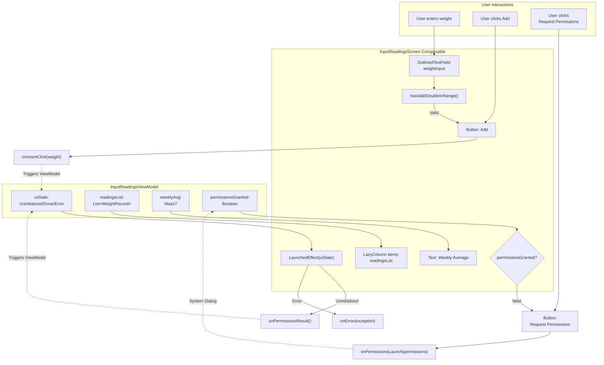
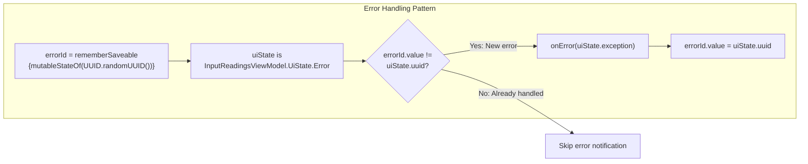
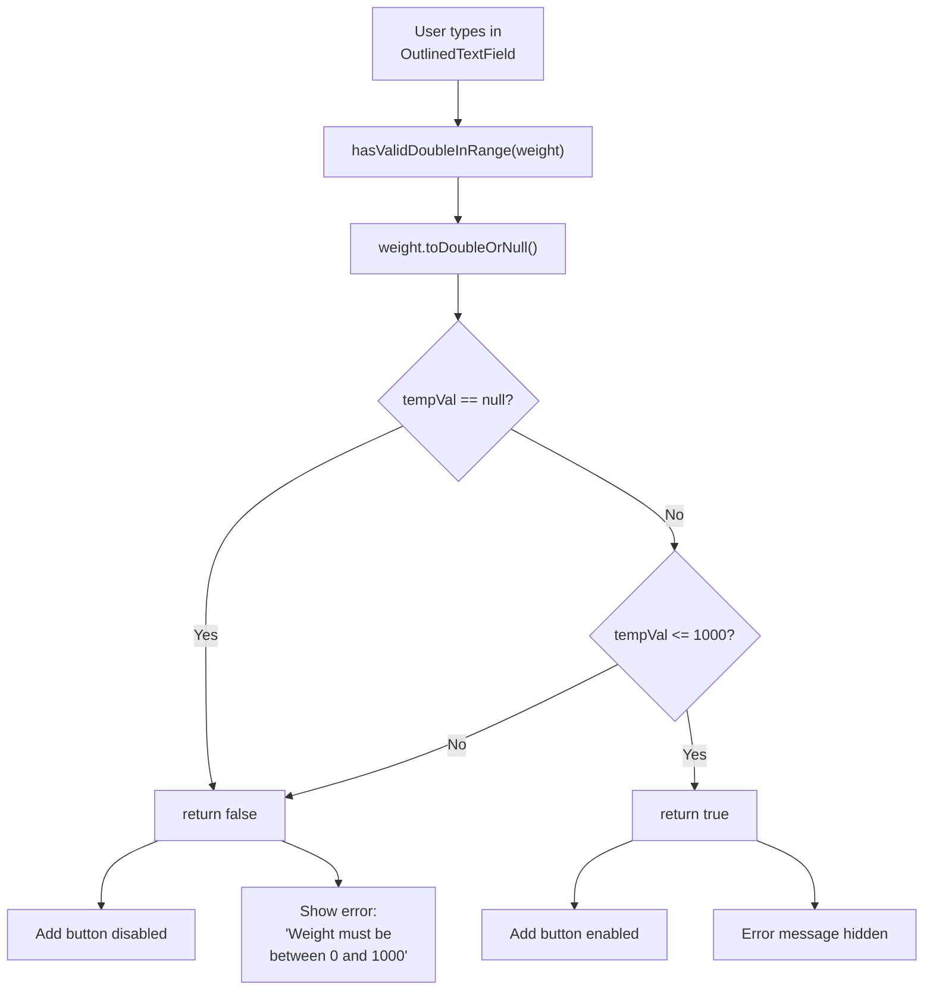
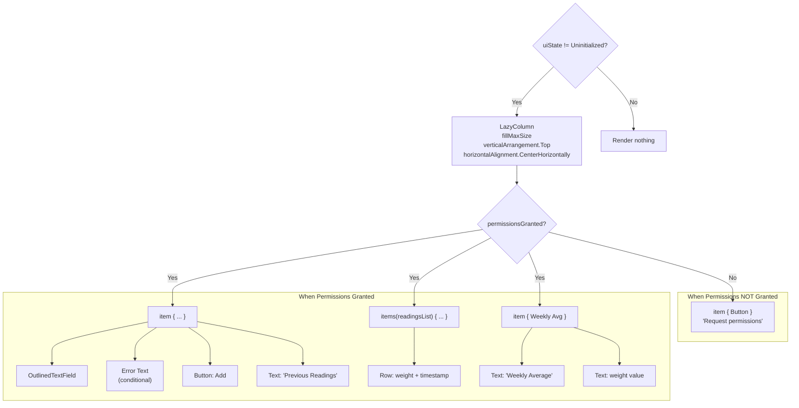
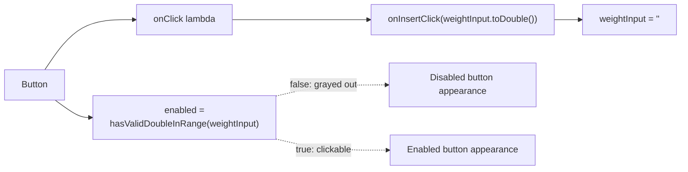
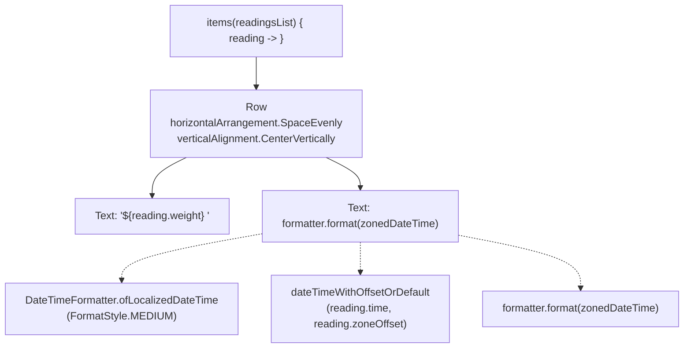
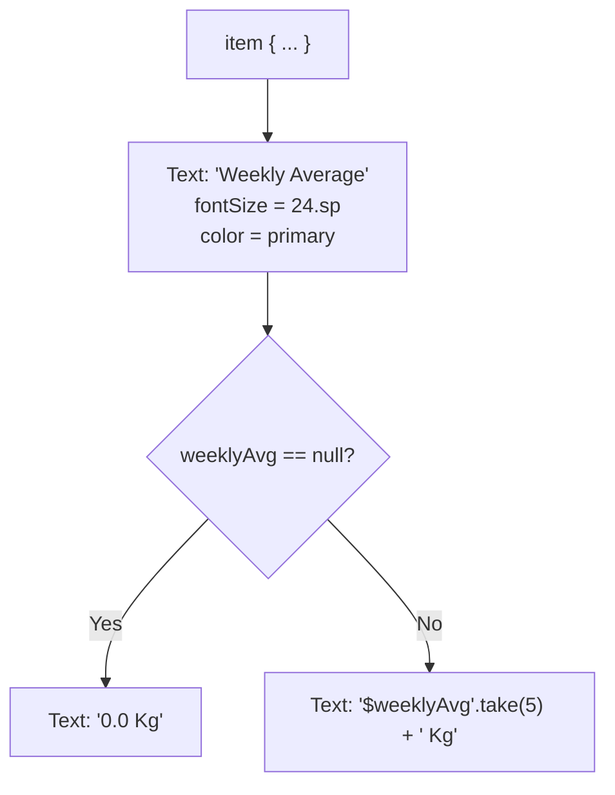
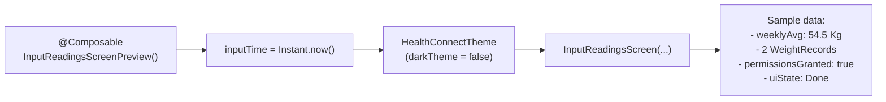

<!-- source: DeepWiki mcp.deepwiki.com · repo android/android-health-connect-codelab · page 7.1 InputReadingsScreen UI · fetched 2026-10-23 -->

# InputReadingsScreen UI

<details>
<summary>Relevant source files</summary>

The following files were used as context for generating this wiki page:

- [finished/src/main/java/com/example/healthconnect/codelab/presentation/screen/inputreadings/InputReadingsScreen.kt](finished/src/main/java/com/example/healthconnect/codelab/presentation/screen/inputreadings/InputReadingsScreen.kt)
- [finished/src/main/res/values/strings.xml](finished/src/main/res/values/strings.xml)
- [start/src/main/java/com/example/healthconnect/codelab/presentation/screen/inputreadings/InputReadingsScreen.kt](start/src/main/java/com/example/healthconnect/codelab/presentation/screen/inputreadings/InputReadingsScreen.kt)
- [start/src/main/res/values/strings.xml](start/src/main/res/values/strings.xml)

</details>


## Purpose and Scope

This page documents the UI implementation of the `InputReadingsScreen` composable, which provides the user interface for recording body weight measurements in the Health Connect codelab. The screen handles weight input validation, displays historical weight readings, and shows weekly averages. 

For details on the underlying weight data operations (reading from and writing to Health Connect), see [Weight Data Operations](#7.2). For the ViewModel that manages state and business logic, see [Weight Data Operations](#7.2).

**Sources:** [start/src/main/java/com/example/healthconnect/codelab/presentation/screen/inputreadings/InputReadingsScreen.kt:1-219](), [finished/src/main/java/com/example/healthconnect/codelab/presentation/screen/inputreadings/InputReadingsScreen.kt:1-219]()

---

## Composable Function Signature

The `InputReadingsScreen` composable is defined in both the start and finished modules with identical implementations, as the UI layer is already complete for students.

| Parameter | Type | Description |
|-----------|------|-------------|
| `permissions` | `Set<String>` | Set of Health Connect permissions required for this feature |
| `permissionsGranted` | `Boolean` | Whether all required permissions have been granted |
| `readingsList` | `List<WeightRecord>` | List of historical weight measurements to display |
| `uiState` | `InputReadingsViewModel.UiState` | Current state of the screen (Uninitialized/Done/Error) |
| `onInsertClick` | `(Double) -> Unit` | Callback invoked when user adds a new weight measurement |
| `onError` | `(Throwable?) -> Unit` | Callback for error handling and user notification |
| `onPermissionsResult` | `() -> Unit` | Callback to trigger initial data load after permission check |
| `weeklyAvg` | `Mass?` | Calculated weekly average weight, or null if unavailable |
| `onPermissionsLaunch` | `(Set<String>) -> Unit` | Callback to launch the permission request flow |

**Sources:** [start/src/main/java/com/example/healthconnect/codelab/presentation/screen/inputreadings/InputReadingsScreen.kt:56-67]()

---

## Screen Architecture and Data Flow

The following diagram illustrates how the `InputReadingsScreen` composable receives data from the ViewModel and triggers operations through callbacks.



**Sources:** [start/src/main/java/com/example/healthconnect/codelab/presentation/screen/inputreadings/InputReadingsScreen.kt:56-187]()

---

## Initialization and Error Handling with LaunchedEffect

The screen uses `LaunchedEffect` to handle initialization and error states reactively. This effect observes the `uiState` parameter and triggers appropriate callbacks.

### Error ID Deduplication



The screen uses UUID-based deduplication to prevent re-displaying the same error message when the composable recomposes or configuration changes occur. Each error state carries a unique UUID, and the screen tracks the last processed error ID using `rememberSaveable`.

**Sources:** [start/src/main/java/com/example/healthconnect/codelab/presentation/screen/inputreadings/InputReadingsScreen.kt:69-86]()

---

## Input Validation: hasValidDoubleInRange

The screen defines a local validation function to ensure weight inputs are valid before enabling the Add button.

### Validation Logic Flow



The validation function performs two checks:
1. **Parsability**: Attempts to parse the string as a `Double` using `toDoubleOrNull()`
2. **Range validation**: Ensures the value is less than or equal to 1000 (implicit lower bound of 0 from `toDoubleOrNull()` behavior)

**Sources:** [start/src/main/java/com/example/healthconnect/codelab/presentation/screen/inputreadings/InputReadingsScreen.kt:91-97]()

---

## UI Component Hierarchy

The screen renders different content based on the `uiState` and `permissionsGranted` state.



**Sources:** [start/src/main/java/com/example/healthconnect/codelab/presentation/screen/inputreadings/InputReadingsScreen.kt:99-186]()

---

## Weight Input Form Components

### OutlinedTextField Configuration

The weight input field is configured with specific keyboard options and validation display:

| Property | Value | Purpose |
|----------|-------|---------|
| `value` | `weightInput` (mutable state) | Current text field content |
| `onValueChange` | Updates `weightInput` | Reactive input handling |
| `label` | `stringResource(R.string.weight_input)` | "New Record (Kg)" |
| `isError` | `!hasValidDoubleInRange(weightInput)` | Red border when invalid |
| `keyboardOptions` | `KeyboardType.Number` | Shows numeric keyboard |
| `keyboardActions` | Checks validation | Custom action on keyboard done |

### Error Message Display

When validation fails, an error message appears below the text field:

```kotlin
if (!hasValidDoubleInRange(weightInput)) {
    Text(
        text = stringResource(id = R.string.valid_weight_error_message),
        color = MaterialTheme.colors.error,
        style = MaterialTheme.typography.caption,
        modifier = Modifier.padding(start = 16.dp)
    )
}
```

The message displays: "Weight must be between 0 and 1000"

**Sources:** [start/src/main/java/com/example/healthconnect/codelab/presentation/screen/inputreadings/InputReadingsScreen.kt:115-135](), [start/src/main/res/values/strings.xml:109-114]()

---

## Add Button Behavior

The Add button implements several important behaviors:



Key behaviors:
1. **Conditional enabling**: Only enabled when `hasValidDoubleInRange(weightInput)` returns true
2. **Value conversion**: Converts the validated string to `Double` before passing to callback
3. **Field clearing**: Resets `weightInput` to empty string after successful submission
4. **Label**: Displays "Add" from string resources

**Sources:** [start/src/main/java/com/example/healthconnect/codelab/presentation/screen/inputreadings/InputReadingsScreen.kt:137-149]()

---

## Previous Readings List Display

The historical weight readings are displayed using the `items()` function within the `LazyColumn`.

### WeightRecord Display Pattern



### Date Formatting

The screen uses `DateTimeFormatter.ofLocalizedDateTime(FormatStyle.MEDIUM)` to format timestamps in a user-friendly, localized format. The `dateTimeWithOffsetOrDefault` utility function handles zone offset conversion from the `WeightRecord` data.

Each reading displays:
- **Weight value**: Directly from `reading.weight` property of the `WeightRecord`
- **Timestamp**: Formatted local date and time

**Sources:** [start/src/main/java/com/example/healthconnect/codelab/presentation/screen/inputreadings/InputReadingsScreen.kt:157-171]()

---

## Weekly Average Display Section

The final item in the `LazyColumn` displays the computed weekly average weight.

### Weekly Average Rendering Logic



### String Formatting

The weekly average value uses a simple truncation approach:
- **When null**: Displays `"0.0 Kg"` as placeholder
- **When present**: Converts `Mass` object to string, takes first 5 characters, appends " Kg" from string resources

The `.take(5)` operation limits the displayed precision, preventing overly long decimal values from affecting the UI layout.

**Sources:** [start/src/main/java/com/example/healthconnect/codelab/presentation/screen/inputreadings/InputReadingsScreen.kt:172-183](), [start/src/main/res/values/strings.xml:112-113]()

---

## String Resources

The screen uses the following string resources for localization:

| Resource ID | Value | Usage |
|-------------|-------|-------|
| `R.string.permissions_button_label` | "Request permissions" | Permission request button |
| `R.string.weight_input` | "New Record (Kg)" | Text field label |
| `R.string.valid_weight_error_message` | "Weight must be between 0 and 1000" | Validation error message |
| `R.string.add_readings_button` | "Add" | Add button label |
| `R.string.previous_readings` | "Previous Measurements" | Section header |
| `R.string.weekly_avg` | "Weekly Average" | Average section header |
| `R.string.kilograms` | "Kg\u0020" | Unit display with non-breaking space |

**Sources:** [start/src/main/res/values/strings.xml:65-114]()

---

## Preview Function

The screen includes a `@Preview` composable for design-time preview in Android Studio:



The preview demonstrates the screen in a fully populated state with:
- Two sample `WeightRecord` entries at 54.0 Kg and 55.0 Kg
- Weekly average of 54.5 Kg
- Permissions already granted
- UI state set to `Done`
- Light theme enabled

**Sources:** [start/src/main/java/com/example/healthconnect/codelab/presentation/screen/inputreadings/InputReadingsScreen.kt:189-216]()

---

## State Management Pattern Summary

The `InputReadingsScreen` follows a unidirectional data flow pattern common in Jetpack Compose:

| Flow Direction | Mechanism | Example |
|----------------|-----------|---------|
| **ViewModel → UI** | State parameters | `readingsList`, `weeklyAvg`, `permissionsGranted`, `uiState` |
| **UI → ViewModel** | Callback lambdas | `onInsertClick()`, `onPermissionsLaunch()`, `onPermissionsResult()` |
| **Error Handling** | Error callback with UUID deduplication | `onError(exception)` with `errorId` tracking |
| **Initialization** | `LaunchedEffect` observing `uiState` | Triggers `onPermissionsResult()` when `Uninitialized` |

This pattern ensures that:
1. The UI is a pure function of the ViewModel state
2. All data modifications flow through the ViewModel
3. Errors are handled consistently with deduplication to prevent repeated notifications
4. The screen is testable and previewable with mock data

**Sources:** [start/src/main/java/com/example/healthconnect/codelab/presentation/screen/inputreadings/InputReadingsScreen.kt:56-187]()

---

