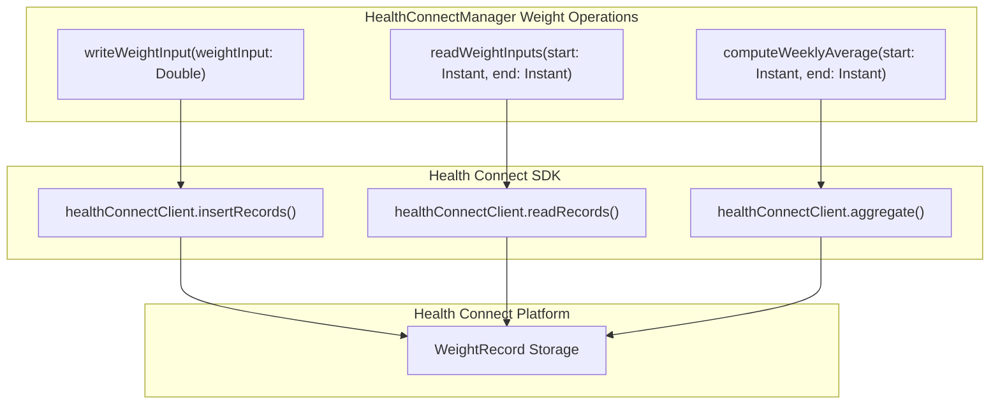
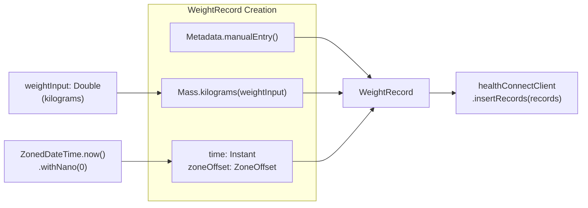
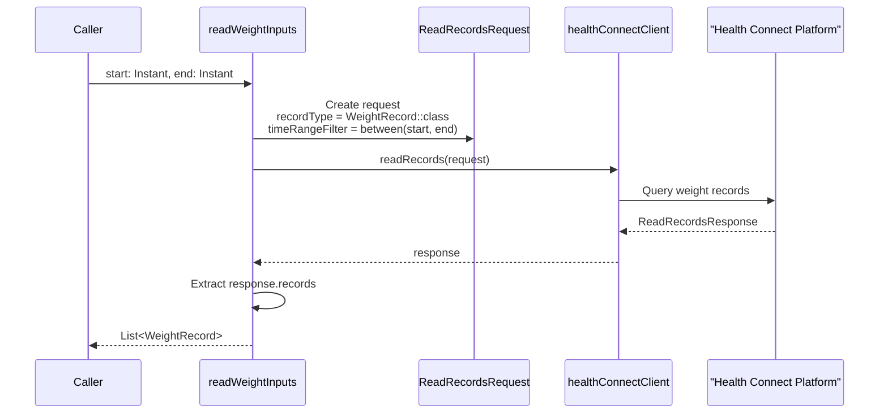
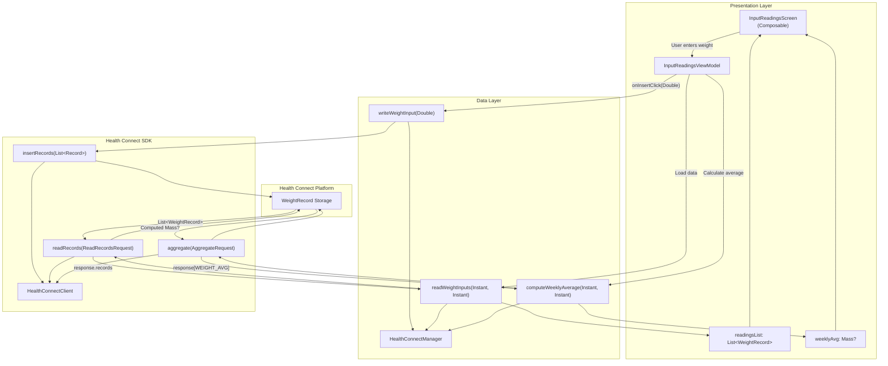
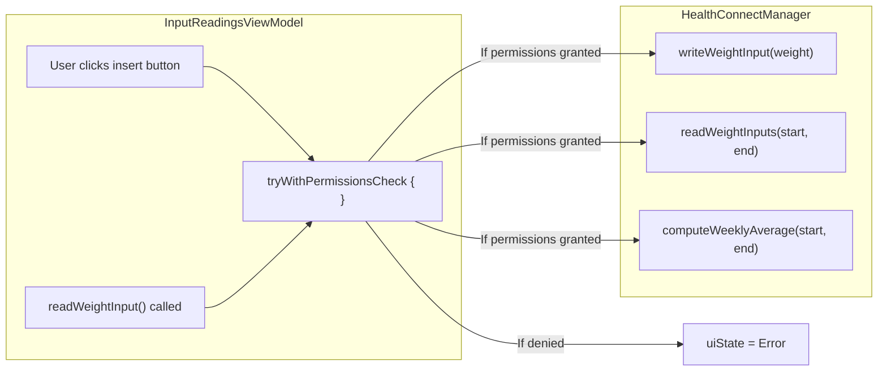

<!-- source: DeepWiki mcp.deepwiki.com · repo android/android-health-connect-codelab · page 7.2 Weight Data Operations · fetched 2026-10-23 -->

# Weight Data Operations

<details>
<summary>Relevant source files</summary>

The following files were used as context for generating this wiki page:

- [finished/src/main/java/com/example/healthconnect/codelab/data/HealthConnectManager.kt](finished/src/main/java/com/example/healthconnect/codelab/data/HealthConnectManager.kt)
- [finished/src/main/java/com/example/healthconnect/codelab/presentation/screen/inputreadings/InputReadingsScreen.kt](finished/src/main/java/com/example/healthconnect/codelab/presentation/screen/inputreadings/InputReadingsScreen.kt)
- [start/src/main/java/com/example/healthconnect/codelab/presentation/screen/inputreadings/InputReadingsScreen.kt](start/src/main/java/com/example/healthconnect/codelab/presentation/screen/inputreadings/InputReadingsScreen.kt)

</details>


## Purpose and Scope

This page documents the data operations for managing weight measurements in the Health Connect Codelab. It covers three primary operations: writing `WeightRecord` instances to Health Connect, reading weight history with time-based filtering, and computing aggregated statistics (weekly averages). 

For information about the weight input UI components and user interactions, see [InputReadingsScreen UI](#7.1). For general Health Connect data patterns applicable to all record types, see [Reading Health Data](#5.4) and [Writing Health Data](#5.5).

**Sources:** [finished/src/main/java/com/example/healthconnect/codelab/data/HealthConnectManager.kt:98-139]()

## Operation Overview

The weight data operations are implemented as three methods in `HealthConnectManager`. All operations interact directly with the Health Connect SDK's `HealthConnectClient` to persist and retrieve weight measurements.



**Sources:** [finished/src/main/java/com/example/healthconnect/codelab/data/HealthConnectManager.kt:98-139]()

## Writing Weight Records

The `writeWeightInput` method creates a `WeightRecord` instance and writes it to Health Connect. The implementation captures the current timestamp with nanosecond precision zeroed out for consistency.

### WeightRecord Construction



The method implementation follows this pattern:

| Step | Operation | Implementation Detail |
|------|-----------|----------------------|
| 1 | Get current time | `ZonedDateTime.now().withNano(0)` - zeroes nanoseconds |
| 2 | Create WeightRecord | Constructs record with manual entry metadata |
| 3 | Set weight value | `Mass.kilograms(weightInput)` converts Double to Mass type |
| 4 | Set timestamp | `time = time.toInstant()` and `zoneOffset = time.offset` |
| 5 | Insert record | `healthConnectClient.insertRecords(listOf(weightRecord))` |
| 6 | User feedback | Toast message on success or exception |

**Key Implementation Details:**
- The weight is wrapped in `Mass.kilograms()` to provide type safety and unit conversion capabilities
- `Metadata.manualEntry()` marks the record as user-entered (not from a device sensor)
- Time is stored both as an `Instant` (absolute point in time) and a `ZoneOffset` (timezone information)
- The method uses `.withNano(0)` to ensure consistent timestamp granularity

**Sources:** [finished/src/main/java/com/example/healthconnect/codelab/data/HealthConnectManager.kt:100-115]()

## Reading Weight Records

The `readWeightInputs` method retrieves historical weight measurements within a specified time range. It returns a list of `WeightRecord` instances ordered by timestamp.

### Read Request Flow



### Request Configuration

The `ReadRecordsRequest` is constructed with two key parameters:

| Parameter | Type | Purpose |
|-----------|------|---------|
| `recordType` | `KClass<WeightRecord>` | Specifies the record type to retrieve |
| `timeRangeFilter` | `TimeRangeFilter` | Filters records between start and end timestamps |

**Filtering Behavior:**
- `TimeRangeFilter.between(start, end)` includes records where `start <= record.time <= end`
- The filter operates on the record's `time` field (the measurement timestamp)
- Records are returned in chronological order by default
- All weight records matching the time range are included, regardless of which app wrote them

**Sources:** [finished/src/main/java/com/example/healthconnect/codelab/data/HealthConnectManager.kt:120-127]()

## Computing Weekly Averages

The `computeWeeklyAverage` method uses Health Connect's aggregation API to calculate the average weight over a specified time period (typically 7 days). It returns a `Mass?` value that may be null if no data exists.

### Aggregation Request Pattern

```mermaid
graph TB
    subgraph "Input Parameters"
        StartTime["start: Instant"]
        EndTime["end: Instant"]
    end
    
    subgraph "AggregateRequest Construction"
        Metrics["metrics = setOf(<br/>WeightRecord.WEIGHT_AVG<br/>)"]
        TimeFilter["timeRangeFilter =<br/>TimeRangeFilter.between(start, end)"]
    end
    
    subgraph "Health Connect Aggregation"
        AggregateCall["healthConnectClient.aggregate(request)"]
        Computation["Platform computes<br/>average across all<br/>WeightRecords in range"]
    end
    
    subgraph "Result"
        Response["AggregateResponse"]
        Extract["response[WeightRecord.WEIGHT_AVG]"]
        Result["Mass? (nullable)"]
    end
    
    StartTime --> TimeFilter
    EndTime --> TimeFilter
    Metrics --> AggregateCall
    TimeFilter --> AggregateCall
    AggregateCall --> Computation
    Computation --> Response
    Response --> Extract
    Extract --> Result
```

### Aggregation Metric

The method uses `WeightRecord.WEIGHT_AVG`, which is a predefined aggregation metric provided by the Health Connect SDK. This metric:

- Computes the arithmetic mean of all `WeightRecord.weight` values in the time range
- Returns `null` if no weight records exist in the specified period
- Includes all weight records regardless of data origin (unless explicitly filtered)
- The result is returned as a `Mass` object, preserving the unit information

### Null Handling

The return type `Mass?` is nullable because:
- No weight records may exist in the specified time range
- The aggregation operation can fail if permissions are insufficient
- The Health Connect platform may return null for empty datasets

**Typical Usage Pattern:**
```kotlin
val weeklyAvg = computeWeeklyAverage(startOfWeek, endOfWeek)
if (weeklyAvg != null) {
    // Display average: weeklyAvg is a Mass object
} else {
    // Display "No data" or "0.0 kg"
}
```

**Sources:** [finished/src/main/java/com/example/healthconnect/codelab/data/HealthConnectManager.kt:132-139]()

## Data Type Specifications

### WeightRecord Structure

The `WeightRecord` class (from Health Connect SDK) contains the following fields:

| Field | Type | Description | Set By |
|-------|------|-------------|--------|
| `metadata` | `Metadata` | Record metadata including data origin | `Metadata.manualEntry()` |
| `weight` | `Mass` | The weight measurement | `Mass.kilograms(value)` |
| `time` | `Instant` | Timestamp of measurement (UTC) | `zonedDateTime.toInstant()` |
| `zoneOffset` | `ZoneOffset?` | Timezone offset at measurement time | `zonedDateTime.offset` |

### Mass Unit Type

The `Mass` type provides:
- Type-safe weight representation
- Automatic unit conversion (kilograms, pounds, etc.)
- String formatting via `toString()` (e.g., "54.5 kg")
- Factory methods: `Mass.kilograms()`, `Mass.pounds()`, `Mass.grams()`

**Sources:** [finished/src/main/java/com/example/healthconnect/codelab/data/HealthConnectManager.kt:100-139]()

## Complete Data Flow

The following diagram shows how weight data flows from user input through the ViewModel to Health Connect storage and back to the UI.



**Sources:** [finished/src/main/java/com/example/healthconnect/codelab/data/HealthConnectManager.kt:98-139](), [finished/src/main/java/com/example/healthconnect/codelab/presentation/screen/inputreadings/InputReadingsScreen.kt:56-187]()

## Error Handling

All three weight operations include error handling through try-catch blocks or exception propagation:

| Operation | Error Handling | User Feedback |
|-----------|---------------|---------------|
| `writeWeightInput` | Catches `Exception`, displays Toast with error message | Toast notification |
| `readWeightInputs` | Exceptions propagate to caller (ViewModel) | ViewModel updates UiState.Error |
| `computeWeeklyAverage` | Exceptions propagate to caller (ViewModel) | ViewModel updates UiState.Error |

**Common Exception Types:**
- `SecurityException`: Insufficient permissions to access weight data
- `IOException`: Network or platform communication issues
- `IllegalStateException`: Health Connect client not available

The ViewModel layer (documented in [InputReadingsViewModel Logic](#7.1)) wraps these operations with `tryWithPermissionsCheck` to ensure permissions are granted before attempting data access.

**Sources:** [finished/src/main/java/com/example/healthconnect/codelab/data/HealthConnectManager.kt:100-139]()

## Integration with InputReadingsViewModel

The weight operations are invoked by `InputReadingsViewModel` methods, which manage state transitions and permission checking:



The ViewModel ensures that:
1. Permissions are checked before each operation
2. Results update observable state properties (`readingsList`, `weeklyAvg`)
3. Errors are captured and exposed via `UiState.Error` with UUID-based deduplication
4. UI recomposition is triggered when state changes

**Sources:** [finished/src/main/java/com/example/healthconnect/codelab/data/HealthConnectManager.kt:98-139]()

---

