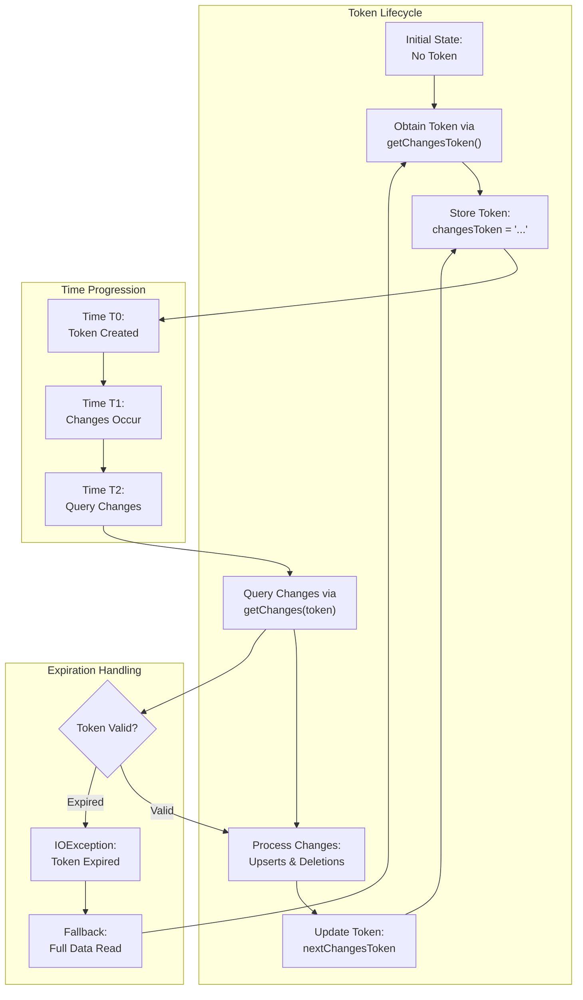
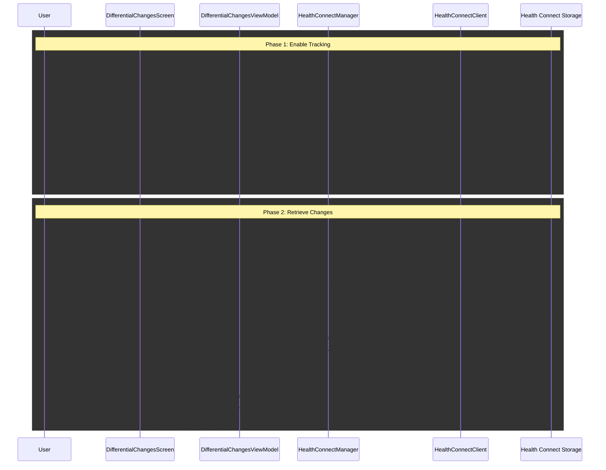
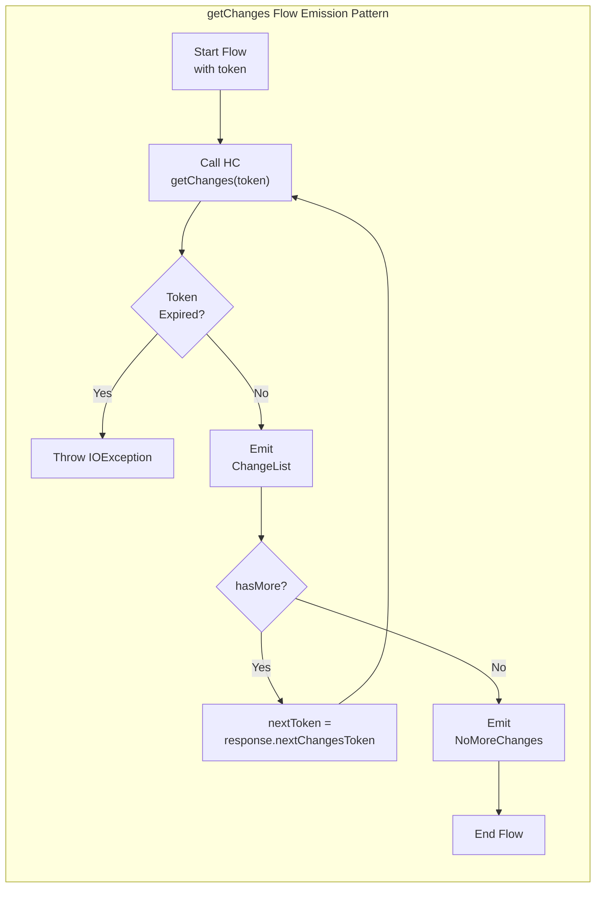
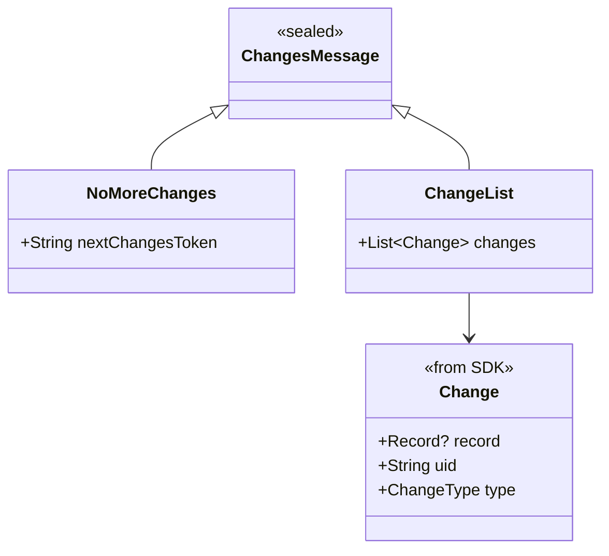
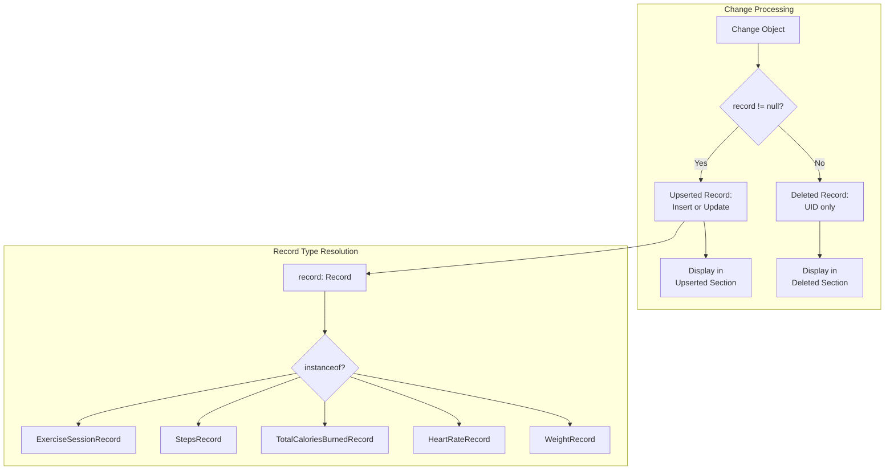
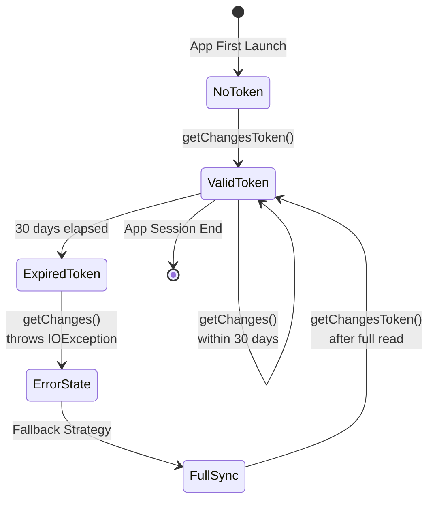
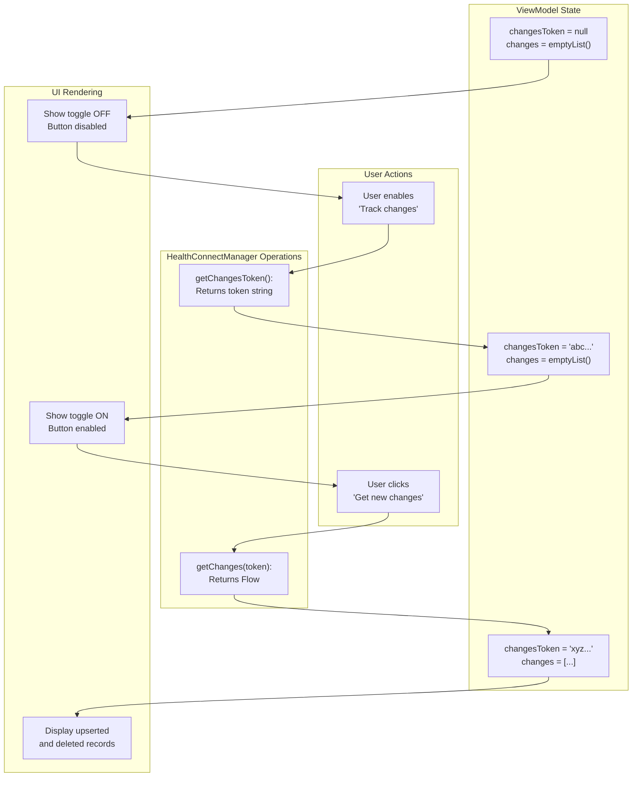

<!-- source: DeepWiki mcp.deepwiki.com · repo android/android-health-connect-codelab · page 8 Feature: Differential Changes · fetched 2026-10-23 -->

# Feature: Differential Changes

<details>
<summary>Relevant source files</summary>

The following files were used as context for generating this wiki page:

- [finished/src/main/java/com/example/healthconnect/codelab/data/HealthConnectManager.kt](finished/src/main/java/com/example/healthconnect/codelab/data/HealthConnectManager.kt)
- [finished/src/main/java/com/example/healthconnect/codelab/presentation/navigation/HealthConnectNavigation.kt](finished/src/main/java/com/example/healthconnect/codelab/presentation/navigation/HealthConnectNavigation.kt)
- [finished/src/main/res/values/strings.xml](finished/src/main/res/values/strings.xml)
- [start/src/main/res/values/strings.xml](start/src/main/res/values/strings.xml)

</details>


## Purpose and Scope

This document describes the differential changes tracking feature, which enables incremental synchronization of Health Connect data using token-based change detection. This feature allows applications to efficiently monitor modifications (insertions, updates, deletions) to health records without repeatedly querying the entire dataset.

For general information about Health Connect data operations, see [Data Layer - HealthConnectManager](#5). For details on the specific record types that can be tracked, see [Health Records and Data Types](#5.3).

---

## Overview

The differential changes feature implements an incremental sync pattern where the application:

1. Obtains a **changes token** representing a snapshot point in time
2. Stores this token for later use
3. Subsequently retrieves all changes that occurred since that token was created
4. Processes upserted (inserted/updated) and deleted records
5. Updates to the next token for future sync operations

This pattern is significantly more efficient than repeatedly reading entire time ranges of data, particularly for applications that need to synchronize data with external systems or maintain local caches.

**Sources:** [finished/src/main/java/com/example/healthconnect/codelab/data/HealthConnectManager.kt:264-299]()

---

## Token-Based Synchronization Model



### Token Characteristics

| Property | Details |
|----------|---------|
| **Validity Period** | 30 days from creation |
| **Scope** | Specific record types specified in `ChangesTokenRequest` |
| **Storage** | Application must persist token between sessions |
| **Uniqueness** | Each token is unique and non-transferable |

Tokens expire after 30 days to prevent indefinite accumulation of change history in the Health Connect system. Applications must check for expiration and handle it gracefully by falling back to a full data read and obtaining a new token.

**Sources:** [finished/src/main/java/com/example/healthconnect/codelab/data/HealthConnectManager.kt:286-294]()

---

## Data Flow Architecture



The data flow implements a two-phase operation:

1. **Token Acquisition Phase**: User enables tracking, triggering token generation and storage
2. **Change Retrieval Phase**: User requests changes, triggering paginated change retrieval

**Sources:** [finished/src/main/java/com/example/healthconnect/codelab/presentation/navigation/HealthConnectNavigation.kt:194-229]()

---

## Obtaining a Changes Token

The `getChangesToken()` method creates a snapshot token for specified record types.

### Implementation Details

```
suspend fun getChangesToken(): String {
  return healthConnectClient.getChangesToken(
    ChangesTokenRequest(
      setOf(
        ExerciseSessionRecord::class,
        StepsRecord::class,
        TotalCaloriesBurnedRecord::class,
        HeartRateRecord::class,
        WeightRecord::class
      )
    )
  )
}
```

### Record Types Tracked

The following record types are included in the changes token:

| Record Type | Purpose |
|-------------|---------|
| `ExerciseSessionRecord` | Exercise activities and sessions |
| `StepsRecord` | Step count data |
| `TotalCaloriesBurnedRecord` | Calorie expenditure |
| `HeartRateRecord` | Heart rate time series |
| `WeightRecord` | Body weight measurements |

These types align with the data written and read by other features in the application (Exercise Sessions, Weight Input).

**Sources:** [finished/src/main/java/com/example/healthconnect/codelab/data/HealthConnectManager.kt:266-278]()

---

## Retrieving Changes

The `getChanges(token)` method retrieves all changes since the token was created, emitting them as a Flow for efficient processing.

### Flow-Based Change Retrieval



### Pagination Handling

The Health Connect API returns changes in pages. The implementation loops until `hasMore` is false:

```
do {
  val response = healthConnectClient.getChanges(nextChangesToken)
  if (response.changesTokenExpired) {
    throw IOException("Changes token has expired")
  }
  emit(ChangesMessage.ChangeList(response.changes))
  nextChangesToken = response.nextChangesToken
} while (response.hasMore)
emit(ChangesMessage.NoMoreChanges(nextChangesToken))
```

The loop:
1. Fetches a page of changes
2. Checks for token expiration
3. Emits the change list
4. Updates the token for the next page
5. Continues until all pages are retrieved
6. Emits the final token

**Sources:** [finished/src/main/java/com/example/healthconnect/codelab/data/HealthConnectManager.kt:283-299]()

---

## Changes Message Types

The `ChangesMessage` sealed class provides type-safe representation of the Flow emissions.

### Class Hierarchy



### Message Type Usage

| Message Type | Purpose | Data Contained |
|--------------|---------|----------------|
| `ChangesMessage.ChangeList` | Intermediate emission during pagination | `List<Change>` containing upserted/deleted records |
| `ChangesMessage.NoMoreChanges` | Final emission when all changes retrieved | `nextChangesToken` for subsequent sync operations |

The ViewModel collects these messages and accumulates the `Change` objects:

```kotlin
// Collector pattern in ViewModel
healthConnectManager.getChanges(token).collect { message ->
  when (message) {
    is ChangesMessage.ChangeList -> {
      // Accumulate changes
      changes.addAll(message.changes)
    }
    is ChangesMessage.NoMoreChanges -> {
      // Update token for next sync
      changesToken = message.nextChangesToken
    }
  }
}
```

**Sources:** [finished/src/main/java/com/example/healthconnect/codelab/data/HealthConnectManager.kt:329-332]()

---

## Processing Change Records

Each `Change` object from the Health Connect SDK contains:

- **`record`**: The actual record object (null if deleted)
- **`uid`**: Unique identifier for the record
- **Type information**: Whether the change is an upsert or deletion

### Change Type Categorization



The UI categorizes changes into two lists:
- **Upserted**: Records that were created or modified (have non-null `record` field)
- **Deleted**: Records that were removed (have null `record` field, only `uid` available)

**Sources:** [finished/src/main/res/values/strings.xml:123-124]()

---

## Token Lifecycle and Expiration

### Expiration Handling



### Error Handling Strategy

When a token expires:

1. **Detection**: The `response.changesTokenExpired` flag is checked
2. **Exception**: `IOException("Changes token has expired")` is thrown
3. **Fallback**: Application should:
   - Perform a full data read for the required time range
   - Obtain a new token via `getChangesToken()`
   - Resume using differential changes for future syncs

### Best Practices

| Practice | Rationale |
|----------|-----------|
| **Use changes API regularly** | Prevents token expiration (< 30 days) |
| **Persist token** | Enables cross-session synchronization |
| **Implement fallback** | Handles expiration gracefully |
| **Monitor sync frequency** | Balances efficiency with freshness |

The 30-day expiration prevents indefinite storage of change history in Health Connect, requiring applications to sync data at least monthly.

**Sources:** [finished/src/main/java/com/example/healthconnect/codelab/data/HealthConnectManager.kt:287-293]()

---

## UI Integration

### Screen Structure

The `DifferentialChangesScreen` provides:

1. **Enable/Disable Toggle**: Switch to start/stop change tracking
2. **Current Token Display**: Shows truncated token string
3. **Get Changes Button**: Retrieves new changes since last sync
4. **Changes Display**: Lists upserted and deleted records

### UI String Resources

| String Resource | Usage |
|----------------|-------|
| `differential_changes_title_text` | Explains token concept |
| `differential_changes_continuation_text` | Instructions for retrieving changes |
| `differential_changes_switch_text` | Toggle label: "Track changes" |
| `differential_changes_button_text` | Button label: "Get new changes" |
| `differential_changes_empty` | Shown when no changes found |
| `differential_changes_current_token` | Format string for token display |
| `differential_changes_upserted` | Section header for upserted records |
| `differential_changes_deleted` | Section header for deleted records |

### Record Type Display Labels

Each record type has a corresponding display string:

| Record Type | String Resource |
|-------------|-----------------|
| `ExerciseSessionRecord` | `differential_changes_type_exercise_session` |
| `StepsRecord` | `differential_changes_type_steps` |
| `TotalCaloriesBurnedRecord` | `differential_changes_type_total_calories` |
| `HeartRateRecord` | `differential_changes_type_heart_rate_series` |
| `WeightRecord` | `differential_changes_type_weight` |

**Sources:** [finished/src/main/res/values/strings.xml:116-135](), [finished/src/main/java/com/example/healthconnect/codelab/presentation/navigation/HealthConnectNavigation.kt:194-229]()

---

## Complete Integration Flow



The integration follows a clear state progression:

1. **Initial State**: No token, toggle off, button disabled
2. **Tracking Enabled**: Token obtained, toggle on, button enabled
3. **Changes Retrieved**: Changes list populated, next token stored

This design ensures users cannot retrieve changes until a token exists, preventing error conditions.

**Sources:** [finished/src/main/java/com/example/healthconnect/codelab/presentation/navigation/HealthConnectNavigation.kt:207-218](), [finished/src/main/java/com/example/healthconnect/codelab/data/HealthConnectManager.kt:264-299]()

---

