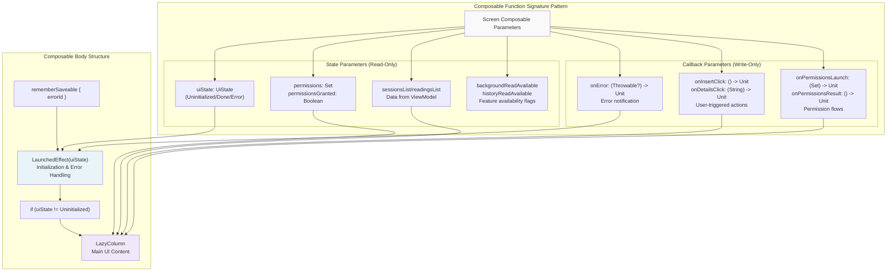
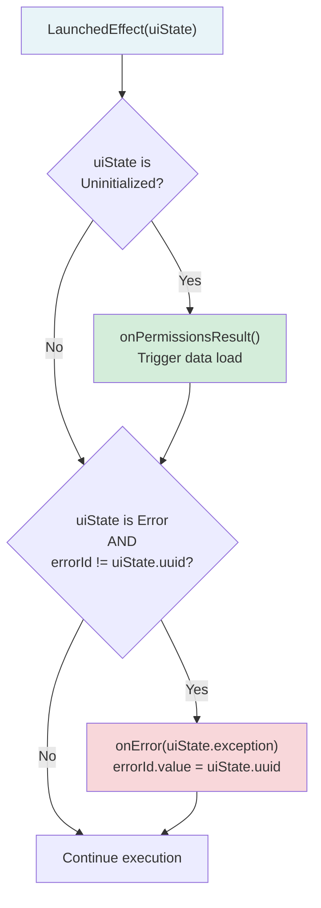
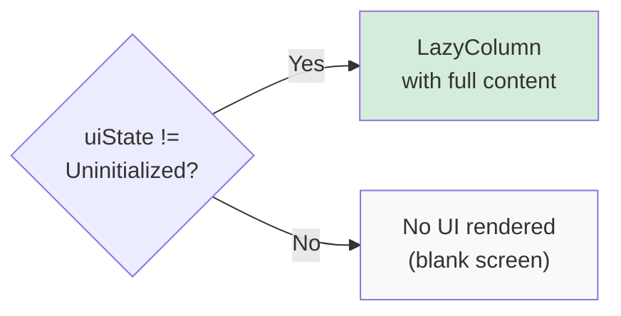
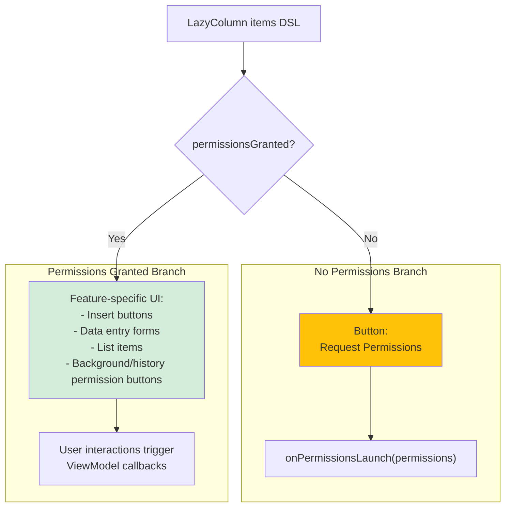
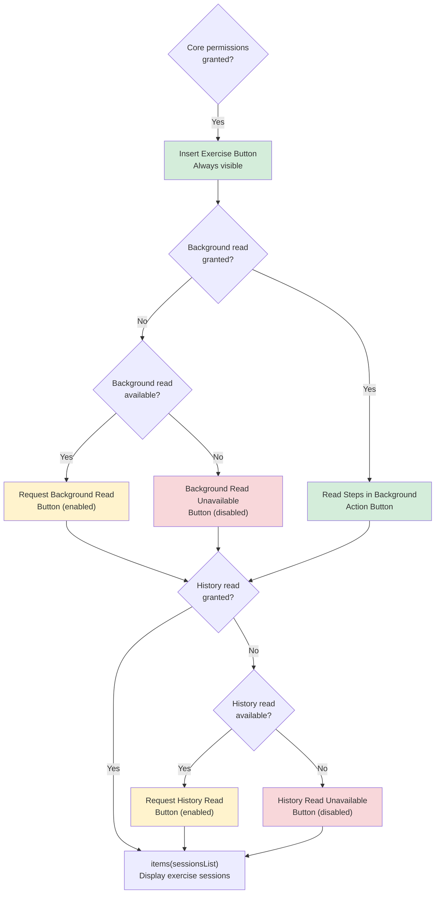
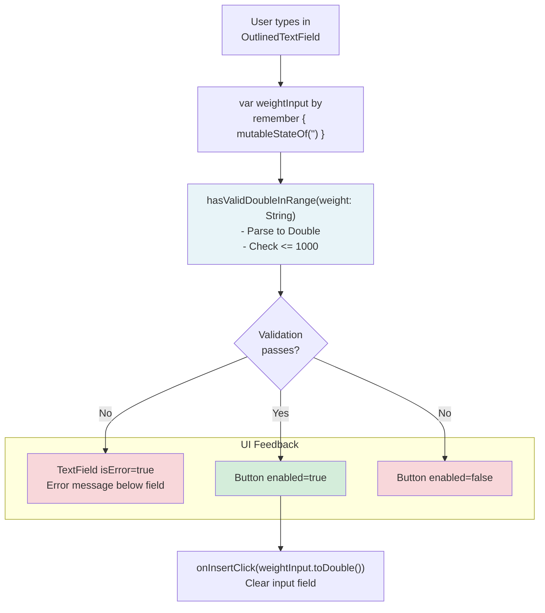
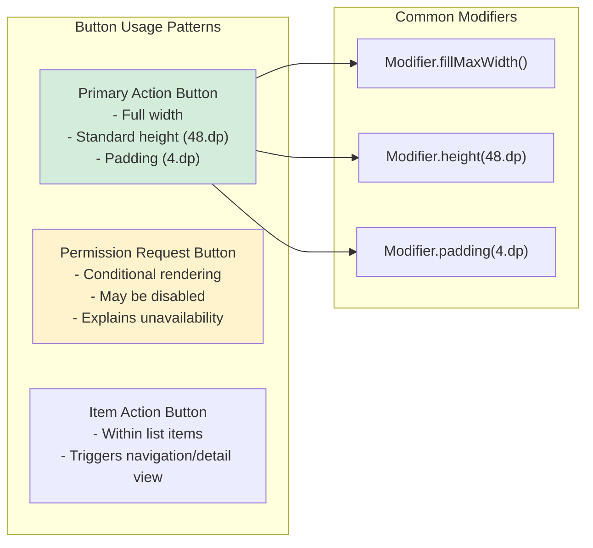

<!-- source: DeepWiki mcp.deepwiki.com · repo android/android-health-connect-codelab · page 9 UI Architecture Patterns · fetched 2026-10-23 -->

# UI Architecture Patterns

<details>
<summary>Relevant source files</summary>

The following files were used as context for generating this wiki page:

- [finished/src/main/java/com/example/healthconnect/codelab/presentation/screen/exercisesession/ExerciseSessionScreen.kt](finished/src/main/java/com/example/healthconnect/codelab/presentation/screen/exercisesession/ExerciseSessionScreen.kt)
- [finished/src/main/java/com/example/healthconnect/codelab/presentation/screen/inputreadings/InputReadingsScreen.kt](finished/src/main/java/com/example/healthconnect/codelab/presentation/screen/inputreadings/InputReadingsScreen.kt)
- [start/src/main/java/com/example/healthconnect/codelab/presentation/screen/inputreadings/InputReadingsScreen.kt](start/src/main/java/com/example/healthconnect/codelab/presentation/screen/inputreadings/InputReadingsScreen.kt)

</details>


## Purpose and Scope

This document describes the common UI architecture patterns used across all Composable screens in the Health Connect Codelab. These patterns provide consistent approaches to state management, error handling, conditional rendering, and user interaction throughout the application. The patterns are built on Jetpack Compose and follow modern Android UI development best practices.

For detailed information about the `UiState` sealed class pattern and state transitions, see [State Management with UiState](#9.1). For error handling specifics and user feedback mechanisms, see [Error Handling and User Feedback](#9.2).

For feature-specific UI implementations, refer to [ExerciseSessionScreen UI](#6.1), [InputReadingsScreen UI](#7.1), or [Differential Changes](#8).

---

## Composable Screen Structure

All screens in the codelab follow a consistent structural pattern. Each screen is implemented as a `@Composable` function that receives state and callback parameters from its associated ViewModel, ensuring unidirectional data flow and clear separation of concerns.



**Sources:**
- [finished/src/main/java/com/example/healthconnect/codelab/presentation/screen/exercisesession/ExerciseSessionScreen.kt:47-65]()
- [finished/src/main/java/com/example/healthconnect/codelab/presentation/screen/inputreadings/InputReadingsScreen.kt:56-67]()

---

## Parameter Categories

All Composable screens receive parameters organized into three distinct categories, ensuring clear contracts between the UI layer and ViewModels:

| Parameter Category | Purpose | Example Parameters | Mutability |
|-------------------|---------|-------------------|------------|
| **State Parameters** | Provide read-only data from ViewModel | `permissionsGranted`, `sessionsList`, `uiState`, `weeklyAvg` | Read-only (val) |
| **Callback Parameters** | Allow UI to trigger ViewModel actions | `onInsertClick`, `onPermissionsLaunch`, `onError` | Function references |
| **Feature Availability Flags** | Indicate platform capability status | `backgroundReadAvailable`, `historyReadAvailable` | Read-only (val) |

This parameter organization enforces unidirectional data flow: state flows down from ViewModel to UI, events flow up from UI to ViewModel.

**Sources:**
- [finished/src/main/java/com/example/healthconnect/codelab/presentation/screen/exercisesession/ExerciseSessionScreen.kt:48-64]()
- [finished/src/main/java/com/example/healthconnect/codelab/presentation/screen/inputreadings/InputReadingsScreen.kt:57-66]()

---

## LaunchedEffect Pattern for Initialization

All screens use `LaunchedEffect` to perform initialization logic and error handling. The effect is keyed on `uiState`, ensuring it re-executes whenever the state changes. This pattern handles two critical responsibilities: initial data loading and error propagation.



The initialization pattern follows this exact sequence in all screens:

1. **Check for Uninitialized State**: If `uiState is Uninitialized`, call `onPermissionsResult()` to trigger the initial data load
2. **Check for Error State**: If `uiState is Error`, compare the error UUID with the remembered `errorId` to prevent duplicate notifications
3. **Update Error ID**: If a new error is detected, call `onError()` and update the remembered `errorId`

**Sources:**
- [finished/src/main/java/com/example/healthconnect/codelab/presentation/screen/exercisesession/ExerciseSessionScreen.kt:71-85]()
- [finished/src/main/java/com/example/healthconnect/codelab/presentation/screen/inputreadings/InputReadingsScreen.kt:73-86]()

---

## Error ID Deduplication with rememberSaveable

To prevent repeated error notifications during recomposition or configuration changes (like screen rotation), all screens implement a UUID-based error deduplication pattern using `rememberSaveable`.

```kotlin
// Pattern used across all screens
val errorId = rememberSaveable { mutableStateOf(UUID.randomUUID()) }
```

This pattern works as follows:

1. **Initial Creation**: A random UUID is generated and stored in a `MutableState` wrapped by `rememberSaveable`
2. **Survive Configuration Changes**: The `rememberSaveable` wrapper ensures the UUID persists across configuration changes
3. **Error Comparison**: When an error occurs, the error's UUID (from `uiState.uuid`) is compared with the remembered `errorId.value`
4. **Conditional Notification**: Only if the UUIDs differ is the error notification triggered, and the `errorId` is updated to the new error's UUID

This prevents the same error from being shown multiple times when:
- The Composable recomposes due to other state changes
- The device undergoes a configuration change (rotation, language change, etc.)
- The user navigates away and back to the screen

**Sources:**
- [finished/src/main/java/com/example/healthconnect/codelab/presentation/screen/exercisesession/ExerciseSessionScreen.kt:69]()
- [finished/src/main/java/com/example/healthconnect/codelab/presentation/screen/inputreadings/InputReadingsScreen.kt:71]()

---

## Conditional Rendering Based on UiState

All screens guard their main content behind a check for the `Uninitialized` state. This prevents rendering empty or invalid UI while initial data is being loaded.



This pattern ensures:
- No flash of empty content on screen launch
- Clean separation between loading and ready states
- Consistent behavior across all screens

The check appears immediately after the `LaunchedEffect` block and before the `LazyColumn`:

**Sources:**
- [finished/src/main/java/com/example/healthconnect/codelab/presentation/screen/exercisesession/ExerciseSessionScreen.kt:87-88]()
- [finished/src/main/java/com/example/healthconnect/codelab/presentation/screen/inputreadings/InputReadingsScreen.kt:99-100]()

---

## Permission-Based Conditional Rendering

Within the main `LazyColumn`, all screens implement a permission-gated UI pattern that shows different content based on whether required permissions are granted.



The pattern uses the `LazyColumn` DSL's conditional `item` blocks:

```
if (!permissionsGranted) {
  item {
    Button(onClick = { onPermissionsLaunch(permissions) }) {
      Text("Request Permissions")
    }
  }
} else {
  // Feature-specific UI items
  item { /* Insert button */ }
  item { /* Input form */ }
  items(dataList) { /* List items */ }
}
```

This ensures users always see appropriate UI for their permission state, with clear calls-to-action when permissions are needed.

**Sources:**
- [finished/src/main/java/com/example/healthconnect/codelab/presentation/screen/exercisesession/ExerciseSessionScreen.kt:93-103]()
- [finished/src/main/java/com/example/healthconnect/codelab/presentation/screen/inputreadings/InputReadingsScreen.kt:105-113]()

---

## Multi-Tier Permission UI Pattern

The `ExerciseSessionScreen` demonstrates an advanced pattern for handling multiple permission tiers (core, background read, history read). Each permission type has conditional UI that adapts to both permission status and feature availability.



This pattern handles three states for each optional permission:
1. **Granted**: Show action button that uses the permission
2. **Not Granted & Available**: Show enabled request button
3. **Not Granted & Unavailable**: Show disabled button with explanatory text

**Sources:**
- [finished/src/main/java/com/example/healthconnect/codelab/presentation/screen/exercisesession/ExerciseSessionScreen.kt:104-171]()

---

## List Rendering with LazyColumn

All screens that display collections of data use `LazyColumn` with the `items()` function for efficient rendering. This pattern provides scrolling performance optimization and automatic recycling of list items.

### Pattern Structure

```
LazyColumn(
  modifier = Modifier.fillMaxSize(),
  verticalArrangement = Arrangement.Top,
  horizontalAlignment = Alignment.CenterHorizontally
) {
  // Static items (buttons, headers)
  item { /* ... */ }
  
  // Dynamic list items
  items(dataList) { dataItem ->
    DataItemRow(dataItem, onItemClick)
  }
}
```

### Key Characteristics

| Aspect | Implementation | Purpose |
|--------|---------------|---------|
| **Sizing** | `modifier = Modifier.fillMaxSize()` | Fills available screen space |
| **Arrangement** | `verticalArrangement = Arrangement.Top` | Items start from top |
| **Alignment** | `horizontalAlignment = Alignment.CenterHorizontally` | Centers items horizontally |
| **Static Items** | `item { }` blocks | Buttons, headers, forms |
| **Dynamic Items** | `items(list) { }` lambda | Data-driven list items |

The `items()` function automatically handles:
- Efficient rendering of only visible items
- Recycling of list item Composables
- Proper key management for recomposition optimization

**Sources:**
- [finished/src/main/java/com/example/healthconnect/codelab/presentation/screen/exercisesession/ExerciseSessionScreen.kt:88-187]()
- [finished/src/main/java/com/example/healthconnect/codelab/presentation/screen/inputreadings/InputReadingsScreen.kt:100-186]()

---

## Input Validation Pattern

The `InputReadingsScreen` demonstrates a comprehensive input validation pattern for user-entered data. This pattern provides real-time validation feedback and prevents invalid data submission.



### Validation Implementation

The validation function `hasValidDoubleInRange()` is defined as a local function within the Composable:

```
fun hasValidDoubleInRange(weight: String): Boolean {
  val tempVal = weight.toDoubleOrNull()
  return if (tempVal == null) {
    false
  } else tempVal <= 1000
}
```

### UI Integration Points

| Component | Validation Usage | Effect |
|-----------|-----------------|--------|
| `OutlinedTextField` | `isError = !hasValidDoubleInRange(weightInput)` | Red border when invalid |
| Error Text | Conditionally rendered if validation fails | Shows "valid_weight_error_message" |
| Submit Button | `enabled = hasValidDoubleInRange(weightInput)` | Disabled when invalid |
| `KeyboardActions` | Checks validation result | Keyboard behavior modification |

The pattern ensures:
- Immediate visual feedback during typing
- Prevention of invalid data submission
- Clear user guidance on validation rules
- Input field clearing after successful submission

**Sources:**
- [finished/src/main/java/com/example/healthconnect/codelab/presentation/screen/inputreadings/InputReadingsScreen.kt:89-149]()

---

## Preview Composable Pattern

All screen Composables include a `@Preview` annotated function that provides a preview in Android Studio. These previews use sample data to demonstrate the UI in various states without requiring runtime execution.

### Preview Structure

```
@Preview
@Composable
fun ScreenNamePreview() {
  HealthConnectTheme(darkTheme = false) {
    ScreenComposable(
      permissions = setOf(),
      permissionsGranted = true,
      dataList = listOf(/* sample data */),
      uiState = UiState.Done
      // ... other parameters with preview values
    )
  }
}
```

### Preview Best Practices

| Practice | Implementation | Purpose |
|----------|---------------|---------|
| **Theme Wrapper** | Wrap in `HealthConnectTheme {}` | Apply app theming to preview |
| **Realistic Data** | Provide sample records with realistic values | Show actual UI appearance |
| **Common State** | Usually show `UiState.Done` state | Display functional UI state |
| **Multiple Previews** | Can create multiple preview functions | Show different states (empty, error, etc.) |

The preview pattern enables rapid UI development by:
- Showing immediate visual feedback without building/running the app
- Testing different states by varying preview parameters
- Validating layout and styling changes quickly
- Documenting expected UI appearance

**Sources:**
- [finished/src/main/java/com/example/healthconnect/codelab/presentation/screen/exercisesession/ExerciseSessionScreen.kt:190-230]()
- [finished/src/main/java/com/example/healthconnect/codelab/presentation/screen/inputreadings/InputReadingsScreen.kt:189-216]()

---

## Local State Management with remember

In addition to ViewModel state, screens use local Composable state for UI-specific concerns that don't need to survive process death or be shared across screens.

### Common Local State Patterns

| Use Case | Implementation | Scope |
|----------|---------------|-------|
| **Form Input** | `var weightInput by remember { mutableStateOf("") }` | Temporary input text |
| **Error Deduplication** | `val errorId = rememberSaveable { mutableStateOf(UUID.randomUUID()) }` | Survives config changes |
| **UI-Only State** | `var isExpanded by remember { mutableStateOf(false) }` | Expandable sections |

### remember vs rememberSaveable

- **`remember`**: Survives recomposition, lost on configuration change (e.g., form inputs that should reset)
- **`rememberSaveable`**: Survives recomposition AND configuration changes (e.g., error IDs that should persist)

The choice between these depends on whether the state should be preserved during configuration changes like screen rotation.

**Sources:**
- [finished/src/main/java/com/example/healthconnect/codelab/presentation/screen/inputreadings/InputReadingsScreen.kt:89]()
- [finished/src/main/java/com/example/healthconnect/codelab/presentation/screen/exercisesession/ExerciseSessionScreen.kt:69]()

---

## Navigation Callback Pattern

Screens that navigate to other screens receive callback functions with specific type signatures that include navigation arguments. This pattern ensures type-safe navigation with required parameters.

### Navigation Callback Types

```
// Simple navigation (no arguments)
onInsertClick: () -> Unit

// Navigation with string argument (e.g., record ID)
onDetailsClick: (String) -> Unit

// Permission launch with permission set
onPermissionsLaunch: (Set<String>) -> Unit
```

The pattern separates navigation logic (implemented in the ViewModel/Navigation layer) from the UI presentation. The Composable screen never performs navigation directly; it only invokes callbacks when user actions require navigation.

**Example from ExerciseSessionScreen:**

When a user clicks on an exercise session row, the screen calls `onDetailsClick(uid)` with the session's unique ID. The ViewModel handles this callback by triggering navigation to the detail screen with the appropriate navigation argument.

**Sources:**
- [finished/src/main/java/com/example/healthconnect/codelab/presentation/screen/exercisesession/ExerciseSessionScreen.kt:61]()
- [finished/src/main/java/com/example/healthconnect/codelab/presentation/screen/exercisesession/ExerciseSessionScreen.kt:180-182]()

---

## Data Formatting Pattern

Screens consistently format health data for display using utility functions and standard formatting libraries. This ensures consistent presentation across the application.

### Common Formatting Patterns

| Data Type | Formatting Approach | Example |
|-----------|-------------------|---------|
| **Date/Time** | `DateTimeFormatter.ofLocalizedDateTime(FormatStyle.MEDIUM)` | "Jan 15, 2024, 3:30:00 PM" |
| **ZonedDateTime** | `dateTimeWithOffsetOrDefault(instant, offset)` | Convert Instant to ZonedDateTime |
| **Mass** | String interpolation with truncation: `"$weeklyAvg".take(5)` | "54.5 kg" |
| **Metadata** | Extract package name: `session.metadata.dataOrigin.packageName` | "com.example.app" |

### Date/Time Formatting Example

```
val formatter = DateTimeFormatter.ofLocalizedDateTime(FormatStyle.MEDIUM)
val zonedDateTime = dateTimeWithOffsetOrDefault(reading.time, reading.zoneOffset)
Text(text = formatter.format(zonedDateTime))
```

This pattern uses:
- Standard Java time formatting for localization support
- Helper function `dateTimeWithOffsetOrDefault()` to handle null zone offsets
- Consistent formatter creation within the Composable scope

**Sources:**
- [finished/src/main/java/com/example/healthconnect/codelab/presentation/screen/inputreadings/InputReadingsScreen.kt:163-169]()
- [finished/src/main/java/com/example/healthconnect/codelab/presentation/screen/exercisesession/ExerciseSessionScreen.kt:175-179]()

---

## Common UI Component Usage

All screens follow consistent patterns for using Material Design components from Jetpack Compose Material.

### Button Patterns



### Text Components

| Component | Usage | Example |
|-----------|-------|---------|
| **Section Headers** | Large text with primary color | `Text(text = "Previous Readings", fontSize = 24.sp, color = MaterialTheme.colors.primary)` |
| **Error Messages** | Caption style with error color | `Text(text = errorMessage, color = MaterialTheme.colors.error, style = MaterialTheme.typography.caption)` |
| **Data Display** | Standard text with no styling | `Text(text = "${reading.weight}")` |

### TextField Patterns

Input fields use `OutlinedTextField` with:
- Value binding to local state
- Label from string resources
- `isError` flag for validation feedback
- `KeyboardOptions` for input type (e.g., `KeyboardType.Number`)
- Error text displayed conditionally below the field

**Sources:**
- [finished/src/main/java/com/example/healthconnect/codelab/presentation/screen/exercisesession/ExerciseSessionScreen.kt:105-115]()
- [finished/src/main/java/com/example/healthconnect/codelab/presentation/screen/inputreadings/InputReadingsScreen.kt:115-149]()

---

## String Resource Integration

All user-facing text is externalized to string resources, ensuring localization support and centralized text management. Screens consistently use `stringResource()` to retrieve localized strings.

### String Resource Access Pattern

```
Text(text = stringResource(R.string.permissions_button_label))
```

### Common String Categories

| Category | Purpose | Example Resource ID |
|----------|---------|-------------------|
| **Button Labels** | Action button text | `R.string.insert_exercise_session` |
| **Error Messages** | Validation/error feedback | `R.string.valid_weight_error_message` |
| **Section Headers** | Screen section titles | `R.string.previous_readings` |
| **Permission Messages** | Permission request explanations | `R.string.request_background_read` |
| **Feature Unavailable** | Platform capability messages | `R.string.background_read_is_not_available` |

This pattern ensures:
- Easy translation to multiple languages
- Consistent terminology across the app
- Centralized text management for updates
- Compile-time verification of resource IDs

**Sources:**
- [finished/src/main/java/com/example/healthconnect/codelab/presentation/screen/exercisesession/ExerciseSessionScreen.kt:100]()
- [finished/src/main/java/com/example/healthconnect/codelab/presentation/screen/inputreadings/InputReadingsScreen.kt:122]()

---

## Summary

The Health Connect Codelab employs consistent UI architecture patterns across all screens, providing a maintainable and predictable codebase. Key patterns include:

1. **Structured Parameters**: Clear separation of state, callbacks, and feature flags
2. **LaunchedEffect Initialization**: Standardized data loading and error handling
3. **Error Deduplication**: UUID-based prevention of duplicate error notifications
4. **Conditional Rendering**: Permission-gated and state-gated UI display
5. **List Rendering**: Efficient `LazyColumn` with `items()` function
6. **Input Validation**: Real-time validation with UI feedback
7. **Local State Management**: Appropriate use of `remember` and `rememberSaveable`
8. **Navigation Callbacks**: Type-safe navigation through callback parameters
9. **Preview Composables**: Development-time UI visualization
10. **String Resources**: Complete externalization of user-facing text

These patterns create a consistent development experience and ensure that all screens behave predictably from both developer and user perspectives.

---

