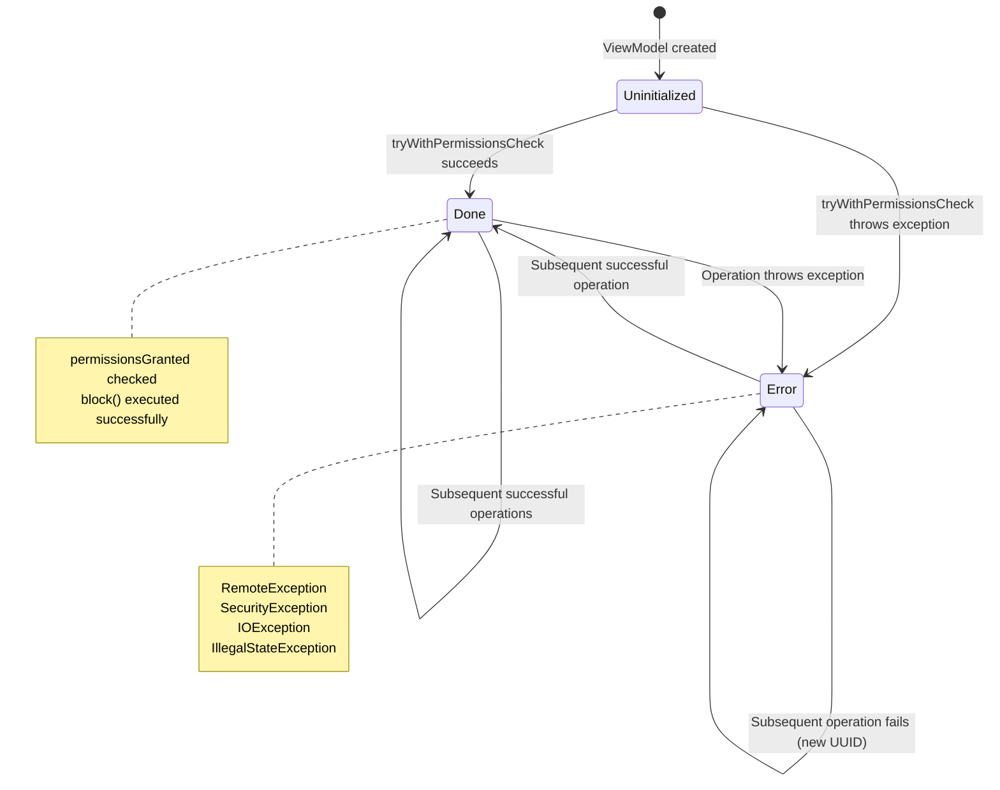
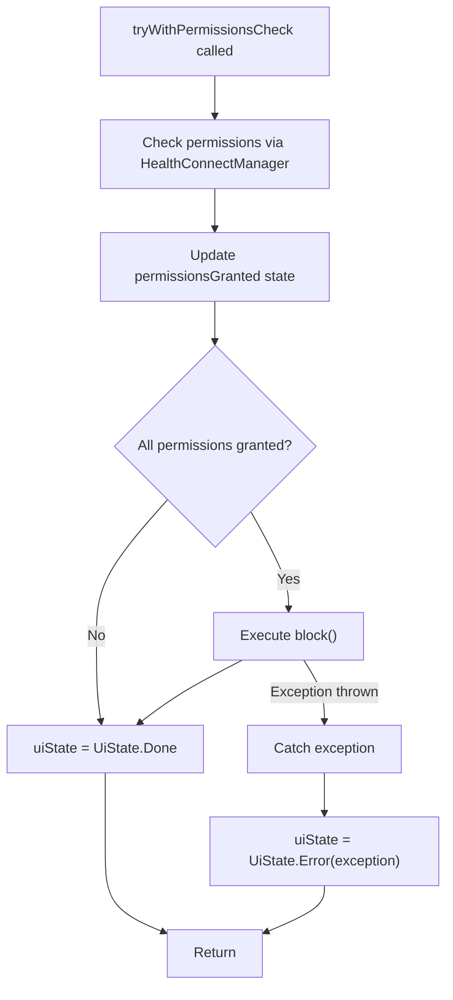
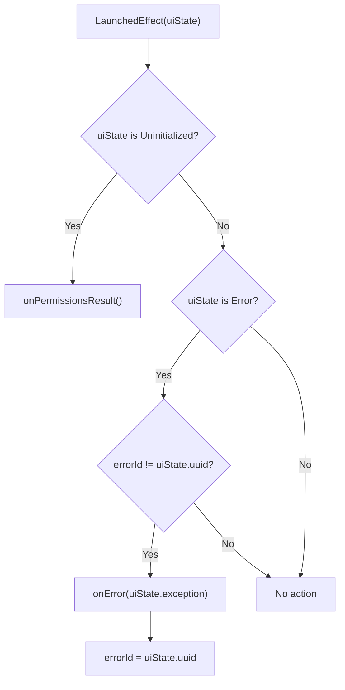
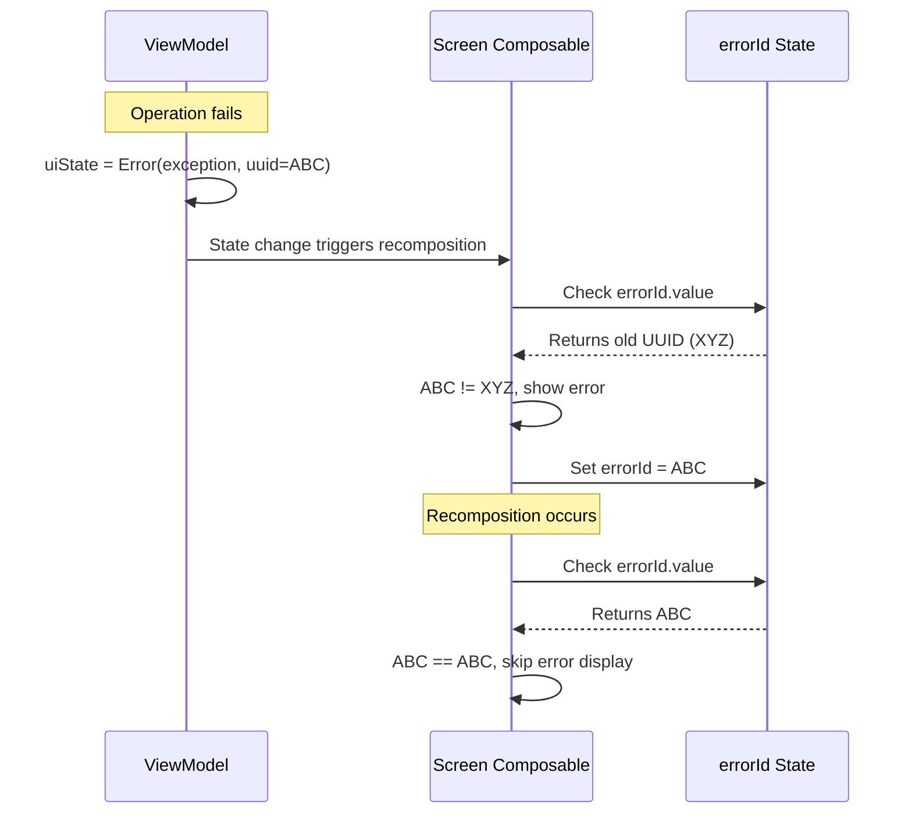
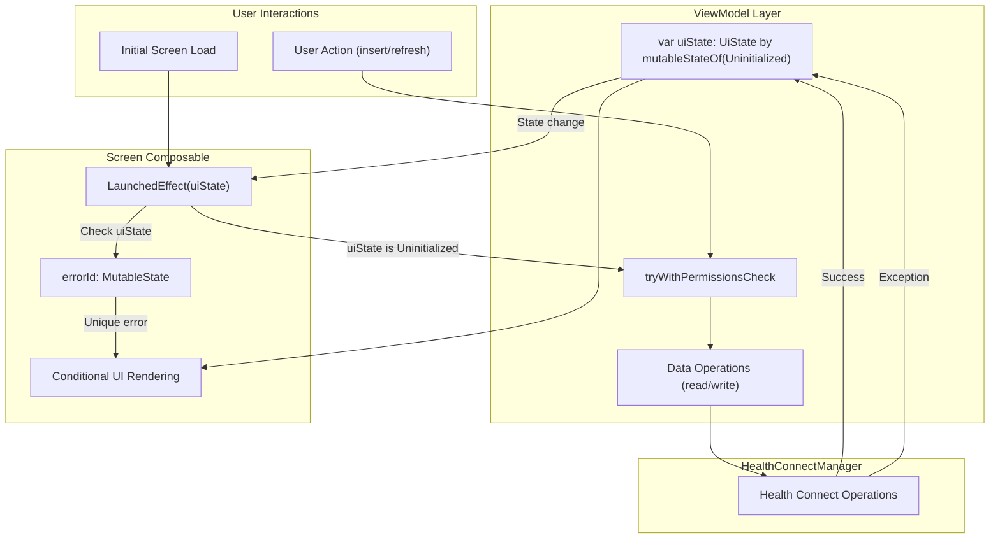
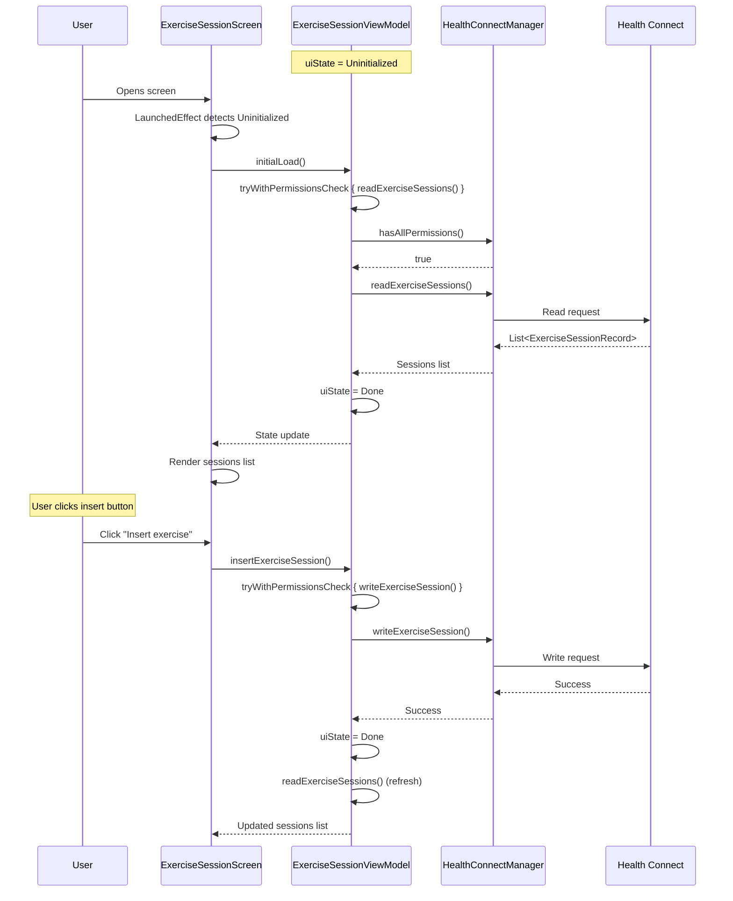

<!-- source: DeepWiki mcp.deepwiki.com · repo android/android-health-connect-codelab · page 9.1 State Management with UiState · fetched 2026-10-23 -->

# State Management with UiState

<details>
<summary>Relevant source files</summary>

The following files were used as context for generating this wiki page:

- [finished/src/main/java/com/example/healthconnect/codelab/presentation/screen/exercisesession/ExerciseSessionViewModel.kt](finished/src/main/java/com/example/healthconnect/codelab/presentation/screen/exercisesession/ExerciseSessionViewModel.kt)
- [finished/src/main/java/com/example/healthconnect/codelab/presentation/screen/inputreadings/InputReadingsScreen.kt](finished/src/main/java/com/example/healthconnect/codelab/presentation/screen/inputreadings/InputReadingsScreen.kt)
- [start/src/main/java/com/example/healthconnect/codelab/presentation/screen/inputreadings/InputReadingsScreen.kt](start/src/main/java/com/example/healthconnect/codelab/presentation/screen/inputreadings/InputReadingsScreen.kt)

</details>


This document explains the `UiState` sealed class pattern used throughout the Health Connect Codelab for managing UI state and coordinating between ViewModels and Composable screens. The pattern provides a standardized approach for representing initialization, success, and error states across all features. For information about how errors are displayed to users and exception handling, see [Error Handling and User Feedback](#9.2). For broader UI architectural patterns, see [UI Architecture Patterns](#9).

## Overview of the UiState Pattern

The codebase uses a sealed class hierarchy to represent three distinct UI states:

| State | Purpose | ViewModel Usage | UI Response |
|-------|---------|-----------------|-------------|
| `Uninitialized` | Initial state before first data load | Default state on ViewModel creation | Triggers initial permission check and data loading |
| `Done` | Successful completion of operation | Set after successful data read/write | Enables normal UI display and interaction |
| `Error` | Operation failed with exception | Set in catch blocks with exception details | Displays error message, preserves UUID for deduplication |

Sources: [finished/src/main/java/com/example/healthconnect/codelab/presentation/screen/exercisesession/ExerciseSessionViewModel.kt:156-163]()

## UiState Sealed Class Definition

The `UiState` sealed class is defined within each ViewModel with identical structure:

```kotlin
sealed class UiState {
    object Uninitialized : UiState()
    object Done : UiState()
    data class Error(val exception: Throwable, val uuid: UUID = UUID.randomUUID()) : UiState()
}
```

**Key Design Decisions:**
- **Object for Uninitialized/Done**: These states carry no additional data, so they use singleton objects
- **Data class for Error**: Contains `exception` for error details and `uuid` for deduplication
- **Random UUID generation**: Each `Error` instance gets a unique identifier to prevent duplicate error notifications during recomposition

Sources: [finished/src/main/java/com/example/healthconnect/codelab/presentation/screen/exercisesession/ExerciseSessionViewModel.kt:156-163]()

## State Management in ViewModels

### State Exposure Pattern

ViewModels expose `uiState` as a mutable state property that Composable screens observe:

```kotlin
var uiState: UiState by mutableStateOf(UiState.Uninitialized)
    private set
```

The `private set` modifier ensures that only the ViewModel can modify state, maintaining unidirectional data flow.

Sources: [finished/src/main/java/com/example/healthconnect/codelab/presentation/screen/exercisesession/ExerciseSessionViewModel.kt:77-78]()

### State Transition Flow



Sources: [finished/src/main/java/com/example/healthconnect/codelab/presentation/screen/exercisesession/ExerciseSessionViewModel.kt:130-154]()

### The tryWithPermissionsCheck Pattern

The `tryWithPermissionsCheck` function encapsulates state transition logic:



**Caught Exception Types:**
- `RemoteException`: Health Connect service communication failure
- `SecurityException`: Permission violations
- `IOException`: Network or storage errors
- `IllegalStateException`: Invalid operation state

Sources: [finished/src/main/java/com/example/healthconnect/codelab/presentation/screen/exercisesession/ExerciseSessionViewModel.kt:130-154]()

## UI Response to State Changes

### LaunchedEffect Pattern

Composable screens use `LaunchedEffect(uiState)` to react to state changes. This effect re-executes whenever `uiState` changes:



Sources: [finished/src/main/java/com/example/healthconnect/codelab/presentation/screen/inputreadings/InputReadingsScreen.kt:73-86]()

### Conditional UI Rendering

The UI renders different content based on `uiState`:

| State Check | UI Behavior | Code Location |
|-------------|-------------|---------------|
| `uiState != Uninitialized` | Show main content | [InputReadingsScreen.kt:99]() |
| `uiState is Uninitialized` | Trigger initial load in LaunchedEffect | [InputReadingsScreen.kt:75-76]() |
| `uiState is Error` | Show error notification if UUID differs | [InputReadingsScreen.kt:83-86]() |
| `uiState is Done` | Normal rendering, no special action | Implicit when not other states |

Sources: [finished/src/main/java/com/example/healthconnect/codelab/presentation/screen/inputreadings/InputReadingsScreen.kt:73-99]()

## Error Deduplication with UUID

### The UUID Pattern

Each `Error` state instance contains a randomly generated UUID to prevent duplicate error notifications during recomposition:

```kotlin
// In Screen Composable
val errorId = rememberSaveable { mutableStateOf(UUID.randomUUID()) }

LaunchedEffect(uiState) {
    if (uiState is InputReadingsViewModel.UiState.Error && errorId.value != uiState.uuid) {
        onError(uiState.exception)
        errorId.value = uiState.uuid
    }
}
```

**Deduplication Flow:**



**Why This Matters:**
- Configuration changes (rotation) trigger recomposition
- Without UUID tracking, same error would show multiple times
- `rememberSaveable` persists `errorId` across configuration changes

Sources: [finished/src/main/java/com/example/healthconnect/codelab/presentation/screen/inputreadings/InputReadingsScreen.kt:71-86](), [finished/src/main/java/com/example/healthconnect/codelab/presentation/screen/exercisesession/ExerciseSessionViewModel.kt:160-162]()

## ViewModel-Screen State Coordination

The following diagram shows how state flows between ViewModel and Screen:



Sources: [finished/src/main/java/com/example/healthconnect/codelab/presentation/screen/exercisesession/ExerciseSessionViewModel.kt:77-154](), [finished/src/main/java/com/example/healthconnect/codelab/presentation/screen/inputreadings/InputReadingsScreen.kt:73-99]()

## Usage Across Features

All feature ViewModels implement the same `UiState` pattern:

| ViewModel Class | UiState Definition Location | State Transitions Triggered By |
|-----------------|---------------------------|-------------------------------|
| `ExerciseSessionViewModel` | [ExerciseSessionViewModel.kt:156-163]() | `initialLoad()`, `insertExerciseSession()` |
| `ExerciseSessionDetailViewModel` | Similar pattern | Session detail loading |
| `InputReadingsViewModel` | Similar pattern | `initialLoad()`, `insertWeightInput()` |
| `DifferentialChangesViewModel` | Similar pattern | `enableChangesTracking()`, `readChanges()` |

**Consistency Benefits:**
- Uniform error handling across all features
- Predictable state management for developers
- Reusable UI patterns for LaunchedEffect handling
- Testable state transitions

Sources: [finished/src/main/java/com/example/healthconnect/codelab/presentation/screen/exercisesession/ExerciseSessionViewModel.kt:156-163]()

## State Transition Example

Here's a complete flow through the state lifecycle when a user inserts an exercise session:



Sources: [finished/src/main/java/com/example/healthconnect/codelab/presentation/screen/exercisesession/ExerciseSessionViewModel.kt:82-154]()

## Best Practices

**When implementing state management:**
1. **Always initialize to Uninitialized**: Allows screens to trigger initial data load
2. **Use tryWithPermissionsCheck pattern**: Centralizes permission checking and error handling
3. **Set Done state even without block execution**: When permissions aren't granted, set Done to prevent infinite loops
4. **Generate new UUID for each Error**: Ensures error deduplication works correctly
5. **Use rememberSaveable for errorId**: Preserves error tracking across configuration changes
6. **Check uiState before rendering**: Prevents rendering with stale data during Uninitialized state

Sources: [finished/src/main/java/com/example/healthconnect/codelab/presentation/screen/exercisesession/ExerciseSessionViewModel.kt:130-154](), [finished/src/main/java/com/example/healthconnect/codelab/presentation/screen/inputreadings/InputReadingsScreen.kt:71-99]()

---

