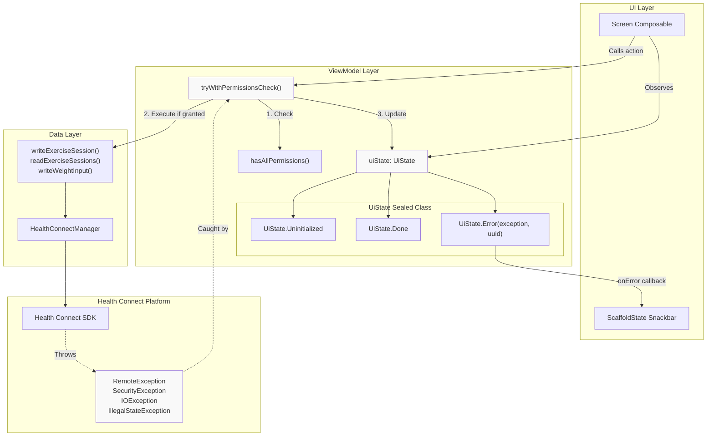
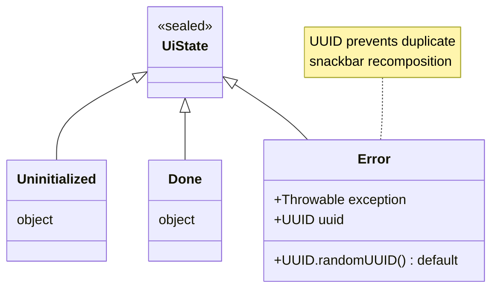
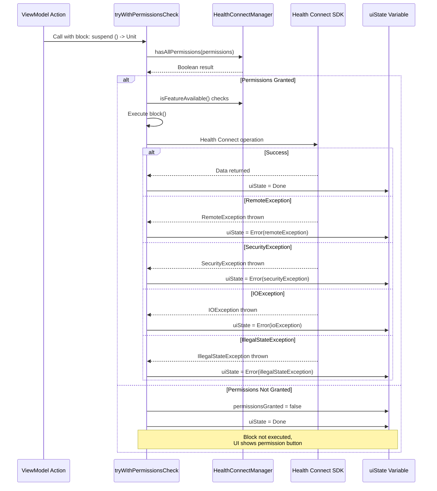
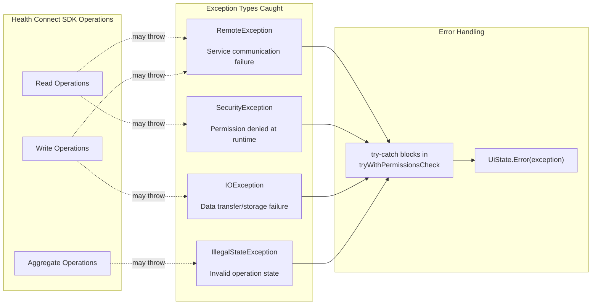
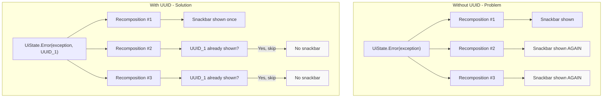
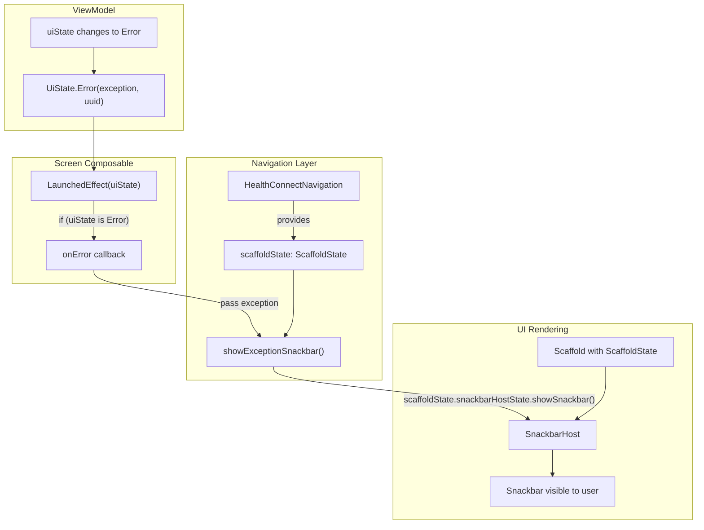
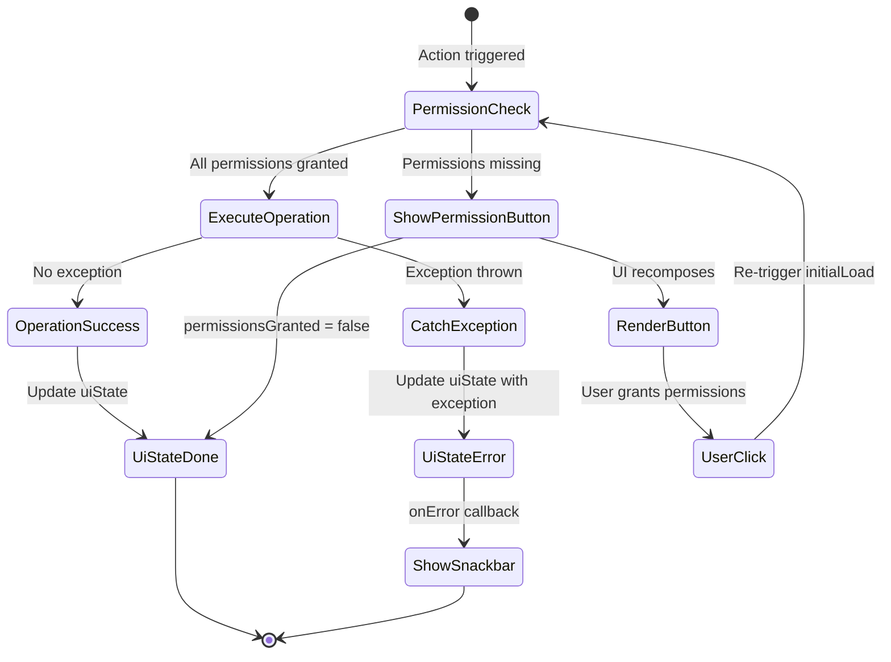

<!-- source: DeepWiki mcp.deepwiki.com · repo android/android-health-connect-codelab · page 9.2 Error Handling and User Feedback · fetched 2026-10-23 -->

# Error Handling and User Feedback

<details>
<summary>Relevant source files</summary>

The following files were used as context for generating this wiki page:

- [finished/src/main/java/com/example/healthconnect/codelab/presentation/navigation/HealthConnectNavigation.kt](finished/src/main/java/com/example/healthconnect/codelab/presentation/navigation/HealthConnectNavigation.kt)
- [finished/src/main/java/com/example/healthconnect/codelab/presentation/screen/exercisesession/ExerciseSessionViewModel.kt](finished/src/main/java/com/example/healthconnect/codelab/presentation/screen/exercisesession/ExerciseSessionViewModel.kt)

</details>


## Purpose and Scope

This page documents the error handling patterns and user feedback mechanisms used throughout the Health Connect Codelab application. It covers the centralized error handling wrapper (`tryWithPermissionsCheck`), the UiState sealed class pattern, exception types caught from Health Connect operations, UUID-based error deduplication to prevent duplicate UI notifications, and the snackbar-based user feedback system.

For information about permission management logic, see [5.2](#5.2). For details on state management patterns more broadly, see [9.1](#9.1).

---

## Error Handling Architecture Overview

The application implements a consistent error handling pattern across all ViewModels, where Health Connect operations are wrapped in a try-catch block that handles known exception types, manages permission state, and updates UI state accordingly.



**Sources:** [finished/src/main/java/com/example/healthconnect/codelab/presentation/screen/exercisesession/ExerciseSessionViewModel.kt:130-154](), [finished/src/main/java/com/example/healthconnect/codelab/presentation/navigation/HealthConnectNavigation.kt:115-117]()

---

## UiState Sealed Class Pattern

All ViewModels in the application use a consistent `UiState` sealed class to represent the current operational state. This pattern provides type-safe state management and enables predictable UI behavior.

### UiState Structure

The sealed class defines three possible states:

| State | Description | Use Case |
|-------|-------------|----------|
| `Uninitialized` | Initial state before any operation | Default state when ViewModel is created |
| `Done` | Operation completed successfully | Successful data read/write, permissions granted |
| `Error(exception, uuid)` | Operation failed with exception | Any caught exception during Health Connect operations |

The `Error` state includes two properties:
- `exception: Throwable` - The actual exception that was caught
- `uuid: UUID` - A randomly generated identifier for deduplication (see [UUID-based Error Deduplication](#uuid-based-error-deduplication))



**Sources:** [finished/src/main/java/com/example/healthconnect/codelab/presentation/screen/exercisesession/ExerciseSessionViewModel.kt:156-163]()

---

## tryWithPermissionsCheck Wrapper Function

The `tryWithPermissionsCheck` function is the core error handling mechanism used by all ViewModels. It provides three key services: permission verification, exception handling, and state management.

### Function Signature and Behavior

Located in ViewModels like `ExerciseSessionViewModel`, this suspend function wraps Health Connect operations:



**Sources:** [finished/src/main/java/com/example/healthconnect/codelab/presentation/screen/exercisesession/ExerciseSessionViewModel.kt:130-154]()

### Permission State Updates

Before executing the operation block, the wrapper updates multiple permission-related state variables:

| State Variable | Source | Purpose |
|----------------|--------|---------|
| `permissionsGranted` | `hasAllPermissions(permissions)` | Core read/write permissions granted |
| `backgroundReadAvailable` | `isFeatureAvailable(FEATURE_READ_HEALTH_DATA_IN_BACKGROUND)` | Device supports background reading |
| `backgroundReadGranted` | `hasAllPermissions(backgroundReadPermissions)` | Background permission granted |
| `historyReadAvailable` | `isFeatureAvailable(FEATURE_READ_HEALTH_DATA_HISTORY)` | Device supports history reading |
| `historyReadGranted` | `hasAllPermissions(historyReadPermissions)` | History permission granted |

**Sources:** [finished/src/main/java/com/example/healthconnect/codelab/presentation/screen/exercisesession/ExerciseSessionViewModel.kt:131-139]()

---

## Exception Types from Health Connect

The application handles four specific exception types that the Health Connect SDK is known to throw. Each exception type indicates a different category of failure:



**Sources:** [finished/src/main/java/com/example/healthconnect/codelab/presentation/screen/exercisesession/ExerciseSessionViewModel.kt:145-152]()

### Exception Categories

| Exception Type | Typical Causes | Application Response |
|----------------|----------------|----------------------|
| `RemoteException` | Health Connect service unavailable, IPC failure | Show error snackbar, operation fails gracefully |
| `SecurityException` | Permission revoked after initial check, unauthorized access | Show error snackbar, re-check permissions |
| `IOException` | Data write/read failure, storage issues | Show error snackbar, retry may help |
| `IllegalStateException` | Invalid operation sequence, malformed request | Show error snackbar, indicates code bug |

---

## UUID-based Error Deduplication

The `UiState.Error` class includes a UUID field generated with `UUID.randomUUID()` as a default parameter value. This design pattern prevents duplicate error snackbars during recomposition cycles.

### Problem: Recomposition Duplicate Snackbars

Without the UUID, the same `Error` instance would trigger multiple snackbar displays during Compose recomposition, since the error state object reference remains the same:



**Sources:** [finished/src/main/java/com/example/healthconnect/codelab/presentation/screen/exercisesession/ExerciseSessionViewModel.kt:160-162]()

### UUID Implementation Details

The UUID is generated as a default parameter in the `Error` data class:

```kotlin
data class Error(val exception: Throwable, val uuid: UUID = UUID.randomUUID()) : UiState()
```

This means:
- Each new `Error` instance automatically gets a unique UUID
- Screen composables can track which UUIDs have already triggered snackbars
- The same error (by exception content) can be distinguished across different occurrences

**Sources:** [finished/src/main/java/com/example/healthconnect/codelab/presentation/screen/exercisesession/ExerciseSessionViewModel.kt:162]()

---

## User Feedback via Snackbars

The application uses Material Design snackbars (via `ScaffoldState`) to display error messages to users. The snackbar system is integrated into the navigation architecture.

### Snackbar Display Flow



**Sources:** [finished/src/main/java/com/example/healthconnect/codelab/presentation/navigation/HealthConnectNavigation.kt:116](), [finished/src/main/java/com/example/healthconnect/codelab/presentation/navigation/HealthConnectNavigation.kt:43]()

### Navigation Integration Pattern

Each screen in the navigation graph receives an `onError` callback that invokes `showExceptionSnackbar`:

| Screen Route | onError Implementation | Line Reference |
|--------------|------------------------|----------------|
| `ExerciseSessions` | `showExceptionSnackbar(scaffoldState, scope, exception)` | [finished/src/main/java/com/example/healthconnect/codelab/presentation/navigation/HealthConnectNavigation.kt:115-117]() |
| `ExerciseSessionDetail` | `showExceptionSnackbar(scaffoldState, scope, exception)` | [finished/src/main/java/com/example/healthconnect/codelab/presentation/navigation/HealthConnectNavigation.kt:147-149]() |
| `InputReadings` | `showExceptionSnackbar(scaffoldState, scope, exception)` | [finished/src/main/java/com/example/healthconnect/codelab/presentation/navigation/HealthConnectNavigation.kt:183-185]() |
| `DifferentialChanges` | `showExceptionSnackbar(scaffoldState, scope, exception)` | [finished/src/main/java/com/example/healthconnect/codelab/presentation/navigation/HealthConnectNavigation.kt:220-222]() |

**Sources:** [finished/src/main/java/com/example/healthconnect/codelab/presentation/navigation/HealthConnectNavigation.kt:75-229]()

### showExceptionSnackbar Function

This function (referenced but implementation not shown in provided files) is a utility that:
1. Takes `ScaffoldState`, `CoroutineScope`, and `Throwable` parameters
2. Launches a coroutine in the provided scope
3. Calls `scaffoldState.snackbarHostState.showSnackbar()` with the exception message
4. Handles the asynchronous nature of snackbar display

**Sources:** [finished/src/main/java/com/example/healthconnect/codelab/presentation/navigation/HealthConnectNavigation.kt:43]()

---

## Permission Error Handling Pattern

Permission failures are handled differently from other exceptions. When permissions are not granted, the operation block is not executed, and the UI conditionally renders a permission request button instead of showing an error.

### Permission Check vs Exception Flow



**Sources:** [finished/src/main/java/com/example/healthconnect/codelab/presentation/screen/exercisesession/ExerciseSessionViewModel.kt:130-154]()

### Conditional UI Rendering Based on Permission State

The screens observe the `permissionsGranted` state variable and render different UI elements:

| Permission State | UI Element Displayed | User Action Available |
|------------------|----------------------|----------------------|
| `permissionsGranted == false` | "Request Permissions" button | Launch permission request |
| `permissionsGranted == true` | Feature UI (forms, lists, buttons) | Use feature normally |
| Exception caught | Feature UI + Snackbar with error | Retry operation |

**Sources:** [finished/src/main/java/com/example/healthconnect/codelab/presentation/navigation/HealthConnectNavigation.kt:81-124]()

---

## Error State Propagation in ViewModels

All feature ViewModels follow the same error handling pattern. Here's how the pattern is consistently applied:

### Common ViewModel Structure

```mermaid
graph TB
    subgraph "ExerciseSessionViewModel"
        ESVM_TryWrapper["tryWithPermissionsCheck"]
        ESVM_State["uiState: UiState"]
        ESVM_Insert["insertExerciseSession()"]
        ESVM_Read["readExerciseSessions()"]
    end
    
    subgraph "InputReadingsViewModel"
        IRVM_TryWrapper["tryWithPermissionsCheck"]
        IRVM_State["uiState: UiState"]
        IRVM_Input["inputReadings()"]
        IRVM_Read["readWeightInputs()"]
    end
    
    subgraph "DifferentialChangesViewModel"
        DCVM_TryWrapper["tryWithPermissionsCheck"]
        DCVM_State["uiState: UiState"]
        DCVM_GetChanges["getChanges()"]
        DCVM_Enable["enableOrDisableChanges()"]
    end
    
    subgraph "ExerciseSessionDetailViewModel"
        ESDVM_TryWrapper["tryWithPermissionsCheck"]
        ESDVM_State["uiState: UiState"]
        ESDVM_Load["initialLoad()"]
    end
    
    ESVM_Insert --> ESVM_TryWrapper
    ESVM_Read --> ESVM_TryWrapper
    ESVM_TryWrapper --> ESVM_State
    
    IRVM_Input --> IRVM_TryWrapper
    IRVM_Read --> IRVM_TryWrapper
    IRVM_TryWrapper --> IRVM_State
    
    DCVM_GetChanges --> DCVM_TryWrapper
    DCVM_Enable --> DCVM_TryWrapper
    DCVM_TryWrapper --> DCVM_State
    
    ESDVM_Load --> ESDVM_TryWrapper
    ESDVM_TryWrapper --> ESDVM_State
    
    style ESVM_TryWrapper fill:#f9f9f9
    style IRVM_TryWrapper fill:#f9f9f9
    style DCVM_TryWrapper fill:#f9f9f9
    style ESDVM_TryWrapper fill:#f9f9f9
```



**Sources:** [finished/src/main/java/com/example/healthconnect/codelab/presentation/screen/exercisesession/ExerciseSessionViewModel.kt:44-178]()

### Typical Usage Pattern in Actions

ViewModel action methods follow this consistent pattern:

1. Launch coroutine in `viewModelScope`
2. Call `tryWithPermissionsCheck` with operation block
3. Inside block, call `HealthConnectManager` methods
4. Update observable state variables (e.g., `sessionsList.value`)
5. `tryWithPermissionsCheck` automatically updates `uiState`

Example from `insertExerciseSession()`:

```kotlin
fun insertExerciseSession() {
    viewModelScope.launch {
        tryWithPermissionsCheck {
            // Generate session data
            healthConnectManager.writeExerciseSession(startOfSession, endOfSession)
            readExerciseSessions() // Refresh list
        }
    }
}
```

**Sources:** [finished/src/main/java/com/example/healthconnect/codelab/presentation/screen/exercisesession/ExerciseSessionViewModel.kt:90-107]()

---

## Summary Table: Error Handling Components

| Component | Location | Responsibility |
|-----------|----------|----------------|
| `UiState` sealed class | ViewModels | Type-safe state representation (Uninitialized/Done/Error) |
| `tryWithPermissionsCheck` | ViewModels | Permission checking, exception catching, state updates |
| `uuid` in `UiState.Error` | Error data class | Prevents duplicate snackbar displays during recomposition |
| `showExceptionSnackbar` | Navigation utility | Displays error messages via ScaffoldState snackbar |
| `onError` callbacks | Navigation graph | Connects ViewModel errors to snackbar system |
| `permissionsGranted` state | ViewModels | Controls conditional UI rendering for permission requests |
| Exception catch blocks | `tryWithPermissionsCheck` | Handles RemoteException, SecurityException, IOException, IllegalStateException |

**Sources:** [finished/src/main/java/com/example/healthconnect/codelab/presentation/screen/exercisesession/ExerciseSessionViewModel.kt:44-178](), [finished/src/main/java/com/example/healthconnect/codelab/presentation/navigation/HealthConnectNavigation.kt:48-231]()

---

