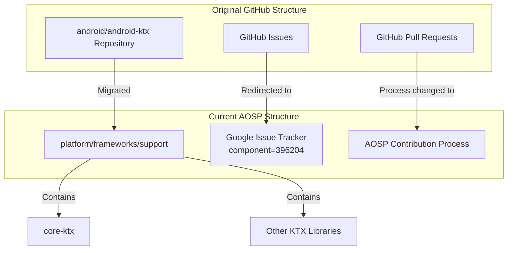
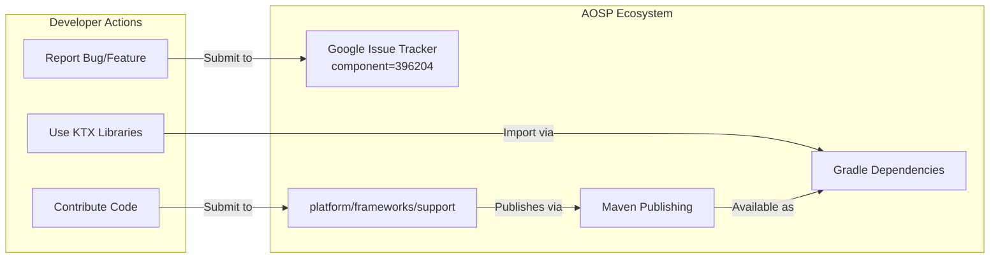
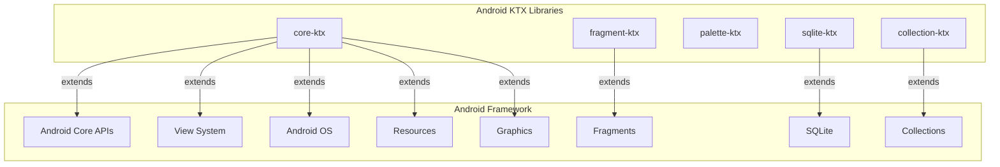
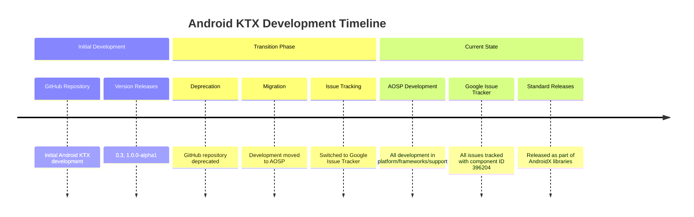

<!-- source: DeepWiki mcp.deepwiki.com · repo android/android-ktx · page 1 Android KTX Overview · fetched 2026-10-23 -->

# Android KTX Overview

Relevant source files

The following files were used as context for generating this wiki page:

- [README.md](README.md)

## Purpose and Scope

This document introduces the Android KTX repository, explains its primary purpose as a collection of Kotlin extensions for Android development, and details its current deprecated status following its transition to the Android Open Source Project (AOSP). For specific information about the Kotlin extensions provided by Android KTX, see [Kotlin Extensions for Android](#1.1). For detailed information about the repository transition process, see [Repository Transition to AOSP](#1.2).

## What is Android KTX?

Android KTX (Kotlin Extensions) is a set of extensions that provide concise, idiomatic Kotlin to standard Android APIs. These extensions leverage Kotlin language features like extension functions/properties, lambdas, named parameters, and parameter defaults to make Android development more concise, readable, and enjoyable when using Kotlin.

The library was designed to eliminate boilerplate code, improve type safety, and increase development efficiency by building on top of the Android SDK with Kotlin-specific optimizations.

Sources: [README.md:1-2]()

## Repository Status

The Android KTX repository (https://github.com/android/android-ktx) is **deprecated** and no longer active for development. All development activities, including:

- Code contributions
- Issue tracking
- Pull requests
- Releases

Have been migrated to the Android Open Source Project (AOSP) platform/frameworks/support repository.

Sources: [README.md:4-13]()

## System Structure and Transition

The following diagram illustrates the transition of Android KTX from its original GitHub repository to the AOSP ecosystem:

**Android KTX Repository Transition**

Sources: [README.md:4-11]()

## Developer Interaction

Developers wishing to interact with Android KTX should follow the current workflows outlined below. The original repository no longer accepts contributions, issues, or pull requests.

**Android KTX Developer Workflow**

### Reporting Issues

Bug reports and feature requests should be submitted to Google's Issue Tracker with the component ID 396204.

URL: https://issuetracker.google.com/issues/new?component=396204

Sources: [README.md:7-8]()

### Contributing Code

Code contributions to Android KTX libraries should follow the AOSP contribution process. Developers should refer to the README in the platform/frameworks/support repository for detailed instructions.

Repository: https://android.googlesource.com/platform/frameworks/support/

Sources: [README.md:10-11]()

## Core Components

Android KTX consists of several extension libraries, with `core-ktx` being the main component. The library structure provides Kotlin extensions for different aspects of Android development:

| Library | Purpose | Provides Extensions For |
|---------|---------|------------------------|
| core-ktx | Core Android functionality | View system, Resources, Graphics, OS, etc. |
| fragment-ktx | Fragment extensions | FragmentManager, Fragment transactions |
| palette-ktx | Color palette extensions | Palette generation and manipulation |
| sqlite-ktx | SQLite extensions | Database operations, cursors |
| collection-ktx | Collection extensions | SparseArray, ArrayMap, etc. |

The following diagram shows the relationship between these libraries and the Android framework components they extend:

**Android KTX Extension Architecture**

Sources: [README.md:1-2](), [README.md:7-8]()

## Historical Context

The Android KTX project was initially developed in the standalone GitHub repository before being migrated to AOSP. The repository transition represents a consolidation of Android KTX development within the broader Android ecosystem, allowing for more standardized development processes and better integration with other Android components.

**Android KTX Timeline**

Sources: [README.md:4-13]()

## Conclusion

Android KTX provides valuable Kotlin extensions that enhance Android development by making the APIs more concise and idiomatic in Kotlin. Following the migration to AOSP, all development activities now take place within the AOSP ecosystem, and developers should direct their contributions and issues accordingly.

For more detailed information about the specific Kotlin extensions provided by Android KTX, see [Kotlin Extensions for Android](#1.1). For more information about the repository transition process and current development workflows, see [Repository Transition to AOSP](#1.2).

---

