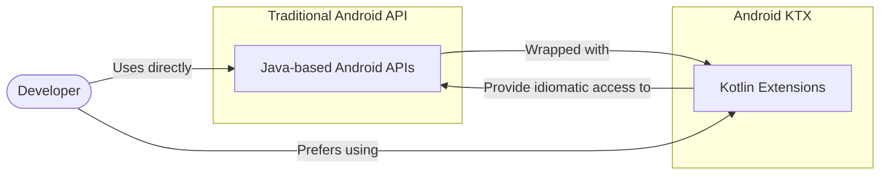
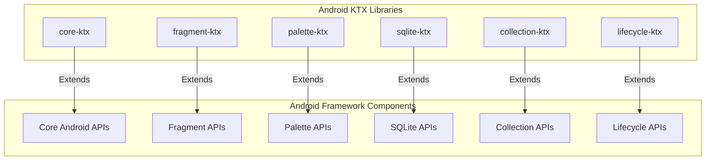
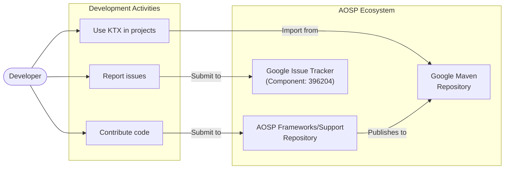

<!-- source: DeepWiki mcp.deepwiki.com · repo android/android-ktx · page 1.1 Kotlin Extensions for Android · fetched 2026-10-23 -->

# Kotlin Extensions for Android

<details>
<summary>Relevant source files</summary>

The following files were used as context for generating this wiki page:

- [README.md](README.md)

</details>


## Purpose and Scope

This document explains Android KTX (Kotlin Extensions), a set of Kotlin extensions that enhance the Android API with concise and idiomatic Kotlin code. It covers what these extensions are, how they simplify Android development, and the benefits they provide to Kotlin Android developers. For information about the repository's transition to AOSP, see [Repository Transition to AOSP](#1.2).

## What are Kotlin Extensions for Android?

Android KTX is a collection of Kotlin extensions that provide concise, idiomatic Kotlin to standard Android APIs. These extensions leverage Kotlin language features such as extension functions, property delegates, lambdas, and named parameters to make Android development more pleasant and productive when using Kotlin.

Kotlin extensions are a language feature that allows developers to extend existing classes with new functionality without having to inherit from the class or use design patterns like Decorator. Android KTX uses this feature to add useful utilities to standard Android framework classes.



Title: Android KTX Relationship to Standard Android APIs

Sources: README.md

## Core Benefits

Android KTX provides several key advantages for Kotlin Android developers:

1. **Conciseness**: Eliminates boilerplate code through extension functions and properties
2. **Readability**: More natural API syntax aligned with Kotlin conventions
3. **Safety**: Leverages Kotlin's null safety and type system
4. **Functionality**: Adds useful utilities not present in the original APIs

```mermaid
flowchart TD
    subgraph "Without KTX"
        J1["sharedPreferences.edit().<br>putString(key, value).<br>apply()"]
        J2["ViewCompat.<br>setBackground(view, drawable)"]
        J3["Bundle().apply {<br>  putString(\"key\", value)<br>  putInt(\"id\", id)<br>}"]
    end
    
    subgraph "With KTX"
        K1["sharedPreferences.edit {<br>  putString(key, value)<br>}"]
        K2["view.background = drawable"]
        K3["bundleOf(<br>  \"key\" to value,<br>  \"id\" to id<br>)"]
    end
    
    J1 -->|"Simplified to"| K1
    J2 -->|"Simplified to"| K2
    J3 -->|"Simplified to"| K3
```

Title: Code Comparison With and Without KTX

Sources: README.md

## Android KTX Library Structure

Android KTX is organized into multiple modules, each targeting specific parts of the Android framework. The original repository contained early versions, but all development has now moved to AOSP.

The main modules include:

| Module | Description | Target Android Components |
|--------|-------------|---------------------------|
| core-ktx | Core Android framework extensions | Context, SharedPreferences, View, Resources, etc. |
| fragment-ktx | Fragment extensions | Fragment transactions, arguments |
| palette-ktx | Palette API extensions | Color palette extraction |
| sqlite-ktx | SQLite extensions | Database operations |
| collection-ktx | Collection extensions | Arrays, collections related to Android |
| lifecycle-ktx | Lifecycle component extensions | ViewModel, LiveData |



Title: Android KTX Library Structure

Sources: README.md

## Extension Function Patterns

Android KTX uses several common patterns for its extensions:

1. **Property Access**: Converts getter/setter methods to Kotlin properties
2. **Scope Functions**: Uses `apply`, `let`, `run`, etc. for cleaner code blocks
3. **Factory Functions**: Simplifies object creation
4. **Infix Functions**: Makes certain operations more readable
5. **Extension Properties**: Adds computed properties to existing classes

```mermaid
flowchart TD
    subgraph "Extension Patterns"
        direction LR
        Property["Property Access<br>view.isVisible = true"]
        Scope["Scope Functions<br>view.updateLayoutParams { width = MATCH_PARENT }"]
        Factory["Factory Functions<br>bundleOf(\"key\" to value)"]
        Infix["Infix Functions<br>value to \"key\""]
        ExtProp["Extension Properties<br>view.children"]
    end
    
    subgraph "Benefits"
        direction LR
        Concise["Conciseness"]
        Readable["Readability"]
        Idiomatic["Idiomatic Kotlin"]
        Intuitive["Intuitive APIs"]
    end
    
    Property --> Concise
    Property --> Readable
    Scope --> Concise
    Scope --> Idiomatic
    Factory --> Intuitive
    Factory --> Concise
    Infix --> Readable
    Infix --> Idiomatic
    ExtProp --> Intuitive
    ExtProp --> Concise
```

Title: Android KTX Extension Patterns and Benefits

Sources: README.md

## Using Android KTX in Your Projects

To use Android KTX libraries in your projects, you need to add the appropriate dependencies to your Gradle build files. Since the libraries are now maintained as part of AOSP, they are published through Google's Maven repository.

Here's a general overview of how to include Android KTX in your projects:

1. Ensure you have the Google Maven repository in your project-level `build.gradle` file
2. Add the specific KTX module dependencies to your app-level `build.gradle` file
3. Import the extension functions in your Kotlin files

Note that as the repository has moved to AOSP, the latest versions and documentation should be consulted through official Android documentation.

## Current Status and Development

As noted in the repository README, the original Android KTX repository is no longer being used for development, tracking issues, or accepting pull requests. All development has moved to AOSP.

For bug reports or feature suggestions for Android KTX libraries, use Google's Issue Tracker with component ID 396204. To contribute to the libraries, follow the AOSP contribution guidelines.



Title: Android KTX Developer Interaction Flow

Sources: README.md

## Conclusion

Android KTX makes Android development with Kotlin more concise, idiomatic, and enjoyable by leveraging Kotlin's language features to enhance the standard Android APIs. While the original repository has been deprecated, the libraries continue to be developed and maintained as part of AOSP, with new versions regularly published.

By using Android KTX, developers can write more readable and maintainable Android applications while taking full advantage of Kotlin's powerful features.

---

