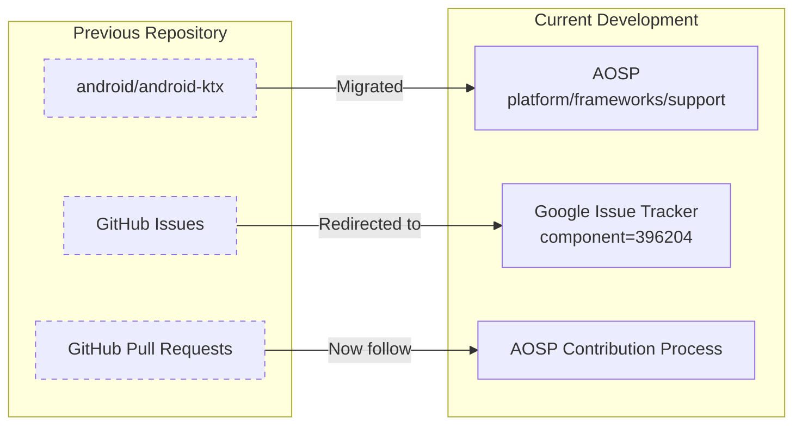
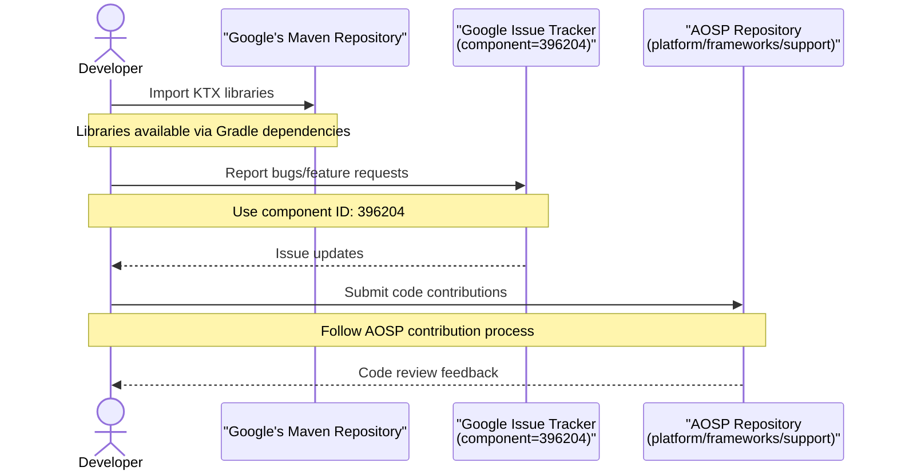
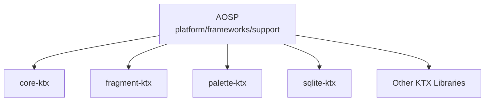

<!-- source: DeepWiki mcp.deepwiki.com · repo android/android-ktx · page 1.2 Repository Transition to AOSP · fetched 2026-10-23 -->

# Repository Transition to AOSP

<details>
<summary>Relevant source files</summary>

The following files were used as context for generating this wiki page:

- [README.md](README.md)

</details>


## Purpose

This document details the transition of Android KTX development from the standalone GitHub repository to the Android Open Source Project (AOSP). It explains the current status of the repository, why the transition occurred, and how developers should interact with Android KTX libraries moving forward. For general information about what Android KTX is and its purpose, see [Kotlin Extensions for Android](#1.1).

## Transition Status

The Android KTX GitHub repository (`android/android-ktx`) has been deprecated and is no longer active for development purposes. All development activities have been moved to the Android Open Source Project (AOSP).



**Diagram: Android KTX Repository Transition**

Sources: [README.md:4-11]()

## Key Changes

The transition to AOSP brought several significant changes to how developers interact with Android KTX:

1. **No GitHub Issues or PRs**: The original repository no longer accepts issues or pull requests
2. **Issue Tracking**: All bug reports and feature requests should be submitted to Google's Issue Tracker
3. **Code Contributions**: Code contributions must follow AOSP contribution guidelines
4. **Library Maintenance**: All KTX libraries are now maintained as part of the Android framework support

Sources: [README.md:4-13]()

## New Developer Workflow

The transition to AOSP has established a new workflow for developers wanting to interact with Android KTX libraries:



**Diagram: Developer Interaction with Android KTX after AOSP Transition**

Sources: [README.md:7-11]()

## Reporting Issues

Bug reports and feature suggestions for all KTX libraries should now be filed at Google's Issue Tracker with the specific component ID:

```
Component ID: 396204
```

Direct link to create new issues: https://issuetracker.google.com/issues/new?component=396204

Sources: [README.md:7-8]()

## Contributing Code

For developers wishing to contribute code to Android KTX libraries, contributions must be made through the AOSP contribution process:

1. Clone the AOSP repository: https://android.googlesource.com/platform/frameworks/support/
2. Follow contribution guidelines in the README of the AOSP repository
3. Submit patches through the AOSP code review system

More detailed instructions on contributing code can be found in the [Contributing Code](#2.2) section.

Sources: [README.md:10-11]()

## Technical Impact of the Transition

The transition to AOSP has several technical implications for both the library maintenance and developer interaction:

| Aspect | Before Transition | After Transition |
|--------|-------------------|------------------|
| Repository Location | GitHub: android/android-ktx | AOSP: platform/frameworks/support |
| Issue Tracking | GitHub Issues | Google Issue Tracker (component 396204) |
| Code Contributions | GitHub Pull Requests | AOSP Contribution Process |
| Release Process | GitHub Releases | AOSP Release Pipeline |
| Integration with Android | Standalone | Direct integration with framework support |
| Package Structure | Consistent with initial design | May evolve as part of AOSP |

Sources: [README.md:4-13]()

## Timeline of Transition

```mermaid
timeline
    title Android KTX Repository Transition Timeline
    
    section Initial Repository
        : Android KTX established on GitHub
        : Early development and releases
    
    section Transition
        : Announcement of transition to AOSP
        : Repository marked as deprecated
        : Development moved to platform/frameworks/support
    
    section Current Status
        : No active development in GitHub repository
        : All development activities in AOSP
        : Libraries maintained and released as part of Android support libraries
```

**Diagram: Timeline of Android KTX Repository Transition**

Sources: [README.md:4-13]()

## Finding KTX Libraries in AOSP

After the transition, Android KTX libraries can be found within the structure of the Android frameworks support repository:



**Diagram: KTX Libraries in AOSP Repository Structure**

Sources: [README.md:10-11]()

## Conclusion

The Android KTX GitHub repository has been fully transitioned to AOSP. Developers should now:

1. Use Google's Issue Tracker for bug reports and feature requests
2. Follow AOSP contribution guidelines for code contributions
3. Import KTX libraries from Google's Maven repository

This transition integrates Android KTX more deeply into the Android platform development process, allowing for better coordination with other Android components and more streamlined maintenance.

Sources: [README.md:4-13]()

---

