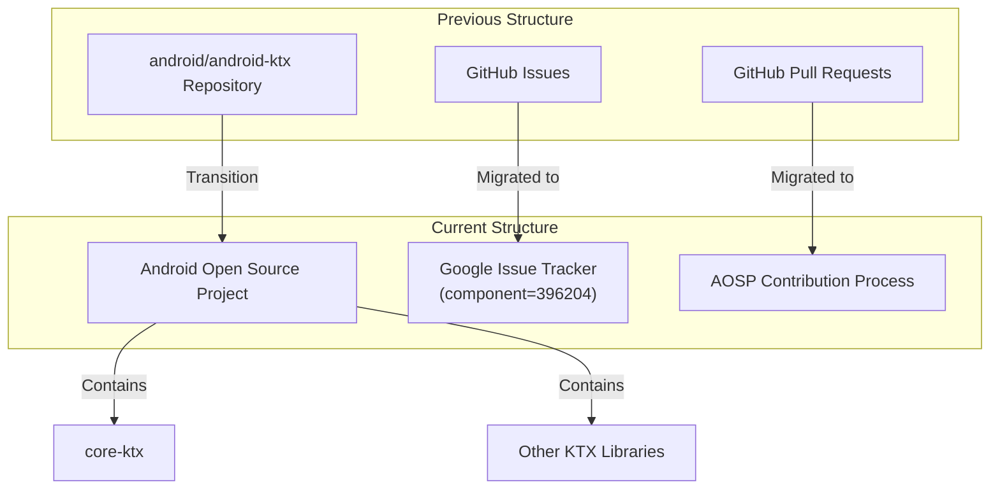
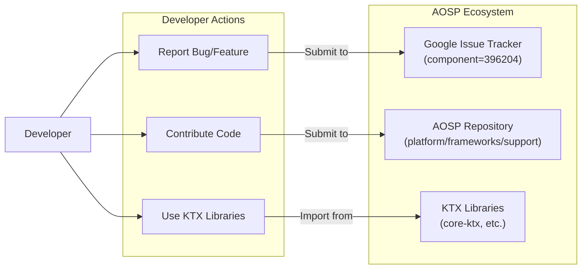
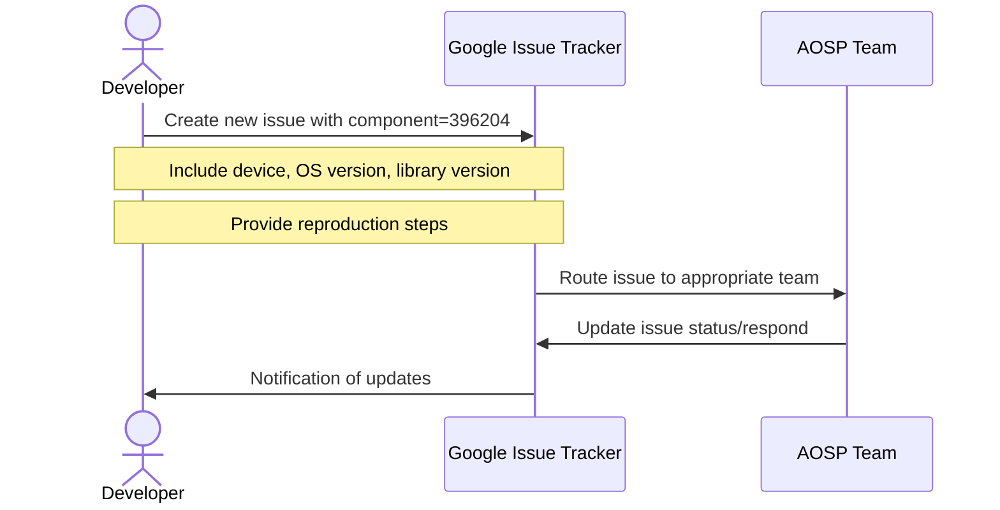
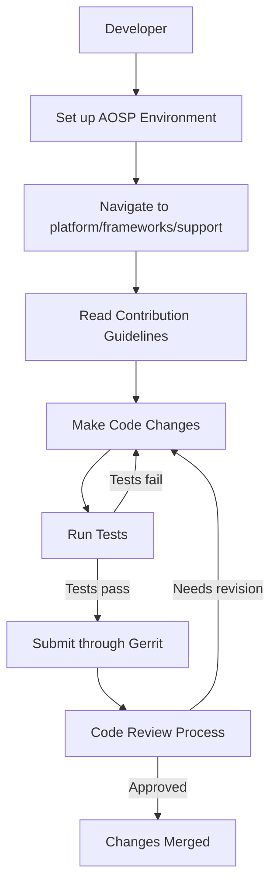
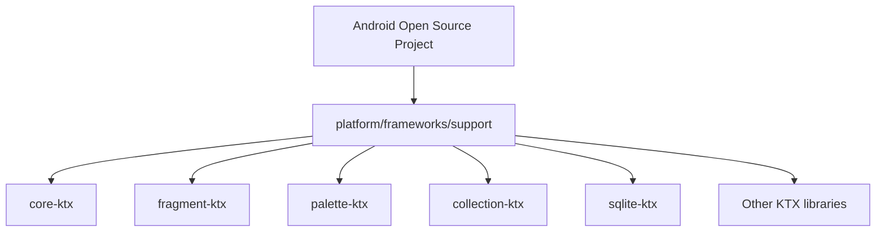
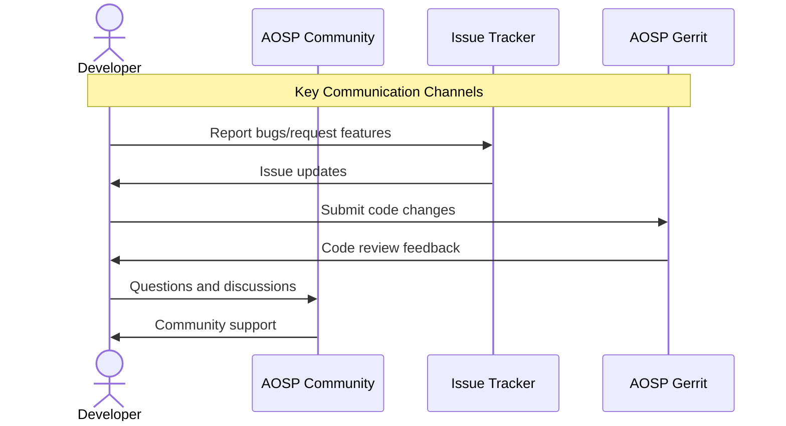

<!-- source: DeepWiki mcp.deepwiki.com · repo android/android-ktx · page 2 Developer Interaction Guide · fetched 2026-10-23 -->

# Developer Interaction Guide

Relevant source files

The following files were used as context for generating this wiki page:

- [README.md](README.md)

## Purpose and Scope

This guide outlines the procedures and channels for developers to interact with Android KTX libraries following the transition to the Android Open Source Project (AOSP). It covers how to report issues, request features, contribute code, and effectively engage with the Android KTX ecosystem now that the original repository has been deprecated.

For historical information about the Android KTX project before its transition, see [Project History and Versioning](#3). For specific details on reporting issues and contributing code, see [Reporting Issues and Feature Requests](#2.1) and [Contributing Code](#2.2).

Sources: [README.md:4-13]()

## Repository Transition Overview

The Android KTX repository has undergone a significant transition. Originally developed as a standalone repository, all development activities have now moved to the Android Open Source Project (AOSP). This means that the original repository is no longer accepting pull requests or issues, and all development work takes place within AOSP.

*Diagram: Android KTX Repository Transition*

Sources: [README.md:4-13]()

## Current Developer Interaction Workflow

Developers now interact with Android KTX through AOSP channels rather than the original GitHub repository. This ensures standardized development processes and better integration with other Android components.

*Diagram: Developer Interaction Workflow*

Sources: [README.md:4-13]()

## Reporting Issues and Feature Requests

All bug reports, feature suggestions, and other issue tracking for Android KTX libraries are now handled through Google's Issue Tracker rather than GitHub Issues.

### Process for Issue Reporting

1. Navigate to Google's Issue Tracker at https://issuetracker.google.com/issues/new
2. Select component ID: 396204 (specific to Android KTX libraries)
3. Provide detailed information about the issue or feature request
4. Submit the issue

| Category | Platform | Link |
|----------|----------|------|
| Bug Reports | Google Issue Tracker | Component ID: 396204 |
| Feature Requests | Google Issue Tracker | Component ID: 396204 |
| General Queries | Google Issue Tracker | Component ID: 396204 |

*Diagram: Issue Reporting Process*

Sources: [README.md:7-8]()

## Contributing Code

Code contributions to Android KTX libraries must now follow the AOSP contribution process. The original repository no longer accepts pull requests.

### Contribution Process

1. Set up AOSP development environment
2. Navigate to the platform/frameworks/support repository
3. Follow the contribution guidelines in the repository's README
4. Submit code changes through the AOSP gerrit system

*Diagram: Code Contribution Process*

Sources: [README.md:10-11]()

## KTX Libraries Structure in AOSP

The Android KTX libraries are now organized within the AOSP structure, primarily in the platform/frameworks/support repository.

*Diagram: KTX Libraries in AOSP Structure*

Sources: [README.md:10-11]()

## Communication Channels

As part of the transition to AOSP, the communication channels for Android KTX have changed. Developers should be aware of the current channels for effective interaction.

| Channel Type | Previous | Current |
|--------------|----------|---------|
| Issue Tracking | GitHub Issues | Google Issue Tracker (component=396204) |
| Code Contributions | GitHub Pull Requests | AOSP Gerrit |
| Documentation | GitHub Wiki | AOSP Documentation |

*Diagram: Communication Channels*

Sources: [README.md:4-13]()

## Summary

The migration of Android KTX to AOSP represents a significant change in how developers interact with these libraries. By following the guidelines in this document, developers can effectively:

1. Report issues and request features through Google's Issue Tracker
2. Contribute code through the AOSP contribution process
3. Access the latest KTX libraries through the AOSP ecosystem

This transition aligns Android KTX development with the broader Android development process, providing a more integrated experience for developers.

Sources: [README.md:4-13]()

---

