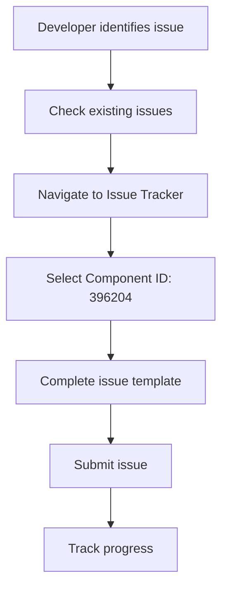
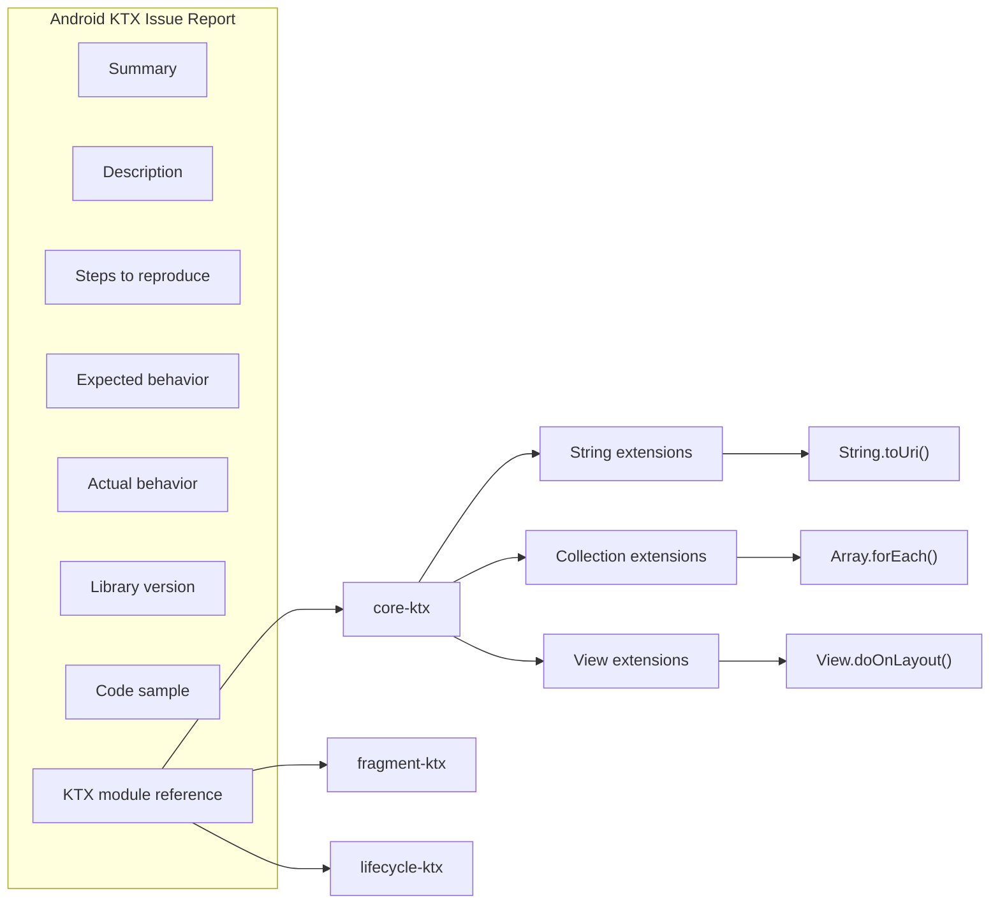
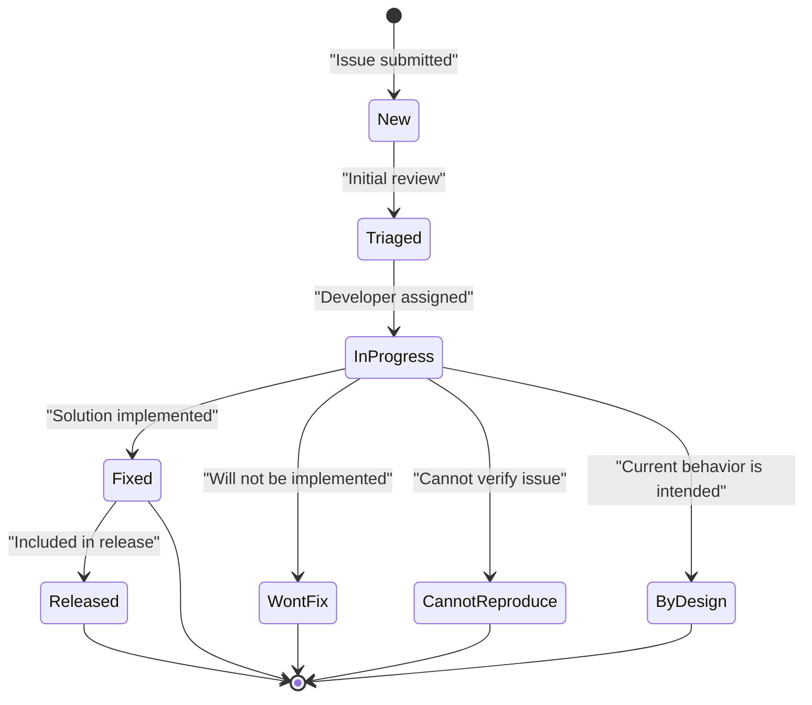

<!-- source: DeepWiki mcp.deepwiki.com · repo android/android-ktx · page 2.1 Reporting Issues and Feature Requests · fetched 2026-10-23 -->

# Reporting Issues and Feature Requests

Relevant source files

The following files were used as context for generating this wiki page:

- [README.md](README.md)

This document provides instructions for reporting bugs and requesting features for Android KTX libraries following the repository's transition to the Android Open Source Project (AOSP). For information about contributing code to Android KTX, see [Contributing Code](#2.2).

## Overview of Issue Reporting

Following the deprecation of the original GitHub repository, all bug reports and feature requests for Android KTX must now be submitted through Google's Issue Tracker. This change is part of the broader transition of Android KTX development to AOSP as detailed in [Repository Transition to AOSP](#1.2).

Sources: [README.md:4-8]()

## Issue Reporting Process

The following process outlines how to report bugs or request features for Android KTX libraries through Google's Issue Tracker.

### Issue Reporting Workflow

Sources: [README.md:7-8]()

### Submitting an Issue

1. Go to Google Issue Tracker with the Android KTX component preselected
2. Ensure you're signed in with your Google account
3. Verify component ID 396204 is selected (this identifies the issue as related to Android KTX)
4. Fill in the required information:
   - Issue type (Bug, Feature Request)
   - Summary: A clear, concise title
   - Description: Detailed information following the guidelines below
5. Submit the issue
6. Track the status of your submission through Google Issue Tracker

Sources: [README.md:7-8]()

## Creating Effective Issue Reports

To help the Android KTX maintainers address your issue efficiently, include specific information in your report that clearly identifies the affected components and behavior.

### Issue Report Components

Sources: [README.md:7-8]()

### For Bug Reports

| Field | Description | Example |
|-------|-------------|---------|
| Module | Specific KTX library affected | core-ktx, fragment-ktx |
| Version | Library version | 1.7.0 |
| Steps to reproduce | Ordered steps to trigger the bug | 1. Import core-ktx 2. Call String.toUri() 3. Pass result to... |
| Expected behavior | What should happen | URI object correctly created from string |
| Actual behavior | What actually happens | NullPointerException thrown |
| Code sample | Minimal code that demonstrates the issue | `val uri = "https://example.com".toUri()` |
| Environment | Development environment details | Android Studio 4.2.1 AGP 7.0.0 Kotlin 1.5.30 |

### For Feature Requests

| Field | Description | Example |
|-------|-------------|---------|
| Module | Target KTX library | core-ktx |
| Feature description | Clear explanation of proposed functionality | Add extension function for converting between units |
| Use case | Why this feature would be valuable | Simplifies common task of converting dp to px |
| Current workaround | How you're addressing this need now | Currently using custom utility functions |
| Example API | Proposed function signature | `fun Int.dpToPx(): Int` |

Sources: [README.md:7-8]()

## Issue Lifecycle

After submission, your issue will progress through several stages in Google's Issue Tracker.

### Issue Status Flow

Sources: [README.md:4-13]()

## Best Practices

1. **Search first**: Before submitting a new issue, search the issue tracker for similar reports
2. **One issue per report**: Submit separate reports for unrelated issues
3. **Be specific**: Include precise details about the affected module and functionality
4. **Provide context**: Explain why this issue or feature is important
5. **Be responsive**: Monitor your issue for questions from maintainers

## Referencing Code in Issue Reports

When reporting issues with specific KTX extensions, reference the exact function, property, or class where you're experiencing the problem. This helps maintainers locate and address the issue more efficiently.

### Example References for Common KTX Modules

| Module | Common Extension Points | Issue Reference Example |
|--------|-------------------------|-------------------------|
| core-ktx | String extensions, View extensions, Color utilities | Issue with View.doOnNextLayout() not executing callback |
| fragment-ktx | Fragment transactions, ViewModels | FragmentTransaction.commit() extension causing crash |
| lifecycle-ktx | LifecycleOwner extensions, LiveData | repeatOnLifecycle() not respecting lifecycle state |

Sources: [README.md:4-13]()

## Frequently Asked Questions

**Q: Can I still use GitHub Issues for the Android KTX repository?**  
A: No. The GitHub repository is deprecated and no longer accepting issues or pull requests.

**Q: What information should I include about my environment?**  
A: Include Android Studio version, Gradle version, Kotlin version, target/compile SDK versions, and device/emulator information if relevant.

**Q: How do I know if my feature request is appropriate for Android KTX?**  
A: Android KTX focuses on Kotlin extensions that make Android development more concise and idiomatic. Good requests align with this goal and follow Kotlin's extension function patterns.

**Q: What if I'm not sure which KTX module is affected?**  
A: Provide as much detail as possible about the functionality you're using, and the maintainers will help identify the appropriate module.

**Q: How can I track if my issue has been fixed?**  
A: Follow your issue in Google Issue Tracker. Once fixed, it will be included in a future release of the appropriate KTX module.

Sources: [README.md:4-13]()

---

