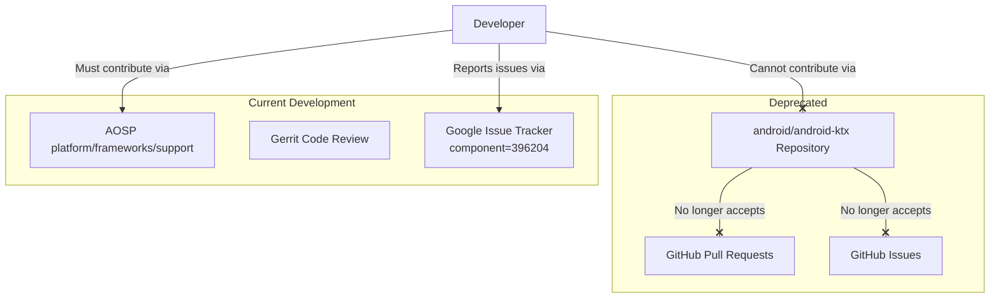
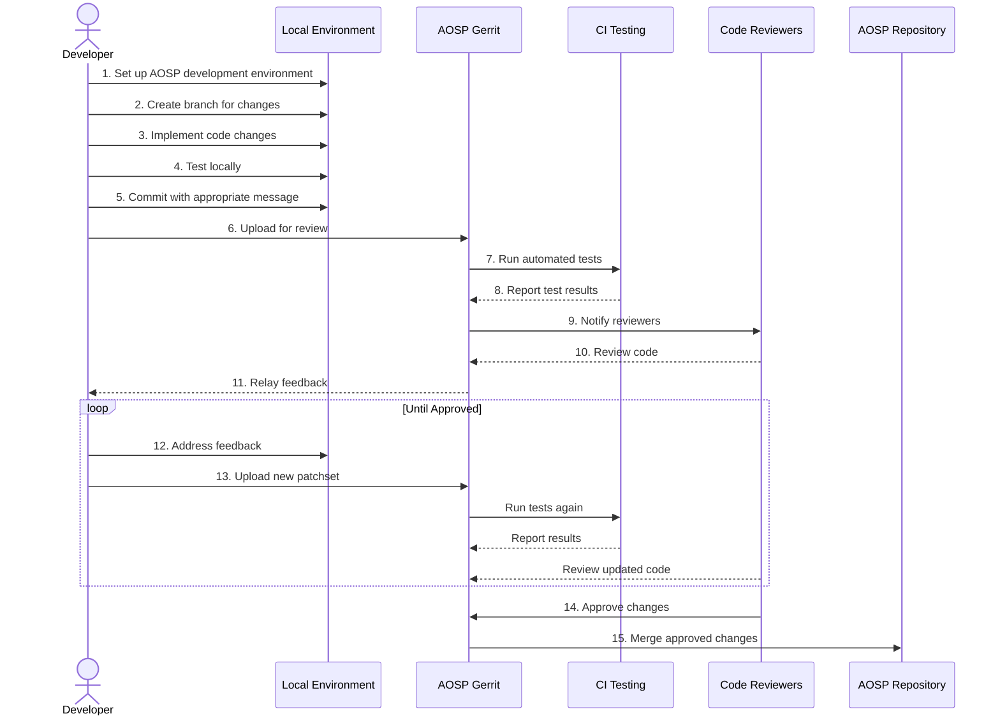
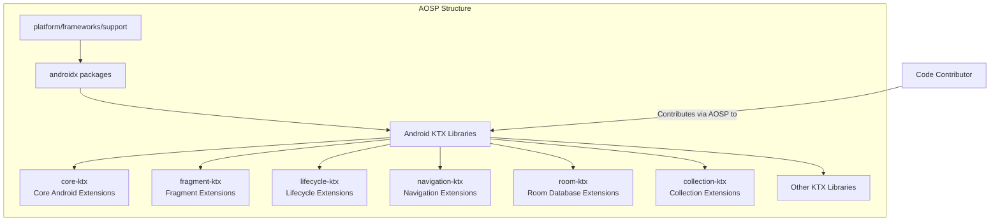

<!-- source: DeepWiki mcp.deepwiki.com · repo android/android-ktx · page 2.2 Contributing Code · fetched 2026-10-23 -->

# Contributing Code

Relevant source files

The following files were used as context for generating this wiki page:

- [README.md](README.md)

This document outlines the process for contributing code to Android KTX libraries. Since the original GitHub repository is deprecated, all contributions must now be made through the Android Open Source Project (AOSP).

## Repository Status

As clearly stated in the README.md file, this repository is no longer being used for development or accepting pull requests:

Sources: [README.md:4-13]()

## Contributing Through AOSP

To contribute code to Android KTX libraries, you must follow the AOSP contribution process as outlined in the README of the platform/frameworks/support repository.

### Contribution Workflow

The following diagram illustrates the general workflow for contributing code to Android KTX through AOSP:

Sources: [README.md:10-11]()

## Getting Started with AOSP Contributions

To begin contributing to Android KTX through AOSP:

1. Visit the AOSP platform/frameworks/support repository at https://android.googlesource.com/platform/frameworks/support/
2. Follow the README instructions for setting up your development environment
3. Follow the AOSP contribution guidelines for creating and submitting changes

Sources: [README.md:10-11]()

## KTX Libraries in AOSP

The following diagram shows the structure of KTX libraries within the AOSP ecosystem:

Sources: [README.md:7-8]()

## Contribution Focus Areas

When contributing to Android KTX libraries, you will typically be working on:

| Contribution Type | Description | Purpose |
|-------------------|-------------|---------|
| Extension Functions | Additional utility methods for Android classes | Simplify common operations |
| Extension Properties | Property accessors for cleaner syntax | Make code more concise and readable |
| Inline Functions | Performance optimizations for higher-order functions | Reduce lambda overhead |
| Operator Overloads | Kotlin operator implementations | Make Android APIs more Kotlin-idiomatic |

All contributions should follow Kotlin best practices and maintain backward compatibility where appropriate.

Sources: [README.md:7-8]()

## Related Resources

For reporting bugs or suggesting features rather than contributing code, please see [Reporting Issues and Feature Requests](#2.1).

For more information about the transition of this repository to AOSP, refer to [Repository Transition to AOSP](#1.2).

Sources: [README.md:7-8]()

---

