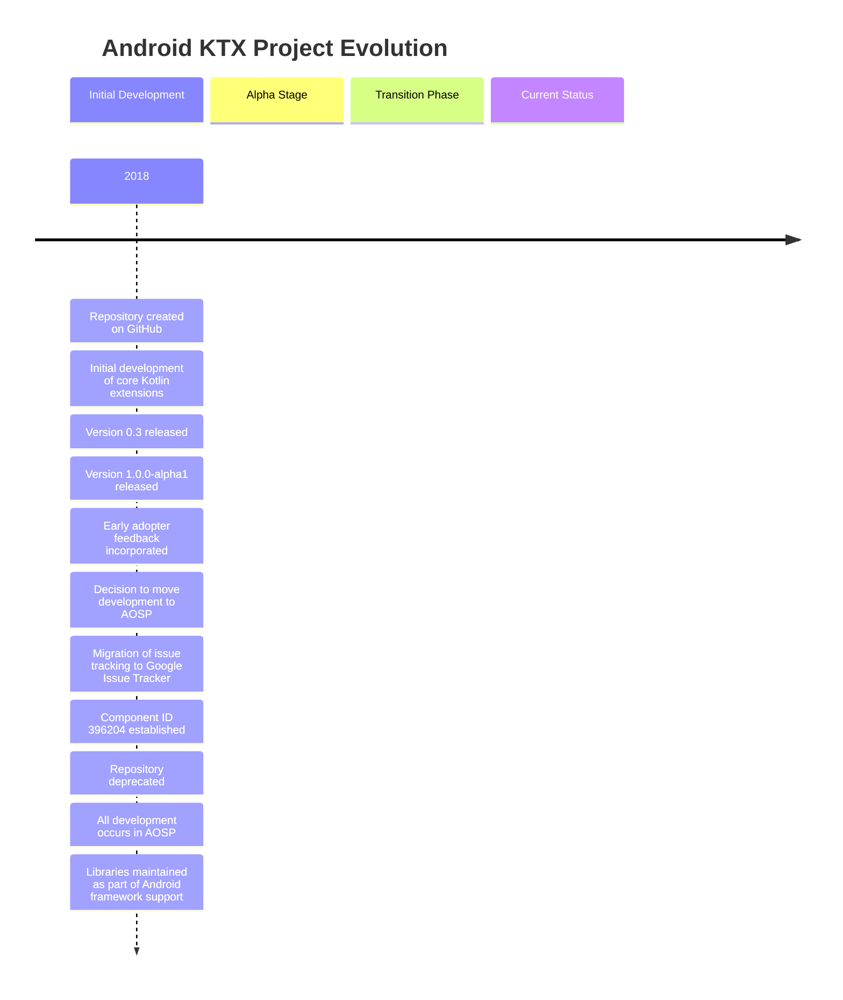
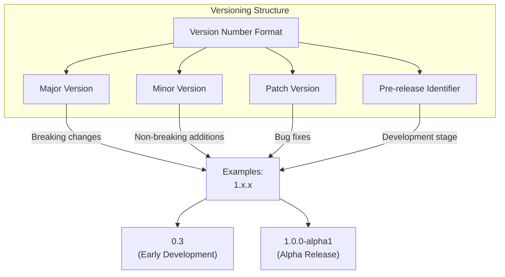
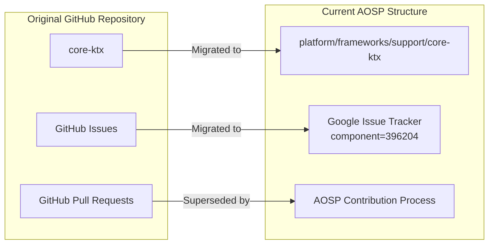
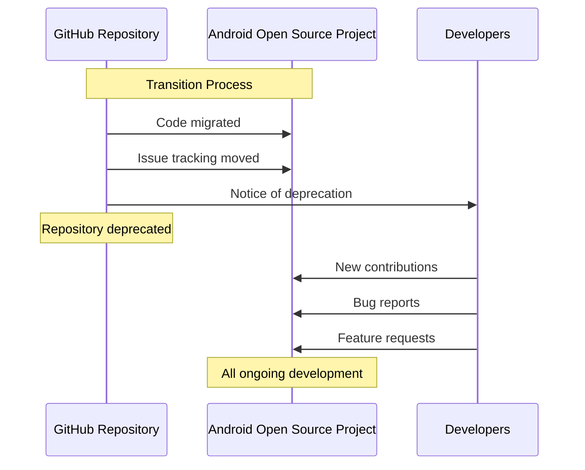

<!-- source: DeepWiki mcp.deepwiki.com · repo android/android-ktx · page 3 Project History and Versioning · fetched 2026-10-23 -->

# Project History and Versioning

Relevant source files

The following files were used as context for generating this wiki page:

- [README.md](README.md)

This document outlines the historical development of the Android KTX project, its versioning scheme, and significant milestones from initial development through its transition to the Android Open Source Project (AOSP). For information about current releases and API documentation, see [Changelog and Releases](#3.1) and [API Documentation](#3.2).

## Project Evolution

Android KTX began as a standalone GitHub repository designed to provide Kotlin extensions for Android development. The project has undergone significant structural changes since its inception, most notably its complete transition to AOSP.

Sources: [README.md:1-14]()

## Versioning Scheme

Android KTX initially followed a semantic versioning scheme with some adaptations specific to the pre-release nature of the project.

The versioning scheme indicates:
- Early development versions (0.x)
- Alpha releases with pre-release identifier (1.0.0-alpha1)
- The project never reached stable 1.0 release in the original repository

Sources: [README.md:1-14]()

## Repository Structure Evolution

The repository structure changed significantly as the project evolved, particularly during its transition to AOSP.

Sources: [README.md:4-13]()

## Historical Releases

During its lifetime in the standalone GitHub repository, Android KTX had two notable releases:

| Version | Release Date | Significant Changes |
|---------|--------------|---------------------|
| 0.3     | Early 2018   | Initial public development release with core Android extensions |
| 1.0.0-alpha1 | 2018 | First alpha release with expanded API coverage |

After these releases, all further development and versioning was managed under AOSP.

Sources: [README.md:1-14]()

## Transition to AOSP

The transition to AOSP represented a significant milestone in the project's history, changing how development, issue tracking, and contributions were handled.

Key aspects of the transition:
- All code was migrated to the platform/frameworks/support repository in AOSP
- Issue tracking moved from GitHub Issues to Google Issue Tracker (component ID: 396204)
- The original repository was deprecated and no longer accepts contributions
- All new development, bug fixes, and feature implementations now occur in AOSP

Sources: [README.md:4-13]()

## Current Status

The Android KTX GitHub repository exists as a historical artifact and reference point. No active development occurs in this repository, and all versioning, releases, and development are now managed through AOSP.

For developers wishing to:
- Report issues: Use Google Issue Tracker with component ID 396204
- Contribute code: Follow the AOSP contribution process
- Use the libraries: Import the official releases published through Google Maven

Sources: [README.md:1-14]()

---

