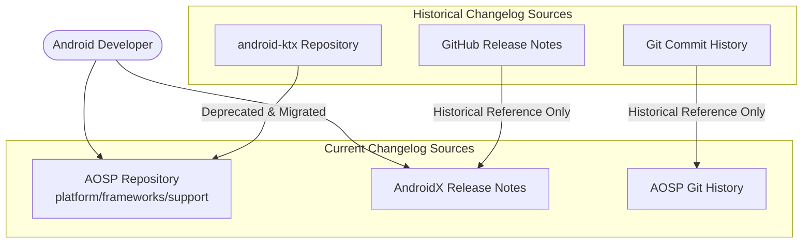
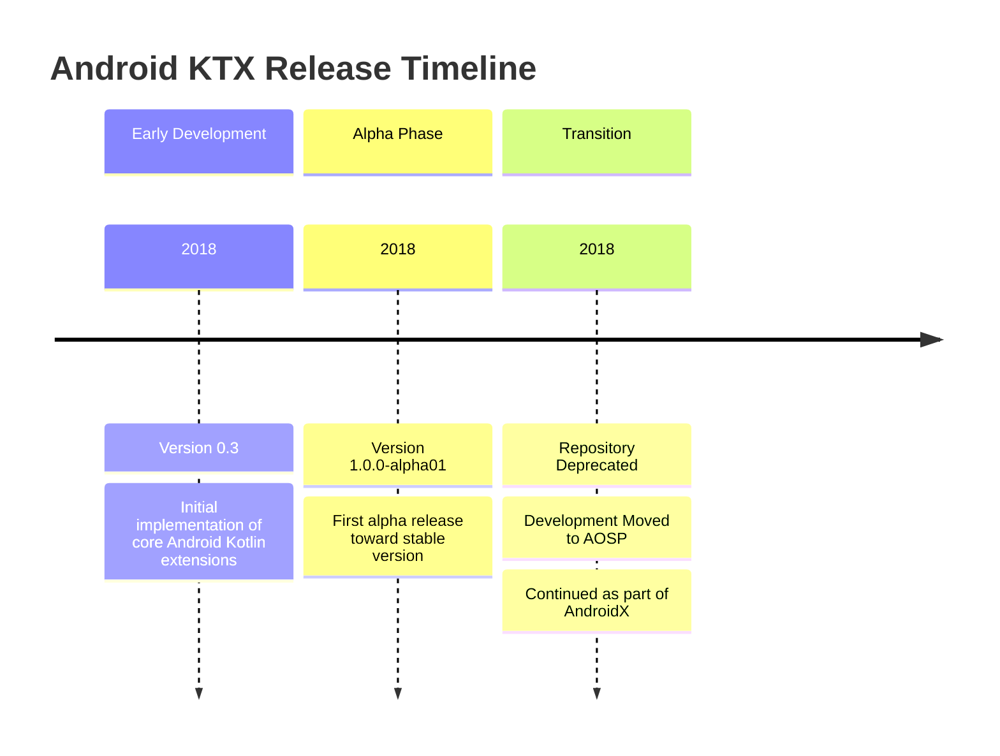
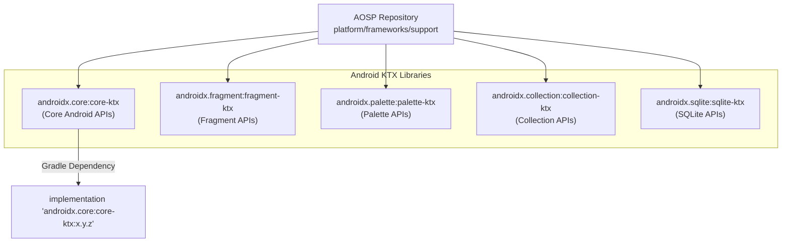
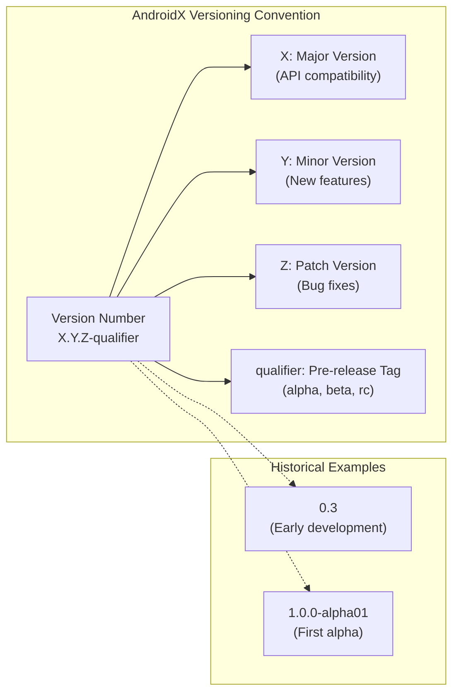
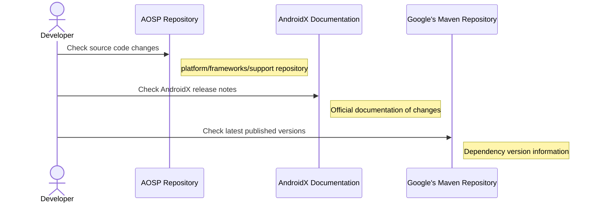
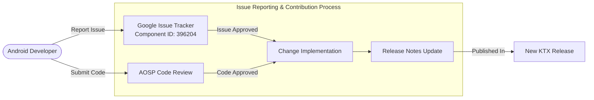

<!-- source: DeepWiki mcp.deepwiki.com · repo android/android-ktx · page 3.1 Changelog and Releases · fetched 2026-10-23 -->

# Changelog and Releases

Relevant source files

The following files were used as context for generating this wiki page:

- [README.md](README.md)

## Purpose and Scope

This document provides information about the historical changelog and releases of the Android KTX libraries before the project's transition to the Android Open Source Project (AOSP). It explains how to find release information for both past versions and current development. For information about the current release process in AOSP, see [Release Process](#4). For technical details about specific API versions, see [API Documentation](#3.2).

## Repository Status and Changelog Location

As documented in the README, this repository is no longer actively maintained:

> **ATTENTION**: This repository is no longer being used for development, tracking issues, or accepting pull requests.

This transition has important implications for users seeking changelog information:

Sources: [README.md:1-13]()

## Historical Releases

Before the transition to AOSP, Android KTX had limited public releases that provided Kotlin extensions for Android framework APIs:

Sources: [README.md:1-13]()

## KTX Libraries and Their Release Structure

The Android KTX project includes multiple libraries providing Kotlin extensions for Android APIs, with core-ktx being the primary library:

Sources: [README.md:1-13]()

## Versioning Strategy

Android KTX libraries follow the standard AndroidX versioning scheme:

Sources: [README.md:1-13]()

## Finding Current Changelog Information

With the migration to AOSP, developers should now use these sources for changelog information:

Sources: [README.md:1-13]()

## Notable Changes in Early Releases

While detailed changelog information for early releases is limited due to the repository transition, the early Android KTX versions introduced important Kotlin extensions:

| Version | Notable Additions |
|---------|-------------------|
| 0.3     | - Core Kotlin extensions for Android framework APIs - Extensions for SharedPreferences - View and Context extensions - Uri and Resources extensions |
| 1.0.0-alpha01 | - Expanded API coverage - Stability improvements - Integration with AndroidX libraries |

Sources: [README.md:1-13]()

## Contributing to Future Releases

All future releases and changelogs are now managed through the AOSP process:

Sources: [README.md:4-13]()

## Reporting Issues for Future Releases

As noted in the README, for reporting issues or suggesting features that would affect future releases:

> Please file any bug reports or feature suggestions for core-ktx and the other "KTX" libraries at https://issuetracker.google.com/issues/new?component=396204

This is the official channel for contributing to future changes that will appear in Android KTX changelogs.

Sources: [README.md:7-8]()

## Current Release Information

For the most up-to-date changelog information, refer to:

1. The official AndroidX documentation
2. The AOSP repository at platform/frameworks/support
3. Release notes for AndroidX libraries in the Google Maven repository

All ongoing development, including new releases and their associated changelogs, are now managed within the Android Open Source Project (AOSP).

Sources: [README.md:10-11]()

---

