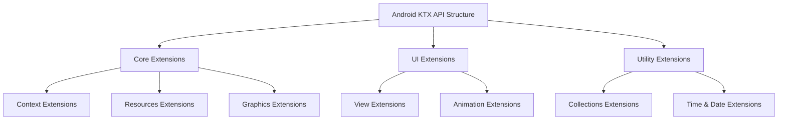
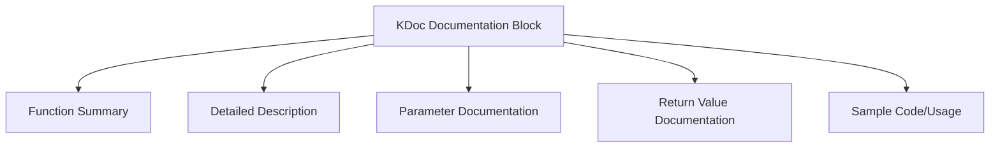
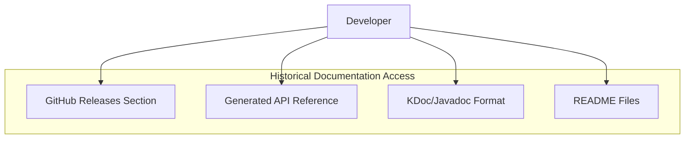
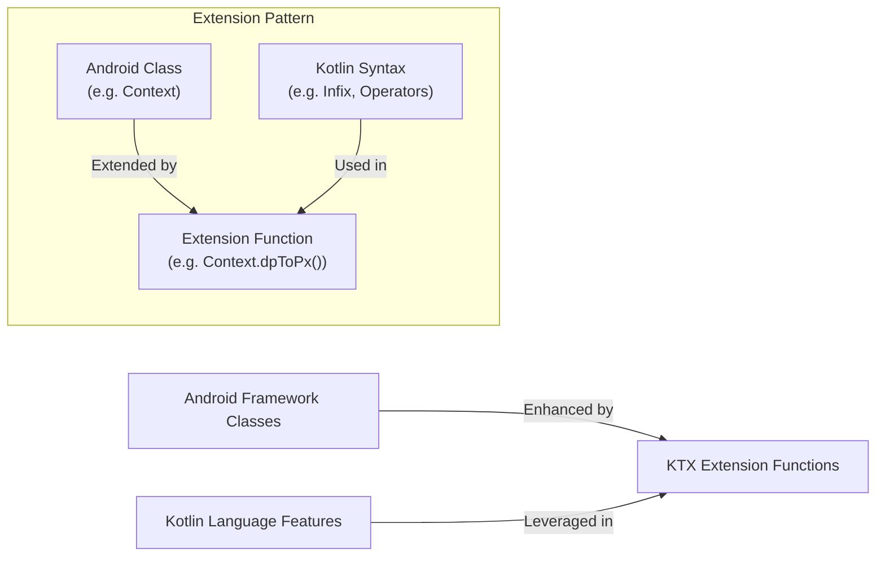
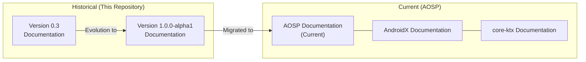
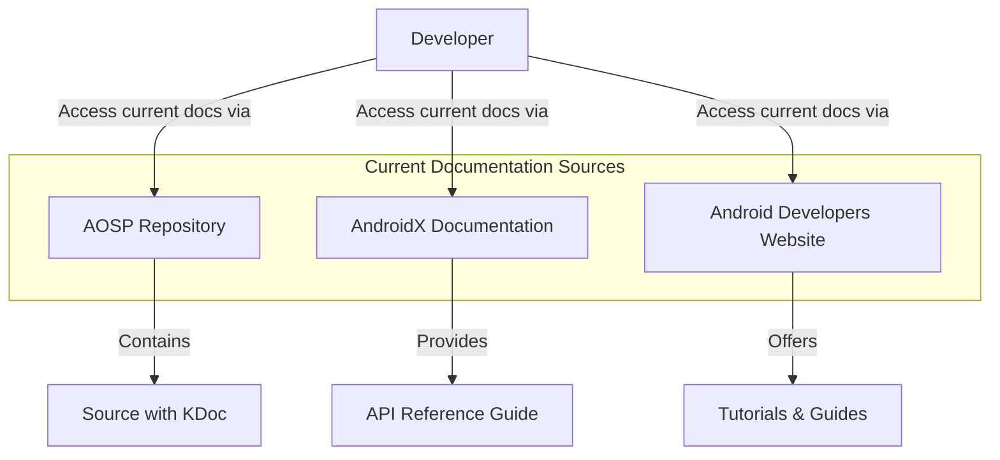

<!-- source: DeepWiki mcp.deepwiki.com · repo android/android-ktx · page 3.2 API Documentation · fetched 2026-10-23 -->

# API Documentation

Relevant source files

The following files were used as context for generating this wiki page:

- [README.md](README.md)

This document provides information about the historical API documentation for Android KTX versions 0.3 and 1.0.0-alpha1 that were released from this repository before its transition to AOSP. For information about current API documentation and ongoing development, see [Repository Transition to AOSP](#1.2).

## Historical API Versions

Android KTX had two primary releases from this repository before development moved to AOSP:

| Version | Release Type | Key Characteristics |
|---------|--------------|---------------------|
| 0.3     | Initial public release | Foundation of core Kotlin extensions for Android |
| 1.0.0-alpha1 | Alpha release | Expanded functionality, API refinements |

These versions represented the early stages of Android's official Kotlin extensions, designed to make Android development with Kotlin more concise and idiomatic.

## API Documentation Structure

The Android KTX API documentation followed a standard structure based on the organization of extension functions for Android framework classes.

### Organization by Extension Type

Sources: README.md

### Documentation Format

The API documentation for Android KTX followed standard Kotlin documentation practices, using KDoc for all public APIs. Each extension function was documented with:

Sources: README.md

## Documentation Access Methods

### Historical Documentation Access

The documentation for these historical versions (0.3 and 1.0.0-alpha1) can be accessed through several methods:

Sources: README.md

## Relationship Between KTX Extensions and Android Framework

Android KTX provided Kotlin extension functions that enhanced the Android framework classes with more concise, idiomatic Kotlin capabilities.

Sources: README.md

## Documentation Evolution Timeline

The following timeline shows the evolution of Android KTX API documentation from this repository to AOSP:

Sources: README.md

## Current API Documentation

As stated in the repository README, all development has moved to AOSP. Current API documentation for Android KTX libraries, including core-ktx, can be found in the AndroidX documentation:

Sources: README.md

## Package and Module Structure

Historical versions of Android KTX were organized into logical packages that corresponded to the Android framework components they extended:

| Package | Purpose | Common Extensions |
|---------|---------|-------------------|
| androidx.core.content | Context extensions | Context property and utility extensions |
| androidx.core.graphics | Graphics extensions | Bitmap, Canvas, and drawing utilities |
| androidx.core.view | View extensions | View property and listener extensions |
| androidx.core.text | Text handling | CharSequence and String extensions |
| androidx.core.util | Utility extensions | Collections, time, and primitive extensions |

Sources: README.md

## Conclusion

This document provides information about the historical API documentation for Android KTX versions 0.3 and 1.0.0-alpha1. While these versions are no longer actively maintained in this repository, their documentation represents the foundation of what evolved into the current AndroidX KTX libraries. For current documentation and ongoing development, refer to the AOSP repository and AndroidX documentation as noted in the README.

Sources: README.md

---

