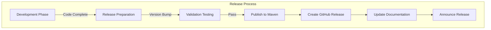
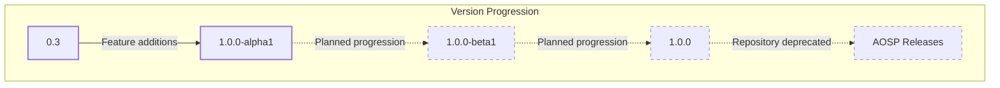
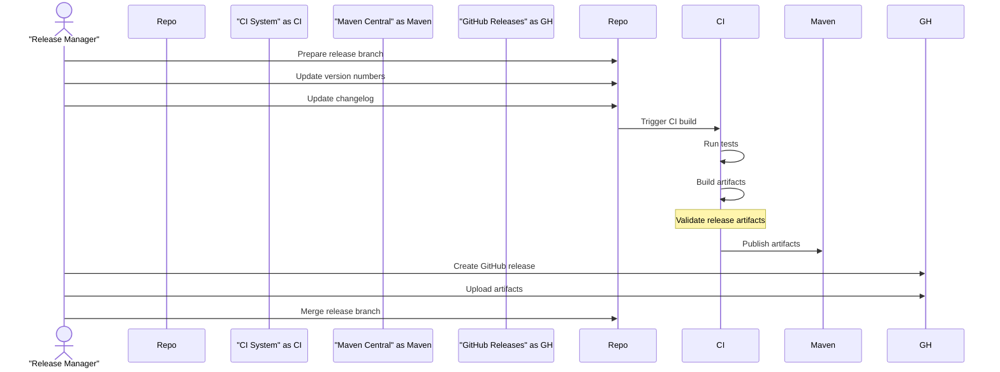
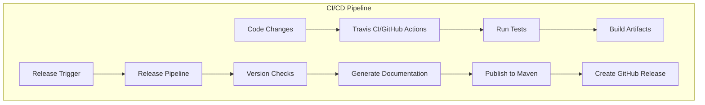
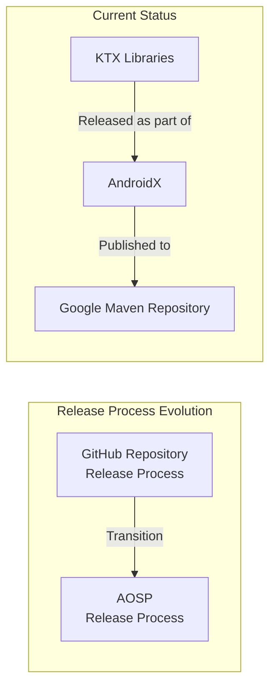

<!-- source: DeepWiki mcp.deepwiki.com · repo android/android-ktx · page 4 Release Process · fetched 2026-10-23 -->

# Release Process

<details>
<summary>Relevant source files</summary>

The following files were used as context for generating this wiki page:

- [README.md](README.md)

</details>


## Purpose and Scope

This document describes the historical release process for Android KTX libraries as it existed in the original GitHub repository before the transition to AOSP. It covers the workflow, versioning strategy, and tooling used to publish releases of the KTX libraries. For information about the current development and release process, see [Repository Transition to AOSP](#1.2). For details on how to contribute to the current development, see [Contributing Code](#2.2).

## Historical Release Process Overview

The Android KTX libraries went through a structured release process before the project transitioned to AOSP. This section documents that historical process for reference purposes.



Sources: [README.md:1-14]()

## Versioning Strategy

Android KTX followed a semantic versioning approach for its releases. The repository had released versions such as 0.3 and 1.0.0-alpha1, indicating the early development stage of the libraries before the transition to AOSP.



Sources: [README.md:1-14]()

## Release Workflow Details

The release process for Android KTX likely involved the following stages:

### 1. Development and Integration

Development occurred through pull requests to the main branch, with each change going through code review and continuous integration testing before being integrated.

### 2. Release Preparation

When preparing for a release, the following steps would likely be taken:

1. Code freeze to stabilize the codebase
2. Version number update in build configuration files
3. Changelog updates documenting new features and fixes
4. Final integration testing

### 3. Release Publishing

The release would then be published through these steps:

1. Building release artifacts
2. Signing artifacts
3. Publishing to Maven repositories
4. Creating a GitHub release with release notes
5. Updating documentation



Sources: [README.md:1-14]()

## Maven Publishing Details

Android KTX releases would have been published to Maven repositories to make them available for developers to use as dependencies in their projects.

| Repository Type | URL Pattern | Purpose |
|----------------|-------------|---------|
| Maven Central | https://repo1.maven.org/maven2/ | Primary public distribution |
| Google Maven | https://maven.google.com/ | Android-specific libraries |
| Sonatype Snapshots | https://oss.sonatype.org/content/repositories/snapshots/ | Development snapshots |

### Maven Coordinates

The libraries would have been published with Maven coordinates following this pattern:

```
Group ID: androidx.*
Artifact ID: *-ktx
Version: 0.3, 1.0.0-alpha1, etc.
```

Sources: [README.md:1-14]()

## Continuous Integration

The release process was likely supported by continuous integration systems that automated testing, building, and publishing of releases.



Sources: [README.md:1-14]()

## Transition to AOSP

As noted in the README, the Android KTX repository has been deprecated and all development has moved to AOSP. The release process documented here is no longer active.



The current release process for KTX libraries follows the standard AndroidX release procedures within AOSP. All new issues, feature requests, and contributions should be submitted according to the AOSP guidelines mentioned in the README.

Sources: [README.md:1-14]()

## Summary

The release process for Android KTX libraries evolved from an independent GitHub repository workflow to being integrated into the broader AOSP release cycle. Historical releases (0.3 and 1.0.0-alpha1) followed a typical open-source release pattern with semantic versioning, while current releases are managed as part of the AndroidX libraries in AOSP.

Sources: [README.md:1-14]()