# Page: Android KTX Overview

# Android KTX Overview

<details>
<summary>Relevant source files</summary>

The following files were used as context for generating this wiki page:

- [README.md](README.md)

</details>


## Purpose and Scope

This document introduces the Android KTX repository, explains its primary purpose as a collection of Kotlin extensions for Android development, and details its current deprecated status following its transition to the Android Open Source Project (AOSP). For specific information about the Kotlin extensions provided by Android KTX, see [Kotlin Extensions for Android](#1.1). For detailed information about the repository transition process, see [Repository Transition to AOSP](#1.2).

## What is Android KTX?

Android KTX (Kotlin Extensions) is a set of extensions that provide concise, idiomatic Kotlin to standard Android APIs. These extensions leverage Kotlin language features like extension functions/properties, lambdas, named parameters, and parameter defaults to make Android development more concise, readable, and enjoyable when using Kotlin.

The library was designed to eliminate boilerplate code, improve type safety, and increase development efficiency by building on top of the Android SDK with Kotlin-specific optimizations.

Sources: [README.md:1-2]()

## Repository Status

The Android KTX repository (https://github.com/android/android-ktx) is **deprecated** and no longer active for development. All development activities, including:

- Code contributions
- Issue tracking
- Pull requests
- Releases

Have been migrated to the Android Open Source Project (AOSP) platform/frameworks/support repository.

Sources: [README.md:4-13]()

## System Structure and Transition

The following diagram illustrates the transition of Android KTX from its original GitHub repository to the AOSP ecosystem:

**Android KTX Repository Transition**

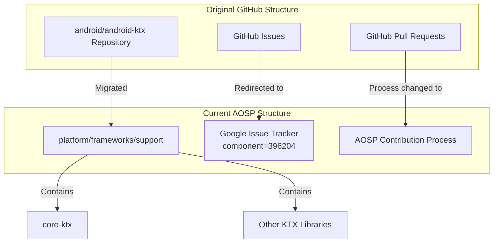

Sources: [README.md:4-11]()

## Developer Interaction

Developers wishing to interact with Android KTX should follow the current workflows outlined below. The original repository no longer accepts contributions, issues, or pull requests.

**Android KTX Developer Workflow**

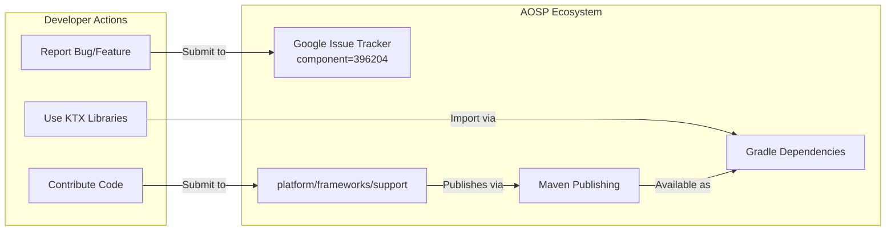

### Reporting Issues

Bug reports and feature requests should be submitted to Google's Issue Tracker with the component ID 396204.

URL: https://issuetracker.google.com/issues/new?component=396204

Sources: [README.md:7-8]()

### Contributing Code

Code contributions to Android KTX libraries should follow the AOSP contribution process. Developers should refer to the README in the platform/frameworks/support repository for detailed instructions.

Repository: https://android.googlesource.com/platform/frameworks/support/

Sources: [README.md:10-11]()

## Core Components

Android KTX consists of several extension libraries, with `core-ktx` being the main component. The library structure provides Kotlin extensions for different aspects of Android development:

| Library | Purpose | Provides Extensions For |
|---------|---------|------------------------|
| core-ktx | Core Android functionality | View system, Resources, Graphics, OS, etc. |
| fragment-ktx | Fragment extensions | FragmentManager, Fragment transactions |
| palette-ktx | Color palette extensions | Palette generation and manipulation |
| sqlite-ktx | SQLite extensions | Database operations, cursors |
| collection-ktx | Collection extensions | SparseArray, ArrayMap, etc. |

The following diagram shows the relationship between these libraries and the Android framework components they extend:

**Android KTX Extension Architecture**

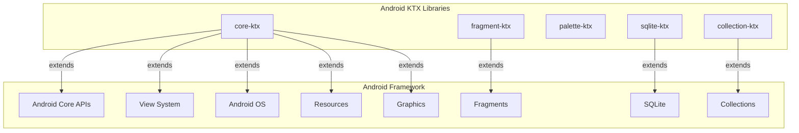

Sources: [README.md:1-2](), [README.md:7-8]()

## Historical Context

The Android KTX project was initially developed in the standalone GitHub repository before being migrated to AOSP. The repository transition represents a consolidation of Android KTX development within the broader Android ecosystem, allowing for more standardized development processes and better integration with other Android components.

**Android KTX Timeline**

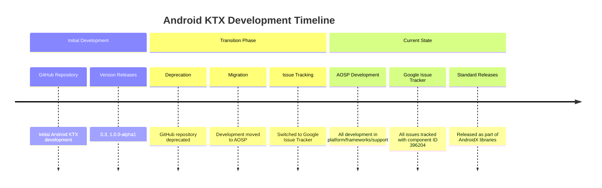

Sources: [README.md:4-13]()

## Conclusion

Android KTX provides valuable Kotlin extensions that enhance Android development by making the APIs more concise and idiomatic in Kotlin. Following the migration to AOSP, all development activities now take place within the AOSP ecosystem, and developers should direct their contributions and issues accordingly.

For more detailed information about the specific Kotlin extensions provided by Android KTX, see [Kotlin Extensions for Android](#1.1). For more information about the repository transition process and current development workflows, see [Repository Transition to AOSP](#1.2).

---

# Page: Kotlin Extensions for Android

# Kotlin Extensions for Android

<details>
<summary>Relevant source files</summary>

The following files were used as context for generating this wiki page:

- [README.md](README.md)

</details>


## Purpose and Scope

This document explains Android KTX (Kotlin Extensions), a set of Kotlin extensions that enhance the Android API with concise and idiomatic Kotlin code. It covers what these extensions are, how they simplify Android development, and the benefits they provide to Kotlin Android developers. For information about the repository's transition to AOSP, see [Repository Transition to AOSP](#1.2).

## What are Kotlin Extensions for Android?

Android KTX is a collection of Kotlin extensions that provide concise, idiomatic Kotlin to standard Android APIs. These extensions leverage Kotlin language features such as extension functions, property delegates, lambdas, and named parameters to make Android development more pleasant and productive when using Kotlin.

Kotlin extensions are a language feature that allows developers to extend existing classes with new functionality without having to inherit from the class or use design patterns like Decorator. Android KTX uses this feature to add useful utilities to standard Android framework classes.

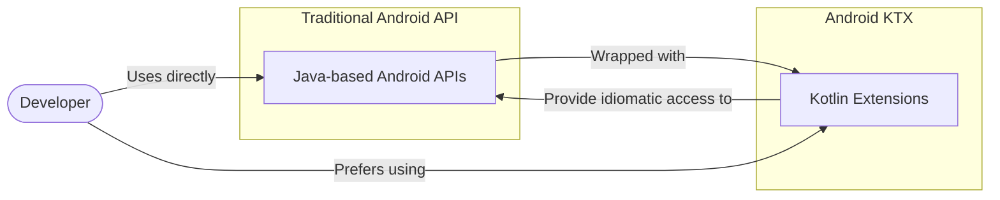

Title: Android KTX Relationship to Standard Android APIs

Sources: README.md

## Core Benefits

Android KTX provides several key advantages for Kotlin Android developers:

1. **Conciseness**: Eliminates boilerplate code through extension functions and properties
2. **Readability**: More natural API syntax aligned with Kotlin conventions
3. **Safety**: Leverages Kotlin's null safety and type system
4. **Functionality**: Adds useful utilities not present in the original APIs

```mermaid
flowchart TD
    subgraph "Without KTX"
        J1["sharedPreferences.edit().<br>putString(key, value).<br>apply()"]
        J2["ViewCompat.<br>setBackground(view, drawable)"]
        J3["Bundle().apply {<br>  putString(\"key\", value)<br>  putInt(\"id\", id)<br>}"]
    end
    
    subgraph "With KTX"
        K1["sharedPreferences.edit {<br>  putString(key, value)<br>}"]
        K2["view.background = drawable"]
        K3["bundleOf(<br>  \"key\" to value,<br>  \"id\" to id<br>)"]
    end
    
    J1 -->|"Simplified to"| K1
    J2 -->|"Simplified to"| K2
    J3 -->|"Simplified to"| K3
```

Title: Code Comparison With and Without KTX

Sources: README.md

## Android KTX Library Structure

Android KTX is organized into multiple modules, each targeting specific parts of the Android framework. The original repository contained early versions, but all development has now moved to AOSP.

The main modules include:

| Module | Description | Target Android Components |
|--------|-------------|---------------------------|
| core-ktx | Core Android framework extensions | Context, SharedPreferences, View, Resources, etc. |
| fragment-ktx | Fragment extensions | Fragment transactions, arguments |
| palette-ktx | Palette API extensions | Color palette extraction |
| sqlite-ktx | SQLite extensions | Database operations |
| collection-ktx | Collection extensions | Arrays, collections related to Android |
| lifecycle-ktx | Lifecycle component extensions | ViewModel, LiveData |

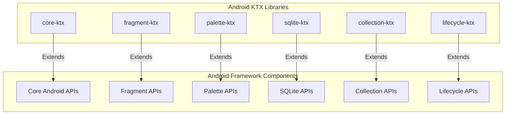

Title: Android KTX Library Structure

Sources: README.md

## Extension Function Patterns

Android KTX uses several common patterns for its extensions:

1. **Property Access**: Converts getter/setter methods to Kotlin properties
2. **Scope Functions**: Uses `apply`, `let`, `run`, etc. for cleaner code blocks
3. **Factory Functions**: Simplifies object creation
4. **Infix Functions**: Makes certain operations more readable
5. **Extension Properties**: Adds computed properties to existing classes

```mermaid
flowchart TD
    subgraph "Extension Patterns"
        direction LR
        Property["Property Access<br>view.isVisible = true"]
        Scope["Scope Functions<br>view.updateLayoutParams { width = MATCH_PARENT }"]
        Factory["Factory Functions<br>bundleOf(\"key\" to value)"]
        Infix["Infix Functions<br>value to \"key\""]
        ExtProp["Extension Properties<br>view.children"]
    end
    
    subgraph "Benefits"
        direction LR
        Concise["Conciseness"]
        Readable["Readability"]
        Idiomatic["Idiomatic Kotlin"]
        Intuitive["Intuitive APIs"]
    end
    
    Property --> Concise
    Property --> Readable
    Scope --> Concise
    Scope --> Idiomatic
    Factory --> Intuitive
    Factory --> Concise
    Infix --> Readable
    Infix --> Idiomatic
    ExtProp --> Intuitive
    ExtProp --> Concise
```

Title: Android KTX Extension Patterns and Benefits

Sources: README.md

## Using Android KTX in Your Projects

To use Android KTX libraries in your projects, you need to add the appropriate dependencies to your Gradle build files. Since the libraries are now maintained as part of AOSP, they are published through Google's Maven repository.

Here's a general overview of how to include Android KTX in your projects:

1. Ensure you have the Google Maven repository in your project-level `build.gradle` file
2. Add the specific KTX module dependencies to your app-level `build.gradle` file
3. Import the extension functions in your Kotlin files

Note that as the repository has moved to AOSP, the latest versions and documentation should be consulted through official Android documentation.

## Current Status and Development

As noted in the repository README, the original Android KTX repository is no longer being used for development, tracking issues, or accepting pull requests. All development has moved to AOSP.

For bug reports or feature suggestions for Android KTX libraries, use Google's Issue Tracker with component ID 396204. To contribute to the libraries, follow the AOSP contribution guidelines.

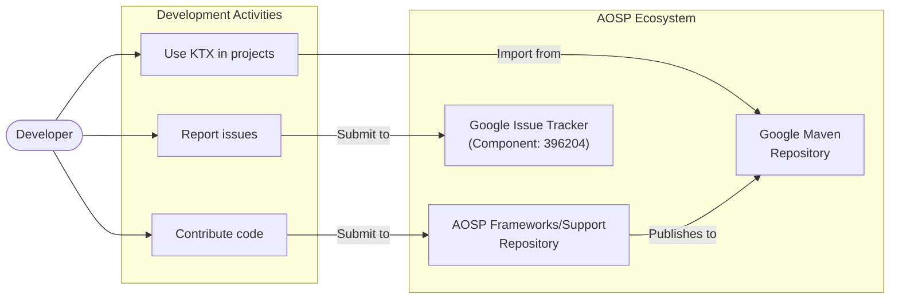

Title: Android KTX Developer Interaction Flow

Sources: README.md

## Conclusion

Android KTX makes Android development with Kotlin more concise, idiomatic, and enjoyable by leveraging Kotlin's language features to enhance the standard Android APIs. While the original repository has been deprecated, the libraries continue to be developed and maintained as part of AOSP, with new versions regularly published.

By using Android KTX, developers can write more readable and maintainable Android applications while taking full advantage of Kotlin's powerful features.

---

# Page: Repository Transition to AOSP

# Repository Transition to AOSP

<details>
<summary>Relevant source files</summary>

The following files were used as context for generating this wiki page:

- [README.md](README.md)

</details>


## Purpose

This document details the transition of Android KTX development from the standalone GitHub repository to the Android Open Source Project (AOSP). It explains the current status of the repository, why the transition occurred, and how developers should interact with Android KTX libraries moving forward. For general information about what Android KTX is and its purpose, see [Kotlin Extensions for Android](#1.1).

## Transition Status

The Android KTX GitHub repository (`android/android-ktx`) has been deprecated and is no longer active for development purposes. All development activities have been moved to the Android Open Source Project (AOSP).

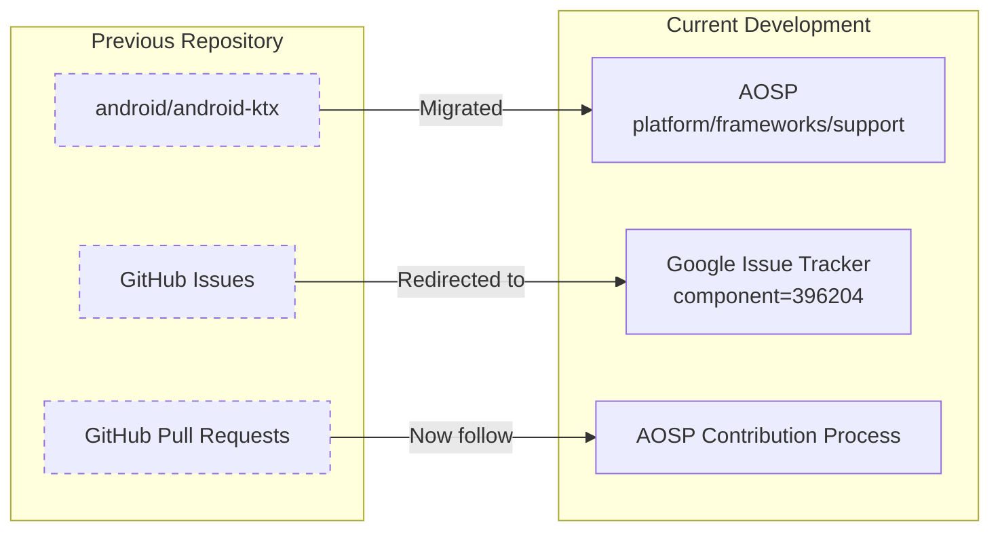

**Diagram: Android KTX Repository Transition**

Sources: [README.md:4-11]()

## Key Changes

The transition to AOSP brought several significant changes to how developers interact with Android KTX:

1. **No GitHub Issues or PRs**: The original repository no longer accepts issues or pull requests
2. **Issue Tracking**: All bug reports and feature requests should be submitted to Google's Issue Tracker
3. **Code Contributions**: Code contributions must follow AOSP contribution guidelines
4. **Library Maintenance**: All KTX libraries are now maintained as part of the Android framework support

Sources: [README.md:4-13]()

## New Developer Workflow

The transition to AOSP has established a new workflow for developers wanting to interact with Android KTX libraries:

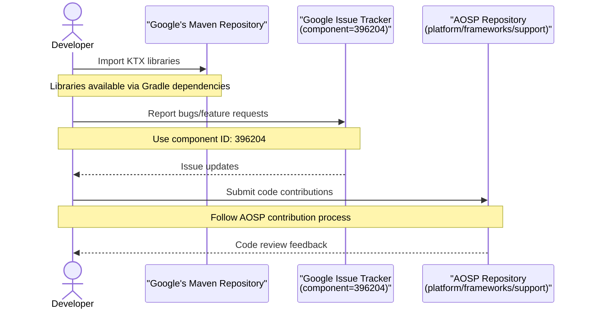

**Diagram: Developer Interaction with Android KTX after AOSP Transition**

Sources: [README.md:7-11]()

## Reporting Issues

Bug reports and feature suggestions for all KTX libraries should now be filed at Google's Issue Tracker with the specific component ID:

```
Component ID: 396204
```

Direct link to create new issues: https://issuetracker.google.com/issues/new?component=396204

Sources: [README.md:7-8]()

## Contributing Code

For developers wishing to contribute code to Android KTX libraries, contributions must be made through the AOSP contribution process:

1. Clone the AOSP repository: https://android.googlesource.com/platform/frameworks/support/
2. Follow contribution guidelines in the README of the AOSP repository
3. Submit patches through the AOSP code review system

More detailed instructions on contributing code can be found in the [Contributing Code](#2.2) section.

Sources: [README.md:10-11]()

## Technical Impact of the Transition

The transition to AOSP has several technical implications for both the library maintenance and developer interaction:

| Aspect | Before Transition | After Transition |
|--------|-------------------|------------------|
| Repository Location | GitHub: android/android-ktx | AOSP: platform/frameworks/support |
| Issue Tracking | GitHub Issues | Google Issue Tracker (component 396204) |
| Code Contributions | GitHub Pull Requests | AOSP Contribution Process |
| Release Process | GitHub Releases | AOSP Release Pipeline |
| Integration with Android | Standalone | Direct integration with framework support |
| Package Structure | Consistent with initial design | May evolve as part of AOSP |

Sources: [README.md:4-13]()

## Timeline of Transition

```mermaid
timeline
    title Android KTX Repository Transition Timeline
    
    section Initial Repository
        : Android KTX established on GitHub
        : Early development and releases
    
    section Transition
        : Announcement of transition to AOSP
        : Repository marked as deprecated
        : Development moved to platform/frameworks/support
    
    section Current Status
        : No active development in GitHub repository
        : All development activities in AOSP
        : Libraries maintained and released as part of Android support libraries
```

**Diagram: Timeline of Android KTX Repository Transition**

Sources: [README.md:4-13]()

## Finding KTX Libraries in AOSP

After the transition, Android KTX libraries can be found within the structure of the Android frameworks support repository:

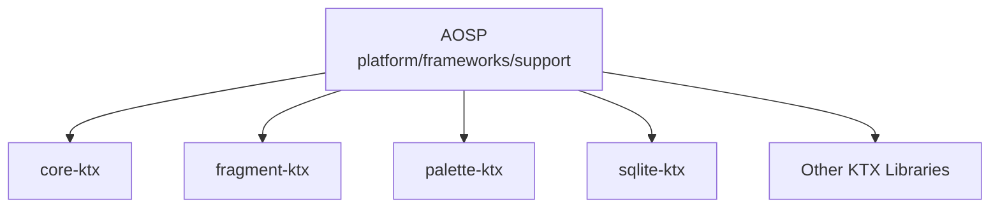

**Diagram: KTX Libraries in AOSP Repository Structure**

Sources: [README.md:10-11]()

## Conclusion

The Android KTX GitHub repository has been fully transitioned to AOSP. Developers should now:

1. Use Google's Issue Tracker for bug reports and feature requests
2. Follow AOSP contribution guidelines for code contributions
3. Import KTX libraries from Google's Maven repository

This transition integrates Android KTX more deeply into the Android platform development process, allowing for better coordination with other Android components and more streamlined maintenance.

Sources: [README.md:4-13]()

---

# Page: Developer Interaction Guide

# Developer Interaction Guide

<details>
<summary>Relevant source files</summary>

The following files were used as context for generating this wiki page:

- [README.md](README.md)

</details>


## Purpose and Scope

This guide outlines the procedures and channels for developers to interact with Android KTX libraries following the transition to the Android Open Source Project (AOSP). It covers how to report issues, request features, contribute code, and effectively engage with the Android KTX ecosystem now that the original repository has been deprecated.

For historical information about the Android KTX project before its transition, see [Project History and Versioning](#3). For specific details on reporting issues and contributing code, see [Reporting Issues and Feature Requests](#2.1) and [Contributing Code](#2.2).

Sources: [README.md:4-13]()

## Repository Transition Overview

The Android KTX repository has undergone a significant transition. Originally developed as a standalone repository, all development activities have now moved to the Android Open Source Project (AOSP). This means that the original repository is no longer accepting pull requests or issues, and all development work takes place within AOSP.

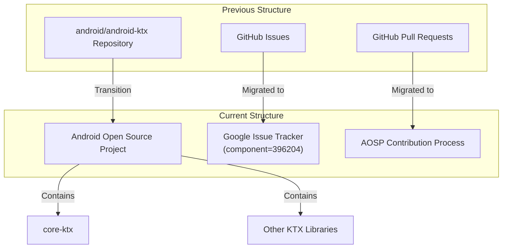

*Diagram: Android KTX Repository Transition*

Sources: [README.md:4-13]()

## Current Developer Interaction Workflow

Developers now interact with Android KTX through AOSP channels rather than the original GitHub repository. This ensures standardized development processes and better integration with other Android components.

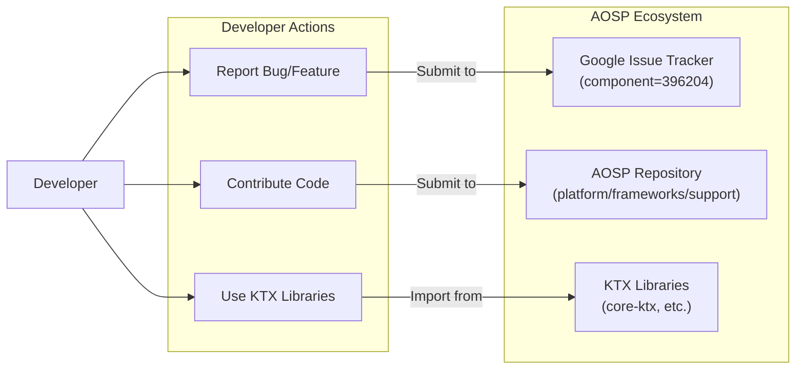

*Diagram: Developer Interaction Workflow*

Sources: [README.md:4-13]()

## Reporting Issues and Feature Requests

All bug reports, feature suggestions, and other issue tracking for Android KTX libraries are now handled through Google's Issue Tracker rather than GitHub Issues.

### Process for Issue Reporting

1. Navigate to Google's Issue Tracker at https://issuetracker.google.com/issues/new
2. Select component ID: 396204 (specific to Android KTX libraries)
3. Provide detailed information about the issue or feature request
4. Submit the issue

| Category | Platform | Link |
|----------|----------|------|
| Bug Reports | Google Issue Tracker | Component ID: 396204 |
| Feature Requests | Google Issue Tracker | Component ID: 396204 |
| General Queries | Google Issue Tracker | Component ID: 396204 |

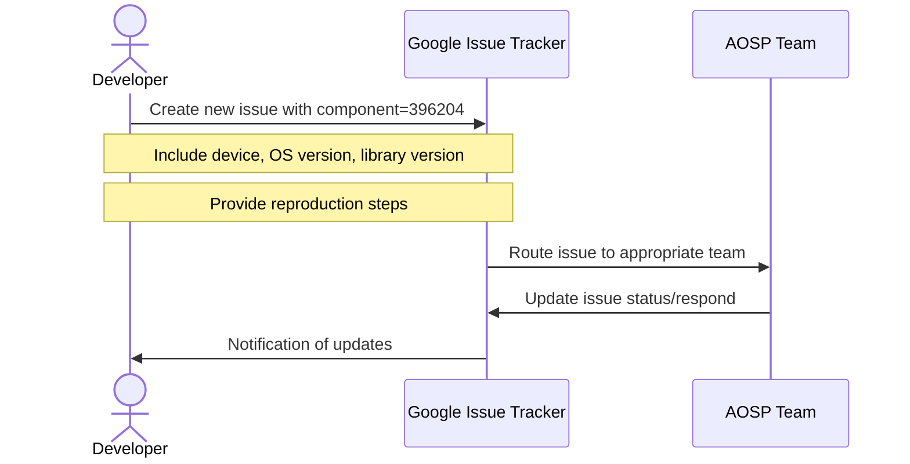

*Diagram: Issue Reporting Process*

Sources: [README.md:7-8]()

## Contributing Code

Code contributions to Android KTX libraries must now follow the AOSP contribution process. The original repository no longer accepts pull requests.

### Contribution Process

1. Set up AOSP development environment
2. Navigate to the platform/frameworks/support repository
3. Follow the contribution guidelines in the repository's README
4. Submit code changes through the AOSP gerrit system

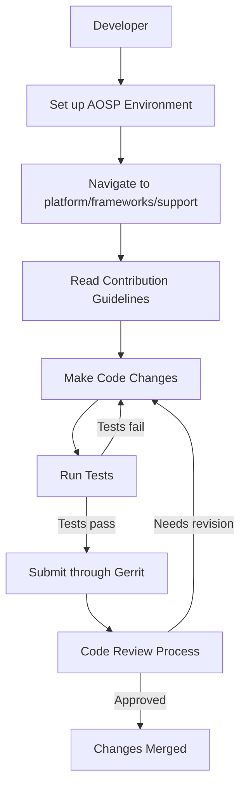

*Diagram: Code Contribution Process*

Sources: [README.md:10-11]()

## KTX Libraries Structure in AOSP

The Android KTX libraries are now organized within the AOSP structure, primarily in the platform/frameworks/support repository.

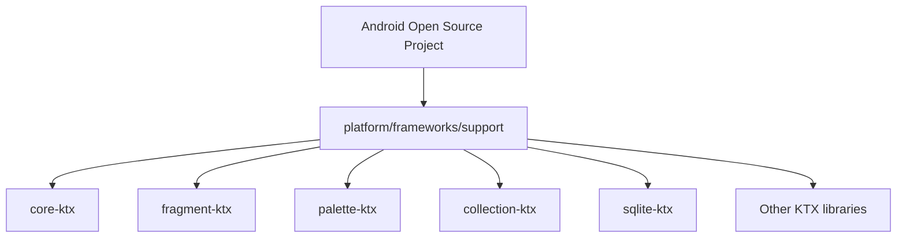

*Diagram: KTX Libraries in AOSP Structure*

Sources: [README.md:10-11]()

## Communication Channels

As part of the transition to AOSP, the communication channels for Android KTX have changed. Developers should be aware of the current channels for effective interaction.

| Channel Type | Previous | Current |
|--------------|----------|---------|
| Issue Tracking | GitHub Issues | Google Issue Tracker (component=396204) |
| Code Contributions | GitHub Pull Requests | AOSP Gerrit |
| Documentation | GitHub Wiki | AOSP Documentation |

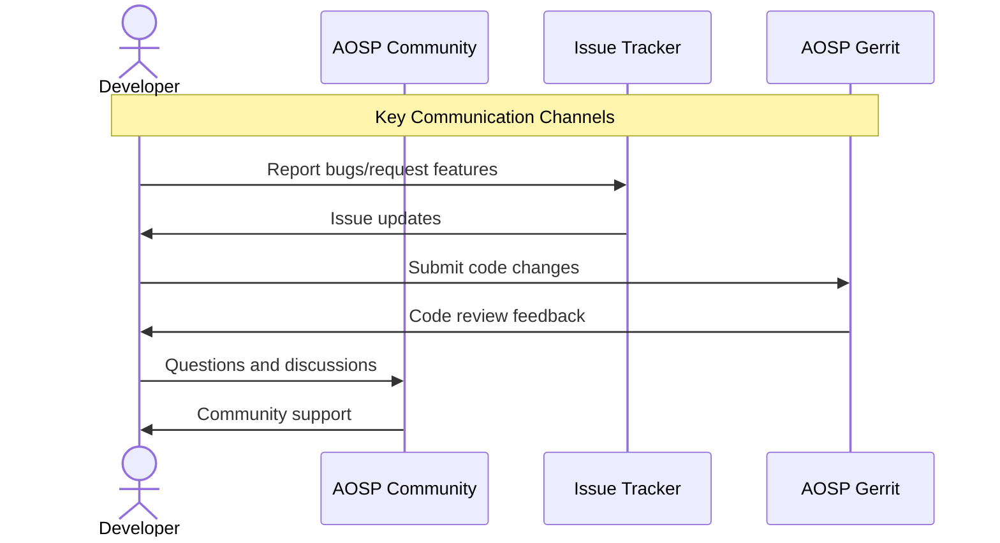

*Diagram: Communication Channels*

Sources: [README.md:4-13]()

## Summary

The migration of Android KTX to AOSP represents a significant change in how developers interact with these libraries. By following the guidelines in this document, developers can effectively:

1. Report issues and request features through Google's Issue Tracker
2. Contribute code through the AOSP contribution process
3. Access the latest KTX libraries through the AOSP ecosystem

This transition aligns Android KTX development with the broader Android development process, providing a more integrated experience for developers.

Sources: [README.md:4-13]()

---

# Page: Reporting Issues and Feature Requests

# Reporting Issues and Feature Requests

<details>
<summary>Relevant source files</summary>

The following files were used as context for generating this wiki page:

- [README.md](README.md)

</details>


This document provides instructions for reporting bugs and requesting features for Android KTX libraries following the repository's transition to the Android Open Source Project (AOSP). For information about contributing code to Android KTX, see [Contributing Code](#2.2).

## Overview of Issue Reporting

Following the deprecation of the original GitHub repository, all bug reports and feature requests for Android KTX must now be submitted through Google's Issue Tracker. This change is part of the broader transition of Android KTX development to AOSP as detailed in [Repository Transition to AOSP](#1.2).

Sources: [README.md:4-8]()

## Issue Reporting Process

The following process outlines how to report bugs or request features for Android KTX libraries through Google's Issue Tracker.

### Issue Reporting Workflow

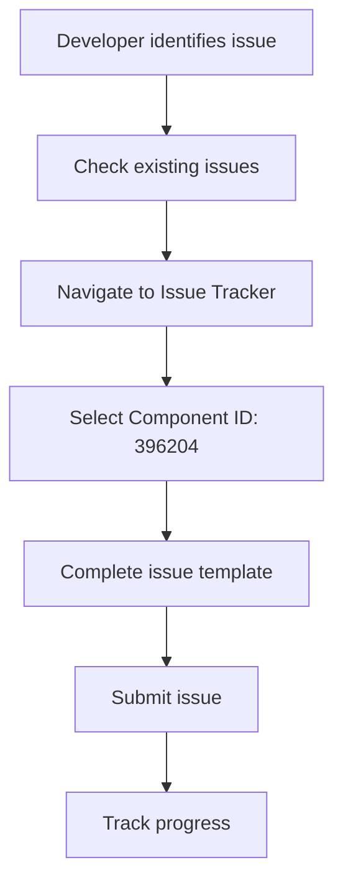

Sources: [README.md:7-8]()

### Submitting an Issue

1. Go to Google Issue Tracker with the Android KTX component preselected
2. Ensure you're signed in with your Google account
3. Verify component ID 396204 is selected (this identifies the issue as related to Android KTX)
4. Fill in the required information:
   - Issue type (Bug, Feature Request)
   - Summary: A clear, concise title
   - Description: Detailed information following the guidelines below
5. Submit the issue
6. Track the status of your submission through Google Issue Tracker

Sources: [README.md:7-8]()

## Creating Effective Issue Reports

To help the Android KTX maintainers address your issue efficiently, include specific information in your report that clearly identifies the affected components and behavior.

### Issue Report Components

```mermaid
flowchart LR
    subgraph "Android KTX Issue Report"
        Summary["Summary"]
        Description["Description"]
        Repro["Steps to reproduce"]
        Expected["Expected behavior"]
        Actual["Actual behavior"]
        Version["Library version"]
        Sample["Code sample"]
        Module["KTX module reference"]
    end
    
    Module --> CoreKTX["core-ktx"]
    Module --> FragmentKTX["fragment-ktx"]
    Module --> LifecycleKTX["lifecycle-ktx"]
    
    CoreKTX --> StringExt["String extensions"]
    CoreKTX --> CollectionExt["Collection extensions"]
    CoreKTX --> ViewExt["View extensions"]
    
    StringExt --> toUri["String.toUri()"]
    CollectionExt --> forEach["Array.forEach()"]
    ViewExt --> doOnLayout["View.doOnLayout()"]
```

Sources: [README.md:7-8]()

### For Bug Reports

| Field | Description | Example |
|-------|-------------|---------|
| Module | Specific KTX library affected | core-ktx, fragment-ktx |
| Version | Library version | 1.7.0 |
| Steps to reproduce | Ordered steps to trigger the bug | 1. Import core-ktx<br>2. Call String.toUri()<br>3. Pass result to... |
| Expected behavior | What should happen | URI object correctly created from string |
| Actual behavior | What actually happens | NullPointerException thrown |
| Code sample | Minimal code that demonstrates the issue | `val uri = "https://example.com".toUri()` |
| Environment | Development environment details | Android Studio 4.2.1<br>AGP 7.0.0<br>Kotlin 1.5.30 |

### For Feature Requests

| Field | Description | Example |
|-------|-------------|---------|
| Module | Target KTX library | core-ktx |
| Feature description | Clear explanation of proposed functionality | Add extension function for converting between units |
| Use case | Why this feature would be valuable | Simplifies common task of converting dp to px |
| Current workaround | How you're addressing this need now | Currently using custom utility functions |
| Example API | Proposed function signature | `fun Int.dpToPx(): Int` |

Sources: [README.md:7-8]()

## Issue Lifecycle

After submission, your issue will progress through several stages in Google's Issue Tracker.

### Issue Status Flow

```mermaid
stateDiagram-v2
    [*] --> New: "Issue submitted"
    New --> Triaged: "Initial review"
    Triaged --> InProgress: "Developer assigned"
    InProgress --> Fixed: "Solution implemented"
    InProgress --> WontFix: "Will not be implemented"
    InProgress --> CannotReproduce: "Cannot verify issue"
    InProgress --> ByDesign: "Current behavior is intended"
    Fixed --> Released: "Included in release"
    Fixed --> [*]
    WontFix --> [*]
    CannotReproduce --> [*]
    ByDesign --> [*]
    Released --> [*]
```

Sources: [README.md:4-13]()

## Best Practices

1. **Search first**: Before submitting a new issue, search the issue tracker for similar reports
2. **One issue per report**: Submit separate reports for unrelated issues
3. **Be specific**: Include precise details about the affected module and functionality
4. **Provide context**: Explain why this issue or feature is important
5. **Be responsive**: Monitor your issue for questions from maintainers

## Referencing Code in Issue Reports

When reporting issues with specific KTX extensions, reference the exact function, property, or class where you're experiencing the problem. This helps maintainers locate and address the issue more efficiently.

### Example References for Common KTX Modules

| Module | Common Extension Points | Issue Reference Example |
|--------|-------------------------|-------------------------|
| core-ktx | String extensions, View extensions, Color utilities | Issue with View.doOnNextLayout() not executing callback |
| fragment-ktx | Fragment transactions, ViewModels | FragmentTransaction.commit() extension causing crash |
| lifecycle-ktx | LifecycleOwner extensions, LiveData | repeatOnLifecycle() not respecting lifecycle state |

Sources: [README.md:4-13]()

## Frequently Asked Questions

**Q: Can I still use GitHub Issues for the Android KTX repository?**  
A: No. The GitHub repository is deprecated and no longer accepting issues or pull requests.

**Q: What information should I include about my environment?**  
A: Include Android Studio version, Gradle version, Kotlin version, target/compile SDK versions, and device/emulator information if relevant.

**Q: How do I know if my feature request is appropriate for Android KTX?**  
A: Android KTX focuses on Kotlin extensions that make Android development more concise and idiomatic. Good requests align with this goal and follow Kotlin's extension function patterns.

**Q: What if I'm not sure which KTX module is affected?**  
A: Provide as much detail as possible about the functionality you're using, and the maintainers will help identify the appropriate module.

**Q: How can I track if my issue has been fixed?**  
A: Follow your issue in Google Issue Tracker. Once fixed, it will be included in a future release of the appropriate KTX module.

Sources: [README.md:4-13]()

---

# Page: Contributing Code

# Contributing Code

<details>
<summary>Relevant source files</summary>

The following files were used as context for generating this wiki page:

- [README.md](README.md)

</details>


This document outlines the process for contributing code to Android KTX libraries. Since the original GitHub repository is deprecated, all contributions must now be made through the Android Open Source Project (AOSP).

## Repository Status

As clearly stated in the README.md file, this repository is no longer being used for development or accepting pull requests:

```mermaid
flowchart TD
    subgraph "Deprecated"
        GHRepo["android/android-ktx Repository"]
        PRs["GitHub Pull Requests"]
        Issues["GitHub Issues"]
    end
    
    subgraph "Current Development"
        AOSP["AOSP platform/frameworks/support"]
        Gerrit["Gerrit Code Review"]
        IssueTracker["Google Issue Tracker<br>component=396204"]
    end
    
    GHRepo --x|"No longer accepts"| PRs
    GHRepo --x|"No longer accepts"| Issues
    
    Developer["Developer"] --x|"Cannot contribute via"| GHRepo
    Developer -->|"Must contribute via"| AOSP
    Developer -->|"Reports issues via"| IssueTracker
```

Sources: [README.md:4-13]()

## Contributing Through AOSP

To contribute code to Android KTX libraries, you must follow the AOSP contribution process as outlined in the README of the platform/frameworks/support repository.

### Contribution Workflow

The following diagram illustrates the general workflow for contributing code to Android KTX through AOSP:

```mermaid
sequenceDiagram
    actor Developer
    participant Local as Local Environment
    participant Gerrit as AOSP Gerrit
    participant CI as CI Testing
    participant Reviewers as Code Reviewers
    participant AOSP as AOSP Repository
    
    Developer->>Local: 1. Set up AOSP development environment
    Developer->>Local: 2. Create branch for changes
    Developer->>Local: 3. Implement code changes
    Developer->>Local: 4. Test locally
    Developer->>Local: 5. Commit with appropriate message
    Developer->>Gerrit: 6. Upload for review
    Gerrit->>CI: 7. Run automated tests
    CI-->>Gerrit: 8. Report test results
    Gerrit->>Reviewers: 9. Notify reviewers
    Reviewers-->>Gerrit: 10. Review code
    Gerrit-->>Developer: 11. Relay feedback
    
    loop Until Approved
        Developer->>Local: 12. Address feedback
        Developer->>Gerrit: 13. Upload new patchset
        Gerrit->>CI: Run tests again
        CI-->>Gerrit: Report results
        Reviewers-->>Gerrit: Review updated code
    end
    
    Reviewers->>Gerrit: 14. Approve changes
    Gerrit->>AOSP: 15. Merge approved changes
```

Sources: [README.md:10-11]()

## Getting Started with AOSP Contributions

To begin contributing to Android KTX through AOSP:

1. Visit the AOSP platform/frameworks/support repository at https://android.googlesource.com/platform/frameworks/support/
2. Follow the README instructions for setting up your development environment
3. Follow the AOSP contribution guidelines for creating and submitting changes

Sources: [README.md:10-11]()

## KTX Libraries in AOSP

The following diagram shows the structure of KTX libraries within the AOSP ecosystem:

```mermaid
flowchart TD
    subgraph "AOSP Structure"
        support["platform/frameworks/support"]
        androidx["androidx packages"]
        
        support --> androidx
        
        androidx --> ktx["Android KTX Libraries"]
        
        ktx --> core["core-ktx<br>Core Android Extensions"]
        ktx --> fragment["fragment-ktx<br>Fragment Extensions"]
        ktx --> lifecycle["lifecycle-ktx<br>Lifecycle Extensions"]
        ktx --> navigation["navigation-ktx<br>Navigation Extensions"]
        ktx --> room["room-ktx<br>Room Database Extensions"]
        ktx --> collection["collection-ktx<br>Collection Extensions"]
        ktx --> other["Other KTX Libraries"]
    end
    
    Contributor["Code Contributor"] -->|"Contributes via AOSP to"| ktx
```

Sources: [README.md:7-8]()

## Contribution Focus Areas

When contributing to Android KTX libraries, you will typically be working on:

| Contribution Type | Description | Purpose |
|-------------------|-------------|---------|
| Extension Functions | Additional utility methods for Android classes | Simplify common operations |
| Extension Properties | Property accessors for cleaner syntax | Make code more concise and readable |
| Inline Functions | Performance optimizations for higher-order functions | Reduce lambda overhead |
| Operator Overloads | Kotlin operator implementations | Make Android APIs more Kotlin-idiomatic |

All contributions should follow Kotlin best practices and maintain backward compatibility where appropriate.

Sources: [README.md:7-8]()

## Related Resources

For reporting bugs or suggesting features rather than contributing code, please see [Reporting Issues and Feature Requests](#2.1).

For more information about the transition of this repository to AOSP, refer to [Repository Transition to AOSP](#1.2).

Sources: [README.md:7-8]()

---

# Page: Project History and Versioning

# Project History and Versioning

<details>
<summary>Relevant source files</summary>

The following files were used as context for generating this wiki page:

- [README.md](README.md)

</details>


This document outlines the historical development of the Android KTX project, its versioning scheme, and significant milestones from initial development through its transition to the Android Open Source Project (AOSP). For information about current releases and API documentation, see [Changelog and Releases](#3.1) and [API Documentation](#3.2).

## Project Evolution

Android KTX began as a standalone GitHub repository designed to provide Kotlin extensions for Android development. The project has undergone significant structural changes since its inception, most notably its complete transition to AOSP.

```mermaid
timeline
    title Android KTX Project Evolution
    section Initial Development
        2018 : Repository created on GitHub
        : Initial development of core Kotlin extensions
        : Version 0.3 released
    section Alpha Stage
        : Version 1.0.0-alpha1 released
        : Early adopter feedback incorporated
    section Transition Phase
        : Decision to move development to AOSP
        : Migration of issue tracking to Google Issue Tracker
        : Component ID 396204 established
    section Current Status
        : Repository deprecated
        : All development occurs in AOSP
        : Libraries maintained as part of Android framework support
```

Sources: [README.md:1-14]()

## Versioning Scheme

Android KTX initially followed a semantic versioning scheme with some adaptations specific to the pre-release nature of the project.

```mermaid
flowchart TD
    subgraph "Versioning Structure"
        Version["Version Number Format"]
        Major["Major Version"]
        Minor["Minor Version"]
        Patch["Patch Version"]
        Identifier["Pre-release Identifier"]
    end
    
    Version --> Major
    Version --> Minor
    Version --> Patch
    Version --> Identifier
    
    Major --"Breaking changes"--> Examples["Examples:<br>1.x.x"]
    Minor --"Non-breaking additions"--> Examples
    Patch --"Bug fixes"--> Examples
    Identifier --"Development stage"--> Examples
    
    Examples --> Example1["0.3<br>(Early Development)"]
    Examples --> Example2["1.0.0-alpha1<br>(Alpha Release)"]
```

The versioning scheme indicates:
- Early development versions (0.x)
- Alpha releases with pre-release identifier (1.0.0-alpha1)
- The project never reached stable 1.0 release in the original repository

Sources: [README.md:1-14]()

## Repository Structure Evolution

The repository structure changed significantly as the project evolved, particularly during its transition to AOSP.

```mermaid
flowchart LR
    subgraph "Original GitHub Repository"
        CoreKTX["core-ktx"]
        GithubIssues["GitHub Issues"]
        GithubPRs["GitHub Pull Requests"]
    end
    
    subgraph "Current AOSP Structure"
        AOSPCore["platform/frameworks/support/core-ktx"]
        AOSPIssueTracker["Google Issue Tracker<br>component=396204"]
        AOSPContribution["AOSP Contribution Process"]
    end
    
    CoreKTX -->|"Migrated to"| AOSPCore
    GithubIssues -->|"Migrated to"| AOSPIssueTracker
    GithubPRs -->|"Superseded by"| AOSPContribution
```

Sources: [README.md:4-13]()

## Historical Releases

During its lifetime in the standalone GitHub repository, Android KTX had two notable releases:

| Version | Release Date | Significant Changes |
|---------|--------------|---------------------|
| 0.3     | Early 2018   | Initial public development release with core Android extensions |
| 1.0.0-alpha1 | 2018 | First alpha release with expanded API coverage |

After these releases, all further development and versioning was managed under AOSP.

Sources: [README.md:1-14]()

## Transition to AOSP

The transition to AOSP represented a significant milestone in the project's history, changing how development, issue tracking, and contributions were handled.

```mermaid
sequenceDiagram
    participant GH as GitHub Repository
    participant AOSP as Android Open Source Project
    participant Dev as Developers
    
    Note over GH,AOSP: Transition Process
    
    GH->>AOSP: Code migrated
    GH->>AOSP: Issue tracking moved
    GH->>Dev: Notice of deprecation
    
    Note over GH: Repository deprecated
    
    Dev->>AOSP: New contributions
    Dev->>AOSP: Bug reports
    Dev->>AOSP: Feature requests
    
    Note over AOSP: All ongoing development
```

Key aspects of the transition:
- All code was migrated to the platform/frameworks/support repository in AOSP
- Issue tracking moved from GitHub Issues to Google Issue Tracker (component ID: 396204)
- The original repository was deprecated and no longer accepts contributions
- All new development, bug fixes, and feature implementations now occur in AOSP

Sources: [README.md:4-13]()

## Current Status

The Android KTX GitHub repository exists as a historical artifact and reference point. No active development occurs in this repository, and all versioning, releases, and development are now managed through AOSP.

For developers wishing to:
- Report issues: Use Google Issue Tracker with component ID 396204
- Contribute code: Follow the AOSP contribution process
- Use the libraries: Import the official releases published through Google Maven

Sources: [README.md:1-14]()

---

# Page: Changelog and Releases

# Changelog and Releases

<details>
<summary>Relevant source files</summary>

The following files were used as context for generating this wiki page:

- [README.md](README.md)

</details>


## Purpose and Scope

This document provides information about the historical changelog and releases of the Android KTX libraries before the project's transition to the Android Open Source Project (AOSP). It explains how to find release information for both past versions and current development. For information about the current release process in AOSP, see [Release Process](#4). For technical details about specific API versions, see [API Documentation](#3.2).

## Repository Status and Changelog Location

As documented in the README, this repository is no longer actively maintained:

> **ATTENTION**: This repository is no longer being used for development, tracking issues, or accepting pull requests.

This transition has important implications for users seeking changelog information:

```mermaid
flowchart TD
    subgraph "Historical Changelog Sources"
        OldRepo["android-ktx Repository"]
        GitHistory["Git Commit History"]
        ReleaseNotes["GitHub Release Notes"]
    end
    
    subgraph "Current Changelog Sources"
        AOSP["AOSP Repository<br>platform/frameworks/support"]
        AndroidXReleaseNotes["AndroidX Release Notes"]
        AOSPGitLogs["AOSP Git History"]
    end
    
    OldRepo --> |"Deprecated & Migrated"| AOSP
    GitHistory --> |"Historical Reference Only"| AOSPGitLogs
    ReleaseNotes --> |"Historical Reference Only"| AndroidXReleaseNotes
    
    User(["Android Developer"]) --> AOSP
    User --> AndroidXReleaseNotes
```

Sources: [README.md:1-13]()

## Historical Releases

Before the transition to AOSP, Android KTX had limited public releases that provided Kotlin extensions for Android framework APIs:

```mermaid
timeline
    title Android KTX Release Timeline
    
    section Early Development
        2018 : Version 0.3
              : Initial implementation of core Android Kotlin extensions
    
    section Alpha Phase
        2018 : Version 1.0.0-alpha01
              : First alpha release toward stable version
    
    section Transition
        2018 : Repository Deprecated
              : Development Moved to AOSP
              : Continued as part of AndroidX
```

Sources: [README.md:1-13]()

## KTX Libraries and Their Release Structure

The Android KTX project includes multiple libraries providing Kotlin extensions for Android APIs, with core-ktx being the primary library:

```mermaid
flowchart TD
    subgraph "Android KTX Libraries"
        CoreKTX["androidx.core:core-ktx<br>(Core Android APIs)"]
        FragmentKTX["androidx.fragment:fragment-ktx<br>(Fragment APIs)"]
        PaletteKTX["androidx.palette:palette-ktx<br>(Palette APIs)"]
        CollectionKTX["androidx.collection:collection-ktx<br>(Collection APIs)"]
        SQLiteKTX["androidx.sqlite:sqlite-ktx<br>(SQLite APIs)"]
    end
    
    AOSP["AOSP Repository<br>platform/frameworks/support"] --> CoreKTX
    AOSP --> FragmentKTX
    AOSP --> PaletteKTX
    AOSP --> CollectionKTX
    AOSP --> SQLiteKTX
    
    CoreKTX --> |"Gradle Dependency"| GradleDep["implementation 'androidx.core:core-ktx:x.y.z'"]
```

Sources: [README.md:1-13]()

## Versioning Strategy

Android KTX libraries follow the standard AndroidX versioning scheme:

```mermaid
flowchart LR
    subgraph "AndroidX Versioning Convention"
        Version["Version Number<br>X.Y.Z-qualifier"] --> MajorVersion["X: Major Version<br>(API compatibility)"]
        Version --> MinorVersion["Y: Minor Version<br>(New features)"]
        Version --> PatchVersion["Z: Patch Version<br>(Bug fixes)"]
        Version --> PreReleaseTag["qualifier: Pre-release Tag<br>(alpha, beta, rc)"]
    end
    
    subgraph "Historical Examples"
        Ver03["0.3<br>(Early development)"]
        Ver10a["1.0.0-alpha01<br>(First alpha)"]
    end
    
    Version -.-> Ver03
    Version -.-> Ver10a
```

Sources: [README.md:1-13]()

## Finding Current Changelog Information

With the migration to AOSP, developers should now use these sources for changelog information:

```mermaid
sequenceDiagram
    actor Dev as Developer
    participant AOSP as AOSP Repository
    participant IX as AndroidX Documentation
    participant Maven as Google's Maven Repository
    
    Dev->>AOSP: Check source code changes
    Note right of AOSP: platform/frameworks/support repository
    
    Dev->>IX: Check AndroidX release notes
    Note right of IX: Official documentation of changes
    
    Dev->>Maven: Check latest published versions
    Note right of Maven: Dependency version information
```

Sources: [README.md:1-13]()

## Notable Changes in Early Releases

While detailed changelog information for early releases is limited due to the repository transition, the early Android KTX versions introduced important Kotlin extensions:

| Version | Notable Additions |
|---------|-------------------|
| 0.3     | - Core Kotlin extensions for Android framework APIs<br>- Extensions for SharedPreferences<br>- View and Context extensions<br>- Uri and Resources extensions |
| 1.0.0-alpha01 | - Expanded API coverage<br>- Stability improvements<br>- Integration with AndroidX libraries |

Sources: [README.md:1-13]()

## Contributing to Future Releases

All future releases and changelogs are now managed through the AOSP process:

```mermaid
flowchart LR
    Developer(["Android Developer"])
    
    subgraph "Issue Reporting & Contribution Process"
        IssueTracker["Google Issue Tracker<br>Component ID: 396204"]
        AOSPReview["AOSP Code Review"]
        Implementation["Change Implementation"]
        ReleaseNotes["Release Notes Update"]
    end
    
    Developer -->|"Report Issue"| IssueTracker
    Developer -->|"Submit Code"| AOSPReview
    IssueTracker -->|"Issue Approved"| Implementation
    AOSPReview -->|"Code Approved"| Implementation
    Implementation --> ReleaseNotes
    ReleaseNotes -->|"Published In"| NewRelease["New KTX Release"]
```

Sources: [README.md:4-13]()

## Reporting Issues for Future Releases

As noted in the README, for reporting issues or suggesting features that would affect future releases:

> Please file any bug reports or feature suggestions for core-ktx and the other "KTX" libraries at https://issuetracker.google.com/issues/new?component=396204

This is the official channel for contributing to future changes that will appear in Android KTX changelogs.

Sources: [README.md:7-8]()

## Current Release Information

For the most up-to-date changelog information, refer to:

1. The official AndroidX documentation
2. The AOSP repository at platform/frameworks/support
3. Release notes for AndroidX libraries in the Google Maven repository

All ongoing development, including new releases and their associated changelogs, are now managed within the Android Open Source Project (AOSP).

Sources: [README.md:10-11]()

---

# Page: API Documentation

# API Documentation

<details>
<summary>Relevant source files</summary>

The following files were used as context for generating this wiki page:

- [README.md](README.md)

</details>


This document provides information about the historical API documentation for Android KTX versions 0.3 and 1.0.0-alpha1 that were released from this repository before its transition to AOSP. For information about current API documentation and ongoing development, see [Repository Transition to AOSP](#1.2).

## Historical API Versions

Android KTX had two primary releases from this repository before development moved to AOSP:

| Version | Release Type | Key Characteristics |
|---------|--------------|---------------------|
| 0.3     | Initial public release | Foundation of core Kotlin extensions for Android |
| 1.0.0-alpha1 | Alpha release | Expanded functionality, API refinements |

These versions represented the early stages of Android's official Kotlin extensions, designed to make Android development with Kotlin more concise and idiomatic.

## API Documentation Structure

The Android KTX API documentation followed a standard structure based on the organization of extension functions for Android framework classes.

### Organization by Extension Type

```mermaid
flowchart TD
    AndroidKTX["Android KTX API Structure"]
    CoreExt["Core Extensions"]
    UIExt["UI Extensions"]
    UtilExt["Utility Extensions"]
    
    AndroidKTX --> CoreExt
    AndroidKTX --> UIExt
    AndroidKTX --> UtilExt
    
    CoreExt --> ContextExt["Context Extensions"]
    CoreExt --> ResourcesExt["Resources Extensions"]
    CoreExt --> GraphicsExt["Graphics Extensions"]
    
    UIExt --> ViewExt["View Extensions"]
    UIExt --> AnimationExt["Animation Extensions"]
    
    UtilExt --> CollectionsExt["Collections Extensions"]
    UtilExt --> TimeExt["Time & Date Extensions"]
```

Sources: README.md

### Documentation Format

The API documentation for Android KTX followed standard Kotlin documentation practices, using KDoc for all public APIs. Each extension function was documented with:

```mermaid
flowchart TD
    KDocBlock["KDoc Documentation Block"]
    Summary["Function Summary"]
    Details["Detailed Description"]
    ParamBlock["Parameter Documentation"]
    ReturnBlock["Return Value Documentation"]
    SampleBlock["Sample Code/Usage"]
    
    KDocBlock --> Summary
    KDocBlock --> Details
    KDocBlock --> ParamBlock
    KDocBlock --> ReturnBlock
    KDocBlock --> SampleBlock
```

Sources: README.md

## Documentation Access Methods

### Historical Documentation Access

The documentation for these historical versions (0.3 and 1.0.0-alpha1) can be accessed through several methods:

```mermaid
flowchart TD
    Developer["Developer"]
    
    subgraph HistoricalAccess["Historical Documentation Access"]
        GitHubReleases["GitHub Releases Section"]
        GeneratedDocs["Generated API Reference"]
        Javadoc["KDoc/Javadoc Format"]
        ReadmeFiles["README Files"]
    end
    
    Developer --> GitHubReleases
    Developer --> GeneratedDocs
    Developer --> Javadoc
    Developer --> ReadmeFiles
```

Sources: README.md

## Relationship Between KTX Extensions and Android Framework

Android KTX provided Kotlin extension functions that enhanced the Android framework classes with more concise, idiomatic Kotlin capabilities.

```mermaid
flowchart LR
    AndroidFramework["Android Framework Classes"]
    KTXExtensions["KTX Extension Functions"]
    KotlinFeatures["Kotlin Language Features"]
    
    AndroidFramework -->|"Enhanced by"| KTXExtensions
    KotlinFeatures -->|"Leveraged in"| KTXExtensions
    
    subgraph "Extension Pattern"
        FrameworkClass["Android Class\n(e.g. Context)"]
        ExtensionFunction["Extension Function\n(e.g. Context.dpToPx())"]
        KotlinSyntax["Kotlin Syntax\n(e.g. Infix, Operators)"]
    end
    
    FrameworkClass -->|"Extended by"| ExtensionFunction
    KotlinSyntax -->|"Used in"| ExtensionFunction
```

Sources: README.md

## Documentation Evolution Timeline

The following timeline shows the evolution of Android KTX API documentation from this repository to AOSP:

```mermaid
flowchart LR
    V03["Version 0.3\nDocumentation"]
    V10A["Version 1.0.0-alpha1\nDocumentation"]
    AOSP["AOSP Documentation\n(Current)"]
    
    V03 -->|"Evolution to"| V10A
    V10A -->|"Migrated to"| AOSP
    
    subgraph HistoricalRepo["Historical (This Repository)"]
        V03
        V10A
    end
    
    subgraph CurrentAOSP["Current (AOSP)"]
        AOSP
        AndroidXDocs["AndroidX Documentation"]
        CoreKTXDocs["core-ktx Documentation"]
    end
    
    AOSP --- AndroidXDocs
    AndroidXDocs --- CoreKTXDocs
```

Sources: README.md

## Current API Documentation

As stated in the repository README, all development has moved to AOSP. Current API documentation for Android KTX libraries, including core-ktx, can be found in the AndroidX documentation:

```mermaid
flowchart TD
    Developer["Developer"]
    
    subgraph CurrentDocumentation["Current Documentation Sources"]
        AOSPRepo["AOSP Repository"]
        AndroidXDocs["AndroidX Documentation"]
        AndroidDevSite["Android Developers Website"]
    end
    
    Developer -->|"Access current docs via"| AOSPRepo
    Developer -->|"Access current docs via"| AndroidXDocs
    Developer -->|"Access current docs via"| AndroidDevSite
    
    AOSPRepo -->|"Contains"| SourceCode["Source with KDoc"]
    AndroidXDocs -->|"Provides"| ReferenceGuide["API Reference Guide"]
    AndroidDevSite -->|"Offers"| Tutorials["Tutorials & Guides"]
```

Sources: README.md

## Package and Module Structure

Historical versions of Android KTX were organized into logical packages that corresponded to the Android framework components they extended:

| Package | Purpose | Common Extensions |
|---------|---------|-------------------|
| androidx.core.content | Context extensions | Context property and utility extensions |
| androidx.core.graphics | Graphics extensions | Bitmap, Canvas, and drawing utilities |
| androidx.core.view | View extensions | View property and listener extensions |
| androidx.core.text | Text handling | CharSequence and String extensions |
| androidx.core.util | Utility extensions | Collections, time, and primitive extensions |

Sources: README.md

## Conclusion

This document provides information about the historical API documentation for Android KTX versions 0.3 and 1.0.0-alpha1. While these versions are no longer actively maintained in this repository, their documentation represents the foundation of what evolved into the current AndroidX KTX libraries. For current documentation and ongoing development, refer to the AOSP repository and AndroidX documentation as noted in the README.

Sources: README.md

---

# Page: Release Process

# Release Process

<details>
<summary>Relevant source files</summary>

The following files were used as context for generating this wiki page:

- [README.md](README.md)

</details>


## Purpose and Scope

This document describes the historical release process for Android KTX libraries as it existed in the original GitHub repository before the transition to AOSP. It covers the workflow, versioning strategy, and tooling used to publish releases of the KTX libraries. For information about the current development and release process, see [Repository Transition to AOSP](#1.2). For details on how to contribute to the current development, see [Contributing Code](#2.2).

## Historical Release Process Overview

The Android KTX libraries went through a structured release process before the project transitioned to AOSP. This section documents that historical process for reference purposes.

```mermaid
flowchart TD
    subgraph "Release Process"
        A["Development Phase"] -->|"Code Complete"| B["Release Preparation"]
        B -->|"Version Bump"| C["Validation Testing"]
        C -->|"Pass"| D["Publish to Maven"]
        D --> E["Create GitHub Release"]
        E --> F["Update Documentation"]
        F --> G["Announce Release"]
    end
```

Sources: [README.md:1-14]()

## Versioning Strategy

Android KTX followed a semantic versioning approach for its releases. The repository had released versions such as 0.3 and 1.0.0-alpha1, indicating the early development stage of the libraries before the transition to AOSP.

```mermaid
flowchart LR
    subgraph "Version Progression"
        direction LR
        A["0.3"] -->|"Feature additions"| B["1.0.0-alpha1"]
        B -.->|"Planned progression"| C["1.0.0-beta1"]
        C -.->|"Planned progression"| D["1.0.0"]
        D -.->|"Repository deprecated"| E["AOSP Releases"]
    end

    style A stroke-width:2px
    style B stroke-width:2px
    style C stroke-dasharray: 5 5
    style D stroke-dasharray: 5 5
    style E stroke-dasharray: 5 5
```

Sources: [README.md:1-14]()

## Release Workflow Details

The release process for Android KTX likely involved the following stages:

### 1. Development and Integration

Development occurred through pull requests to the main branch, with each change going through code review and continuous integration testing before being integrated.

### 2. Release Preparation

When preparing for a release, the following steps would likely be taken:

1. Code freeze to stabilize the codebase
2. Version number update in build configuration files
3. Changelog updates documenting new features and fixes
4. Final integration testing

### 3. Release Publishing

The release would then be published through these steps:

1. Building release artifacts
2. Signing artifacts
3. Publishing to Maven repositories
4. Creating a GitHub release with release notes
5. Updating documentation

```mermaid
sequenceDiagram
    actor "Release Manager"
    participant "Repository" as Repo
    participant "CI System" as CI
    participant "Maven Central" as Maven
    participant "GitHub Releases" as GH
    
    "Release Manager"->>Repo: Prepare release branch
    "Release Manager"->>Repo: Update version numbers
    "Release Manager"->>Repo: Update changelog
    Repo->>CI: Trigger CI build
    CI->>CI: Run tests
    CI->>CI: Build artifacts
    Note over CI: Validate release artifacts
    CI->>Maven: Publish artifacts
    "Release Manager"->>GH: Create GitHub release
    "Release Manager"->>GH: Upload artifacts
    "Release Manager"->>Repo: Merge release branch
```

Sources: [README.md:1-14]()

## Maven Publishing Details

Android KTX releases would have been published to Maven repositories to make them available for developers to use as dependencies in their projects.

| Repository Type | URL Pattern | Purpose |
|----------------|-------------|---------|
| Maven Central | https://repo1.maven.org/maven2/ | Primary public distribution |
| Google Maven | https://maven.google.com/ | Android-specific libraries |
| Sonatype Snapshots | https://oss.sonatype.org/content/repositories/snapshots/ | Development snapshots |

### Maven Coordinates

The libraries would have been published with Maven coordinates following this pattern:

```
Group ID: androidx.*
Artifact ID: *-ktx
Version: 0.3, 1.0.0-alpha1, etc.
```

Sources: [README.md:1-14]()

## Continuous Integration

The release process was likely supported by continuous integration systems that automated testing, building, and publishing of releases.

```mermaid
flowchart TD
    subgraph "CI/CD Pipeline"
        A["Code Changes"] --> B["Travis CI/GitHub Actions"]
        B --> C["Run Tests"]
        C --> D["Build Artifacts"]
        
        E["Release Trigger"] --> F["Release Pipeline"]
        F --> G["Version Checks"]
        G --> H["Generate Documentation"]
        H --> I["Publish to Maven"]
        I --> J["Create GitHub Release"]
    end
```

Sources: [README.md:1-14]()

## Transition to AOSP

As noted in the README, the Android KTX repository has been deprecated and all development has moved to AOSP. The release process documented here is no longer active.

```mermaid
flowchart LR
    subgraph "Release Process Evolution"
        A["GitHub Repository<br>Release Process"] -->|"Transition"| B["AOSP<br>Release Process"]
    end
    
    subgraph "Current Status"
        C["KTX Libraries"] -->|"Released as part of"| D["AndroidX"]
        D -->|"Published to"| E["Google Maven Repository"]
    end
```

The current release process for KTX libraries follows the standard AndroidX release procedures within AOSP. All new issues, feature requests, and contributions should be submitted according to the AOSP guidelines mentioned in the README.

Sources: [README.md:1-14]()

## Summary

The release process for Android KTX libraries evolved from an independent GitHub repository workflow to being integrated into the broader AOSP release cycle. Historical releases (0.3 and 1.0.0-alpha1) followed a typical open-source release pattern with semantic versioning, while current releases are managed as part of the AndroidX libraries in AOSP.

Sources: [README.md:1-14]()