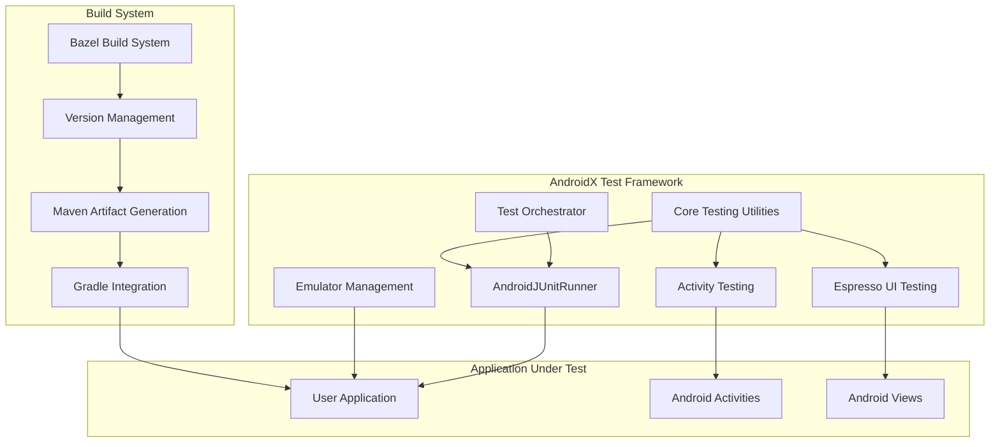
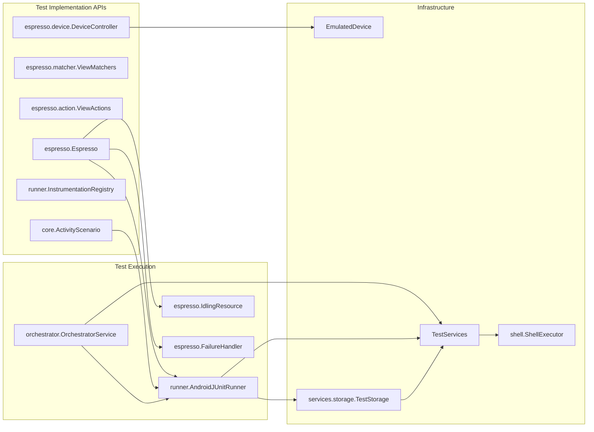
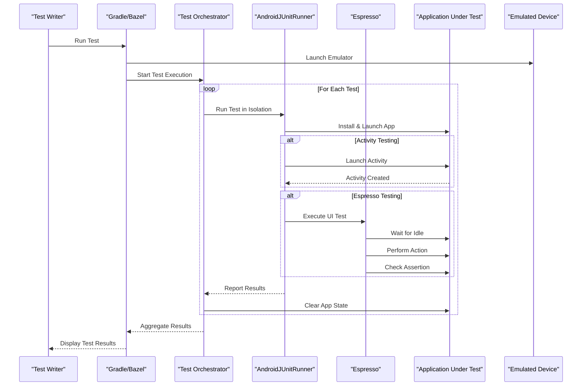
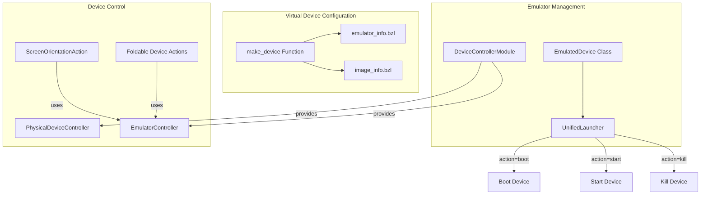
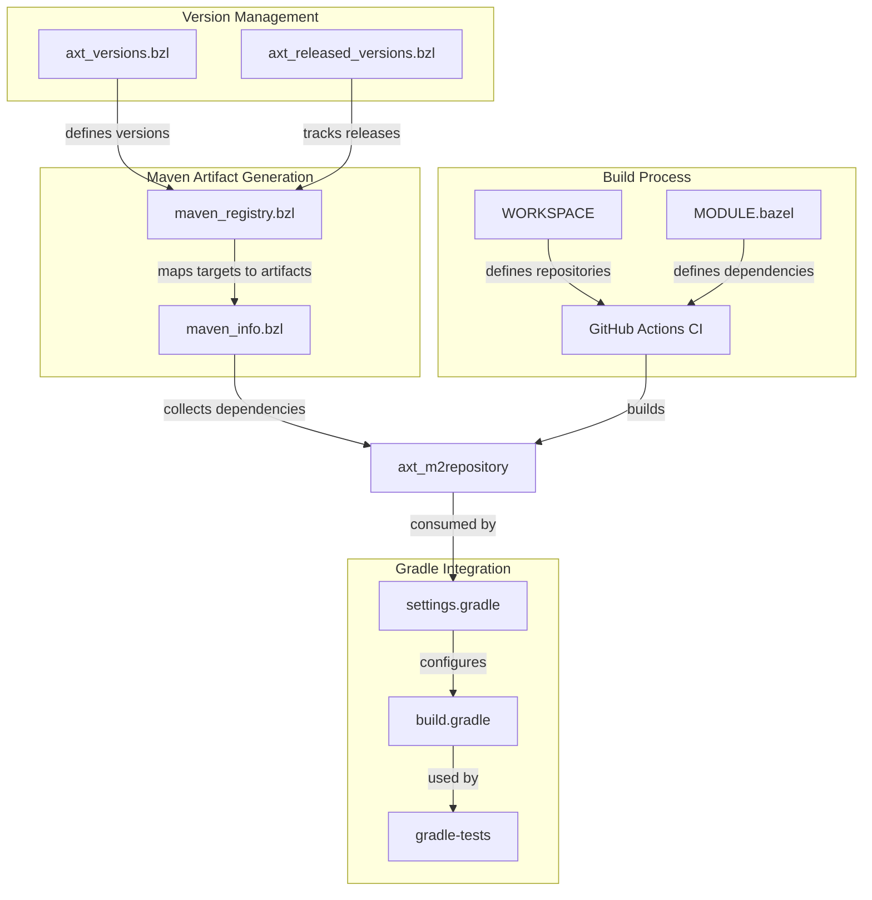

<!-- source: DeepWiki mcp.deepwiki.com · repo android/android-test · page 1 Overview · fetched 2026-10-23 -->

# Overview

Relevant source files

The following files were used as context for generating this wiki page:

- [.bazelproject](.bazelproject)
- [.bazelversion](.bazelversion)
- [.gitignore](.gitignore)
- [CONTRIBUTING.md](CONTRIBUTING.md)
- [Dockerfile](Dockerfile)
- [ISSUE_TEMPLATE.md](ISSUE_TEMPLATE.md)
- [LICENSE](LICENSE)
- [README.md](README.md)
- [bazelci/buildkite-pipeline.yml](bazelci/buildkite-pipeline.yml)
- [build_extensions/maven/maven_info.bzl](build_extensions/maven/maven_info.bzl)
- [build_extensions/maven/maven_registry.bzl](build_extensions/maven/maven_registry.bzl)
- [gradle-tests/espresso/.gitignore](gradle-tests/espresso/.gitignore)
- [gradle-tests/orchestrator/.gitignore](gradle-tests/orchestrator/.gitignore)
- [tools/android/emulator/common.py](tools/android/emulator/common.py)
- [tools/android/emulator/common_subprocess_test.py](tools/android/emulator/common_subprocess_test.py)
- [tools/android/emulator/common_test.py](tools/android/emulator/common_test.py)
- [tools/android/emulator/daemon/x86/pipe_traversal](tools/android/emulator/daemon/x86/pipe_traversal)
- [tools/device_broker/proto/BUILD.bazel](tools/device_broker/proto/BUILD.bazel)

This document provides an introduction to the AndroidX Test repository, which hosts two primary projects:

1. **AndroidX Test libraries**: A comprehensive framework for testing Android applications
2. **Bazel support for android_instrumentation_test**: Tools enabling Android instrumentation testing in Bazel build environments

This overview focuses on the AndroidX Test libraries, explaining their purpose, component architecture, and how they work together to provide a complete Android testing solution.

Sources:
- [README.md:1-9]()

## Purpose

The AndroidX Test Library provides a comprehensive framework for testing Android applications. It offers a set of APIs that enable developers to build and run test code for their apps, including JUnit 4 tests and functional user interface (UI) tests. Tests created with these libraries can be run from the Android Studio IDE or from the command line.

Key capabilities include:
- **UI testing** with Espresso
- **Component testing** with ActivityScenario
- **Test isolation** with the Test Orchestrator
- **Device configuration** for testing different device states
- **Test execution** with AndroidJUnitRunner

Sources:
- [README.md:7-9]()

## Maven Artifacts

The AndroidX Test framework is distributed as a collection of Maven artifacts, each serving a specific purpose in the testing ecosystem:

| Artifact | Path in Repository | Purpose |
|----------|-------------------|---------|
| androidx.test:core | //core/java/ | Core testing utilities |
| androidx.test:core-ktx | //ktx/core/java/ | Kotlin extensions for core |
| androidx.test.espresso:* | //espresso/*/java/ | UI testing framework |
| androidx.test.ext:junit | //ext/junit/java/ | JUnit 4 extensions |
| androidx.test.ext:junit-ktx | //ktx/ext/junit/java/ | Kotlin extensions for JUnit |
| androidx.test:orchestrator | //runner/android_test_orchestrator/ | Test isolation service |
| androidx.test:runner | //runner/android_junit_runner/java/ | Test runner |
| androidx.test:rules | //runner/rules/java/ | Test environment setup |
| androidx.test:monitor | //runner/monitor/java/ | Activity lifecycle monitoring |
| androidx.test:services | //services/ | Test supporting services |

Sources:
- [README.md:11-22]()
- [build_extensions/maven/maven_registry.bzl:25-61]()

## Architecture Overview

### High-Level System Architecture

This diagram shows the high-level components of the AndroidX Test framework and how they relate to each other. The framework provides testing capabilities through various interconnected components, supported by a Bazel-based build system that produces Maven artifacts for consumption in Gradle-based Android projects.

Sources:
- The provided high-level architecture diagram

### Component Class Relationships

This diagram illustrates the relationships between key classes across the different layers of the testing framework. Test writers interact with the Test Implementation APIs like `Espresso` and `ActivityScenario`, which in turn use the Test Execution components. These execution components rely on the Infrastructure layer for services like device control and storage.

Sources:
- The provided component relationships diagram

## Test Execution Flow

This sequence diagram illustrates how tests flow through the AndroidX Test system. When a developer runs a test, the build system launches an emulator and starts the Test Orchestrator. For each test, the AndroidJUnitRunner executes it in isolation, and after completion, the Orchestrator clears the app state before the next test. This isolation improves test reliability by preventing state leakage between tests.

Sources:
- The provided test execution flow diagram

## Core Components

### Espresso

Espresso is the UI testing framework within AndroidX Test that allows developers to write concise, reliable UI tests. It provides a fluent API for:

- Finding UI elements using matchers (`onView(withId(R.id.my_button))`)
- Performing actions on elements (`perform(click())`) 
- Verifying element states (`check(matches(isDisplayed()))`)

Key Espresso modules include:

| Module | Path | Purpose |
|--------|------|---------|
| espresso-core | //espresso/core/java/ | Core functionality |
| espresso-contrib | //espresso/contrib/java/ | Additional UI interactions |
| espresso-web | //espresso/web/java/ | WebView testing |
| espresso-intents | //espresso/intents/java/ | Intent verification |
| espresso-device | //espresso/device/java/ | Device configuration control |
| espresso-idling-resource | //espresso/idling_resource/java/ | Synchronization with app |

The modular design allows test writers to include only the components they need.

Sources:
- [build_extensions/maven/maven_registry.bzl:33-42]()

### AndroidJUnitRunner

AndroidJUnitRunner (`runner.AndroidJUnitRunner`) is the test instrumentation runner that executes JUnit 4 tests on Android devices. It:

- Loads and runs test classes
- Provides access to the instrumentation context
- Manages activity lifecycle during tests
- Integrates with the Test Orchestrator

All tests using AndroidX Test require AndroidJUnitRunner or a subclass configured in the application's build setup.

Sources:
- [build_extensions/maven/maven_registry.bzl:26]()

### Activity Testing

Activity testing is facilitated by `ActivityScenario` in the Core module. This class provides:

- Programmatic control over activity lifecycle (create, start, resume, pause, stop, destroy)
- Synchronization with UI thread
- Clean state between tests

`ActivityScenario` replaces the older `ActivityTestRule` with a more flexible, programmatic approach.

Sources:
- [build_extensions/maven/maven_registry.bzl:31]()

### Emulator Management

The Emulator Management system allows controlling emulator instances during testing. It includes components for launching emulators, configuring virtual devices, and controlling device states like screen orientation and foldable device configurations.

Sources:
- The provided emulator management system diagram
- [tools/android/emulator/common.py:15-384]()

## Build System

The AndroidX Test framework uses Bazel for building, with support for Maven artifact generation:

Key build system files:
- `.bazelversion`: Specifies the required Bazel version (7.5.0)
- `maven_registry.bzl`: Maps Bazel targets to Maven artifacts
- `maven_info.bzl`: Collects Maven dependency information
- Gradle test projects for integration testing

Sources:
- [.bazelversion:1-2]()
- [build_extensions/maven/maven_registry.bzl:1-128]()
- [build_extensions/maven/maven_info.bzl:1-210]()
- The provided build and version management system diagram

## Development and Contribution

The repository uses Bazel for building and testing. To contribute:

1. Fork and clone the repository
2. Install Bazelisk and the Android SDK
3. Set ANDROID_HOME environment variable
4. Build with `bazelisk build :axt_m2repository`
5. Test with `bazelisk test //core/javatests/...`

Integration tests can be run using the Gradle test projects.

Sources:
- [CONTRIBUTING.md:18-91]()

## Related Documentation

For more detailed information on specific components, refer to the following wiki pages:

- [Architecture](#2): Detailed architectural explanation
- [Core Components](#3): Details on fundamental building blocks
- [Espresso](#4): UI testing framework documentation
- [Runner](#5): Test runner and execution documentation
- [Device Management](#6): Emulator and device control
- [Build System](#7): Build infrastructure details
- [Test Services](#8): Service components documentation

External documentation is available at [developers.android.com/testing](https://developers.android.com/testing).

Sources:
- [README.md:9-42]()

---

