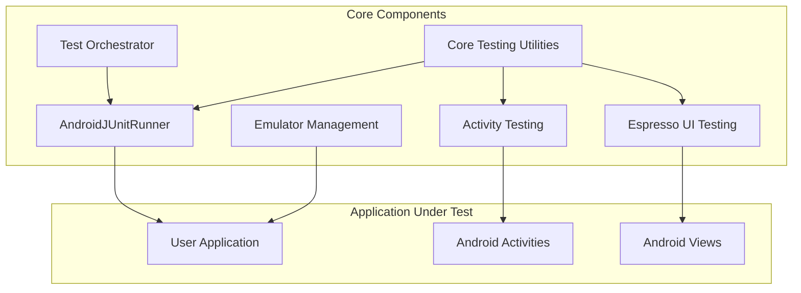
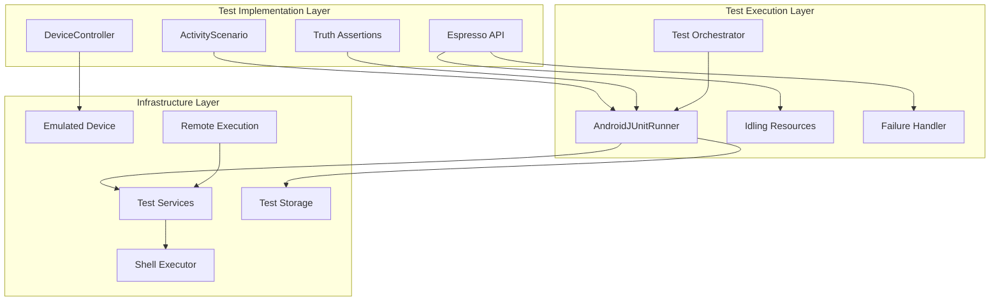
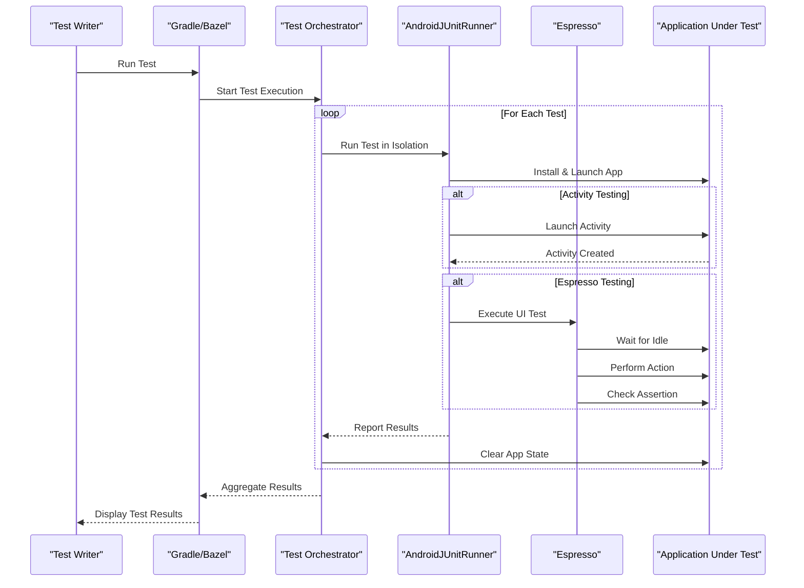
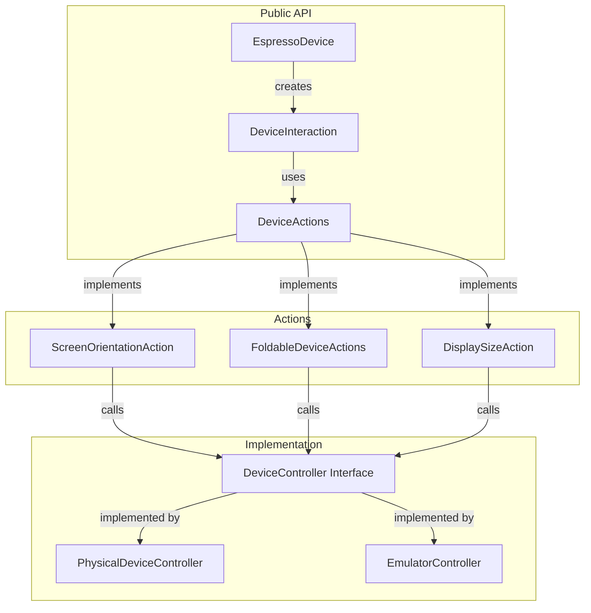
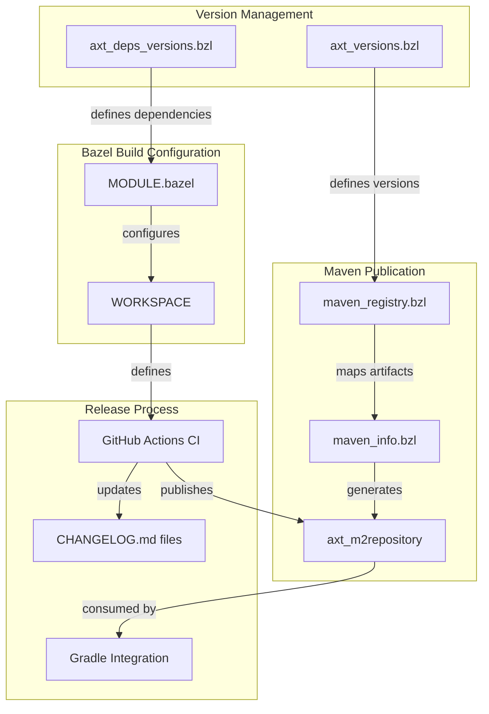

<!-- source: DeepWiki mcp.deepwiki.com · repo android/android-test · page 2 Architecture · fetched 2026-10-23 -->

# Architecture

Relevant source files

The following files were used as context for generating this wiki page:

- [MODULE.bazel](MODULE.bazel)
- [build_extensions/axt_deps_versions.bzl](build_extensions/axt_deps_versions.bzl)
- [core/CHANGELOG.md](core/CHANGELOG.md)
- [espresso/CHANGELOG.md](espresso/CHANGELOG.md)
- [espresso/core/java/androidx/test/espresso/api/current_public.txt](espresso/core/java/androidx/test/espresso/api/current_public.txt)
- [espresso/device/CHANGELOG.md](espresso/device/CHANGELOG.md)
- [espresso/device/java/androidx/test/espresso/device/api/current_public.txt](espresso/device/java/androidx/test/espresso/device/api/current_public.txt)
- [espresso/intents/java/androidx/test/espresso/intent/api/current_public.txt](espresso/intents/java/androidx/test/espresso/intent/api/current_public.txt)
- [espresso/remote/java/androidx/test/espresso/remote/api/current_public.txt](espresso/remote/java/androidx/test/espresso/remote/api/current_public.txt)
- [espresso/web/java/androidx/test/espresso/web/api/current_public.txt](espresso/web/java/androidx/test/espresso/web/api/current_public.txt)
- [espresso/web/java/androidx/test/espresso/web/util/concurrent/FutureCallback.java](espresso/web/java/androidx/test/espresso/web/util/concurrent/FutureCallback.java)
- [ext/junit/CHANGELOG.md](ext/junit/CHANGELOG.md)
- [ext/junit/java/androidx/test/ext/junit/api/current_public.txt](ext/junit/java/androidx/test/ext/junit/api/current_public.txt)
- [ext/truth/CHANGELOG.md](ext/truth/CHANGELOG.md)
- [ext/truth/java/androidx/test/ext/truth/api/current_public.txt](ext/truth/java/androidx/test/ext/truth/api/current_public.txt)
- [runner/android_junit_runner/CHANGELOG.md](runner/android_junit_runner/CHANGELOG.md)
- [runner/android_junit_runner/java/androidx/test/api/current_public.txt](runner/android_junit_runner/java/androidx/test/api/current_public.txt)
- [runner/android_junit_runner/java/androidx/test/filters/Suppress.java](runner/android_junit_runner/java/androidx/test/filters/Suppress.java)
- [runner/android_test_orchestrator/CHANGELOG.md](runner/android_test_orchestrator/CHANGELOG.md)
- [runner/monitor/CHANGELOG.md](runner/monitor/CHANGELOG.md)
- [runner/monitor/java/androidx/test/api/current_internal.txt](runner/monitor/java/androidx/test/api/current_internal.txt)
- [runner/monitor/java/androidx/test/api/current_public.txt](runner/monitor/java/androidx/test/api/current_public.txt)
- [runner/monitor/java/androidx/test/platform/device/DeviceController.java](runner/monitor/java/androidx/test/platform/device/DeviceController.java)
- [runner/rules/CHANGELOG.md](runner/rules/CHANGELOG.md)
- [services/CHANGELOG.md](services/CHANGELOG.md)

## Introduction

This document provides a comprehensive overview of the architectural design of the AndroidX Test framework. It explains how the various components of the framework interact to enable effective testing of Android applications. The architecture is organized into several interconnected subsystems that work together to provide UI testing, component testing, test isolation, device management, and integration with build systems.

For information about specific components like Espresso, the Runner system, or device management, please refer to their respective dedicated pages: [Espresso](#4), [Runner](#5), or [Device Management](#6).

Sources: [core/CHANGELOG.md](), [espresso/CHANGELOG.md](), [runner/android_junit_runner/CHANGELOG.md](), [services/CHANGELOG.md]()

## Core Components

The AndroidX Test framework consists of several core components, each with specific responsibilities:

### Espresso

Espresso provides a fluent API for UI testing, focusing on testing a single application. It offers automatic synchronization with the UI thread, making tests more reliable. The main components include:

- **ViewMatchers**: Find views in the hierarchy (e.g., `withId`, `withText`)
- **ViewActions**: Perform actions on views (e.g., `click()`, `typeText()`)
- **ViewAssertions**: Verify view states (e.g., `matches()`, `doesNotExist()`)
- **Espresso Class**: Entry point providing methods like `onView()`, `onData()`, `pressBack()`
- **IdlingResources**: Synchronization mechanism for asynchronous operations

Espresso is designed to be concise and test actions from a user's perspective, hiding implementation details of the UI.

Sources: [espresso/core/java/androidx/test/espresso/api/current_public.txt:1-507](), [espresso/core/java/androidx/test/espresso/api/current_public.txt:193-471]()

### AndroidJUnitRunner

AndroidJUnitRunner is a JUnit 4-compatible test runner that executes tests on Android devices. It extends `MonitoringInstrumentation` and handles:

- Test discovery and execution
- Test lifecycle management
- Activity and application monitoring
- Instrumentation integration
- Intent interception and monitoring

The runner is the bridge between test code written with JUnit and the Android runtime environment.

Sources: [runner/android_junit_runner/java/androidx/test/api/current_public.txt:229-246](), [runner/monitor/java/androidx/test/api/current_public.txt:106-136]()

### Core Testing Utilities

The Core module provides essential functionality used by other components:

- **ActivityLifecycleMonitor**: Tracks activity lifecycle state changes
- **ApplicationLifecycleMonitor**: Tracks application lifecycle events
- **IntentMonitor/Stubber**: For intent monitoring and stubbing
- **TestStorage**: Manages test files and data
- **ThreadChecker**: Enforces thread constraints for test operations

These utilities form the foundation for higher-level testing tools.

Sources: [core/CHANGELOG.md](), [runner/monitor/java/androidx/test/api/current_public.txt:177-224]()

### Test Orchestrator

Test Orchestrator isolates each test by running it in a separate instrumentation process, preventing test pollution. Key components include:

- **OrchestratorCallback**: Interface for communicating between test processes
- **OrchestrationListenerManager**: Manages test lifecycle notification
- **BundleJUnitUtils**: Utilities for passing test data between processes 
- **ParcelableResult/Description/Failure**: Test result data structures that can cross process boundaries

This isolation improves test reliability by ensuring that state changes in one test don't affect others.

Sources: [runner/android_junit_runner/java/androidx/test/api/current_public.txt:45-152](), [runner/android_test_orchestrator/CHANGELOG.md]()

### Activity Testing

The framework provides tools for testing activities:

- **ActivityScenario**: Primary API for testing activities in isolation
- **ActivityScenarioRule**: JUnit rule for ActivityScenario management
- **ActivityLifecycleTimeout**: Configures timeouts for activity operations
- **ActivityInvoker**: Interface for controlling activity lifecycle

These components make it easier to test single activities without the complexities of full application testing.

Sources: [ext/junit/java/androidx/test/ext/junit/api/current_public.txt:4-20](), [runner/monitor/java/androidx/test/internal/platform/app/ActivityInvoker.java]()

### Device Management

Device Management provides capabilities for controlling and configuring Android devices during testing:

- **DeviceController**: Base interface for device operations
- **ScreenOrientation**: Controls device orientation (portrait/landscape)
- **DeviceMode**: For foldable device configurations (flat, book, tabletop, closed)

This subsystem enables tests to control device configurations for testing different UI states.

Sources: [runner/monitor/java/androidx/test/platform/device/DeviceController.java](), [espresso/device/java/androidx/test/espresso/device/api/current_public.txt:30-49]()

## Component Relationships and Layered Architecture

The AndroidX Test framework is organized into three primary layers:

### Test Implementation Layer

This is the primary interface for test writers, providing high-level APIs for test creation:

- **Espresso API**: For UI testing with `onView()`, `onData()`, and related methods
- **ActivityScenario**: For testing activities in isolation
- **DeviceController**: For controlling device configuration
- **Truth Assertions**: For fluent assertions on Android components

These components present simple, focused APIs that hide implementation complexity.

Sources: [espresso/core/java/androidx/test/espresso/api/current_public.txt:44-59](), [ext/junit/java/androidx/test/ext/junit/api/current_public.txt:4-10](), [ext/truth/java/androidx/test/ext/truth/api/current_public.txt]()

### Test Execution Layer

This layer handles the mechanics of test execution:

- **AndroidJUnitRunner**: Test runner that integrates with JUnit
- **Test Orchestrator**: Manages test isolation
- **IdlingResources**: Handles synchronization with asynchronous operations
- **FailureHandler**: Processes and reports test failures

This layer translates test instructions into actions on the device and application.

Sources: [runner/android_junit_runner/java/androidx/test/api/current_public.txt:237-239](), [espresso/core/java/androidx/test/espresso/api/current_public.txt:64-87]()

### Infrastructure Layer

This foundational layer provides core services and capabilities:

- **Emulated Device**: Manages virtual device instances
- **Test Services**: Provides services to test processes
- **Shell Executor**: Executes privileged commands
- **Test Storage**: Manages test files and data
- **Remote Execution**: Enables cross-process testing

These components handle low-level operations required for test execution.

Sources: [services/CHANGELOG.md](), [runner/monitor/java/androidx/test/api/current_public.txt:66-79](), [espresso/remote/java/androidx/test/espresso/remote/api/current_public.txt]()

## Test Execution Flow

The test execution process follows a specific sequence of operations:

This flow demonstrates how:

1. Tests initiated by developers are processed by the build system (Gradle or Bazel)
2. Test Orchestrator manages isolated execution of individual tests
3. AndroidJUnitRunner executes tests within the application environment
4. Different testing approaches (Activity testing, UI testing) are handled
5. Test results flow back through the system to the developer

The key innovation is the isolation provided by Test Orchestrator, which launches each test in a fresh instrumentation process to prevent test pollution.

Sources: [runner/android_junit_runner/java/androidx/test/api/current_public.txt:45-172](), [runner/android_test_orchestrator/CHANGELOG.md]()

## Device Management Architecture

The Device Management subsystem controls the testing environment:

The architecture provides a clear separation between:

- **Public API**: High-level interfaces for test writers (`EspressoDevice`, `DeviceInteraction`)
- **Implementation**: Device controller implementations for different device types
- **Actions**: Specific operations that can be performed on devices

This design allows tests to control device configuration (orientation, foldable state, display size) without needing to know the implementation details for different device types.

Sources: [espresso/device/java/androidx/test/espresso/device/api/current_public.txt:19-27](), [espresso/device/java/androidx/test/espresso/device/api/current_public.txt:30-49](), [runner/monitor/java/androidx/test/platform/device/DeviceController.java]()

## Build and Version Management

The AndroidX Test framework uses a sophisticated build system:

This system manages:

1. **Version Control**: Using `axt_versions.bzl` and `axt_deps_versions.bzl` to define component versions
2. **Build Configuration**: Using `MODULE.bazel` and `WORKSPACE` files for Bazel builds
3. **Maven Publication**: Generating Maven artifacts from Bazel targets
4. **Release Process**: Managing changelogs and CI integration

The system ensures compatibility with both Bazel (for framework development) and Gradle (for user consumption).

Sources: [build_extensions/axt_deps_versions.bzl](), [MODULE.bazel](), [espresso/CHANGELOG.md](), [core/CHANGELOG.md](), [runner/android_junit_runner/CHANGELOG.md](), [services/CHANGELOG.md]()

## Conclusion

The AndroidX Test framework architecture provides a comprehensive solution for Android application testing through a layered design. Each component focuses on specific responsibilities while interconnecting to deliver a cohesive testing experience:

1. The top-level Test Implementation Layer provides intuitive APIs for test writers
2. The middle Test Execution Layer handles the mechanics of test running and synchronization
3. The foundational Infrastructure Layer provides essential services and device control

This architecture enables developers to write concise, reliable tests that can verify application behavior across different device configurations and states. Understanding these architectural relationships helps developers leverage the framework effectively for their testing needs.

---

