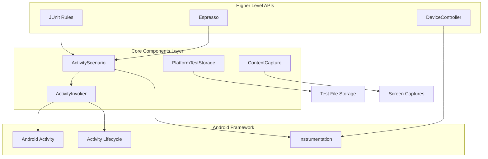
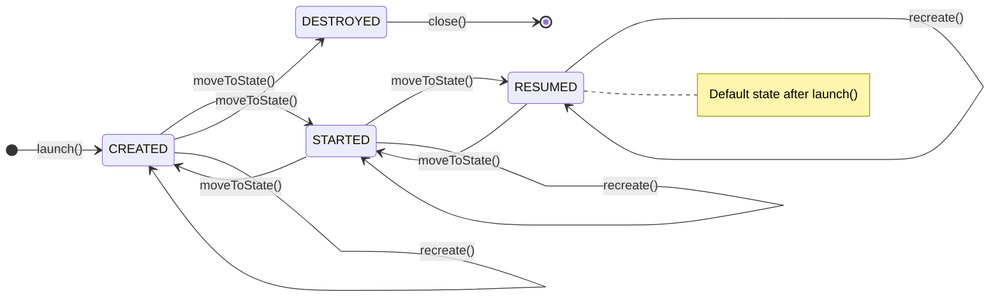
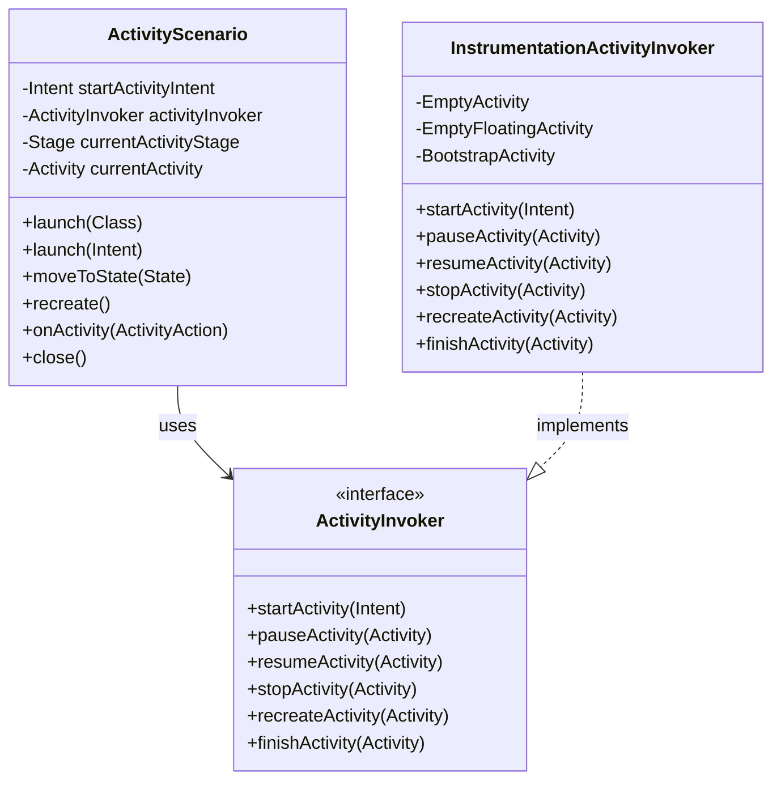
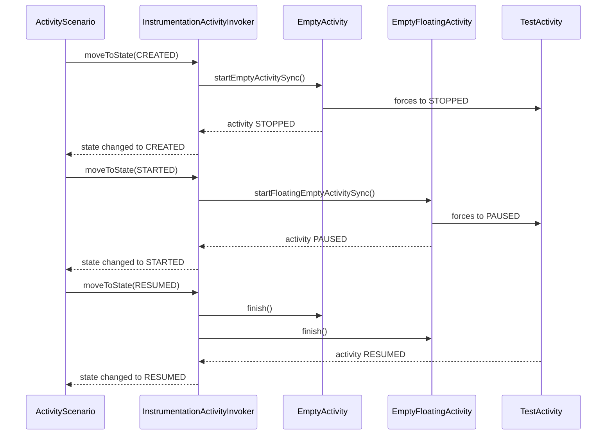
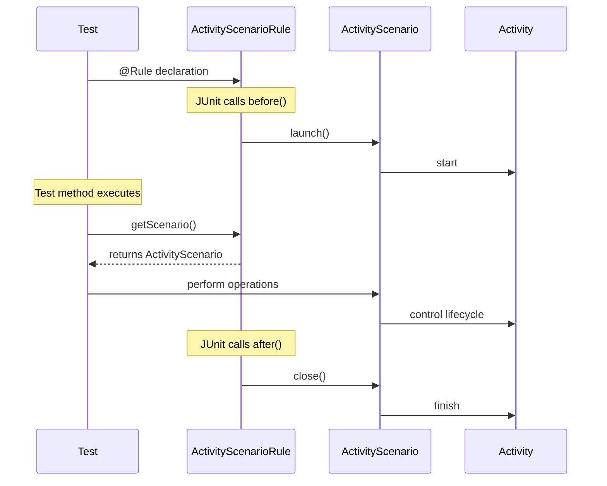
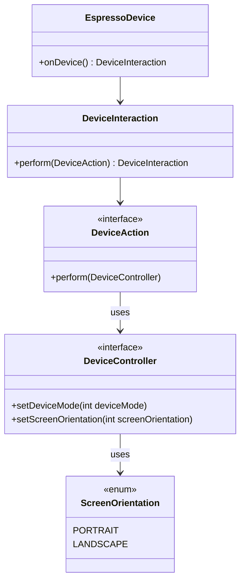
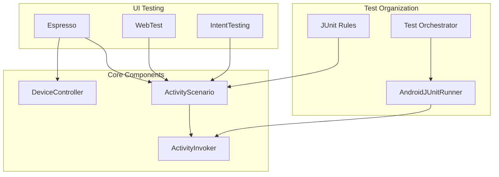

<!-- source: DeepWiki mcp.deepwiki.com · repo android/android-test · page 3 Core Components · fetched 2026-10-23 -->

# Core Components

<details>
<summary>Relevant source files</summary>

The following files were used as context for generating this wiki page:

- [core/java/androidx/test/core/app/ActivityScenario.java](core/java/androidx/test/core/app/ActivityScenario.java)
- [core/java/androidx/test/core/app/InstrumentationActivityInvoker.java](core/java/androidx/test/core/app/InstrumentationActivityInvoker.java)
- [core/javatests/androidx/test/core/app/ActivityScenarioTest.java](core/javatests/androidx/test/core/app/ActivityScenarioTest.java)
- [core/javatests/androidx/test/core/app/testing/AndroidManifest.xml](core/javatests/androidx/test/core/app/testing/AndroidManifest.xml)
- [core/javatests/androidx/test/core/app/testing/AsyncRecordingActivity.java](core/javatests/androidx/test/core/app/testing/AsyncRecordingActivity.java)
- [core/javatests/androidx/test/core/app/testing/IntentActivity.java](core/javatests/androidx/test/core/app/testing/IntentActivity.java)
- [core/javatests/androidx/test/core/app/testing/RecordingActivity.java](core/javatests/androidx/test/core/app/testing/RecordingActivity.java)
- [core/javatests/androidx/test/core/app/testing/RedirectingActivity.java](core/javatests/androidx/test/core/app/testing/RedirectingActivity.java)
- [espresso/core/java/androidx/test/espresso/api/current_public.txt](espresso/core/java/androidx/test/espresso/api/current_public.txt)
- [espresso/device/java/androidx/test/espresso/device/api/current_public.txt](espresso/device/java/androidx/test/espresso/device/api/current_public.txt)
- [espresso/intents/java/androidx/test/espresso/intent/api/current_public.txt](espresso/intents/java/androidx/test/espresso/intent/api/current_public.txt)
- [espresso/remote/java/androidx/test/espresso/remote/api/current_public.txt](espresso/remote/java/androidx/test/espresso/remote/api/current_public.txt)
- [espresso/web/java/androidx/test/espresso/web/api/current_public.txt](espresso/web/java/androidx/test/espresso/web/api/current_public.txt)
- [espresso/web/java/androidx/test/espresso/web/util/concurrent/FutureCallback.java](espresso/web/java/androidx/test/espresso/web/util/concurrent/FutureCallback.java)
- [ext/junit/java/androidx/test/ext/junit/api/current_public.txt](ext/junit/java/androidx/test/ext/junit/api/current_public.txt)
- [ext/junit/java/androidx/test/ext/junit/rules/ActivityScenarioRule.java](ext/junit/java/androidx/test/ext/junit/rules/ActivityScenarioRule.java)
- [ext/junit/javatests/androidx/test/ext/junit/rules/ActivityScenarioRuleWithCustomIntentTest.java](ext/junit/javatests/androidx/test/ext/junit/rules/ActivityScenarioRuleWithCustomIntentTest.java)
- [ext/truth/java/androidx/test/ext/truth/api/current_public.txt](ext/truth/java/androidx/test/ext/truth/api/current_public.txt)
- [ktx/core/java/androidx/test/core/app/ActivityScenario.kt](ktx/core/java/androidx/test/core/app/ActivityScenario.kt)
- [ktx/core/javatests/androidx/test/core/app/ActivityScenarioKotlinTest.kt](ktx/core/javatests/androidx/test/core/app/ActivityScenarioKotlinTest.kt)
- [ktx/ext/junit/java/androidx/test/ext/junit/rules/ActivityScenarioRule.kt](ktx/ext/junit/java/androidx/test/ext/junit/rules/ActivityScenarioRule.kt)
- [ktx/ext/junit/javatests/androidx/test/ext/junit/rules/ActivityScenarioRuleWithCustomIntentKotlinTest.kt](ktx/ext/junit/javatests/androidx/test/ext/junit/rules/ActivityScenarioRuleWithCustomIntentKotlinTest.kt)
- [runner/android_junit_runner/java/androidx/test/api/current_public.txt](runner/android_junit_runner/java/androidx/test/api/current_public.txt)
- [runner/android_junit_runner/java/androidx/test/filters/Suppress.java](runner/android_junit_runner/java/androidx/test/filters/Suppress.java)
- [runner/monitor/java/androidx/test/api/current_internal.txt](runner/monitor/java/androidx/test/api/current_internal.txt)
- [runner/monitor/java/androidx/test/api/current_public.txt](runner/monitor/java/androidx/test/api/current_public.txt)
- [runner/monitor/java/androidx/test/internal/platform/app/ActivityInvoker.java](runner/monitor/java/androidx/test/internal/platform/app/ActivityInvoker.java)
- [runner/monitor/java/androidx/test/platform/device/DeviceController.java](runner/monitor/java/androidx/test/platform/device/DeviceController.java)

</details>


This page describes the fundamental building blocks of the AndroidX Test framework. These components provide the foundation for testing Android applications effectively and are used extensively throughout the testing APIs. For information about UI testing specifically, see [Espresso](#4).

## Overview of Core Components

The AndroidX Test framework provides several key components that form the foundation for Android testing. These components enable developers to control the application lifecycle, set up and tear down test environments, and interact with application components in a consistent and predictable way.



Sources: 
- [core/java/androidx/test/core/app/ActivityScenario.java:24-57](core/java/androidx/test/core/app/ActivityScenario.java:24-57)
- [core/java/androidx/test/core/app/InstrumentationActivityInvoker.java:16-52](core/java/androidx/test/core/app/InstrumentationActivityInvoker.java:16-52)
- [runner/monitor/java/androidx/test/platform/device/DeviceController.java:16-29](runner/monitor/java/androidx/test/platform/device/DeviceController.java:16-29)

## ActivityScenario

ActivityScenario is the primary component for testing activities in the AndroidX Test framework. It provides APIs to launch an activity and control its lifecycle state for testing purposes.

### Purpose and Lifecycle States

ActivityScenario allows you to:
- Launch an activity with a specific intent or activity class
- Move an activity through different lifecycle states
- Recreate an activity to test instance state restoration
- Execute code on the activity's main thread
- Get activity results

ActivityScenario works with the standard Android activity lifecycle states:



Sources:
- [core/java/androidx/test/core/app/ActivityScenario.java:57-117](core/java/androidx/test/core/app/ActivityScenario.java:57-117)
- [core/javatests/androidx/test/core/app/ActivityScenarioTest.java:69-135](core/javatests/androidx/test/core/app/ActivityScenarioTest.java:69-135)

### Implementation Architecture

ActivityScenario uses an `ActivityInvoker` to control the activity lifecycle. The standard implementation, `InstrumentationActivityInvoker`, uses Android's `Instrumentation` API to manipulate activities.



Sources:
- [core/java/androidx/test/core/app/ActivityScenario.java:117-173](core/java/androidx/test/core/app/ActivityScenario.java:117-173)
- [core/java/androidx/test/core/app/InstrumentationActivityInvoker.java:59-102](core/java/androidx/test/core/app/InstrumentationActivityInvoker.java:59-102)
- [runner/monitor/java/androidx/test/internal/platform/app/ActivityInvoker.java:37-59](runner/monitor/java/androidx/test/internal/platform/app/ActivityInvoker.java:37-59)

### Key Methods

| Method | Description |
|--------|-------------|
| `launch(Class)` | Launches an activity of the given class |
| `launch(Intent)` | Launches an activity with the given intent |
| `launchActivityForResult()` | Launches an activity that returns a result |
| `moveToState(State)` | Transitions the activity to the specified state |
| `recreate()` | Recreates the activity |
| `onActivity(ActivityAction)` | Executes code on the activity's main thread |
| `getResult()` | Gets the result of an activity started with `launchActivityForResult()` |
| `close()` | Cleans up resources and finishes the activity |

Sources:
- [core/java/androidx/test/core/app/ActivityScenario.java:201-283](core/java/androidx/test/core/app/ActivityScenario.java:201-283)
- [core/java/androidx/test/core/app/ActivityScenario.java:417-427](core/java/androidx/test/core/app/ActivityScenario.java:417-427)
- [core/java/androidx/test/core/app/ActivityScenario.java:652-691](core/java/androidx/test/core/app/ActivityScenario.java:652-691)
- [core/java/androidx/test/core/app/ActivityScenario.java:706-736](core/java/androidx/test/core/app/ActivityScenario.java:706-736)
- [core/java/androidx/test/core/app/ActivityScenario.java:783-811](core/java/androidx/test/core/app/ActivityScenario.java:783-811)

### Usage Examples

Basic usage pattern for ActivityScenario:

```java
// Launch an activity
try (ActivityScenario<MyActivity> scenario = ActivityScenario.launch(MyActivity.class)) {
    // Execute code on the activity
    scenario.onActivity(activity -> {
        // Verify activity state
        assertThat(activity.getSomething()).isEqualTo("something");
    });
    
    // Move the activity to a different state
    scenario.moveToState(State.STARTED);
    
    // Recreate the activity
    scenario.recreate();
} // ActivityScenario is automatically closed
```

Kotlin extension functions are also provided for a more idiomatic Kotlin experience:

```kotlin
// Launch an activity with Kotlin extension
launchActivity<MyActivity>().use { scenario ->
    // Execute code on the activity
    scenario.onActivity { activity ->
        // Verify activity state
        assertThat(activity.something).isEqualTo("something")
    }
}
```

Sources:
- [core/java/androidx/test/core/app/ActivityScenario.java:89-115](core/java/androidx/test/core/app/ActivityScenario.java:89-115)
- [ktx/core/java/androidx/test/core/app/ActivityScenario.kt:16-44](ktx/core/java/androidx/test/core/app/ActivityScenario.kt:16-44)
- [ktx/core/javatests/androidx/test/core/app/ActivityScenarioKotlinTest.kt:39-75](ktx/core/javatests/androidx/test/core/app/ActivityScenarioKotlinTest.kt:39-75)

## ActivityInvoker

The ActivityInvoker interface defines methods for controlling the lifecycle of activities. This abstraction allows for different implementations of activity lifecycle control.

### Purpose

ActivityInvoker serves as an abstraction layer between ActivityScenario and the actual mechanisms used to control activity lifecycle. This separation makes it possible to test in different environments (like Robolectric) by providing different implementations.

### Implementation

The primary implementation is InstrumentationActivityInvoker, which uses Android's Instrumentation API to control activities. It includes several helper activities:

- **EmptyActivity**: Used to force a tested activity into the STOPPED state
- **EmptyFloatingActivity**: Used to force a tested activity into the PAUSED state
- **BootstrapActivity**: Used for starting activities for result



Sources:
- [core/java/androidx/test/core/app/InstrumentationActivityInvoker.java:128-232](core/java/androidx/test/core/app/InstrumentationActivityInvoker.java:128-232)
- [core/java/androidx/test/core/app/InstrumentationActivityInvoker.java:308-394](core/java/androidx/test/core/app/InstrumentationActivityInvoker.java:308-394)
- [runner/monitor/java/androidx/test/internal/platform/app/ActivityInvoker.java:18-37](runner/monitor/java/androidx/test/internal/platform/app/ActivityInvoker.java:18-37)

### Key Methods

| Method | Description |
|--------|-------------|
| `startActivity(Intent)` | Starts an activity with the given intent |
| `startActivityForResult(Intent)` | Starts an activity for result |
| `getActivityResult()` | Gets the result of the activity |
| `resumeActivity(Activity)` | Transitions an activity to the RESUMED state |
| `pauseActivity(Activity)` | Transitions an activity to the PAUSED state |
| `stopActivity(Activity)` | Transitions an activity to the STOPPED state |
| `recreateActivity(Activity)` | Recreates an activity |
| `finishActivity(Activity)` | Finishes an activity |

Sources:
- [runner/monitor/java/androidx/test/internal/platform/app/ActivityInvoker.java:55-127](runner/monitor/java/androidx/test/internal/platform/app/ActivityInvoker.java:55-127)
- [core/java/androidx/test/core/app/InstrumentationActivityInvoker.java:400-502](core/java/androidx/test/core/app/InstrumentationActivityInvoker.java:400-502)
- [core/java/androidx/test/core/app/InstrumentationActivityInvoker.java:508-581](core/java/androidx/test/core/app/InstrumentationActivityInvoker.java:508-581)

## ActivityScenarioRule

ActivityScenarioRule is a JUnit 4 rule that wraps ActivityScenario to make it easier to use in tests. It automatically launches the activity before the test and closes it after the test.

### Purpose

ActivityScenarioRule simplifies the setup and teardown of activities in JUnit tests. It:
- Automatically launches the activity before each test method
- Makes the ActivityScenario available through the `getScenario()` method
- Automatically closes the activity after each test method



Sources:
- [ext/junit/java/androidx/test/ext/junit/rules/ActivityScenarioRule.java:16-57](ext/junit/java/androidx/test/ext/junit/rules/ActivityScenarioRule.java:16-57)
- [ext/junit/java/androidx/test/ext/junit/rules/ActivityScenarioRule.java:110-120](ext/junit/java/androidx/test/ext/junit/rules/ActivityScenarioRule.java:110-120)

### Usage Examples

Basic usage in Java:

```java
@Rule
public ActivityScenarioRule<MyActivity> rule = new ActivityScenarioRule<>(MyActivity.class);

@Test
public void testSomething() {
    ActivityScenario<MyActivity> scenario = rule.getScenario();
    // Use scenario to control activity
}
```

With a custom intent:

```java
@Rule
public ActivityScenarioRule<MyActivity> rule = new ActivityScenarioRule<>(
    new Intent(getApplicationContext(), MyActivity.class)
        .putExtra("key", "value")
);
```

Kotlin extension function for more idiomatic Kotlin:

```kotlin
@get:Rule
val rule = activityScenarioRule<MyActivity>()

@Test
fun testSomething() {
    val scenario = rule.scenario
    // Use scenario to control activity
}
```

Sources:
- [ext/junit/java/androidx/test/ext/junit/rules/ActivityScenarioRule.java:72-97](ext/junit/java/androidx/test/ext/junit/rules/ActivityScenarioRule.java:72-97)
- [ktx/ext/junit/java/androidx/test/ext/junit/rules/ActivityScenarioRule.kt:16-37](ktx/ext/junit/java/androidx/test/ext/junit/rules/ActivityScenarioRule.kt:16-37)
- [ext/junit/javatests/androidx/test/ext/junit/rules/ActivityScenarioRuleWithCustomIntentTest.java:33-69](ext/junit/javatests/androidx/test/ext/junit/rules/ActivityScenarioRuleWithCustomIntentTest.java:33-69)

## DeviceController

DeviceController is an interface that provides base-level device operations, such as changing screen orientation or controlling foldable devices.

### Purpose

DeviceController serves as a lower-level API for controlling device state during tests. It provides methods to:
- Change screen orientation (portrait/landscape)
- Set device mode (for foldable devices)

This interface is primarily used by higher-level APIs like Espresso's device actions, but can also be used directly when needed.



Sources:
- [runner/monitor/java/androidx/test/platform/device/DeviceController.java:16-50](runner/monitor/java/androidx/test/platform/device/DeviceController.java:16-50)
- [espresso/device/java/androidx/test/espresso/device/api/current_public.txt:16-49](espresso/device/java/androidx/test/espresso/device/api/current_public.txt:16-49)

## Integration with Other Components

The Core Components integrate with several other parts of the AndroidX Test framework:

### Integration with Espresso

Espresso uses ActivityScenario for launching and controlling activities during UI tests. This ensures consistent activity state management across UI test frameworks.

### Integration with JUnit

ActivityScenarioRule provides integration with JUnit 4, allowing for easy setup and teardown of activities in test methods.

### Integration with Test Orchestrator

The Test Orchestrator and AndroidJUnitRunner work with these core components to run tests in isolation and manage the test lifecycle.



Sources:
- [ext/junit/java/androidx/test/ext/junit/api/current_public.txt:4-15](ext/junit/java/androidx/test/ext/junit/api/current_public.txt:4-15)
- [runner/android_junit_runner/java/androidx/test/api/current_public.txt:227-235](runner/android_junit_runner/java/androidx/test/api/current_public.txt:227-235)
- [espresso/core/java/androidx/test/espresso/api/current_public.txt:43-60](espresso/core/java/androidx/test/espresso/api/current_public.txt:43-60)

---

