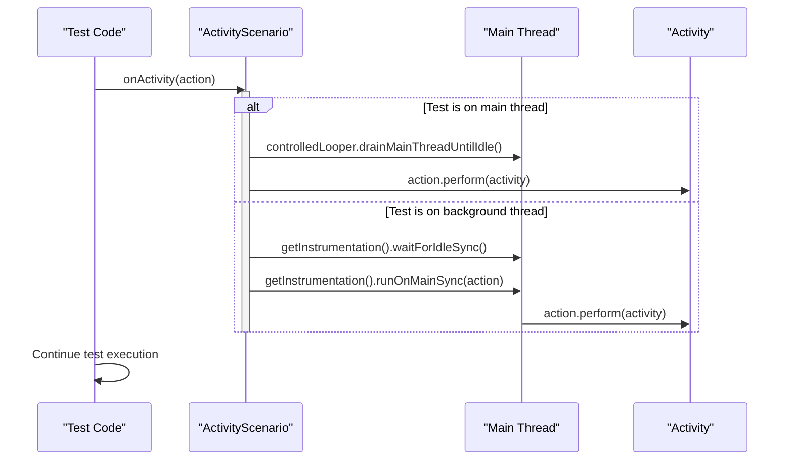
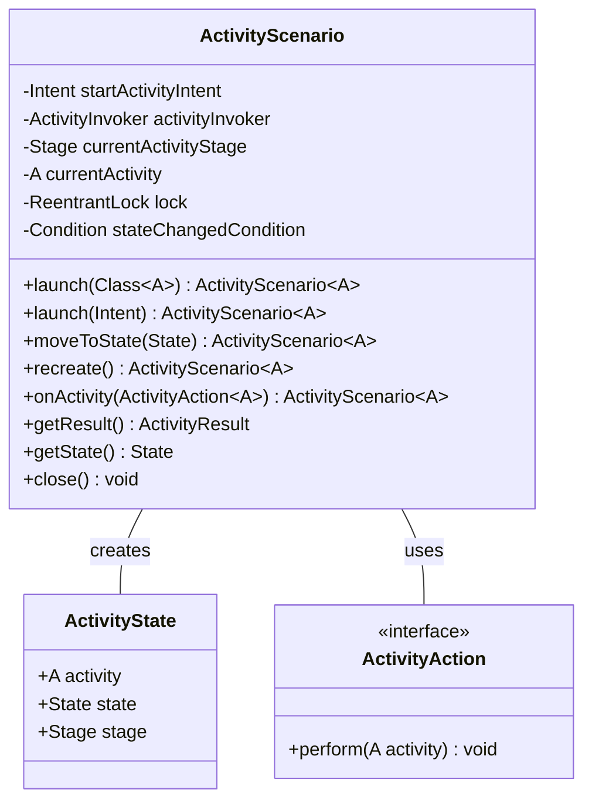
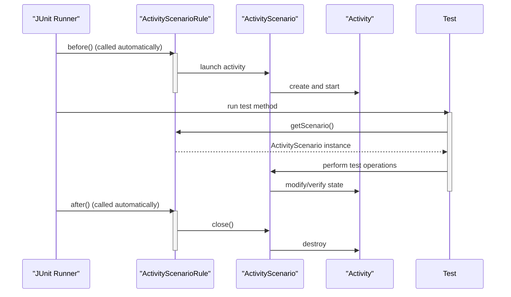

<!-- source: DeepWiki mcp.deepwiki.com · repo android/android-test · page 3.1 ActivityScenario · fetched 2026-10-23 -->

# ActivityScenario

<details>
<summary>Relevant source files</summary>

The following files were used as context for generating this wiki page:

- [core/java/androidx/test/core/app/ActivityScenario.java](core/java/androidx/test/core/app/ActivityScenario.java)
- [core/java/androidx/test/core/app/InstrumentationActivityInvoker.java](core/java/androidx/test/core/app/InstrumentationActivityInvoker.java)
- [core/javatests/androidx/test/core/app/ActivityScenarioTest.java](core/javatests/androidx/test/core/app/ActivityScenarioTest.java)
- [core/javatests/androidx/test/core/app/testing/AndroidManifest.xml](core/javatests/androidx/test/core/app/testing/AndroidManifest.xml)
- [core/javatests/androidx/test/core/app/testing/AsyncRecordingActivity.java](core/javatests/androidx/test/core/app/testing/AsyncRecordingActivity.java)
- [core/javatests/androidx/test/core/app/testing/IntentActivity.java](core/javatests/androidx/test/core/app/testing/IntentActivity.java)
- [core/javatests/androidx/test/core/app/testing/RecordingActivity.java](core/javatests/androidx/test/core/app/testing/RecordingActivity.java)
- [core/javatests/androidx/test/core/app/testing/RedirectingActivity.java](core/javatests/androidx/test/core/app/testing/RedirectingActivity.java)
- [ext/junit/java/androidx/test/ext/junit/rules/ActivityScenarioRule.java](ext/junit/java/androidx/test/ext/junit/rules/ActivityScenarioRule.java)
- [ext/junit/javatests/androidx/test/ext/junit/rules/ActivityScenarioRuleWithCustomIntentTest.java](ext/junit/javatests/androidx/test/ext/junit/rules/ActivityScenarioRuleWithCustomIntentTest.java)
- [ktx/core/java/androidx/test/core/app/ActivityScenario.kt](ktx/core/java/androidx/test/core/app/ActivityScenario.kt)
- [ktx/core/javatests/androidx/test/core/app/ActivityScenarioKotlinTest.kt](ktx/core/javatests/androidx/test/core/app/ActivityScenarioKotlinTest.kt)
- [ktx/ext/junit/java/androidx/test/ext/junit/rules/ActivityScenarioRule.kt](ktx/ext/junit/java/androidx/test/ext/junit/rules/ActivityScenarioRule.kt)
- [ktx/ext/junit/javatests/androidx/test/ext/junit/rules/ActivityScenarioRuleWithCustomIntentKotlinTest.kt](ktx/ext/junit/javatests/androidx/test/ext/junit/rules/ActivityScenarioRuleWithCustomIntentKotlinTest.kt)
- [runner/monitor/java/androidx/test/internal/platform/app/ActivityInvoker.java](runner/monitor/java/androidx/test/internal/platform/app/ActivityInvoker.java)

</details>


## Purpose and Overview

ActivityScenario is a core component of the AndroidX Test framework that provides APIs to launch, control, and test Android activities' lifecycle states. It allows test authors to drive an activity through its lifecycle stages programmatically, facilitating thorough testing of activity behavior across different states.

ActivityScenario is designed to work consistently across different versions of the Android framework and serves as a modern replacement for ActivityController in Robolectric and ActivityTestRule in ATSL.

For information about testing activities using JUnit Rules, see [ActivityScenarioRule](#3.1).

Sources: [core/java/androidx/test/core/app/ActivityScenario.java:58-115]()

## Lifecycle Management

ActivityScenario manages activities according to the Android lifecycle model, supporting transitions between four primary states:

- `CREATED`: Activity has been created but is not visible
- `STARTED`: Activity is visible but does not have focus
- `RESUMED`: Activity is visible and has focus
- `DESTROYED`: Activity has been destroyed

The diagram below illustrates the transitions between these states that ActivityScenario can orchestrate:

```mermaid
stateDiagram-v2
    direction LR
    [*] --> "RESUMED" : launch()
    "RESUMED" --> "STARTED" : moveToState()
    "STARTED" --> "CREATED" : moveToState()
    "CREATED" --> "STARTED" : moveToState()
    "STARTED" --> "RESUMED" : moveToState()
    
    "RESUMED" --> "RESUMED" : recreate()
    "STARTED" --> "STARTED" : recreate()
    "CREATED" --> "CREATED" : recreate()
    
    "RESUMED" --> "DESTROYED" : moveToState()/close()
    "STARTED" --> "DESTROYED" : moveToState()/close()
    "CREATED" --> "DESTROYED" : moveToState()/close()
    "DESTROYED" --> [*]
    
    note right of "RESUMED"
        The default state after launching
    end note
    
    note right of "DESTROYED"
        Terminal state - cannot transition
        to other states afterward
    end note
```

Sources: [core/java/androidx/test/core/app/ActivityScenario.java:69-78](), [core/java/androidx/test/core/app/ActivityScenario.java:631-691]()

## Component Architecture

ActivityScenario interacts with several other components to manage activity lifecycle:

```mermaid
flowchart TD
    subgraph "Test Components"
        TestClass["Test Class"]
        JUnitRule["ActivityScenarioRule"]
    end
    
    subgraph "ActivityScenario System"
        ActivityScenario["ActivityScenario"]
        ActivityAction["ActivityAction Interface"]
        ActivityInvoker["ActivityInvoker Interface"]
        InstrumentationActivityInvoker["InstrumentationActivityInvoker"]
    end
    
    subgraph "Android Framework"
        ActivityLifecycleMonitor["ActivityLifecycleMonitorRegistry"]
        ActivityUnderTest["Activity Under Test"]
        Intent["Intent"]
    end
    
    TestClass -->|"uses"| ActivityScenario
    TestClass -->|"uses"| JUnitRule
    JUnitRule -->|"manages"| ActivityScenario
    
    ActivityScenario -->|"creates/controls"| ActivityUnderTest
    ActivityScenario -->|"monitors"| ActivityLifecycleMonitor
    ActivityScenario -->|"delegates lifecycle ops to"| ActivityInvoker
    ActivityInvoker <|--|"implements"| InstrumentationActivityInvoker
    
    ActivityScenario -->|"launches with"| Intent
    ActivityScenario -->|"defines"| ActivityAction
    ActivityAction -->|"operates on"| ActivityUnderTest
    
    ActivityLifecycleMonitor -->|"tracks"| ActivityUnderTest
```

Sources: [core/java/androidx/test/core/app/ActivityScenario.java:117-175](), [core/java/androidx/test/core/app/InstrumentationActivityInvoker.java:59-649]()

## Core Methods and Usage

### Launching an Activity

ActivityScenario provides several static methods to launch activities:

| Method | Description |
|--------|-------------|
| `launch(Class<A>)` | Launches activity by class |
| `launch(Class<A>, Bundle)` | Launches activity by class with options |
| `launch(Intent)` | Launches activity by intent |
| `launch(Intent, Bundle)` | Launches activity by intent with options |
| `launchActivityForResult(Class<A>)` | Launches activity by class and captures result |
| `launchActivityForResult(Intent)` | Launches activity by intent and captures result |

Sources: [core/java/androidx/test/core/app/ActivityScenario.java:184-254](), [core/java/androidx/test/core/app/ActivityScenario.java:272-334]()

### Lifecycle Control

After launching an activity, you can control its lifecycle using:

| Method | Description |
|--------|-------------|
| `moveToState(State)` | Transitions activity to specified lifecycle state |
| `recreate()` | Recreates the activity (simulates configuration change) |
| `close()` | Destroys activity and cleans up resources |

Sources: [core/java/androidx/test/core/app/ActivityScenario.java:631-736](), [core/java/androidx/test/core/app/ActivityScenario.java:386-427]()

### Interacting with Activity

ActivityScenario provides the `onActivity()` method to safely interact with the activity instance:



Sources: [core/java/androidx/test/core/app/ActivityScenario.java:766-811]()

## Implementation Details

### Internal State Management

ActivityScenario maintains internal state to track the current activity and its lifecycle stage:



ActivityScenario uses an `ActivityLifecycleCallback` to track lifecycle changes and sync its internal state with the Android system. It also employs locks and conditions to synchronize between the test thread and UI thread.

Sources: [core/java/androidx/test/core/app/ActivityScenario.java:140-172](), [core/java/androidx/test/core/app/ActivityScenario.java:471-541](), [core/java/androidx/test/core/app/ActivityScenario.java:605-630]()

### Activity Invoker

ActivityScenario delegates the actual lifecycle operations to an `ActivityInvoker` implementation, which provides methods to start, resume, pause, stop, and finish activities. The default implementation is `InstrumentationActivityInvoker`, which uses Android's Instrumentation API to control activities.

Sources: [core/java/androidx/test/core/app/InstrumentationActivityInvoker.java:59-649](), [runner/monitor/java/androidx/test/internal/platform/app/ActivityInvoker.java:38-128]()

## Best Practices

### Handling Activity References

You should never keep references to the Activity beyond the scope of the `onActivity()` method for two key reasons:

1. Android may recreate the Activity during lifecycle changes, making your reference stale
2. Holding references may affect the framework's behavior and prevent garbage collection

```
// INCORRECT USAGE:
ActivityScenario<MyActivity> scenario = ActivityScenario.launch(MyActivity.class);
final MyActivity[] activityHolder = new MyActivity[1];
scenario.onActivity(activity -> {
    activityHolder[0] = activity; // Don't do this!
});
// activityHolder[0] might be stale or cause memory leaks

// CORRECT USAGE:
ActivityScenario<MyActivity> scenario = ActivityScenario.launch(MyActivity.class);
scenario.onActivity(activity -> {
    // Use activity only within this scope
    String value = activity.getSomeValue();
    assertThat(value).isEqualTo("expected");
});
```

Sources: [core/java/androidx/test/core/app/ActivityScenario.java:738-764]()

### Resource Cleanup

Always clean up ActivityScenario instances to prevent resource leaks. Use one of these approaches:

1. Use try-with-resources (recommended)
   ```
   try (ActivityScenario<MyActivity> scenario = ActivityScenario.launch(MyActivity.class)) {
       // Your test code
   } // Automatically calls scenario.close()
   ```

2. Use ActivityScenarioRule with JUnit
   ```
   @Rule
   public ActivityScenarioRule<MyActivity> rule = new ActivityScenarioRule<>(MyActivity.class);
   
   @Test
   public void myTest() {
       ActivityScenario<MyActivity> scenario = rule.getScenario();
       // Your test code
   } // Rule automatically handles cleanup
   ```

Sources: [core/java/androidx/test/core/app/ActivityScenario.java:386-427](), [ext/junit/java/androidx/test/ext/junit/rules/ActivityScenarioRule.java:30-54]()

## Kotlin Extensions

ActivityScenario provides Kotlin extension functions for more concise syntax:

```
// Java syntax
ActivityScenario<MyActivity> scenario = ActivityScenario.launch(MyActivity.class);

// Kotlin with extensions
val scenario = launchActivity<MyActivity>()
```

The Kotlin extension functions include:
- `launchActivity<A>(intent: Intent? = null, activityOptions: Bundle? = null)`
- `launchActivityForResult<A>(intent: Intent? = null, activityOptions: Bundle? = null)`
- `activityScenarioRule<A>(intent: Intent? = null, activityOptions: Bundle? = null)`

Sources: [ktx/core/java/androidx/test/core/app/ActivityScenario.kt:37-67](), [ktx/ext/junit/java/androidx/test/ext/junit/rules/ActivityScenarioRule.kt:30-37]()

## Integration with JUnit

ActivityScenarioRule is a JUnit rule that manages the lifecycle of an ActivityScenario, launching the activity before tests and cleaning up after. This simplifies test code and ensures proper cleanup:



Sources: [ext/junit/java/androidx/test/ext/junit/rules/ActivityScenarioRule.java:56-129]()

## Practical Examples

### Basic Activity Testing

```
// Launch activity and verify initial state
try (ActivityScenario<MyActivity> scenario = ActivityScenario.launch(MyActivity.class)) {
    scenario.onActivity(activity -> {
        assertThat(activity.getText()).isEqualTo("Initial Text");
    });
    
    // Recreate activity and verify state is maintained
    scenario.recreate();
    scenario.onActivity(activity -> {
        assertThat(activity.getText()).isEqualTo("Initial Text");
    });
    
    // Navigate through lifecycle states
    scenario.moveToState(State.CREATED);
    assertThat(scenario.getState()).isEqualTo(State.CREATED);
    
    scenario.moveToState(State.RESUMED);
    assertThat(scenario.getState()).isEqualTo(State.RESUMED);
}
```

### Testing Activity Results

```
// Launch activity for result testing
try (ActivityScenario<MyActivity> scenario = 
        ActivityScenario.launchActivityForResult(MyActivity.class)) {
    
    // Set a result and finish the activity
    scenario.onActivity(activity -> {
        Intent resultData = new Intent();
        resultData.putExtra("key", "value");
        activity.setResult(Activity.RESULT_OK, resultData);
        activity.finish();
    });
    
    // Verify the result
    ActivityResult result = scenario.getResult();
    assertThat(result.getResultCode()).isEqualTo(Activity.RESULT_OK);
    assertThat(result.getResultData()).extras().string("key").isEqualTo("value");
}
```

Sources: [core/javatests/androidx/test/core/app/ActivityScenarioTest.java:69-389](), [ktx/core/javatests/androidx/test/core/app/ActivityScenarioKotlinTest.kt:42-134]()

---

