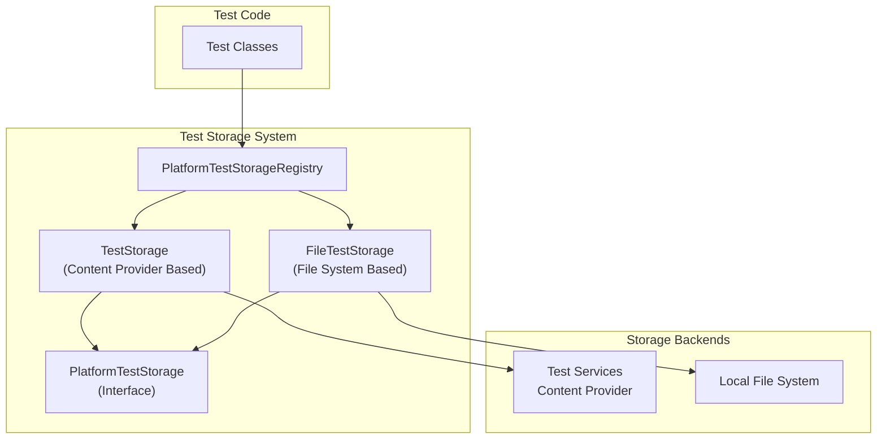
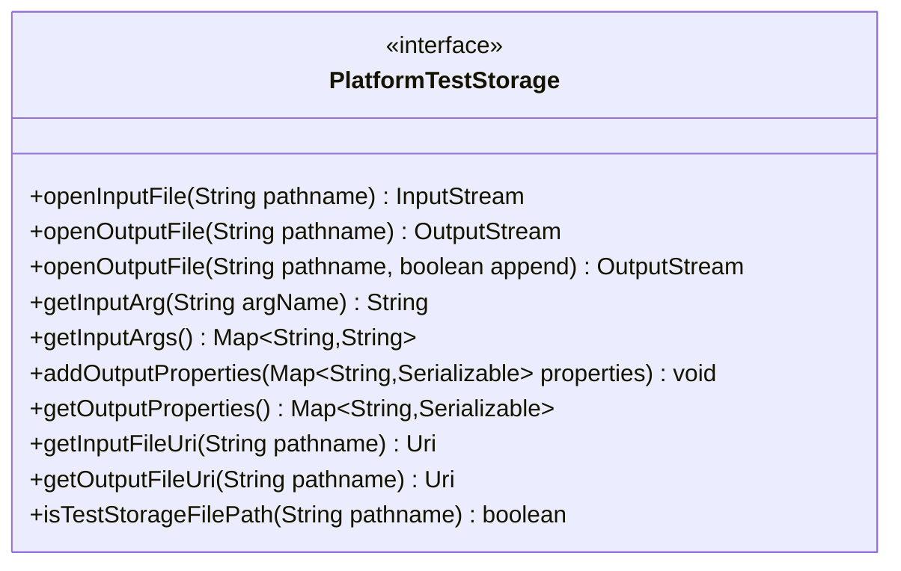
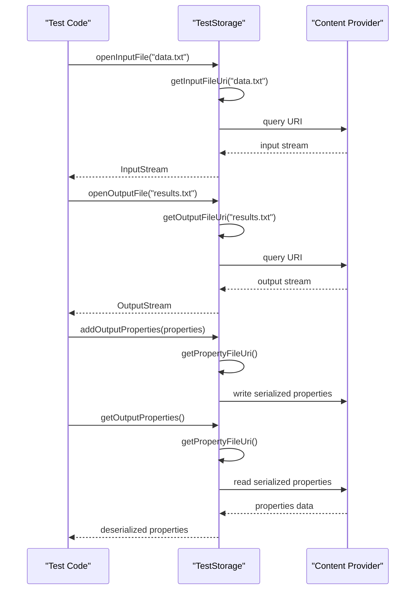
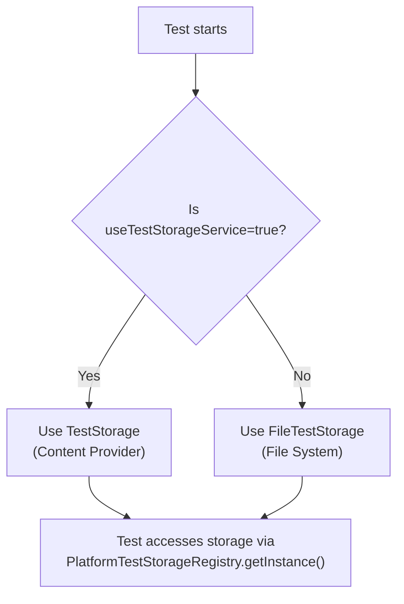
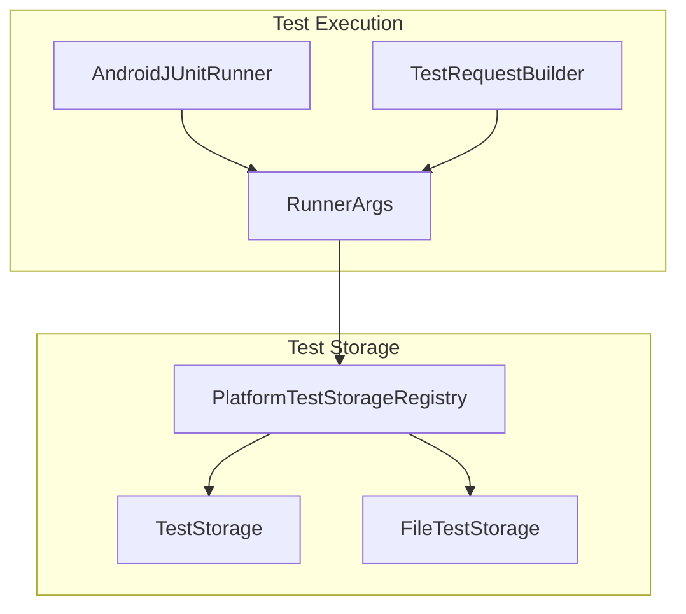

<!-- source: DeepWiki mcp.deepwiki.com · repo android/android-test · page 3.2 Test Storage · fetched 2026-10-23 -->

# Test Storage

<details>
<summary>Relevant source files</summary>

The following files were used as context for generating this wiki page:

- [core/javatests/androidx/test/core/graphics/BitmapStorageTest.kt](core/javatests/androidx/test/core/graphics/BitmapStorageTest.kt)
- [runner/android_junit_runner/java/androidx/test/filters/SdkSuppress.java](runner/android_junit_runner/java/androidx/test/filters/SdkSuppress.java)
- [runner/android_junit_runner/java/androidx/test/internal/runner/RunnerArgs.java](runner/android_junit_runner/java/androidx/test/internal/runner/RunnerArgs.java)
- [runner/android_junit_runner/java/androidx/test/internal/runner/TestRequestBuilder.java](runner/android_junit_runner/java/androidx/test/internal/runner/TestRequestBuilder.java)
- [runner/android_junit_runner/javatests/androidx/test/internal/runner/RunnerArgsTest.java](runner/android_junit_runner/javatests/androidx/test/internal/runner/RunnerArgsTest.java)
- [runner/android_junit_runner/javatests/androidx/test/internal/runner/SdkSuppressTest.java](runner/android_junit_runner/javatests/androidx/test/internal/runner/SdkSuppressTest.java)
- [runner/android_junit_runner/javatests/androidx/test/internal/runner/TestRequestBuilderTest.java](runner/android_junit_runner/javatests/androidx/test/internal/runner/TestRequestBuilderTest.java)
- [runner/monitor/java/androidx/test/platform/io/FileTestStorage.java](runner/monitor/java/androidx/test/platform/io/FileTestStorage.java)
- [runner/monitor/java/androidx/test/platform/io/PlatformTestStorage.java](runner/monitor/java/androidx/test/platform/io/PlatformTestStorage.java)
- [runner/monitor/java/androidx/test/platform/io/PlatformTestStorageRegistry.java](runner/monitor/java/androidx/test/platform/io/PlatformTestStorageRegistry.java)
- [services/storage/java/androidx/test/services/storage/TestStorage.java](services/storage/java/androidx/test/services/storage/TestStorage.java)

</details>


The Test Storage system provides a standardized mechanism for Android tests to read input files, write output files, retrieve test arguments, and store properties. It enables tests to interact with file resources in a consistent way across different testing environments, whether running on a device through instrumentation or in Robolectric.

## Overview

The Test Storage system is built around the `PlatformTestStorage` interface with implementations that handle file I/O operations through different backends. Tests access these implementations via the `PlatformTestStorageRegistry` which automatically selects the appropriate implementation based on the testing environment.



Sources:
- [runner/monitor/java/androidx/test/platform/io/PlatformTestStorage.java]()
- [services/storage/java/androidx/test/services/storage/TestStorage.java]()
- [runner/monitor/java/androidx/test/platform/io/FileTestStorage.java]()
- [runner/monitor/java/androidx/test/platform/io/PlatformTestStorageRegistry.java]()

## Architecture Components

### PlatformTestStorage Interface

The `PlatformTestStorage` interface defines the core operations for test data access:

- `openInputFile` - Provides an InputStream to a test file dependency
- `openOutputFile` - Provides an OutputStream to write test output
- `getInputArg` - Retrieves a test argument by name
- `getInputArgs` - Returns all test arguments
- `addOutputProperties` - Stores serializable test properties
- `getOutputProperties` - Retrieves stored test properties
- `getInputFileUri` - Gets a URI for a test input file
- `getOutputFileUri` - Gets a URI for a test output file



Sources:
- [runner/monitor/java/androidx/test/platform/io/PlatformTestStorage.java:42-193]()

### TestStorage Implementation

The `TestStorage` class implements `PlatformTestStorage` using a content provider housed in the androidx.test.services APK. This implementation provides full support for all interface operations including property storage.

Key features:
- Uses a content provider for file I/O (requires androidx.test.services APK)
- Stores and retrieves serializable properties 
- Supports file URI operations



Sources:
- [services/storage/java/androidx/test/services/storage/TestStorage.java:60-416]()

### FileTestStorage Implementation

The `FileTestStorage` class implements `PlatformTestStorage` using the local file system. It provides basic file I/O capabilities but has limited support for property storage.

Key features:
- Uses direct file system access
- Works in environments without the test services APK (like Robolectric)
- Limited property storage support

Sources:
- [runner/monitor/java/androidx/test/platform/io/FileTestStorage.java:48-168]()

### PlatformTestStorageRegistry

The `PlatformTestStorageRegistry` provides access to the appropriate `PlatformTestStorage` implementation. It uses a service loader mechanism to find implementations but defaults to `FileTestStorage` if no others are available.

```java
// How to access the Test Storage system in your tests
PlatformTestStorage storage = PlatformTestStorageRegistry.getInstance();
```

Sources:
- [runner/monitor/java/androidx/test/platform/io/PlatformTestStorageRegistry.java:28-74]()

## Test Storage Configuration

The Test Storage system can be configured through instrumentation arguments:

| Argument | Description |
|----------|-------------|
| `useTestStorageService` | When set to "true", enables the content provider-based `TestStorage` implementation |



Sources:
- [runner/android_junit_runner/java/androidx/test/internal/runner/RunnerArgs.java:95]()
- [runner/android_junit_runner/java/androidx/test/internal/runner/RunnerArgs.java:242-267]()

## Integration with Test Framework

The Test Storage system is integrated with other parts of the AndroidX Test framework:

1. `AndroidJUnitRunner` uses Test Storage to read test files and configurations
2. `TestRequestBuilder` builds test requests based on files loaded through Test Storage
3. `RunnerArgs` processes test arguments that may come from Test Storage



Sources:
- [runner/android_junit_runner/java/androidx/test/internal/runner/TestRequestBuilder.java]()
- [runner/android_junit_runner/java/androidx/test/internal/runner/RunnerArgs.java:249-256]()

## Using Test Storage

### Reading Input Files

```java
// Get the storage instance
PlatformTestStorage storage = PlatformTestStorageRegistry.getInstance();

// Read from an input file
try (InputStream in = storage.openInputFile("test_data.json")) {
    // Process the input stream
    // Note: You may want to buffer this stream for better performance
}
```

### Writing Output Files

```java
// Get the storage instance
PlatformTestStorage storage = PlatformTestStorageRegistry.getInstance();

// Write to an output file
try (OutputStream out = storage.openOutputFile("test_results.txt")) {
    // Write to the output stream
    // Note: You may want to buffer this stream for better performance
}

// Append to an existing output file
try (OutputStream out = storage.openOutputFile("test_log.txt", true)) {
    // Append to the output stream
}
```

### Working with Test Arguments

```java
// Get the storage instance
PlatformTestStorage storage = PlatformTestStorageRegistry.getInstance();

// Get a specific test argument
String apiKey = storage.getInputArg("api_key");

// Get all test arguments
Map<String, String> allArgs = storage.getInputArgs();
```

### Managing Test Properties

When using the `TestStorage` implementation, you can store and retrieve serializable properties:

```java
// Get the storage instance
PlatformTestStorage storage = PlatformTestStorageRegistry.getInstance();

// Store properties
Map<String, Serializable> properties = new HashMap<>();
properties.put("testDuration", 1234L);
properties.put("testResult", "PASSED");
storage.addOutputProperties(properties);

// Retrieve properties
Map<String, Serializable> retrievedProps = storage.getOutputProperties();
```

### URI Operations

For advanced use cases, you can work with file URIs directly:

```java
// Get the storage instance
PlatformTestStorage storage = PlatformTestStorageRegistry.getInstance();

// Get URIs for files
Uri inputUri = storage.getInputFileUri("test_data.json");
Uri outputUri = storage.getOutputFileUri("test_results.txt");
```

Sources:
- [services/storage/java/androidx/test/services/storage/TestStorage.java:158-162]()
- [services/storage/java/androidx/test/services/storage/TestStorage.java:234-256]()
- [services/storage/java/androidx/test/services/storage/TestStorage.java:179-204]()
- [services/storage/java/androidx/test/services/storage/TestStorage.java:264-321]()

## Best Practices

1. **Use the Registry**: Always access Test Storage through `PlatformTestStorageRegistry.getInstance()` to get the appropriate implementation for your environment.

2. **Resource Management**: Always close streams after use, preferably with try-with-resources.

3. **Buffering**: The streams provided by Test Storage may not be buffered. For better performance, wrap them in buffered streams:
   ```java
   try (BufferedReader reader = new BufferedReader(
           new InputStreamReader(storage.openInputFile("data.txt")))) {
       // Read buffered content
   }
   ```

4. **File Paths**: Use relative paths for test files for better portability.

5. **Exception Handling**: Handle `FileNotFoundException` and `IOException` appropriately.

6. **Content Provider Availability**: Be aware that the content provider-based implementation requires the androidx.test.services APK to be installed.

7. **Environment Awareness**: The `FileTestStorage` implementation has limited functionality compared to `TestStorage`, particularly for property storage.

Sources:
- [services/storage/java/androidx/test/services/storage/TestStorage.java:278-290]()
- [runner/monitor/java/androidx/test/platform/io/PlatformTestStorageRegistry.java:71-73]()

## Compatibility with Testing Frameworks

The Test Storage system is compatible with various testing frameworks in the Android ecosystem:

- **JUnit4 with AndroidJUnitRunner**: Fully supported, can use all Test Storage features
- **Robolectric**: Supported with `FileTestStorage`, limited property storage
- **Espresso**: Can use Test Storage for accessing test data and writing outputs
- **Bazel/Blaze**: Integrates with the build system for test data dependencies
- **Gradle**: Support for writing output files in Android Gradle Plugin 8.0+

Sources:
- [runner/android_junit_runner/javatests/androidx/test/internal/runner/RunnerArgsTest.java:300-341]()
- [core/javatests/androidx/test/core/graphics/BitmapStorageTest.kt:27-30]()

---

