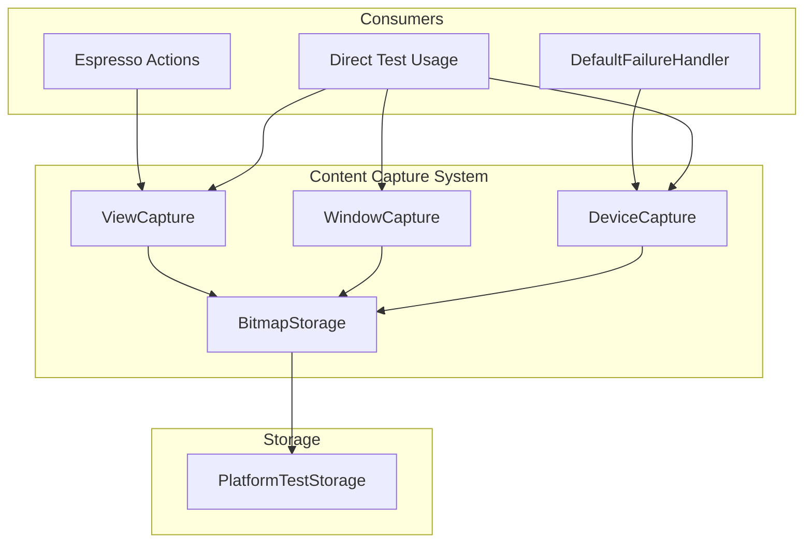
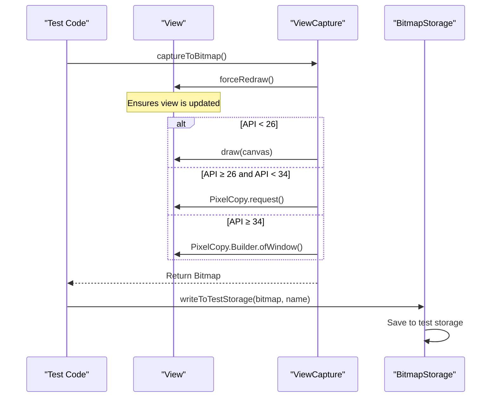
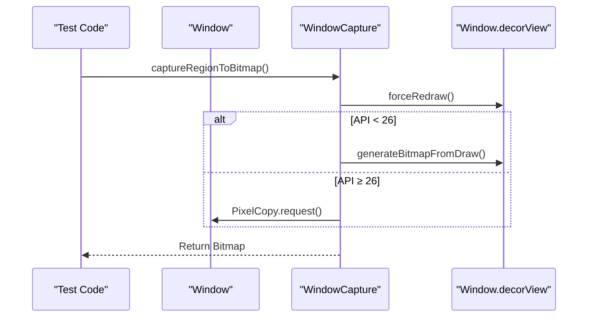
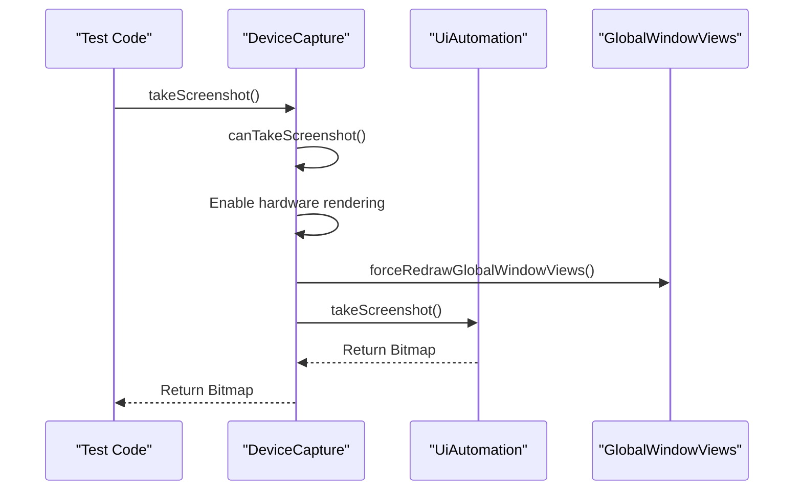
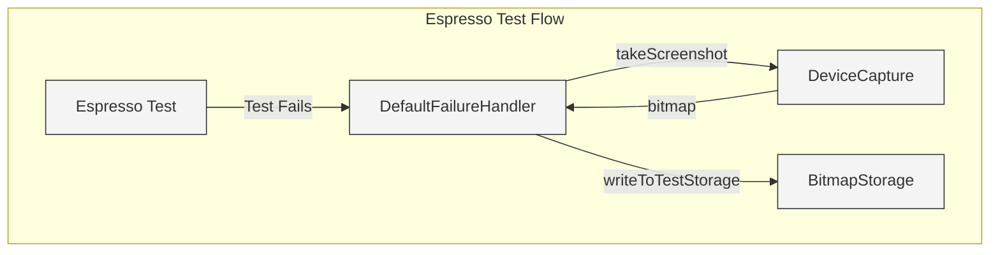

<!-- source: DeepWiki mcp.deepwiki.com · repo android/android-test · page 3.3 Content Capture · fetched 2026-10-23 -->

# Content Capture

<details>
<summary>Relevant source files</summary>

The following files were used as context for generating this wiki page:

- [core/java/androidx/test/core/app/DeviceCapture.kt](core/java/androidx/test/core/app/DeviceCapture.kt)
- [core/java/androidx/test/core/graphics/BitmapStorageExt.kt](core/java/androidx/test/core/graphics/BitmapStorageExt.kt)
- [core/java/androidx/test/core/view/ViewCapture.kt](core/java/androidx/test/core/view/ViewCapture.kt)
- [core/java/androidx/test/core/view/WindowCapture.kt](core/java/androidx/test/core/view/WindowCapture.kt)
- [espresso/core/java/androidx/test/espresso/NoMatchingViewException.java](espresso/core/java/androidx/test/espresso/NoMatchingViewException.java)
- [espresso/core/java/androidx/test/espresso/RootViewException.java](espresso/core/java/androidx/test/espresso/RootViewException.java)
- [espresso/core/java/androidx/test/espresso/action/CaptureToBitmapAction.kt](espresso/core/java/androidx/test/espresso/action/CaptureToBitmapAction.kt)
- [espresso/core/java/androidx/test/espresso/base/BaseLayerModule.java](espresso/core/java/androidx/test/espresso/base/BaseLayerModule.java)
- [espresso/core/java/androidx/test/espresso/base/DefaultFailureHandler.java](espresso/core/java/androidx/test/espresso/base/DefaultFailureHandler.java)
- [espresso/core/javatests/androidx/test/espresso/base/DefaultFailureHandlerTest.java](espresso/core/javatests/androidx/test/espresso/base/DefaultFailureHandlerTest.java)
- [runner/monitor/java/androidx/test/internal/platform/os/ControlledLooper.java](runner/monitor/java/androidx/test/internal/platform/os/ControlledLooper.java)

</details>


This document explains the Content Capture system in Android Test, which provides mechanisms for capturing screenshots, views, and view hierarchies for testing and debugging purposes. For information about test storage which is used to store these captures, see [Test Storage](#3.2).

## Overview

The Content Capture system allows test authors to:

1. Capture screenshots of individual views
2. Capture screenshots of windows
3. Capture full device screenshots
4. Store captures for test reporting and debugging

These capabilities are critical for visual verification, failure diagnosis, and creating better test reports.



Sources: [core/java/androidx/test/core/view/ViewCapture.kt](), [core/java/androidx/test/core/view/WindowCapture.kt](), [core/java/androidx/test/core/app/DeviceCapture.kt](), [core/java/androidx/test/core/graphics/BitmapStorageExt.kt]()

## Capture Components

The Content Capture system consists of three main components that provide different levels of capturing capabilities:

### ViewCapture

Captures an image of a specific View into a Bitmap. This is the most focused capture method, targeting a single view component.

### WindowCapture

Captures an image of an entire window, which may contain multiple views.

### DeviceCapture

Captures a screenshot of the entire device screen, including all visible UI elements regardless of application boundaries.

```mermaid
classDiagram
    class "ViewCapture" {
        +captureToBitmap(rect: Rect?): Bitmap
        +captureToBitmapAsync(rect: Rect?): ListenableFuture~Bitmap~
        -forceRedraw()
        -generateBitmap(rect: Rect?): Bitmap
    }
    
    class "WindowCapture" {
        +captureRegionToBitmap(boundsInWindow: Rect?): Bitmap
        +captureRegionToBitmapAsync(boundsInWindow: Rect?): ListenableFuture~Bitmap~
        -generateBitmap(boundsInWindow: Rect?): Bitmap
    }
    
    class "DeviceCapture" {
        +canTakeScreenshot(): Boolean
        +takeScreenshot(): Bitmap
        +takeScreenshotNoSync(): Bitmap
        -forceRedrawGlobalWindowViews()
    }
    
    class "BitmapStorage" {
        +writeToTestStorage(name: String)
        +writeToTestStorage(testStorage: PlatformTestStorage, name: String)
    }
    
    "ViewCapture" --> "BitmapStorage": stores bitmap
    "WindowCapture" --> "BitmapStorage": stores bitmap
    "DeviceCapture" --> "BitmapStorage": stores bitmap
```

Sources: [core/java/androidx/test/core/view/ViewCapture.kt](), [core/java/androidx/test/core/view/WindowCapture.kt](), [core/java/androidx/test/core/app/DeviceCapture.kt](), [core/java/androidx/test/core/graphics/BitmapStorageExt.kt]()

## View Capture

ViewCapture provides functionality to capture an image of a View into a Bitmap. It handles different Android API levels with appropriate capture strategies.

### Key Features

- Supports capturing specific regions of a view using the optional `rect` parameter
- Handles hardware acceleration settings automatically
- Supports both synchronous and asynchronous capture for Java usage
- Forces redraw before capture to ensure the view is in its latest state

### Implementation Details

The implementation uses different strategies based on the Android API level:
- For API < 26: Uses `View.draw()` to a Canvas
- For API ≥ 26 and < 34: Uses `PixelCopy`
- For API ≥ 34: Uses the modern `PixelCopy.Builder` API

Special handling is provided for SurfaceViews, which require a different capture approach.



Sources: [core/java/androidx/test/core/view/ViewCapture.kt:83-101](), [core/java/androidx/test/core/view/ViewCapture.kt:161-172]()

### Usage Example

```kotlin
// Kotlin usage
val bitmap = view.captureToBitmap()
bitmap.writeToTestStorage("view-capture")

// Java usage
ListenableFuture<Bitmap> bitmapFuture = ViewCapture.captureToBitmapAsync(view);
Bitmap bitmap = bitmapFuture.get();
BitmapStorage.writeToTestStorage(bitmap, "view-capture");
```

## Window Capture

WindowCapture provides functionality to capture an image of an entire window into a Bitmap. Similar to ViewCapture, it supports different Android API levels.

### Key Features

- Captures an entire window or a specific region of a window
- Handles hardware acceleration automatically
- Provides both synchronous and asynchronous APIs

### Implementation Details

The WindowCapture implementation follows similar strategies to ViewCapture:
- For API < 26: Uses `View.draw()` on the window's decorView
- For API ≥ 26: Uses `PixelCopy.request()` for more accurate window capturing



Sources: [core/java/androidx/test/core/view/WindowCapture.kt:52-65](), [core/java/androidx/test/core/view/WindowCapture.kt:74-89]()

## Device Capture

DeviceCapture provides functionality to capture a screenshot of the entire device screen. This is particularly useful for debugging test failures.

### Key Features

- Takes a screenshot of the entire device using UiAutomation
- Ensures hardware acceleration is enabled during capture
- Forces all application windows to redraw before capture for a stable state
- Provides a method to check if screenshot capabilities are available

### Implementation Details

DeviceCapture uses Android's UiAutomation APIs to capture the entire screen. It must be called from a non-UI thread.



Sources: [core/java/androidx/test/core/app/DeviceCapture.kt:76-120](), [core/java/androidx/test/core/app/DeviceCapture.kt:122-128]()

### Usage

```kotlin
// Check if screenshot capability is available
if (DeviceCapture.canTakeScreenshot()) {
    val bitmap = DeviceCapture.takeScreenshot()
    bitmap.writeToTestStorage("device-screenshot")
}
```

## Integration with Espresso

The Content Capture system is deeply integrated with Espresso for automatic and manual capture capabilities.

### Automatic Capture on Test Failures

The `DefaultFailureHandler` in Espresso automatically captures a screenshot when a test fails. This provides valuable visual context for diagnosing test failures.



Sources: [espresso/core/java/androidx/test/espresso/base/DefaultFailureHandler.java:105-137]()

### Manual Capture in Tests

Espresso provides the `CaptureToBitmapAction` that allows test authors to explicitly capture bitmaps of views during test execution.

```kotlin
// Using the Espresso ViewAction
onView(withId(R.id.my_view))
    .perform(ViewActions.captureToBitmap { bitmap ->
        // Do something with the bitmap
        bitmap.writeToTestStorage("my-view-capture")
    })
```

Sources: [espresso/core/java/androidx/test/espresso/action/CaptureToBitmapAction.kt]()

## Storage of Captured Content

All captures are stored using the `BitmapStorage` utility, which leverages the `PlatformTestStorage` system to save images in a format accessible during and after test execution.

### Key Methods

- `writeToTestStorage(name: String)`: Writes the bitmap to test storage with the given base name (`.png` is appended automatically)

The captured screenshots can be accessed:
1. During test execution via the `PlatformTestStorage` APIs
2. After test execution through test artifacts (if using a test runner that collects artifacts)

Sources: [core/java/androidx/test/core/graphics/BitmapStorageExt.kt:32-36]()

## Cross-API Compatibility

One key aspect of the Content Capture system is how it handles different Android API levels to provide consistent functionality:

| API Level Range | View Capture Strategy | Window Capture Strategy | Device Capture |
|-----------------|------------------------|-------------------------|----------------|
| < 26 (Pre-O)    | View.draw() to canvas  | View.draw() to canvas   | UiAutomation   |
| 26-33 (O-T)     | PixelCopy.request      | PixelCopy.request       | UiAutomation   |
| ≥ 34 (U+)       | PixelCopy.Builder.ofWindow | PixelCopy.request   | UiAutomation   |

The system automatically selects the appropriate strategy based on the device's API level, making the APIs simple to use regardless of the test environment.

Sources: [core/java/androidx/test/core/view/ViewCapture.kt:161-172](), [core/java/androidx/test/core/view/WindowCapture.kt:74-89]()

## Troubleshooting and Limitations

### Common Issues

1. **Hardware acceleration issues**: The system attempts to enable hardware acceleration during capture but may encounter issues on some devices.
   
2. **Main thread usage**: Some capture methods must be called from specific threads:
   - `ViewCapture.captureToBitmap`: Must be called from the view's handler thread
   - `WindowCapture.captureRegionToBitmap`: Must be called from the UI thread
   - `DeviceCapture.takeScreenshot`: Must NOT be called from the main thread

3. **SurfaceView limitations**: Capturing SurfaceViews requires special handling due to their rendering model.

### Best Practices

1. Use the most specific capture method for your needs:
   - Use ViewCapture for individual view verification
   - Use WindowCapture for entire screens
   - Use DeviceCapture only when you need the entire device screen

2. Always wrap capture operations in try/catch blocks to handle potential failures gracefully

3. Consider using the asynchronous variants when capturing from the main thread to avoid blocking UI

Sources: [core/java/androidx/test/core/view/ViewCapture.kt:83-87](), [core/java/androidx/test/core/app/DeviceCapture.kt:51-53]()

---

