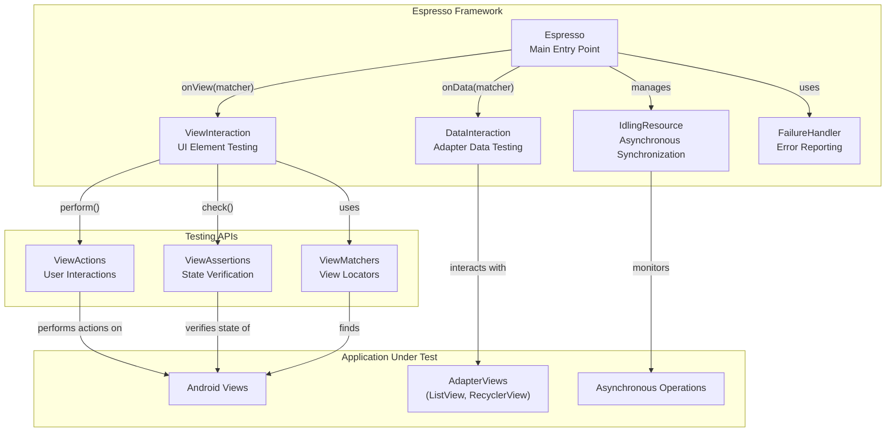

<!-- source: DeepWiki mcp.deepwiki.com · repo android/android-test · page 4 Espresso · fetched 2026-10-23 -->

# Espresso

<details>
<summary>Relevant source files</summary>

The following files were used as context for generating this wiki page:

- [MODULE.bazel](MODULE.bazel)
- [build_extensions/axt_deps_versions.bzl](build_extensions/axt_deps_versions.bzl)
- [core/CHANGELOG.md](core/CHANGELOG.md)
- [espresso/CHANGELOG.md](espresso/CHANGELOG.md)
- [espresso/core/java/androidx/test/espresso/api/current_public.txt](espresso/core/java/androidx/test/espresso/api/current_public.txt)
- [espresso/device/CHANGELOG.md](espresso/device/CHANGELOG.md)
- [espresso/device/java/androidx/test/espresso/device/api/current_public.txt](espresso/device/java/androidx/test/espresso/device/api/current_public.txt)
- [espresso/intents/java/androidx/test/espresso/intent/api/current_public.txt](espresso/intents/java/androidx/test/espresso/intent/api/current_public.txt)
- [espresso/remote/java/androidx/test/espresso/remote/api/current_public.txt](espresso/remote/java/androidx/test/espresso/remote/api/current_public.txt)
- [espresso/web/java/androidx/test/espresso/web/api/current_public.txt](espresso/web/java/androidx/test/espresso/web/api/current_public.txt)
- [espresso/web/java/androidx/test/espresso/web/util/concurrent/FutureCallback.java](espresso/web/java/androidx/test/espresso/web/util/concurrent/FutureCallback.java)
- [ext/junit/CHANGELOG.md](ext/junit/CHANGELOG.md)
- [ext/junit/java/androidx/test/ext/junit/api/current_public.txt](ext/junit/java/androidx/test/ext/junit/api/current_public.txt)
- [ext/truth/CHANGELOG.md](ext/truth/CHANGELOG.md)
- [ext/truth/java/androidx/test/ext/truth/api/current_public.txt](ext/truth/java/androidx/test/ext/truth/api/current_public.txt)
- [runner/android_junit_runner/CHANGELOG.md](runner/android_junit_runner/CHANGELOG.md)
- [runner/android_junit_runner/java/androidx/test/api/current_public.txt](runner/android_junit_runner/java/androidx/test/api/current_public.txt)
- [runner/android_junit_runner/java/androidx/test/filters/Suppress.java](runner/android_junit_runner/java/androidx/test/filters/Suppress.java)
- [runner/android_test_orchestrator/CHANGELOG.md](runner/android_test_orchestrator/CHANGELOG.md)
- [runner/monitor/CHANGELOG.md](runner/monitor/CHANGELOG.md)
- [runner/monitor/java/androidx/test/api/current_internal.txt](runner/monitor/java/androidx/test/api/current_internal.txt)
- [runner/monitor/java/androidx/test/api/current_public.txt](runner/monitor/java/androidx/test/api/current_public.txt)
- [runner/monitor/java/androidx/test/platform/device/DeviceController.java](runner/monitor/java/androidx/test/platform/device/DeviceController.java)
- [runner/rules/CHANGELOG.md](runner/rules/CHANGELOG.md)
- [services/CHANGELOG.md](services/CHANGELOG.md)

</details>


Espresso is a UI testing framework for Android applications, part of the AndroidX Test library. It provides a fluent API to write concise, reliable UI tests that simulate user interactions with the app and verify UI state. Espresso tests run on real or emulated devices and automatically synchronize with the application under test, waiting for the UI thread to be idle before performing actions.

For information about UI testing with WebViews, see [Espresso Web](#4.1). For information about testing device configurations like screen orientation and foldable states, see [Espresso Device](#4.2).

## Architecture

### Espresso Component Architecture



Sources:
- espresso/core/java/androidx/test/espresso/api/current_public.txt:44-59
- espresso/core/java/androidx/test/espresso/api/current_public.txt:183-189
- espresso/core/java/androidx/test/espresso/api/current_public.txt:27-35

### Espresso Classes and Relationships

```mermaid
classDiagram
    class Espresso {
        +onView(Matcher<View>) ViewInteraction
        +onData(Matcher<Object>) DataInteraction
        +pressBack()
        +closeSoftKeyboard()
        +openActionBarOverflowOrOptionsMenu()
        +registerIdlingResources(IdlingResource)
    }
    
    class ViewInteraction {
        +perform(ViewAction...) ViewInteraction
        +check(ViewAssertion) ViewInteraction
        +withFailureHandler(FailureHandler) ViewInteraction
        +inRoot(Matcher<Root>) ViewInteraction
    }
    
    class DataInteraction {
        +inAdapterView(Matcher<View>) DataInteraction
        +atPosition(Integer) DataInteraction
        +onChildView(Matcher<View>) DataInteraction
        +perform(ViewAction...) ViewInteraction
        +check(ViewAssertion) ViewInteraction
    }
    
    class ViewAction {
        <<interface>>
        +getConstraints() Matcher<View>
        +getDescription() String
        +perform(UiController, View)
    }
    
    class ViewAssertion {
        <<interface>>
        +check(View, NoMatchingViewException)
    }
    
    class IdlingResource {
        <<interface>>
        +getName() String
        +isIdleNow() boolean
        +registerIdleTransitionCallback(ResourceCallback)
    }
    
    class FailureHandler {
        <<interface>>
        +handle(Throwable, Matcher<View>)
    }
    
    Espresso --> ViewInteraction : creates
    Espresso --> DataInteraction : creates
    Espresso --> IdlingResource : manages
    
    ViewInteraction --> ViewAction : uses
    ViewInteraction --> ViewAssertion : uses
    ViewInteraction --> FailureHandler : can use custom
    
    DataInteraction --> ViewAction : uses
    DataInteraction --> ViewAssertion : uses
```

Sources:
- espresso/core/java/androidx/test/espresso/api/current_public.txt:44-59
- espresso/core/java/androidx/test/espresso/api/current_public.txt:183-189
- espresso/core/java/androidx/test/espresso/api/current_public.txt:27-35
- espresso/core/java/androidx/test/espresso/api/current_public.txt:169-173
- espresso/core/java/androidx/test/espresso/api/current_public.txt:175-177
- espresso/core/java/androidx/test/espresso/api/current_public.txt:65-67

## Core Components

### Espresso Class

The `Espresso` class is the main entry point for UI testing. It provides static methods to create view interactions and handle common testing scenarios.

| Method | Description |
|--------|-------------|
| `onView(Matcher<View>)` | Returns a `ViewInteraction` for a view matching the given matcher |
| `onData(Matcher<? extends Object>)` | Returns a `DataInteraction` for adapter data matching the given matcher |
| `pressBack()` | Simulates pressing the back button |
| `pressBackUnconditionally()` | Presses back button even if no activity is available to handle it |
| `closeSoftKeyboard()` | Closes the soft keyboard |
| `openActionBarOverflowOrOptionsMenu()` | Opens the action bar overflow menu |
| `registerIdlingResources(IdlingResource...)` | Registers IdlingResources for test synchronization |
| `unregisterIdlingResources(IdlingResource...)` | Unregisters previously registered IdlingResources |

Sources:
- espresso/core/java/androidx/test/espresso/api/current_public.txt:44-59

### ViewInteraction

`ViewInteraction` represents an interaction with a view in the UI hierarchy. It's created by `Espresso.onView()` and provides methods to perform actions and check assertions.

```java
// Example of ViewInteraction usage
ViewInteraction viewInteraction = onView(withId(R.id.button));
viewInteraction.perform(click());
viewInteraction.check(matches(isDisplayed()));

// Method chaining is also supported
onView(withId(R.id.button))
    .perform(click())
    .check(matches(isDisplayed()));
```

Sources:
- espresso/core/java/androidx/test/espresso/api/current_public.txt:183-189

### DataInteraction

`DataInteraction` represents an interaction with data in an adapter view (like `ListView` or `RecyclerView`). It's created by `Espresso.onData()` and provides methods to target specific adapter items.

```java
// Example of DataInteraction usage
onData(allOf(is(instanceOf(Map.class)), 
             hasEntry(equalTo("key"), equalTo("value"))))
    .inAdapterView(withId(R.id.list_view))
    .atPosition(3)
    .perform(click());
```

Sources:
- espresso/core/java/androidx/test/espresso/api/current_public.txt:27-35

### ViewActions

`ViewActions` is a utility class providing factory methods for common `ViewAction` implementations:

| Action | Description |
|--------|-------------|
| `click()` | Clicks on the view |
| `doubleClick()` | Performs a double click |
| `longClick()` | Performs a long click |
| `typeText(String)` | Types text into an EditText |
| `clearText()` | Clears text from an EditText |
| `scrollTo()` | Scrolls to the view if it's not visible |
| `swipeLeft()`, `swipeRight()`, etc. | Performs swipe gestures |
| `pressImeActionButton()` | Presses the keyboard's action button |
| `closeSoftKeyboard()` | Closes the soft keyboard |
| `pressMenuKey()` | Presses the menu key |
| `pressBack()` | Presses the back key |

Sources:
- espresso/core/java/androidx/test/espresso/api/current_public.txt:429-464

### ViewAssertions

`ViewAssertions` is a utility class providing factory methods for common `ViewAssertion` implementations:

| Assertion | Description |
|-----------|-------------|
| `matches(Matcher<View>)` | Asserts that the view matches the given matcher |
| `doesNotExist()` | Asserts that the view does not exist |
| `selectedDescendantsMatch(...)` | Asserts that the view's descendants match the given matcher |

Sources:
- espresso/core/java/androidx/test/espresso/api/current_public.txt:500-504

### PositionAssertions

The `PositionAssertions` class provides assertions for checking the relative position of views:

| Position Assertion | Description |
|-------------------|-------------|
| `isCompletelyLeftOf(Matcher<View>)` | Asserts view is completely to the left of another view |
| `isCompletelyRightOf(Matcher<View>)` | Asserts view is completely to the right of another view |
| `isCompletelyAbove(Matcher<View>)` | Asserts view is completely above another view |
| `isCompletelyBelow(Matcher<View>)` | Asserts view is completely below another view |
| `isLeftAlignedWith(Matcher<View>)` | Asserts view is left-aligned with another view |
| `isRightAlignedWith(Matcher<View>)` | Asserts view is right-aligned with another view |
| `isTopAlignedWith(Matcher<View>)` | Asserts view is top-aligned with another view |
| `isBottomAlignedWith(Matcher<View>)` | Asserts view is bottom-aligned with another view |

Sources:
- espresso/core/java/androidx/test/espresso/api/current_public.txt:481-498

### IdlingResource

`IdlingResource` is an interface for synchronizing Espresso with asynchronous operations in the application under test. Espresso waits for all registered IdlingResources to be idle before performing actions or assertions.

```java
public class NetworkIdlingResource implements IdlingResource {
    private volatile ResourceCallback callback;
    private AtomicBoolean isIdle = new AtomicBoolean(true);
    
    @Override
    public String getName() {
        return "Network Idling Resource";
    }
    
    @Override
    public boolean isIdleNow() {
        return isIdle.get();
    }
    
    @Override
    public void registerIdleTransitionCallback(ResourceCallback callback) {
        this.callback = callback;
    }
    
    // Call when network request starts
    public void setNetworkBusy() {
        isIdle.set(false);
    }
    
    // Call when network request finishes
    public void setNetworkIdle() {
        isIdle.set(true);
        if (callback != null) {
            callback.onTransitionToIdle();
        }
    }
}
```

Sources:
- espresso/core/java/androidx/test/espresso/api/current_public.txt:72-87

## Espresso Modules

Espresso is organized into several modules, each providing specific functionality:

| Module | Maven Artifact | Purpose |
|--------|----------------|---------|
| Core | espresso-core | Basic UI testing functionality |
| Contrib | espresso-contrib | Support for RecyclerView and other complex views |
| Web | espresso-web | WebView testing |
| Intents | espresso-intents | Intent testing and stubbing |
| Device | espresso-device | Device configuration testing (orientation, foldable states) |
| Accessibility | espresso-accessibility | Accessibility testing |
| Idling Resource | espresso-idling-resource | Base IdlingResource interface for async operations |
| Idling Concurrent | idling-concurrent | IdlingResources for concurrent operations |
| Idling Net | idling-net | IdlingResources for network operations |

Sources:
- espresso/CHANGELOG.md:7-15

### Espresso Web

Espresso Web provides tools for testing WebViews, including JavaScript execution and DOM inspection.

```java
// Example of Espresso Web usage
onWebView()
    // Find element by ID
    .withElement(findElement(Locator.ID, "username"))
    // Type into the element
    .perform(webKeys("user@example.com"))
    // Find and click the login button
    .withElement(findElement(Locator.ID, "login"))
    .perform(webClick())
    // Check for success message in the DOM
    .withElement(findElement(Locator.ID, "message"))
    .check(webMatches(getText(), containsString("Welcome")));
```

Sources:
- espresso/web/java/androidx/test/espresso/web/api/current_public.txt:175-195

### Espresso Intents

Espresso Intents allows testing of intent-based interactions by stubbing intents and verifying that expected intents were sent.

```java
// Initialize Intents before test
@Rule
public IntentsRule intentsRule = new IntentsRule();

@Test
public void testCameraIntent() {
    // Stub the camera intent
    intending(hasAction(MediaStore.ACTION_IMAGE_CAPTURE))
        .respondWith(new ActivityResult(Activity.RESULT_OK, null));
    
    // Perform the action that triggers the intent
    onView(withId(R.id.take_photo_button)).perform(click());
    
    // Verify the intent was sent
    intended(hasAction(MediaStore.ACTION_IMAGE_CAPTURE));
}
```

Sources:
- espresso/intents/java/androidx/test/espresso/intent/api/current_public.txt:19-27

### Espresso Device

Espresso Device enables testing of different device configurations, particularly useful for foldable devices and orientation changes.

```java
// Example of Espresso Device usage
// Change screen orientation
onDevice().perform(setScreenOrientation(ScreenOrientation.LANDSCAPE));

// For foldable devices
onDevice().perform(setFlatMode()); // Fully unfolded
onDevice().perform(setTabletopMode()); // Half-folded
onDevice().perform(setBookMode()); // Folded like a book
```

Sources:
- espresso/device/java/androidx/test/espresso/device/api/current_public.txt:2-26

## Common Testing Patterns

### Basic View Testing

The most common Espresso testing pattern follows three steps:
1. Find a view with `onView()`
2. Perform an action with `perform()`
3. Verify a result with `check()`

```java
@Test
public void testLoginFlow() {
    // Enter username
    onView(withId(R.id.username))
        .perform(typeText("user@example.com"), closeSoftKeyboard());
    
    // Enter password
    onView(withId(R.id.password))
        .perform(typeText("password123"), closeSoftKeyboard());
    
    // Click login button
    onView(withId(R.id.login_button))
        .perform(click());
    
    // Verify welcome message is displayed
    onView(withId(R.id.welcome_message))
        .check(matches(withText(containsString("Welcome"))));
}
```

Sources:
- espresso/core/java/androidx/test/espresso/api/current_public.txt:183-189

### Testing AdapterViews

For adapter-backed views like `ListView` or `RecyclerView`, use `onData()` to interact with specific items:

```java
@Test
public void testSelectItemInList() {
    // Click on an item in a ListView
    onData(anything())
        .inAdapterView(withId(R.id.list_view))
        .atPosition(2)
        .perform(click());
    
    // Verify the detail view shows the correct item
    onView(withId(R.id.detail_text))
        .check(matches(withText("Item 3")));
}
```

Sources:
- espresso/core/java/androidx/test/espresso/api/current_public.txt:27-35

### Handling Synchronization Issues

Espresso automatically synchronizes with the UI thread, but for custom asynchronous operations, use IdlingResources:

```java
// Create and register an IdlingResource
CountingIdlingResource idlingResource = new CountingIdlingResource("Network");
Espresso.registerIdlingResources(idlingResource);

// In your app code, increment the counter before async operation
idlingResource.increment();

// Execute async operation with callback
networkClient.fetchData(new Callback() {
    @Override
    public void onComplete(Result result) {
        // Decrement the counter when operation completes
        idlingResource.decrement();
    }
});

// Espresso will wait for the IdlingResource to be idle before continuing
onView(withId(R.id.result_view))
    .check(matches(withText("Data loaded")));

// Clean up
Espresso.unregisterIdlingResources(idlingResource);
```

Sources:
- espresso/core/java/androidx/test/espresso/api/current_public.txt:72-87

### Handling Custom Failures

Customize error handling by implementing a custom `FailureHandler`:

```java
public class ScreenshotFailureHandler implements FailureHandler {
    private final FailureHandler delegate;
    private final Context context;
    
    public ScreenshotFailureHandler(Context context) {
        this.delegate = new DefaultFailureHandler(context);
        this.context = context;
    }
    
    @Override
    public void handle(Throwable error, Matcher<View> viewMatcher) {
        // Take a screenshot before delegating the failure
        takeScreenshot("test_failure_" + System.currentTimeMillis());
        
        // Let the default handler do its thing
        delegate.handle(error, viewMatcher);
    }
    
    private void takeScreenshot(String filename) {
        // Screenshot saving logic...
    }
}

// Set the custom failure handler
Espresso.setFailureHandler(new ScreenshotFailureHandler(getContext()));
```

Sources:
- espresso/core/java/androidx/test/espresso/api/current_public.txt:65-67
- espresso/core/java/androidx/test/espresso/base/DefaultFailureHandler.java

## Advanced Topics

### Creating Custom ViewActions

For specialized interactions, implement the `ViewAction` interface:

```java
public static ViewAction swipeLeftToRight() {
    return new GeneralSwipeAction(
        Swipe.SLOW,          // Speed of swipe
        GeneralLocation.CENTER_LEFT,  // Starting point
        GeneralLocation.CENTER_RIGHT, // End point
        Press.FINGER              // Precision
    );
}

// Use the custom action
onView(withId(R.id.swipeable_view))
    .perform(swipeLeftToRight());
```

Sources:
- espresso/core/java/androidx/test/espresso/api/current_public.txt:169-173
- espresso/core/java/androidx/test/espresso/api/current_public.txt:299-304

### Creating Custom ViewMatchers

For specialized view matching, create custom Hamcrest matchers:

```java
public static Matcher<View> withCustomTag(final Object tag) {
    return new BoundedMatcher<View, View>(View.class) {
        @Override
        public void describeTo(Description description) {
            description.appendText("with tag: " + tag);
        }

        @Override
        protected boolean matchesSafely(View view) {
            return tag.equals(view.getTag());
        }
    };
}

// Use the custom matcher
onView(withCustomTag("important_view"))
    .perform(click());
```

Sources:
- espresso/core/java/androidx/test/espresso/api/current_public.txt:4-20

### Exception Handling

Espresso throws various exceptions to indicate test failures:

| Exception | Description |
|-----------|-------------|
| `NoMatchingViewException` | No view matches the specified matcher |
| `AmbiguousViewMatcherException` | Multiple views match the specified matcher |
| `PerformException` | Failed to perform an action on a view |
| `AppNotIdleException` | App has background operations preventing Espresso from proceeding |
| `IdlingResourceTimeoutException` | Timed out waiting for IdlingResource to become idle |

Sources:
- espresso/core/java/androidx/test/espresso/api/current_public.txt:22-140

## Integration with Testing Frameworks

Espresso works seamlessly with JUnit and can be used with both AndroidJUnitRunner and Kotlin test frameworks:

```java
@RunWith(AndroidJUnit4.class)
public class MyEspressoTest {
    @Rule
    public ActivityScenarioRule<MainActivity> activityRule = 
        new ActivityScenarioRule<>(MainActivity.class);
    
    @Test
    public void testFeature() {
        // Espresso test code...
    }
}
```

Sources:
- ext/junit/java/androidx/test/ext/junit/api/current_public.txt:4-21

---

