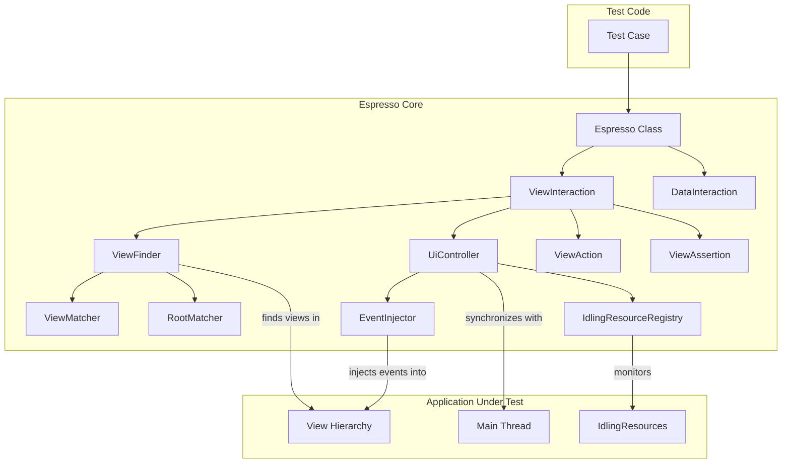
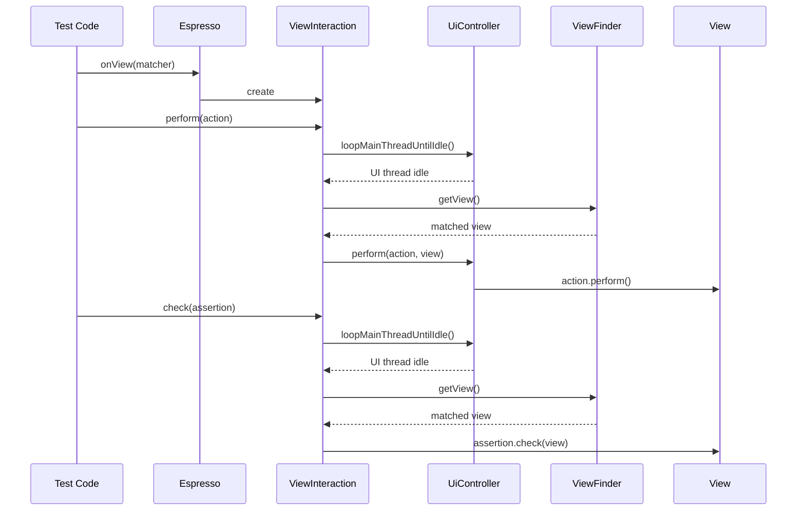
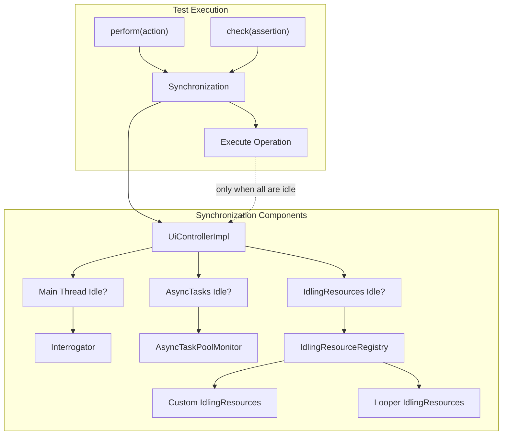
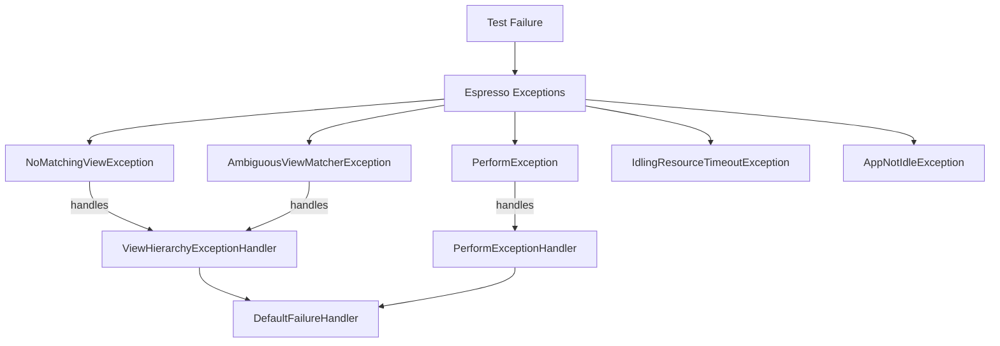

<!-- source: DeepWiki mcp.deepwiki.com · repo android/android-test · page 4.1 Espresso Core · fetched 2026-10-23 -->

# Espresso Core

<details>
<summary>Relevant source files</summary>

The following files were used as context for generating this wiki page:

- [espresso/core/java/androidx/test/espresso/api/current_public.txt](espresso/core/java/androidx/test/espresso/api/current_public.txt)
- [espresso/core/java/androidx/test/espresso/base/BUILD](espresso/core/java/androidx/test/espresso/base/BUILD)
- [espresso/core/java/androidx/test/espresso/base/IdlingResourceRegistry.java](espresso/core/java/androidx/test/espresso/base/IdlingResourceRegistry.java)
- [espresso/core/java/androidx/test/espresso/base/Interrogator.java](espresso/core/java/androidx/test/espresso/base/Interrogator.java)
- [espresso/core/java/androidx/test/espresso/base/LooperIdlingResourceInterrogationHandler.java](espresso/core/java/androidx/test/espresso/base/LooperIdlingResourceInterrogationHandler.java)
- [espresso/core/java/androidx/test/espresso/base/TestLooperManagerCompat.java](espresso/core/java/androidx/test/espresso/base/TestLooperManagerCompat.java)
- [espresso/core/java/androidx/test/espresso/base/UiControllerImpl.java](espresso/core/java/androidx/test/espresso/base/UiControllerImpl.java)
- [espresso/core/javatests/androidx/test/espresso/TestTracer.java](espresso/core/javatests/androidx/test/espresso/TestTracer.java)
- [espresso/core/javatests/androidx/test/espresso/base/BUILD](espresso/core/javatests/androidx/test/espresso/base/BUILD)
- [espresso/core/javatests/androidx/test/espresso/base/EspressoIdleTest.java](espresso/core/javatests/androidx/test/espresso/base/EspressoIdleTest.java)
- [espresso/core/javatests/androidx/test/espresso/base/IdlingResourceRegistryTest.java](espresso/core/javatests/androidx/test/espresso/base/IdlingResourceRegistryTest.java)
- [espresso/core/javatests/androidx/test/espresso/base/UiControllerImplTest.java](espresso/core/javatests/androidx/test/espresso/base/UiControllerImplTest.java)
- [espresso/core/javatests/androidx/test/espresso/util/TreeIterablesTest.java](espresso/core/javatests/androidx/test/espresso/util/TreeIterablesTest.java)
- [espresso/device/java/androidx/test/espresso/device/api/current_public.txt](espresso/device/java/androidx/test/espresso/device/api/current_public.txt)
- [espresso/intents/java/androidx/test/espresso/intent/api/current_public.txt](espresso/intents/java/androidx/test/espresso/intent/api/current_public.txt)
- [espresso/intents/javatests/androidx/test/espresso/intent/IntentsTest.java](espresso/intents/javatests/androidx/test/espresso/intent/IntentsTest.java)
- [espresso/intents/javatests/androidx/test/espresso/intent/matcher/UriMatchersTest.java](espresso/intents/javatests/androidx/test/espresso/intent/matcher/UriMatchersTest.java)
- [espresso/remote/java/androidx/test/espresso/remote/api/current_public.txt](espresso/remote/java/androidx/test/espresso/remote/api/current_public.txt)
- [espresso/web/java/androidx/test/espresso/web/api/current_public.txt](espresso/web/java/androidx/test/espresso/web/api/current_public.txt)
- [espresso/web/java/androidx/test/espresso/web/util/concurrent/FutureCallback.java](espresso/web/java/androidx/test/espresso/web/util/concurrent/FutureCallback.java)
- [ext/junit/java/androidx/test/ext/junit/api/current_public.txt](ext/junit/java/androidx/test/ext/junit/api/current_public.txt)
- [ext/truth/java/androidx/test/ext/truth/api/current_public.txt](ext/truth/java/androidx/test/ext/truth/api/current_public.txt)
- [runner/android_junit_runner/java/androidx/test/api/current_public.txt](runner/android_junit_runner/java/androidx/test/api/current_public.txt)
- [runner/android_junit_runner/java/androidx/test/filters/Suppress.java](runner/android_junit_runner/java/androidx/test/filters/Suppress.java)
- [runner/monitor/java/androidx/test/api/current_internal.txt](runner/monitor/java/androidx/test/api/current_internal.txt)
- [runner/monitor/java/androidx/test/api/current_public.txt](runner/monitor/java/androidx/test/api/current_public.txt)
- [runner/monitor/java/androidx/test/platform/device/DeviceController.java](runner/monitor/java/androidx/test/platform/device/DeviceController.java)

</details>


Espresso Core is the foundation of the Espresso UI testing framework, providing essential components for Android UI testing. It enables developers to write concise, reliable tests that interact with UI elements and verify their state. This document explains the architecture, core components, and typical usage patterns of Espresso Core.

For information about device-specific testing features like screen orientation changes or foldable devices, see [Espresso Device](#4.2). For details on handling intents in tests, see [Espresso Intents](/espresso/intents/java/androidx/test/espresso/intent).

## Architecture Overview

Espresso Core is designed to provide a fluid, synchronous interface for UI testing while handling the complexities of Android's view system and threading model behind the scenes.



Sources:
- [espresso/core/java/androidx/test/espresso/api/current_public.txt:1-191]()
- [espresso/core/java/androidx/test/espresso/base/UiControllerImpl.java:58-711]()
- [espresso/core/java/androidx/test/espresso/base/IdlingResourceRegistry.java:52-559]()

## Core Components and Interactions

The following sequence diagram illustrates how the core components interact during a typical test operation:



Sources:
- [espresso/core/java/androidx/test/espresso/api/current_public.txt:183-189]()
- [espresso/core/java/androidx/test/espresso/base/UiControllerImpl.java:389-455]()

### The Espresso Class

The `Espresso` class is the main entry point for tests. It provides static methods to:

- Find views (`onView()`, `onData()`)
- Control the keyboard (`closeSoftKeyboard()`)
- Navigate (`pressBack()`, `pressBackUnconditionally()`)
- Manage synchronization (`onIdle()`, `registerIdlingResources()`)

```java
// Example usage
onView(withId(R.id.my_view))
    .perform(click())
    .check(matches(isDisplayed()));
```

Sources:
- [espresso/core/java/androidx/test/espresso/api/current_public.txt:44-59]()
- [espresso/core/javatests/androidx/test/espresso/base/EspressoIdleTest.java:26-45]()

### ViewInteraction and DataInteraction

- `ViewInteraction`: Represents an interaction with a view, providing methods to perform actions and check assertions
- `DataInteraction`: Similar to ViewInteraction but designed for interacting with data in AdapterViews

Both provide a fluent interface for test operations.

Sources:
- [espresso/core/java/androidx/test/espresso/api/current_public.txt:27-42]()
- [espresso/core/java/androidx/test/espresso/api/current_public.txt:183-189]()

### ViewAction

A `ViewAction` represents an operation performed on a view. It defines:

1. Constraints specifying which views it can operate on
2. A description of the action
3. The action implementation itself

Espresso provides numerous built-in actions through the `ViewActions` class:

| Category | Examples |
|----------|----------|
| Click | `click()`, `doubleClick()`, `longClick()` |
| Text Input | `typeText()`, `replaceText()`, `clearText()` |
| Scroll/Swipe | `scrollTo()`, `swipeLeft()`, `swipeRight()` |
| Keyboard | `pressImeActionButton()`, `pressKey()` |
| Special | `openLink()`, `closeSoftKeyboard()` |

Sources:
- [espresso/core/java/androidx/test/espresso/api/current_public.txt:169-172]()
- [espresso/core/java/androidx/test/espresso/action/ViewActions.java:428-469]()

### ViewAssertion

A `ViewAssertion` verifies the state of a view. Common assertions provided by `ViewAssertions` include:

- `matches(Matcher<View>)`: Asserts that a view matches specific criteria
- `doesNotExist()`: Asserts that no view matches the criteria
- `selectedDescendantsMatch()`: Asserts conditions on child views

Sources:
- [espresso/core/java/androidx/test/espresso/api/current_public.txt:175-177]()
- [espresso/core/java/androidx/test/espresso/assertion/ViewAssertions.java:500-504]()

### ViewMatcher

ViewMatchers (based on Hamcrest matchers) identify views in the view hierarchy. Common matchers include:

| Category | Examples |
|----------|----------|
| Identity | `withId()`, `withTagKey()`, `withResourceName()` |
| Text | `withText()`, `withHint()`, `withContentDescription()` |
| State | `isDisplayed()`, `isEnabled()`, `isChecked()`, `isFocused()` |
| Hierarchy | `withParent()`, `withChild()`, `hasDescendant()` |
| Compound | `allOf()`, `anyOf()`, `not()` |

Sources:
- [espresso/core/java/androidx/test/espresso/matcher/ViewMatchers.java]()

## Synchronization Mechanism

Espresso's synchronization mechanism is a key feature that reduces flaky tests by ensuring that the UI is in a testable state before proceeding.



Sources:
- [espresso/core/java/androidx/test/espresso/base/UiControllerImpl.java:136-455]()
- [espresso/core/java/androidx/test/espresso/base/IdlingResourceRegistry.java:296-332]()
- [espresso/core/java/androidx/test/espresso/base/Interrogator.java:30-211]()

### IdlingResource and IdlingResourceRegistry

The `IdlingResource` interface allows you to tell Espresso about asynchronous operations in your app:

```java
public interface IdlingResource {
    String getName();
    boolean isIdleNow();
    void registerIdleTransitionCallback(ResourceCallback callback);
}
```

The `IdlingResourceRegistry` manages these resources and monitors their idle state.

Espresso automatically waits for three conditions before proceeding:
1. The main (UI) thread's message queue is empty
2. There are no AsyncTasks currently executing
3. All registered IdlingResources report they are idle

Sources:
- [espresso/core/java/androidx/test/espresso/base/IdlingResourceRegistry.java:52-559]()
- [espresso/core/java/androidx/test/espresso/base/LooperIdlingResourceInterrogationHandler.java:26-201]()

## Error Handling and Failures

Espresso provides detailed error information when tests fail:



The `DefaultFailureHandler` provides detailed context about failures, including:
- View hierarchy dumps
- Matcher descriptions
- Action descriptions
- Screenshots (when configured)

Customizing error handling is possible by implementing the `FailureHandler` interface.

Sources:
- [espresso/core/java/androidx/test/espresso/base/DefaultFailureHandler.java]()
- [espresso/core/java/androidx/test/espresso/api/current_public.txt:4-141]()

## Common Usage Patterns

### Basic View Interactions

```java
// Find a view and perform an action
onView(withId(R.id.button))
    .perform(click());

// Find a view and verify its state
onView(withId(R.id.result_text))
    .check(matches(withText("Button clicked!")));

// Chain multiple actions
onView(withId(R.id.edit_text))
    .perform(clearText(), typeText("Hello Espresso"), closeSoftKeyboard());
```

### AdapterView Interactions

```java
// Interact with items in ListView, Spinner, etc.
onData(allOf(is(instanceOf(String.class)), is("Espresso")))
    .inAdapterView(withId(R.id.list_view))
    .perform(click());
```

### Working with Multiple Windows

```java
// Interact with views in dialogs, etc.
onView(withText("Dialog Title"))
    .inRoot(isDialog())
    .check(matches(isDisplayed()));
```

Sources:
- [espresso/core/java/androidx/test/espresso/api/current_public.txt:44-59]()
- [espresso/core/java/androidx/test/espresso/api/current_public.txt:183-189]()

## Integration with Other Testing Components

Espresso Core integrates with other parts of the AndroidX Test framework:

- **AndroidJUnitRunner**: Runs Espresso tests on Android devices/emulators
- **Test Orchestrator**: Provides test isolation for more reliable test runs
- **ActivityScenario**: Launches activities in a test environment
- **Espresso Device**: Controls device configuration during tests
- **Espresso Intents**: Tests interactions involving Android Intents
- **Espresso Web**: Provides web testing capabilities

Sources:
- [runner/android_junit_runner/java/androidx/test/api/current_public.txt:229-247]()
- [runner/monitor/java/androidx/test/api/current_public.txt:176-225]()

## Advanced Features

### Custom ViewActions

You can create custom actions by implementing the `ViewAction` interface:

```java
public class MyCustomAction implements ViewAction {
    @Override
    public Matcher<View> getConstraints() {
        // Specify which views this action can work with
        return isAssignableFrom(TextView.class);
    }

    @Override
    public String getDescription() {
        return "My custom action description";
    }

    @Override
    public void perform(UiController uiController, View view) {
        // Perform the custom action
        TextView textView = (TextView) view;
        // ... do something with the view
    }
}
```

### Custom ViewMatchers

Custom matchers can be created by extending Hamcrest matchers:

```java
public class HasExactlyChildrenMatcher extends TypeSafeMatcher<View> {
    private final int expectedChildCount;
    
    public HasExactlyChildrenMatcher(int expectedChildCount) {
        this.expectedChildCount = expectedChildCount;
    }
    
    @Override
    protected boolean matchesSafely(View view) {
        if (!(view instanceof ViewGroup)) {
            return false;
        }
        return ((ViewGroup) view).getChildCount() == expectedChildCount;
    }
    
    @Override
    public void describeTo(Description description) {
        description.appendText("with exactly " + expectedChildCount + " children");
    }
}
```

### Custom IdlingResources

For synchronizing with custom asynchronous operations:

```java
public class MyIdlingResource implements IdlingResource {
    private ResourceCallback resourceCallback;
    private boolean isIdle = true;
    
    @Override
    public String getName() {
        return "MyIdlingResource";
    }
    
    @Override
    public boolean isIdleNow() {
        // Return the idle state
        return isIdle;
    }
    
    @Override
    public void registerIdleTransitionCallback(ResourceCallback callback) {
        this.resourceCallback = callback;
    }
    
    // Call when your async operation begins
    public void setIsBusy() {
        isIdle = false;
    }
    
    // Call when your async operation completes
    public void setIsIdle() {
        isIdle = true;
        if (resourceCallback != null) {
            resourceCallback.onTransitionToIdle();
        }
    }
}
```

Sources:
- [espresso/core/java/androidx/test/espresso/api/current_public.txt:169-172]()
- [espresso/core/java/androidx/test/espresso/base/IdlingResourceRegistry.java:393-456]()

## Performance Considerations

To optimize Espresso test performance:

1. **Minimize IdlingResource usage**: Only register IdlingResources when necessary
2. **Use specific matchers**: More specific view matchers are faster
3. **Optimize the app**: Reduce unnecessary animations and background work during tests
4. **Batch operations**: Chain actions together when possible
5. **Use tracing**: The built-in tracing system can help identify performance bottlenecks

Sources:
- [espresso/core/java/androidx/test/espresso/base/IdlingResourceRegistry.java:91-131]()
- [espresso/core/javatests/androidx/test/espresso/TestTracer.java:37-91]()

## Common Issues and Solutions

| Issue | Solution |
|-------|----------|
| View not found | Check view matchers, make sure the view is visible |
| Ambiguous view matcher | Make your matcher more specific |
| Test times out | Implement IdlingResources for asynchronous operations |
| Touch events not working | Ensure views are not obscured and have proper bounds |
| Flaky tests | Use synchronization correctly, avoid hard-coded delays |

Sources:
- [espresso/core/java/androidx/test/espresso/api/current_public.txt:104-126]()
- [espresso/core/java/androidx/test/espresso/api/current_public.txt:4-20]()

## Best Practices

1. **Write atomic tests**: Each test should focus on a single feature/functionality
2. **Use descriptive matcher names**: Make tests readable and maintainable
3. **Isolate tests**: Avoid dependencies between tests
4. **Set up the environment properly**: Initialize the app state before each test
5. **Implement proper IdlingResources**: For reliable synchronization
6. **Handle errors gracefully**: Use custom failure handlers when appropriate

Sources:
- [espresso/core/java/androidx/test/espresso/base/DefaultFailureHandler.java]()
- [espresso/core/java/androidx/test/espresso/api/current_public.txt:65-67]()

Espresso Core provides a robust foundation for Android UI testing that handles the complexities of synchronization, view finding, and interaction. By understanding its architecture and components, you can write reliable and maintainable tests that accurately verify your app's behavior.

---

