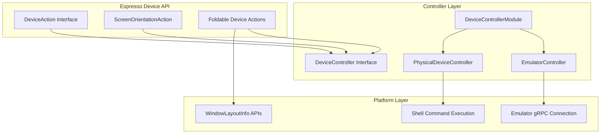
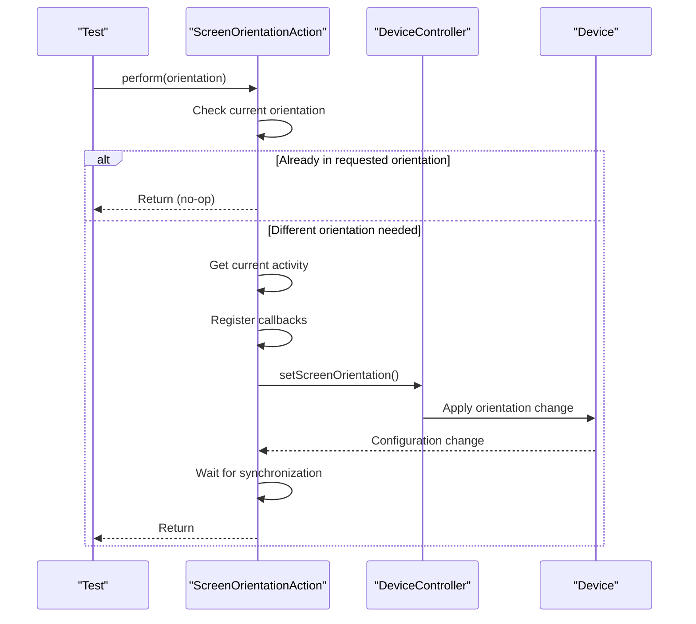
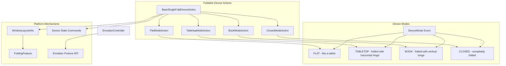

<!-- source: DeepWiki mcp.deepwiki.com · repo android/android-test · page 4.2 Espresso Device · fetched 2026-10-23 -->

# Espresso Device

<details>
<summary>Relevant source files</summary>

The following files were used as context for generating this wiki page:

- [espresso/device/java/androidx/test/espresso/device/AndroidManifest.xml](espresso/device/java/androidx/test/espresso/device/AndroidManifest.xml)
- [espresso/device/java/androidx/test/espresso/device/action/BUILD](espresso/device/java/androidx/test/espresso/device/action/BUILD)
- [espresso/device/java/androidx/test/espresso/device/action/BaseSingleFoldDeviceAction.kt](espresso/device/java/androidx/test/espresso/device/action/BaseSingleFoldDeviceAction.kt)
- [espresso/device/java/androidx/test/espresso/device/action/BookModeAction.kt](espresso/device/java/androidx/test/espresso/device/action/BookModeAction.kt)
- [espresso/device/java/androidx/test/espresso/device/action/ClosedModeAction.kt](espresso/device/java/androidx/test/espresso/device/action/ClosedModeAction.kt)
- [espresso/device/java/androidx/test/espresso/device/action/FlatModeAction.kt](espresso/device/java/androidx/test/espresso/device/action/FlatModeAction.kt)
- [espresso/device/java/androidx/test/espresso/device/action/ScreenOrientationAction.kt](espresso/device/java/androidx/test/espresso/device/action/ScreenOrientationAction.kt)
- [espresso/device/java/androidx/test/espresso/device/action/TabletopModeAction.kt](espresso/device/java/androidx/test/espresso/device/action/TabletopModeAction.kt)
- [espresso/device/java/androidx/test/espresso/device/common/AccelerometerRotationUtil.kt](espresso/device/java/androidx/test/espresso/device/common/AccelerometerRotationUtil.kt)
- [espresso/device/java/androidx/test/espresso/device/common/ActivityUtil.kt](espresso/device/java/androidx/test/espresso/device/common/ActivityUtil.kt)
- [espresso/device/java/androidx/test/espresso/device/common/DeviceUtil.kt](espresso/device/java/androidx/test/espresso/device/common/DeviceUtil.kt)
- [espresso/device/java/androidx/test/espresso/device/common/SettingsObserver.kt](espresso/device/java/androidx/test/espresso/device/common/SettingsObserver.kt)
- [espresso/device/java/androidx/test/espresso/device/common/UiAutomationUtil.kt](espresso/device/java/androidx/test/espresso/device/common/UiAutomationUtil.kt)
- [espresso/device/java/androidx/test/espresso/device/controller/PhysicalDeviceController.kt](espresso/device/java/androidx/test/espresso/device/controller/PhysicalDeviceController.kt)
- [espresso/device/java/androidx/test/espresso/device/controller/emulator/BUILD](espresso/device/java/androidx/test/espresso/device/controller/emulator/BUILD)
- [espresso/device/java/androidx/test/espresso/device/controller/emulator/EmulatorController.kt](espresso/device/java/androidx/test/espresso/device/controller/emulator/EmulatorController.kt)
- [espresso/device/java/androidx/test/espresso/device/dagger/BUILD](espresso/device/java/androidx/test/espresso/device/dagger/BUILD)
- [espresso/device/java/androidx/test/espresso/device/dagger/DeviceControllerModule.kt](espresso/device/java/androidx/test/espresso/device/dagger/DeviceControllerModule.kt)
- [testapps/foldable_testapp/java/androidx/test/foldable/app/BUILD](testapps/foldable_testapp/java/androidx/test/foldable/app/BUILD)
- [testapps/multiwindow_testapp/java/androidx/test/multiwindow/app/BUILD](testapps/multiwindow_testapp/java/androidx/test/multiwindow/app/BUILD)

</details>


Espresso Device is a component of the Espresso UI testing framework that provides APIs for controlling device configurations during tests. It enables tests to modify screen orientation and device modes (particularly for foldable devices), allowing developers to verify how their applications behave across different device states.

For more general information about Espresso UI testing, see [Espresso Core](#4.1).

## Contents
- [Architecture](#architecture)
- [Device Controllers](#device-controllers)
- [Screen Orientation Control](#screen-orientation-control)
- [Foldable Device Support](#foldable-device-support)
- [Setup Requirements](#setup-requirements)

## Architecture

Espresso Device consists of several key components that work together to control device configuration:



The architecture follows a layered approach:

1. **Espresso Device API**: Provides high-level actions that tests can use to modify device configurations
2. **Controller Layer**: Implements the device control logic with different strategies for emulators and physical devices
3. **Platform Layer**: Low-level interfaces to control the actual device through gRPC (for emulators) or shell commands (for physical devices)

The Dagger module `DeviceControllerModule` provides the appropriate `DeviceController` implementation based on the test environment.

Sources:
- [espresso/device/java/androidx/test/espresso/device/dagger/DeviceControllerModule.kt:40-126]()
- [espresso/device/java/androidx/test/espresso/device/controller/emulator/EmulatorController.kt:47-160]()
- [espresso/device/java/androidx/test/espresso/device/controller/PhysicalDeviceController.kt:44-146]()

## Device Controllers

Espresso Device uses two different controller implementations depending on the test environment:

```mermaid
classDiagram
    class "DeviceController" {
        <<interface>>
        +setDeviceMode(deviceMode: int)
        +setScreenOrientation(orientation: int)
    }
    
    class "EmulatorController" {
        -emulatorControllerStub: EmulatorControllerBlockingStub
        +setDeviceMode(deviceMode: int)
        +setScreenOrientation(orientation: int)
        -checkInternetPermission()
    }
    
    class "PhysicalDeviceController" {
        +setDeviceMode(deviceMode: int)
        +setScreenOrientation(orientation: int)
        -setDeviceState(deviceIdentifier: String)
    }
    
    DeviceController <|-- EmulatorController
    DeviceController <|-- PhysicalDeviceController
```

### EmulatorController

The `EmulatorController` uses the Android Emulator's gRPC interface to control the emulator. It can:

- Set different device modes (flat, tabletop, book, closed) for foldable device emulators
- Modify screen orientation by rotating the device using the physical model API
- Requires the INTERNET permission in the app's manifest to communicate with the emulator gRPC service

The controller determines rotation values to provide the correct portrait or landscape orientation.

### PhysicalDeviceController

The `PhysicalDeviceController` uses shell commands to control physical devices. It:

- Manages device states through the `device_state` shell command for foldable devices
- Controls screen orientation by modifying system settings like `user_rotation` and `accelerometer_rotation`
- Has specific handling for different Android API levels and device types

Sources:
- [espresso/device/java/androidx/test/espresso/device/controller/emulator/EmulatorController.kt:47-160]()
- [espresso/device/java/androidx/test/espresso/device/controller/PhysicalDeviceController.kt:44-146]()
- [espresso/device/java/androidx/test/espresso/device/dagger/DeviceControllerModule.kt:40-126]()

## Screen Orientation Control

Espresso Device allows tests to change the screen orientation between portrait and landscape modes:



The `ScreenOrientationAction` class handles:

1. Checking if the device is already in the requested orientation
2. Enabling auto-rotation if needed
3. Synchronizing with the app's activity lifecycle after orientation changes
4. Waiting for the device configuration to update
5. Restoring the device's previous auto-rotation setting

This process ensures that the test remains synchronized with the app's state after the orientation change, regardless of whether the activity handles the configuration change or is recreated.

Sources:
- [espresso/device/java/androidx/test/espresso/device/action/ScreenOrientationAction.kt:41-170]()
- [espresso/device/java/androidx/test/espresso/device/common/ActivityUtil.kt:33-92]()
- [espresso/device/java/androidx/test/espresso/device/common/AccelerometerRotationUtil.kt:32-71]()

## Foldable Device Support

A key feature of Espresso Device is its support for testing foldable device configurations:



The foldable device support includes:

1. **Device Modes**:
   - **Flat**: Device completely unfolded (like a tablet)
   - **Tabletop**: Device half-folded with hinge horizontally positioned
   - **Book**: Device half-folded with hinge vertically positioned
   - **Closed**: Device completely folded

2. **Implementation Details**:
   - Uses the Jetpack WindowManager library to detect folding features
   - Monitors `WindowLayoutInfo` changes to confirm mode transitions
   - For emulators: uses the Emulator's Posture API
   - For physical devices: uses the `device_state` shell command

3. **Special Handling**:
   - Tabletop and Book modes often require orientation changes to position the fold correctly
   - Different synchronization approaches for API levels and device types

Sources:
- [espresso/device/java/androidx/test/espresso/device/action/BaseSingleFoldDeviceAction.kt:38-123]()
- [espresso/device/java/androidx/test/espresso/device/action/TabletopModeAction.kt:30-74]()
- [espresso/device/java/androidx/test/espresso/device/action/BookModeAction.kt:30-74]()
- [espresso/device/java/androidx/test/espresso/device/action/FlatModeAction.kt:27-44]()
- [espresso/device/java/androidx/test/espresso/device/action/ClosedModeAction.kt:26-42]()
- [espresso/device/java/androidx/test/espresso/device/controller/emulator/EmulatorController.kt:71-90]()

## Setup Requirements

To use Espresso Device properly, several setup requirements must be met:

### Emulator Requirements

1. **Emulator Version**: Android Emulator version 33.1.11 or higher
2. **gRPC Service**: The controller gRPC service must be enabled on the emulator
3. **Internet Permission**: The app must include the INTERNET permission in its manifest:

```xml
<uses-permission android:name="android.permission.INTERNET"/>
```

### API Level Requirements

Different features have different minimum API level requirements:

| Feature | Minimum API Level | Notes |
|---------|------------------|-------|
| Screen Orientation (physical devices) | 21 | Uses UI Automation shell commands |
| Foldable Device Modes | 24 | For shell command execution |
| Half-Folded Orientation Change | 34 | For API level < 34, device must temporarily go to flat mode first |

### Common Issues

- **Connection Failures**: Error connecting to emulator gRPC (check emulator version and gRPC service)
- **Permission Issues**: Missing INTERNET permission
- **Unsupported Operations**: Attempting operations not supported by the device or API level
- **Auto-rotation**: Screen orientation changes require auto-rotation to be enabled

Sources:
- [espresso/device/java/androidx/test/espresso/device/AndroidManifest.xml:17-27]()
- [espresso/device/java/androidx/test/espresso/device/controller/emulator/EmulatorController.kt:85-90]()
- [espresso/device/java/androidx/test/espresso/device/controller/emulator/EmulatorController.kt:146-158]()
- [espresso/device/java/androidx/test/espresso/device/controller/PhysicalDeviceController.kt:77-93]()

---

