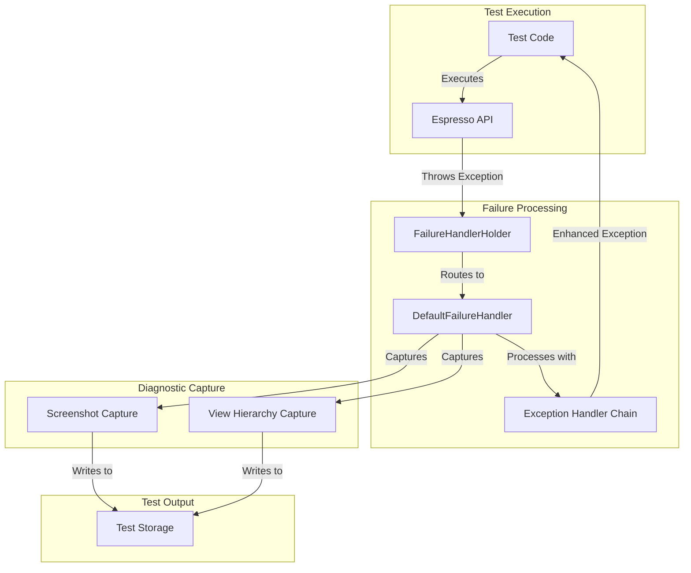
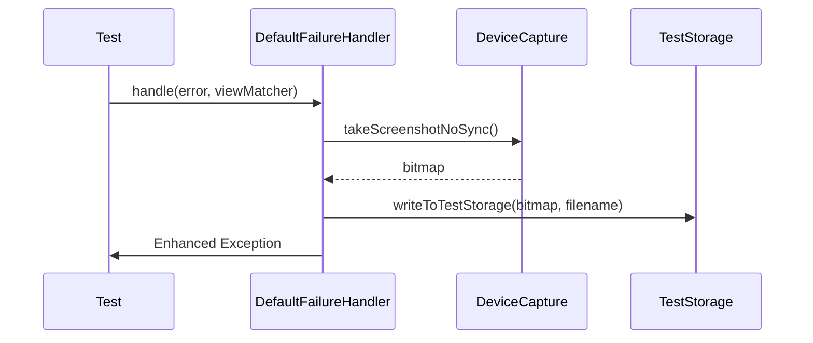

<!-- source: DeepWiki mcp.deepwiki.com · repo android/android-test · page 4.3 Failure Handling · fetched 2026-10-23 -->

# Failure Handling

<details>
<summary>Relevant source files</summary>

The following files were used as context for generating this wiki page:

- [core/java/androidx/test/core/app/DeviceCapture.kt](core/java/androidx/test/core/app/DeviceCapture.kt)
- [core/java/androidx/test/core/graphics/BitmapStorageExt.kt](core/java/androidx/test/core/graphics/BitmapStorageExt.kt)
- [espresso/core/java/androidx/test/espresso/NoMatchingViewException.java](espresso/core/java/androidx/test/espresso/NoMatchingViewException.java)
- [espresso/core/java/androidx/test/espresso/RootViewException.java](espresso/core/java/androidx/test/espresso/RootViewException.java)
- [espresso/core/java/androidx/test/espresso/base/BaseLayerModule.java](espresso/core/java/androidx/test/espresso/base/BaseLayerModule.java)
- [espresso/core/java/androidx/test/espresso/base/DefaultFailureHandler.java](espresso/core/java/androidx/test/espresso/base/DefaultFailureHandler.java)
- [espresso/core/javatests/androidx/test/espresso/base/DefaultFailureHandlerTest.java](espresso/core/javatests/androidx/test/espresso/base/DefaultFailureHandlerTest.java)
- [runner/monitor/java/androidx/test/internal/platform/os/ControlledLooper.java](runner/monitor/java/androidx/test/internal/platform/os/ControlledLooper.java)

</details>


## Introduction

The Failure Handling system in Espresso provides rich diagnostic information when tests fail, making it easier to diagnose and fix test failures. This system is responsible for processing exceptions that occur during test execution, enhancing them with additional diagnostic information such as screenshots and view hierarchies, and presenting them to the test developer in a meaningful way.

This page focuses on how Espresso processes test failures through its failure handling system. For information about test execution in general, see [Runner](#5) and for information about Espresso's core functionality, see [Espresso Core](#4.1).

Sources: [espresso/core/java/androidx/test/espresso/base/DefaultFailureHandler.java:42-47]()

## Architecture Overview

The Failure Handling system is primarily implemented through the `FailureHandler` interface and its default implementation, `DefaultFailureHandler`. When a test failure occurs, Espresso routes the exception through this system to enhance it with diagnostic information before propagating it back to the test runner.

### Failure Handling Flow



Sources: [espresso/core/java/androidx/test/espresso/base/DefaultFailureHandler.java:48-67](), [espresso/core/java/androidx/test/espresso/base/BaseLayerModule.java:131-148]()

## DefaultFailureHandler

The `DefaultFailureHandler` implements the `FailureHandler` interface and serves as Espresso's default mechanism for handling test failures. It enriches exceptions with diagnostic information and maintains a chain of specialized handlers for different exception types.

### Handler Chain

`DefaultFailureHandler` maintains a chain of specialized exception handlers, each responsible for handling a specific type of exception. The handlers are processed in order, with the most specific exception types handled first:

```mermaid
flowchart LR
    subgraph "Handler Chain"
        direction LR
        NMVE["NoMatchingViewExceptionHandler"]
        AVME["AmbiguousViewMatcherExceptionHandler"]
        PE["PerformExceptionHandler"]
        AE["AssertionErrorHandler"]
        EE["EspressoExceptionHandler"]
        TH["ThrowableHandler"]
    end
    
    Exception -->|"Passed to"| NMVE
    NMVE -->|"If not handled"| AVME
    AVME -->|"If not handled"| PE
    PE -->|"If not handled"| AE
    AE -->|"If not handled"| EE
    EE -->|"If not handled"| TH
    TH -->|"Enhanced Exception"| TestRunner
```



The hierarchy of exception types handled is:
- `NoMatchingViewException` - When Espresso cannot find a view matching the specified criteria
- `AmbiguousViewMatcherException` - When multiple views match the specified criteria
- `PerformException` - When an action cannot be performed on a view
- `AssertionError` and `AssertionFailedError` - When an assertion fails
- `EspressoException` - Base class for Espresso-specific exceptions
- Generic `Throwable` - Fallback for any other exceptions

Sources: [espresso/core/java/androidx/test/espresso/base/DefaultFailureHandler.java:63-84]()

## Diagnostic Information Capture

The failure handling system automatically captures diagnostic information to help developers understand the context of a failure.

### Screenshot Capture

When a test failure occurs, the `DefaultFailureHandler` automatically captures a screenshot of the device's screen. This provides visual context for the failure, showing the state of the UI at the time of the failure.



The screenshot is stored in the test's output directory with a name like `view-op-error-N.png`, where N is an incrementing counter starting from 1.

Sources: [espresso/core/java/androidx/test/espresso/base/DefaultFailureHandler.java:105-115](), [espresso/core/java/androidx/test/espresso/base/DefaultFailureHandler.java:124-137](), [core/java/androidx/test/core/app/DeviceCapture.kt:76-81]()

### View Hierarchy Capture

In addition to screenshots, the failure handler also captures the view hierarchy at the time of failure. This provides a complete representation of the view structure, which is invaluable for understanding why a view matcher failed or why an action could not be performed.

The view hierarchy is stored in an XML file named `explore-window-hierarchy-N.xml`, where N is the same counter used for screenshots.

Sources: [espresso/core/java/androidx/test/espresso/base/DefaultFailureHandler.java:109]()

## Exception Enrichment

The failure handling system not only captures diagnostic information but also enriches exception messages with useful context.

### NoMatchingViewException Enrichment

For `NoMatchingViewException`, the handler adds:
- A detailed description of the view matcher that failed
- The complete view hierarchy at the time of failure
- A reference to the view hierarchy file for further inspection

Similarly, for `AmbiguousViewMatcherException`, the handler adds information about all the views that matched the criteria.

The messages are formatted to be easily readable, with reasonable truncation to avoid overwhelming the output.

Sources: [espresso/core/java/androidx/test/espresso/NoMatchingViewException.java:81-100]()

## Customizing Failure Handling

Espresso allows you to customize the failure handling process by providing your own implementation of the `FailureHandler` interface.

```java
// Example of setting a custom failure handler
Espresso.setFailureHandler(new CustomFailureHandler());
```

The `FailureHandlerHolder` in `BaseLayerModule` maintains an `AtomicReference` to the current failure handler, allowing it to be updated at runtime while ensuring thread safety.

Sources: [espresso/core/java/androidx/test/espresso/base/BaseLayerModule.java:131-148](), [espresso/core/java/androidx/test/espresso/base/DefaultFailureHandler.java:43-45]()

## Implementation Details

### DefaultFailureHandler Components

The `DefaultFailureHandler` consists of several key components:
- An atomic counter (`failureCount`) to generate unique identifiers for failure artifacts
- A list of specialized exception handlers for different exception types
- Methods for capturing screenshots and view hierarchies
- An abstract `TypedFailureHandler` class that serves as a base for specific exception handlers

Sources: [espresso/core/java/androidx/test/espresso/base/DefaultFailureHandler.java:48-50](), [espresso/core/java/androidx/test/espresso/base/DefaultFailureHandler.java:139-166]()

### Screenshot Implementation

Screenshot capture is implemented using the `DeviceCapture` class, which provides methods for taking screenshots of the device's screen. The implementation:
1. Checks if screenshot capture is possible (not on main thread and UiAutomation available)
2. Forces a redraw of all global window views
3. Waits for the next frame to ensure the redraw is committed
4. Takes the screenshot using UiAutomation
5. Stores the screenshot in the test output directory

If screenshot capture fails, the exception is suppressed and added to the original exception to ensure the root cause is preserved.

Sources: [core/java/androidx/test/core/app/DeviceCapture.kt:52-53](), [core/java/androidx/test/core/app/DeviceCapture.kt:97-120](), [espresso/core/java/androidx/test/espresso/base/DefaultFailureHandler.java:111-115]()

## Integration with Test Framework

The failure handling system is integrated with the broader AndroidX Test framework through Dagger dependency injection in the `BaseLayerModule`. This module:
- Provides the default implementation of `FailureHandler`
- Maintains the `FailureHandlerHolder` for runtime updates
- Configures the handler with the target application context

This integration ensures that the failure handling system is properly initialized and available throughout the test execution lifecycle.

Sources: [espresso/core/java/androidx/test/espresso/base/BaseLayerModule.java:150-177]()

---

