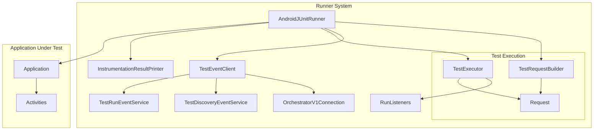
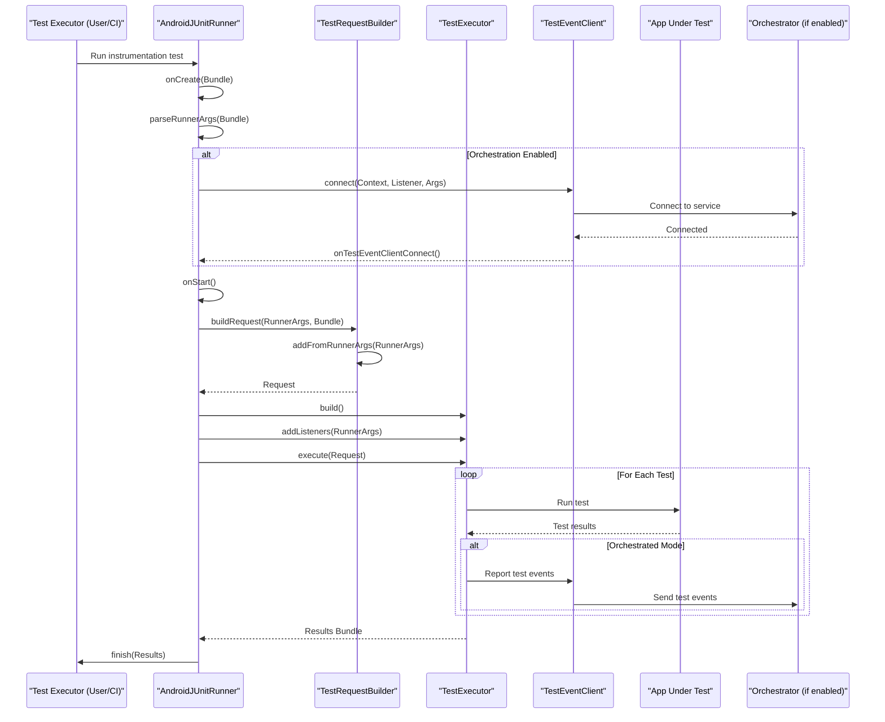
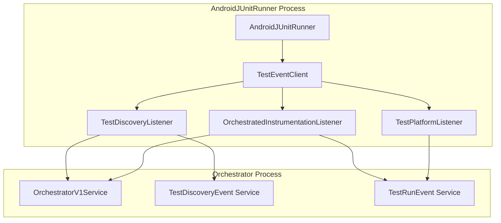
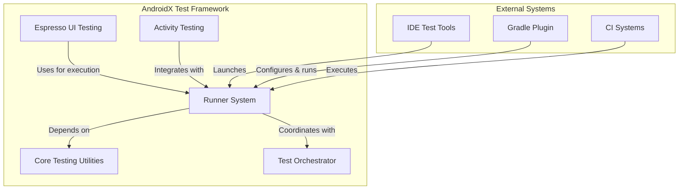

<!-- source: DeepWiki mcp.deepwiki.com · repo android/android-test · page 5 Runner · fetched 2026-10-23 -->

# Runner

Relevant source files

The following files were used as context for generating this wiki page:

- [runner/android_junit_runner/java/androidx/test/internal/events/client/TestEventClient.java](runner/android_junit_runner/java/androidx/test/internal/events/client/TestEventClient.java)
- [runner/android_junit_runner/java/androidx/test/internal/events/client/TestEventClientConnectListener.java](runner/android_junit_runner/java/androidx/test/internal/events/client/TestEventClientConnectListener.java)
- [runner/android_junit_runner/java/androidx/test/orchestrator/callback/BundleConverter.java](runner/android_junit_runner/java/androidx/test/orchestrator/callback/BundleConverter.java)
- [runner/android_junit_runner/java/androidx/test/orchestrator/callback/OrchestratorV1Connection.java](runner/android_junit_runner/java/androidx/test/orchestrator/callback/OrchestratorV1Connection.java)
- [runner/android_junit_runner/java/androidx/test/orchestrator/junit/ParcelableDescription.java](runner/android_junit_runner/java/androidx/test/orchestrator/junit/ParcelableDescription.java)
- [runner/android_junit_runner/java/androidx/test/orchestrator/junit/ParcelableFailure.java](runner/android_junit_runner/java/androidx/test/orchestrator/junit/ParcelableFailure.java)
- [runner/android_junit_runner/java/androidx/test/orchestrator/junit/ParcelableResult.java](runner/android_junit_runner/java/androidx/test/orchestrator/junit/ParcelableResult.java)
- [runner/android_junit_runner/java/androidx/test/runner/AndroidJUnitRunner.java](runner/android_junit_runner/java/androidx/test/runner/AndroidJUnitRunner.java)
- [services/events/java/androidx/test/services/events/ParcelableConverter.java](services/events/java/androidx/test/services/events/ParcelableConverter.java)

The Runner component provides the core infrastructure for executing Android tests. It enables running JUnit3 and JUnit4 style tests against Android applications, handling test discovery, execution, and result reporting. This page documents the Runner system architecture, execution flow, and integration with the test orchestration infrastructure.

For information about the specific implementation in AndroidJUnitRunner, see [AndroidJUnitRunner](#5.1).

## Architecture Overview

The Runner component centers around the AndroidJUnitRunner, which extends Android's Instrumentation class to provide JUnit test execution capabilities. It works in conjunction with test orchestration systems to enable test isolation and reliable execution.

### Core Components Diagram

Sources: 
- [runner/android_junit_runner/java/androidx/test/runner/AndroidJUnitRunner.java:68-94]()
- [runner/android_junit_runner/java/androidx/test/internal/events/client/TestEventClient.java:30-49]()

## Test Execution Flow

The Runner system follows a well-defined flow for test execution, from initialization through test discovery to execution and result reporting:

Sources:
- [runner/android_junit_runner/java/androidx/test/runner/AndroidJUnitRunner.java:444-477]()
- [runner/android_junit_runner/java/androidx/test/runner/AndroidJUnitRunner.java:398-401]()
- [runner/android_junit_runner/java/androidx/test/internal/events/client/TestEventClient.java:120-156]()

## Orchestration Integration

One of the key features of the Runner system is its ability to integrate with the Test Orchestrator, which provides test isolation by running each test in a fresh application instance. This integration is handled through the TestEventClient, which abstracts communication with different orchestration services.

### Test Orchestration Communication

The Runner supports two orchestration approaches:

1. **Orchestrator V1**: Single service handling both test discovery and test run events
2. **Orchestrator V2**: Separate services for test discovery and test run events

Sources:
- [runner/android_junit_runner/java/androidx/test/internal/events/client/TestEventClient.java:50-56]()
- [runner/android_junit_runner/java/androidx/test/orchestrator/callback/OrchestratorV1Connection.java:43-90]()

## Data Transmission

When tests are executed, especially in orchestrated mode, test data needs to be transmitted between processes. The Runner system uses various parcelable classes to facilitate this data transmission.

### Test Data Classes

| Class | Purpose | Source |
|-------|---------|--------|
| `ParcelableDescription` | Transmits test case identifiers | [ParcelableDescription.java]() |
| `ParcelableFailure` | Transmits test failure information | [ParcelableFailure.java]() |
| `ParcelableResult` | Transmits overall test results | [ParcelableResult.java]() |
| `TestCaseInfo` | Newer format for test case metadata | [ParcelableConverter.java]() |
| `FailureInfo` | Newer format for failure information | [ParcelableConverter.java]() |

The system handles converting between JUnit objects (like `Description` and `Failure`) and their parcelable counterparts for cross-process communication.

Sources:
- [runner/android_junit_runner/java/androidx/test/orchestrator/junit/ParcelableDescription.java:23-94]()
- [runner/android_junit_runner/java/androidx/test/orchestrator/junit/ParcelableFailure.java:26-100]()
- [services/events/java/androidx/test/services/events/ParcelableConverter.java:42-204]()

## Execution Options

The Runner system supports an extensive set of execution options for customizing test behavior:

### Test Selection Options

| Option | Description | Example |
|--------|-------------|---------|
| `class` | Run specific test class(es) | `-e class com.example.MyTest` |
| `package` | Run all tests in package | `-e package com.example` |
| `notClass` | Exclude specific class(es) | `-e notClass com.example.SkipTest` |
| `notPackage` | Exclude specific package | `-e notPackage com.example.skip` |
| `testFile` | Run tests listed in file | `-e testFile /sdcard/testlist.txt` |

### Test Filtering Options

| Option | Description | Example |
|--------|-------------|---------|
| `size` | Filter by test size annotation | `-e size small` |
| `annotation` | Filter by annotation | `-e annotation com.example.MyAnnotation` |
| `notAnnotation` | Exclude by annotation | `-e notAnnotation com.example.Skip` |
| `tests_regex` | Filter by regex pattern | `-e tests_regex .*Ui.*` |

### Execution Control Options

| Option | Description | Example |
|--------|-------------|---------|
| `debug` | Wait for debugger | `-e debug true` |
| `log` | Log-only mode (no execution) | `-e log true` |
| `coverage` | Enable code coverage | `-e coverage true` |
| `numShards` | Number of test shards | `-e numShards 4 -e shardIndex 0` |

Sources:
- [runner/android_junit_runner/java/androidx/test/runner/AndroidJUnitRunner.java:88-272]()

## Integration with Other Components

The Runner system is a central component in the AndroidX Test framework and integrates with several other systems:

Sources:
- All files provided

## Error Handling and Reporting

The Runner system includes robust error handling capabilities, ensuring that test failures and crashes are properly reported:

1. Test failures are captured through run listeners and reported via `InstrumentationResultPrinter`
2. Application crashes are detected through the `onException` method
3. In orchestrated mode, crashes are reported to the orchestrator via `TestEventClient.reportProcessCrash()`

This ensures that even if the application under test crashes, the test infrastructure can properly report the issue rather than silently failing.

Sources:
- [runner/android_junit_runner/java/androidx/test/runner/AndroidJUnitRunner.java:598-649]()
- [runner/android_junit_runner/java/androidx/test/internal/events/client/TestEventClient.java:249-276]()

## Summary

The Runner system provides the foundation for Android test execution, with its main component, AndroidJUnitRunner, handling the discovery, execution, and reporting of tests. It supports extensive customization options and integrates with the Test Orchestrator for improved test isolation. The system is designed to be both backward compatible with older testing approaches and forward-looking with support for newer orchestration methods.

---

